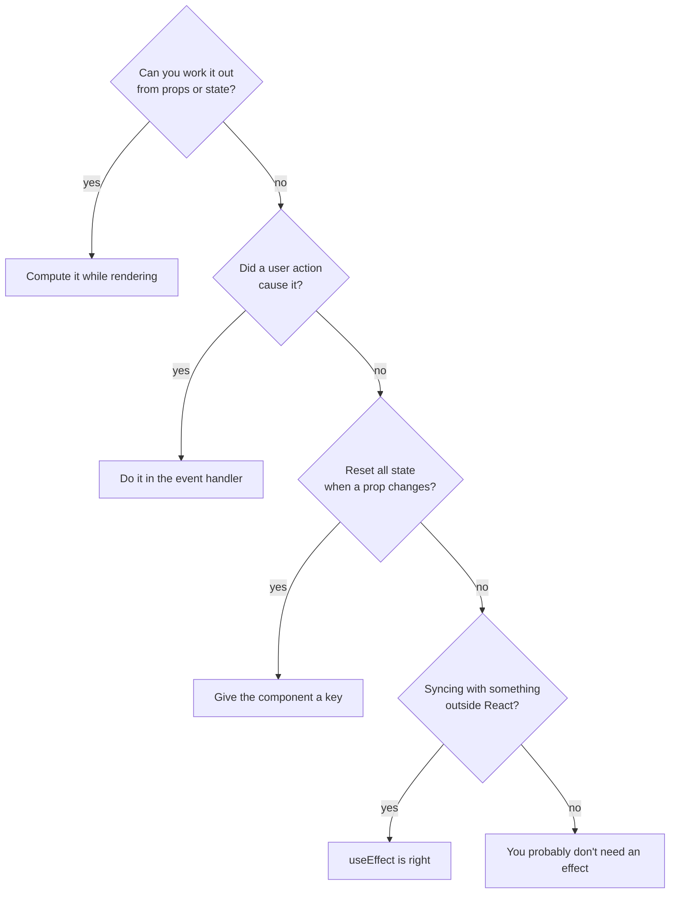

## The idea

Effects are for **syncing with something outside React**: a timer, a subscription, a server connection, a browser API. Many effects in real code don't touch anything outside React at all. They only update state from other state, or react to something the user did. Those effects make the code **slower** (extra renders), **harder to follow**, and buggier.

Think of a **sticky note on the fridge** that says "milk + eggs = 2 items". Every time the shopping list changes, someone has to remember to fix the note too. It's easier to just **count the list** when you need the number. Storing a value you can work out, and keeping it updated with an effect, is that sticky note.

## The quick test

Before writing an effect, ask: **"Is there an outside system involved?"**



## 1. Values you can compute: work them out while rendering

```jsx
function Profile({ firstName, lastName }) {
    const [fullName, setFullName] = useState("");

    // Wrong: state + effect for a value you can compute.
    useEffect(() => {
        setFullName(firstName + " " + lastName);
    }, [firstName, lastName]);

    return <h1>{fullName}</h1>;
}
```

This renders **twice**: first with an empty `fullName`, then the effect sets it and React renders again. The first render even shows the wrong value for a moment.

```jsx
function Profile({ firstName, lastName }) {
    // Right: a normal variable, worked out on every render.
    const fullName = firstName + " " + lastName;

    return <h1>{fullName}</h1>;
}
```

One render, no extra state, nothing to keep in sync. If the calculation is **slow**, like filtering thousands of items, cache it with `useMemo` instead of an effect. See [useMemo and useCallback](./use-memo-and-use-callback.mdx).

## 2. Things the user did: put them in the event handler

```jsx
function BuyButton({ product }) {
    const [isBought, setIsBought] = useState(false);

    // Wrong: an effect that reacts to "the user clicked buy".
    useEffect(() => {
        if (isBought) {
            sendOrder(product.id);
            showToast("Added to your order!");
        }
    }, [isBought]);

    return <button onClick={() => setIsBought(true)}>Buy</button>;
}
```

The order is sent because the **user clicked**, not because the component is on the screen. Put that code where the click happens:

```jsx
function BuyButton({ product }) {
    function handleBuy() {
        sendOrder(product.id);
        showToast("Added to your order!");
    }

    return <button onClick={handleBuy}>Buy</button>;
}
```

The rule: code that runs **because the component appeared** goes in an effect. Code that runs **because the user did something** goes in the handler.

## 3. Resetting all state when a prop changes: use a key

```jsx
function ProfilePage({ userId }) {
    const [comment, setComment] = useState("");

    // Wrong: clearing state by hand when the user changes.
    useEffect(() => {
        setComment("");
    }, [userId]);

    return <textarea value={comment} onChange={(e) => setComment(e.target.value)} />;
}
```

For one render, the new profile shows the **old** comment, then the effect clears it. Instead, give the component a **key** from the parent:

```jsx
function UserPage({ userId }) {
    return <ProfilePage key={userId} userId={userId} />;
}
```

A new key tells React "this is a different component". React throws the old one away and starts fresh, with **all** its state reset. See [Lists and Keys](../react-basics/lists-and-keys.mdx).

## When an effect IS right

Use an effect when the component must stay in sync with something **outside React** for as long as it's on the screen:

- Timers and intervals
- Event listeners on `window` or `document`
- Connections: WebSockets, chat servers, subscriptions
- Non-React widgets: maps, charts, video players
- Fetching data for what's on the screen (with a cleanup that ignores late answers, or better, a data library)

See [useEffect](./use-effect.mdx).

## Common mistakes

- **State plus an effect for a value you can compute.** Work it out while rendering.
- **An effect that watches a "clicked" flag.** Do the work in the click handler.
- **Resetting state in an effect when a prop changes.** Give the component a `key`.
- **Effects that set state that triggers other effects.** Each step is a separate render. Work out all the next state in the handler, or use a [reducer](./use-reducer.mdx).
- **Calling a parent's `onChange` from an effect.** The parent hears about the change one render late. Call it in the handler, next to the state update.

## In the interview

**Likely question:** "When should you not use `useEffect`?"

> "Effects are for syncing with something outside React, like a timer, a subscription or a server. I don't use them for values I can compute from props or state: I work those out while rendering, with `useMemo` if it's slow. I don't use them for things a user action causes, like sending a form: that goes in the event handler. And to reset state when a prop changes, I give the component a `key` instead. These effects cause extra renders, show stale values for a moment, and make the flow harder to follow."

**Likely follow-up:** "How do you reset a component's state when a prop changes?"

**Answer:** "Give it a `key` based on that prop, like `<ProfilePage key={userId} />`. When the key changes, React throws away the old component and creates a fresh one, so all its state resets. No effect needed."

<Callout title="Remember this" type="success">
  - Effects are for syncing with **outside systems**. No outside system → you probably **don't need an effect**.
  - **Computable** from props or state → **compute while rendering** (`useMemo` if slow).
  - Caused by a **user action** → put it in the **event handler**.
  - **Reset all state** when a prop changes → **`key={prop}`**.
  - **Chains of effects** → work out all the next state in **one handler** (or a reducer). **Tell the parent** in the handler, not in an effect.
</Callout>
