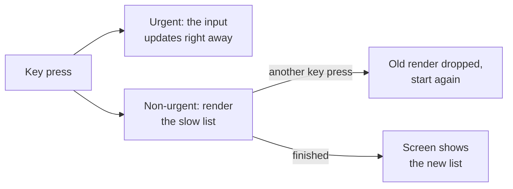

## The idea

Some updates are **urgent**: typing, clicking, pressing a key. The user expects to see them right away. Others **can wait**: filtering a long list or opening a heavy tab. **Concurrent rendering** lets React work on a non-urgent update in the background, **pause** it to handle an urgent one, and **drop** it if it's already out of date.

Think of a **cook** making a big dinner. When a customer asks for a glass of water, the cook stops chopping, hands over the water, and goes back to the dinner. If the customer changes the dinner order, the cook throws away the half-made dish and starts the new one.

## Urgent and non-urgent updates

A normal state update is **urgent**. Once React starts rendering it, it doesn't stop until it's done. If that render is slow, the page **freezes**: the input stops showing keys, and buttons don't react.

You can mark an update as **non-urgent**. React calls this a **transition**. A transition render can be interrupted:



React shows a non-urgent update only when its **whole render** is finished, so the user never sees a half-updated screen.

## useTransition

**`useTransition`** gives you two things: **`isPending`**, which is `true` while the transition is running, and **`startTransition`**, which marks the updates inside it as non-urgent.

```jsx
import { useState, useTransition } from "react";

function TabBar() {
    const [tab, setTab] = useState("home");
    const [isPending, startTransition] = useTransition();

    function selectTab(nextTab) {
        startTransition(() => {
            setTab(nextTab);
        });
    }

    return (
        <div>
            <button onClick={() => selectTab("home")}>Home</button>
            <button onClick={() => selectTab("posts")}>Posts</button>
            <button onClick={() => selectTab("contact")}>Contact</button>
            {isPending && <p>Loading...</p>}

            {tab === "home" && <p>Welcome!</p>}
            {tab === "posts" && <SlowPostList />}
            {tab === "contact" && <p>Write to us.</p>}
        </div>
    );
}
```

Ana clicks **Posts**, which takes a second to render. While it renders, the old tab stays on screen with "Loading...", and the page still reacts. If she clicks **Contact** before Posts is done, React **drops** the Posts render and shows Contact. Without the transition, the page would freeze until Posts finished.

Use `useTransition` when **you own the state update**: you can wrap the setter call in `startTransition`. In React 19 the function you pass can also be `async`. See [What's New in React 19](./react-19.mdx).

## useDeferredValue

Sometimes you only have a **value**, not the setter. **`useDeferredValue(value)`** gives you a copy of the value that "lags behind". On an urgent render it returns the **old** value. Then React renders again in the background with the **new** value, and that render can be interrupted.

```jsx
import { useState, useDeferredValue, memo } from "react";

function ProductSearch() {
    const [query, setQuery] = useState("");
    const deferredQuery = useDeferredValue(query);
    const isStale = query !== deferredQuery;

    return (
        <div>
            <input value={query} onChange={(event) => setQuery(event.target.value)} />
            <div style={{ opacity: isStale ? 0.5 : 1 }}>
                <SlowResults query={deferredQuery} />
            </div>
        </div>
    );
}

const SlowResults = memo(function SlowResults({ query }) {
    // A slow list of products that match the query.
});
```

Ben types "a". The input shows "a" **right away**, because `query` is urgent. `SlowResults` still gets the old `deferredQuery`, so it doesn't re-render yet. Then React renders the results for "a" in the background. While the results are behind, `isStale` is `true` and the old list is dimmed.

`SlowResults` must be wrapped in **`memo`**. Without it, the urgent render re-renders `SlowResults` anyway, with the old query, and nothing gets faster. See [Making React Apps Fast](../performance/making-react-fast.mdx).

## Automatic batching

When you call several setters together, React **batches** them: it renders **once**, after your code has finished. Since React 18 this happens **everywhere**, not only in event handlers: also in `setTimeout`, in promises and after `await`. See [State with useState](../state-and-rendering/use-state.mdx).

```jsx
setTimeout(() => {
    setCount((current) => current + 1);
    setIsOpen(true);
    // One render for both updates.
}, 1000);
```

## Common mistakes

- **Putting the input's own state in a transition.** The typed letter doesn't show until the transition finishes. Keep the input update urgent, and put only the slow update in `startTransition`.
- **`useDeferredValue` without `memo`.** The slow child re-renders on every key press anyway. Wrap it in `memo`.
- **Expecting transitions to make slow code faster.** The slow render takes the same time. The page just **stays responsive** while it runs.
- **Using a transition instead of debouncing network requests.** Transitions only make **rendering** interruptible. To send fewer requests, debounce.

## In the interview

**Likely question:** "What problem does `useTransition` solve?"

> "A normal state update can't be interrupted, so a slow render freezes the page: the input stops responding until it's done. `useTransition` lets me mark an update as non-urgent by wrapping the setter in `startTransition`. React then renders it in the background, pauses it when an urgent update like a key press comes in, and drops it if a newer update makes it out of date. `isPending` tells me the transition is still running, so I can show a loading hint while the old screen stays visible."

**Likely follow-up:** "What's the difference between `useTransition` and `useDeferredValue`?"

**Answer:** "Both mark work as non-urgent. With `useTransition` I wrap the state update itself, so I need access to the setter. With `useDeferredValue` I wrap a value, for example a prop I get from a parent, and React gives me an older copy while it renders the new one in the background. For `useDeferredValue` to help, the slow child must be wrapped in `memo`."

**Another follow-up:** "How is this different from debouncing?"

**Answer:** "Debouncing waits a fixed time before doing anything, even on a fast computer. A transition starts rendering right away, and React interrupts it only if something more urgent happens. So on a fast device the update is almost instant. For network requests I'd still debounce, because transitions don't reduce the number of requests."

<Callout title="Remember this" type="success">
  - **Urgent** updates (typing, clicks) must show at once. **Non-urgent** ones (a slow list, a heavy tab) can wait.
  - A **transition** render can be **paused** for urgent updates and **dropped** if it's out of date. The page stays responsive.
  - **`const [isPending, startTransition] = useTransition()`**: wrap the **setter** in `startTransition`. Never the input's own state.
  - **`useDeferredValue(value)`**: an older copy of a **value** while the new one renders. The slow child needs **`memo`**.
  - Transitions don't make code faster, and they're **not debouncing**: no fixed delay, and no fewer requests.
  - **Automatic batching**: several updates, **one render**, everywhere since **React 18**.
</Callout>
