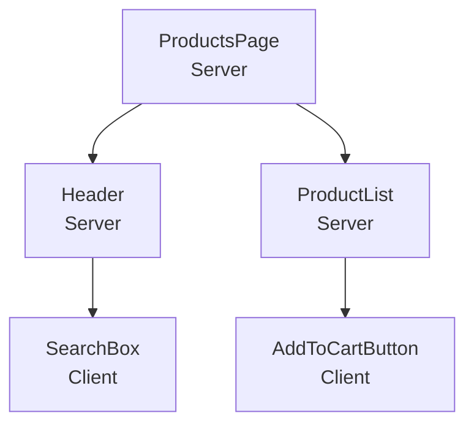

## The idea

**Server Components** run **only on the server**, at build time or on each request. Their code is never sent to the browser, so they can read the database or use secret keys directly, and they add **no JavaScript** to the page. **Client Components** are the components you already know: they run in the browser and can use state, effects and events.

Think of a **restaurant**. The kitchen (the server) uses the stock room and the secret recipes, and only the finished dish goes out. The table (the browser) has the things the guest uses: the salt, the menu, the bell to call the waiter.

Server Components need a **framework** that supports them, such as the **Next.js App Router**. There, every component is a Server Component **by default**.

## A Server Component

A Server Component can be **`async`** and fetch its data right where it renders. File `app/products/page.jsx`:

```jsx
import { db } from "@/lib/db";
import AddToCartButton from "./add-to-cart-button";

export default async function ProductsPage() {
    // Runs on the server: straight to the database, no API needed.
    const products = await db.product.findMany();

    return (
        <ul>
            {products.map((product) => (
                <li key={product.id}>
                    {product.name}
                    <AddToCartButton productId={product.id} />
                </li>
            ))}
        </ul>
    );
}
```

No `useEffect`, no loading state, no API route. The browser gets the finished list, and none of this code.

## "use client"

The button needs a click handler and state, so it must be a **Client Component**. You mark it with **`"use client"`** at the very **top of the file**, above the imports. File `app/products/add-to-cart-button.jsx`:

```jsx
"use client";

import { useState } from "react";
import { addToCart } from "./actions";

export default function AddToCartButton({ productId }) {
    const [added, setAdded] = useState(false);

    async function handleClick() {
        await addToCart(productId);
        setAdded(true);
    }

    return <button onClick={handleClick}>{added ? "Added" : "Add to cart"}</button>;
}
```

`"use client"` marks a **boundary**: this file, and everything it imports, becomes client code. You don't add it to every client file, only to the ones a Server Component renders.

So a page is mostly Server Components, with small Client Components where it needs to be interactive:



Client Components still get their first HTML from the server (see [SSR and Hydration](./ssr-and-hydration.mdx)). Then their JavaScript loads and they're hydrated. Server Components are **never** hydrated: the browser only gets their result.

## What each one can do

| | Server Component | Client Component |
| --- | --- | --- |
| `useState`, `useEffect`, `useContext` | No | Yes |
| `onClick` and other events | No | Yes |
| `window`, `localStorage` | No | Yes |
| `async` / `await` in the component | Yes | No |
| Read the database or files, use secret keys | Yes | No |
| Adds JavaScript to the bundle | No | Yes |

Props passed from a Server Component to a Client Component travel over the network, so they must be **serializable**: strings, numbers, arrays, plain objects and JSX are fine. A normal function, like an `onClick` handler, is not.

## Server Components inside Client Components

A Client Component **can't import** a Server Component: everything a client file imports becomes client code. But it **can show one** that's passed in as **`children`**:

```jsx
import Modal from "./modal";
import Cart from "./cart";

// A Server Component renders both.
export default function Page() {
    return (
        <Modal>
            <Cart />
        </Modal>
    );
}
```

`Modal` is a Client Component that opens and closes with state and shows `{children}`. `Cart` stays a Server Component: it's rendered on the server, and `Modal` only receives the result.

## Server Functions: "use server"

A **Server Function** is an **async** function that runs on the server but can be **called from the browser**. Mark it with **`"use server"`**. The browser gets only a reference to it. In Next.js, calling it sends a **POST request**, and the function runs on the server. File `app/products/actions.js`:

```jsx
"use server";

import { db } from "@/lib/db";
import { getUser } from "@/lib/auth";

export async function addToCart(productId) {
    // Anyone can call this with a POST request, so always check the user.
    const user = await getUser();
    if (!user) {
        throw new Error("Not logged in");
    }

    await db.cartItem.create({ data: { userId: user.id, productId } });
}
```

When a Server Function is a form's `action`, like `<form action={createTodo}>`, it's also called a **Server Action**, and it receives the form's data. See [What's New in React 19](./react-19.mdx).

## Common mistakes

- **Using `"use server"` to make a Server Component.** It marks **Server Functions**. Server Components need no directive: they're the default.
- **`"use client"` on every file.** Put it only where you need state, events or browser APIs, as low in the tree as you can. Everything that file imports is sent to the browser.
- **Passing a function as a prop** from a Server Component to a Client Component. It isn't serializable. Pass data, or a Server Function.
- **Hooks or `onClick` in a Server Component.** Move that part into a small Client Component.
- **Trusting a Server Function's caller.** It's a public endpoint. Check who the user is inside it.

## In the interview

**Likely question:** "What are React Server Components?"

> "They're components that run only on the server, at build time or per request, and never ship their code to the browser. So they can be async, read the database directly and use secret keys, and they add no JavaScript to the bundle. They can't use state, effects or event handlers: for that I make a Client Component with `"use client"` at the top of the file. In the Next.js App Router every component is a Server Component by default, so I keep most of the page on the server and add small Client Components where it needs to be interactive."

**Likely follow-up:** "How are Server Components different from SSR?"

**Answer:** "SSR turns components into HTML for the first page load, but the code of those components is still sent to the browser and hydrated. Server Components never run in the browser and are never hydrated: the browser only gets their result. They work together: in Next.js, Client Components are still server-rendered to HTML on the first load."

**Another follow-up:** "Can a Client Component render a Server Component?"

**Answer:** "It can't import one, because everything a client file imports becomes client code. But a Server Component can pass another Server Component to it as `children` or another prop. The server renders it first, and the Client Component just places the result, for example a server-rendered cart inside a client-side modal."

<Callout title="Remember this" type="success">
  - **Server Components** run **only on the server**: they can be **`async`**, read the **database** and use **secrets**, and add **no JS**. The **default** in the Next.js App Router.
  - **Client Components**: **`"use client"`** at the **top of the file**. Needed for **state, effects, events and browser APIs**. The file and its imports go to the browser.
  - Server to Client props must be **serializable**: data and JSX, **not functions**.
  - A Client Component **can't import** a Server Component, but can render one passed as **`children`**.
  - **`"use server"`** marks **Server Functions**: async functions the browser can call (a **POST** request in Next.js). Always **check the user** inside.
  - **Not the same as SSR**: SSR makes HTML and still **hydrates**. Server Components are **never hydrated**.
</Callout>
