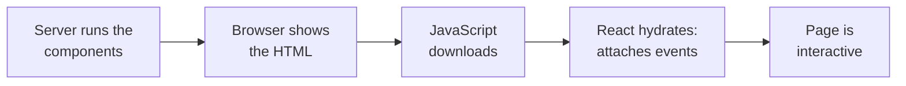

## The idea

A plain React app builds the page **in the browser**: the server sends an almost empty HTML file plus JavaScript, and the user sees nothing until that JavaScript runs. With **server-side rendering (SSR)**, the server runs your components first and sends **finished HTML**, so the content shows at once. Then React loads in the browser and **hydrates** the page: it attaches the event handlers, and the buttons start working.

Think of moving into a **new flat** where all the furniture is already in place, but the electricity is off. You can see everything straight away. Hydration is switching the power on.

## CSR, SSR, SSG and ISR

These four names answer one question: **when** is the HTML built?

| | When the HTML is built | First load | Data | Good for |
| --- | --- | --- | --- | --- |
| **CSR** (client-side rendering) | In the **browser**, after the JavaScript loads | Slow: blank until the JS runs. Weaker for SEO | Always fresh | Dashboards and apps behind a login |
| **SSR** (server-side rendering) | On the server, on **every request** | Fast | Always fresh | Pages with per-user or live data: a feed, stock levels |
| **SSG** (static site generation) | Once, at **build time** | Fastest: a ready file from a CDN | Old until the next build | Blogs, docs, marketing pages |
| **ISR** (incremental static regeneration) | At build time, then **rebuilt in the background** | Fastest | A little old: refreshed after N seconds | Product catalogs, news |

A **CDN** (content delivery network) is a set of servers close to the users that serve ready-made files.

**ISR** works like this, with a 60-second limit: for 60 seconds, every visitor gets the saved page. After that, the next visitor **still gets the old page**, and the server builds a new one in the background. The visitors after that get the new page.

SSR, SSG and ISR all send finished HTML, so all three need **hydration** in the browser. Frameworks like **Next.js** handle this for you.

## What hydration is



On the server, React turns the components into an HTML string. In the browser, you call **`hydrateRoot`** instead of `createRoot`:

```jsx
import { hydrateRoot } from "react-dom/client";

// The server already put App's HTML inside #root.
hydrateRoot(document.getElementById("root"), <App />);
```

During hydration, React renders your components **again** in the browser and expects the **same result** as the server's HTML. It **reuses** the DOM nodes that are already there and attaches the event handlers. `createRoot` would throw the server's HTML away and build the DOM again.

Until the JavaScript has loaded and hydration has run, the page **looks** ready, but its buttons don't work yet.

## Hydration errors

If the browser's first render doesn't match the server's HTML, React reports an error:

```text
Hydration failed because the server rendered text didn't match the client.
As a result this tree will be regenerated on the client.
```

React then throws away the server HTML for that part of the page (up to the nearest `<Suspense>` boundary, or the whole page) and builds it again in the browser. That's slower, and the page can flash. The usual causes:

| Cause | Why the two renders differ |
| --- | --- |
| `new Date()`, `Date.now()` | The server and the browser run at different times |
| `Math.random()` | A new number each time. For ids, use [`useId`](../hooks/more-hooks.mdx) |
| `typeof window`, `localStorage` | The server has no `window`, so it takes the other branch |
| `toLocaleDateString()` | The server and the user can have a different language and time zone |
| A `<div>` inside a `<p>` | The browser "fixes" invalid HTML, so the DOM no longer matches |

The fix is to render **the same thing on both sides first**, then change it **after hydration**, in an effect. Here the server renders 0 and the browser renders the real width:

```jsx
function ScreenWidth() {
    // Wrong: 0 on the server, 1024 in the browser.
    const width = typeof window === "undefined" ? 0 : window.innerWidth;

    return <p>Width: {width}</p>;
}
```

```jsx
import { useState, useEffect } from "react";

function ScreenWidth() {
    const [width, setWidth] = useState(0);

    // Effects run only in the browser, after hydration.
    useEffect(() => {
        setWidth(window.innerWidth);
    }, []);

    return <p>Width: {width}</p>;
}
```

When a difference can't be avoided, like a timestamp, add **`suppressHydrationWarning`** to the element. React then keeps the server's text without an error. It only covers that element's **own** text, not its children.

## Streaming with Suspense

Without streaming, the server waits for the **slowest** data before it sends anything. With **streaming**, it sends the HTML in pieces:

```jsx
import { Suspense } from "react";

function ProductPage() {
    return (
        <main>
            <ProductDetails />
            <Suspense fallback={<p>Loading reviews...</p>}>
                <Reviews />
            </Suspense>
        </main>
    );
}
```

1. The server sends the page with the product details and the fallback, "Loading reviews...", right away.
2. When the reviews' data is ready, it sends their HTML, with a small script that swaps it in for the fallback.

React also **hydrates each Suspense part separately**, so a slow part doesn't hold up the rest, and the part the user clicks on is hydrated first. In the Next.js App Router, streaming works out of the box: wrap a slow part in `<Suspense>`, or add a `loading.js` file next to a page.

## Common mistakes

- **Reading `window` or `localStorage` during render.** On the server it crashes ("window is not defined"), and a `typeof window` check causes a mismatch. Read them in `useEffect`.
- **`Date.now()` or `Math.random()` in render.** Use `useId` for ids. Set time-based values in an effect, or use `suppressHydrationWarning` for a timestamp.
- **Invalid HTML nesting**, like a `<div>` inside a `<p>`. Fix the HTML.
- **Thinking SSR makes the page interactive sooner.** It shows the **content** sooner. Buttons work only after the JavaScript loads and hydration runs.
- **`suppressHydrationWarning` everywhere.** It hides real bugs. Use it only for values that must differ, like a timestamp.

## In the interview

**Likely question:** "What is hydration?"

> "With server rendering, the browser first gets finished HTML, so the user sees the content quickly, but nothing is interactive yet. Hydration is the step where React loads in the browser, renders the same components again and attaches event handlers to the existing HTML, instead of building new DOM nodes. I start it with `hydrateRoot` instead of `createRoot`, though frameworks like Next.js do that for me. For it to work, the browser's first render must match the server's HTML exactly."

**Likely follow-up:** "What causes a hydration mismatch, and how do you fix it?"

**Answer:** "Anything that gives a different result on the server and in the browser: `Date.now()`, `Math.random()`, checking `typeof window`, reading `localStorage`, locale-formatted dates, or invalid HTML like a `div` inside a `p`. React then throws away that part of the server HTML and renders it again on the client. The fix is to render the same output on both sides first and update browser-only values in a `useEffect`, use `useId` for ids, and use `suppressHydrationWarning` only for unavoidable differences like a timestamp."

**Another follow-up:** "When would you pick SSG over SSR?"

**Answer:** "When the page is the same for every visitor and doesn't change often, like a blog post or docs. It's built once at build time and served from a CDN, which is the fastest option. If it changes sometimes, ISR rebuilds it in the background every few seconds or minutes. If it's different per user or must always be fresh, like a feed or a cart, I use SSR."

<Callout title="Remember this" type="success">
  - **CSR**: HTML built in the browser. **SSR**: on every request. **SSG**: once at build time. **ISR**: SSG plus a **rebuild in the background** every N seconds.
  - **Hydration**: React renders again in the browser, **reuses the server's DOM** and **attaches event handlers**. Use **`hydrateRoot`**, not `createRoot`.
  - SSR shows content sooner, but the page is **not interactive until hydration**.
  - **Mismatch** causes: `Date.now()`, `Math.random()`, `typeof window`, `localStorage`, locale dates, invalid HTML nesting. React **re-renders that part** on the client.
  - Fix: **same output on both sides first**, browser-only values in **`useEffect`**, **`useId`** for ids, **`suppressHydrationWarning`** only for timestamps.
  - **Streaming**: the shell and `<Suspense>` fallbacks go first, each part's HTML follows when ready, and each part **hydrates separately**.
</Callout>
