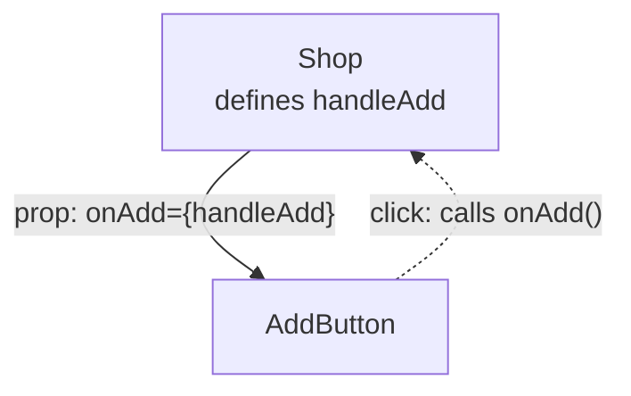

## The idea

A **component** is a JavaScript function that returns JSX. **Props** are its inputs: the values a parent passes in, like the arguments of a function.

Think of a **name badge template** at a conference. The layout is the same on every badge; only the name and company change. The template is the component; the details on each badge are the props.

## Passing props

A component returns JSX (or `null`), and its name starts with a **capital letter**: `<Greeting />` means "my component", `<greeting />` means "an HTML tag called greeting".

The parent writes props like HTML attributes. React collects them into **one object** and passes it to the component as its first argument.

```jsx
function Greeting(props) {
    return <h1>Hello, {props.name}!</h1>;
}

function App() {
    return (
        <div>
            <Greeting name="Ana" />
            <Greeting name="Ben" />
        </div>
    );
}
```

The first `Greeting` gets `props = { name: "Ana" }`. Most code reads the props with **destructuring** right in the parameter list, `function Greeting({ name })`, so you can write `name` instead of `props.name`.

A prop can be **any** JavaScript value. Use quotes for strings and curly braces for everything else: `name="Desk lamp"`, `price={25}`, `onAdd={handleAdd}`.

## Default values

Give a prop a default value in the destructuring. The default is used when the parent **leaves the prop out** (or passes `undefined`).

```jsx
function Avatar({ url, size = 48 }) {
    return ;
}
```

`<Avatar url="/ana.png" />` gets size 48. Passing `size={null}` does **not** use the default: `null` is a real value. React 19 removed `defaultProps` for function components.

## Props are read-only

A component must **never change its own props**: they belong to the parent. `props.name = "Someone else"` is wrong; in development, React freezes props, so it throws an error.

When something must change, **the parent** changes its own state and passes **new props** down. If only the child needs the data, the child keeps it in **state**. See [State with useState](../state-and-rendering/use-state.mdx).

## Components must be pure

A pure component only works out the JSX from its props and state: the same props always give the same JSX. It does **not** change anything outside itself while rendering. That's what lets React call a component again at any time and trust the result.

```jsx
let guestCount = 0;

// Wrong: changes a variable outside the component while rendering.
function Guest() {
    guestCount = guestCount + 1;

    return <p>Guest number {guestCount}</p>;
}
```

The numbers depend on how many times React happened to call `Guest`. In development, Strict Mode calls each component **twice** on purpose to expose bugs like this one. Fix it by passing the number in as a prop.

Side effects, like fetching data or starting a timer, go in **event handlers** or in **`useEffect`**, never in the render itself. See [useEffect](../hooks/use-effect.mdx).

## The children prop

Whatever you put **between** a component's opening and closing tags arrives as a special prop, **`children`**. This lets you build "boxes" that wrap any content.

```jsx
function Card({ title, children }) {
    return (
        <div className="card">
            <h2>{title}</h2>
            {children}
        </div>
    );
}

function App() {
    return (
        <Card title="Profile">
            <p>Ana, 29, Toronto</p>
            <button>Edit</button>
        </Card>
    );
}
```

The same `Card` can wrap a profile, a chart or a form. See [Composition and Children](../patterns/composition-and-children.mdx).

## Passing functions: how a child talks to its parent

Data flows **down**, so a child can't change its parent's data. Instead, the parent passes a **function** as a prop, and the child calls it when something happens.

```jsx
function AddButton({ onAdd }) {
    return <button onClick={onAdd}>Add to cart</button>;
}

function Shop() {
    function handleAdd() {
        console.log("Added!");
    }

    return <AddButton onAdd={handleAdd} />;
}
```

The usual names: the **prop** starts with `on` (`onAdd`), and the **function** that handles it starts with `handle` (`handleAdd`).



## Don't define a component inside another component

```jsx
function Parent() {
    // Wrong: a brand-new Child type on every render of Parent.
    function Child() {
        return <input />;
    }

    return <Child />;
}
```

Every time `Parent` renders, `Child` is a **new** function, so React sees a different component type. It throws the old `Child` away, with its state and DOM, and whatever the user typed disappears. Always define components at the **top level** of the file.

## Common mistakes

- **Lowercase component names.** `<card />` is an unknown HTML tag, not your component.
- **Changing props.** Props are read-only. Change state in the parent instead.
- **Forgetting the curly braces** for numbers and booleans. `price="25"` passes the **string** `"25"`, so `price + 1` gives `"251"`.
- **Calling the handler while passing it.** `onAdd={handleAdd()}` passes the **result** of `handleAdd`, and calls it on every render. Pass the function: `onAdd={handleAdd}`.

## In the interview

**Likely question:** "What's the difference between props and state?"

| | Props | State |
| --- | --- | --- |
| Who owns it | The **parent** | The **component itself** |
| Can the component change it? | **No**, read-only | **Yes**, with its setter function |
| Changing it re-renders the component? | New props come with the parent's re-render | **Yes** |
| Used for | Configuring a component from outside | Data that changes over time inside it |

> "A component is a function that takes props and returns JSX. Props are the inputs, passed down by the parent, and they're read-only: the component must not change them. State is data the component owns and changes itself with a setter, which makes React re-render it. When a child needs to tell the parent something, the parent passes a function as a prop, and the child calls it."

**Likely follow-up:** "What is `children`?"

**Answer:** "Whatever I put between a component's opening and closing tags. It arrives as the `children` prop, so wrapper components like `Card` or `Modal` can show any content without knowing what it is."

<Callout title="Remember this" type="success">
  - A **component** = a function, named with a **capital letter**, that returns JSX.
  - **Props** = one object of inputs from the parent. Strings in quotes, everything else in `{ }`. Defaults with `{ size = 48 }`.
  - Props are **read-only**. Components must be **pure**: same props, same JSX, no changes outside during render.
  - **`children`** = whatever is between the tags. Children talk to parents by calling **functions passed as props** (`onAdd`).
  - Never define a component **inside** another one: it's a new type each render, so its state resets.
</Callout>
