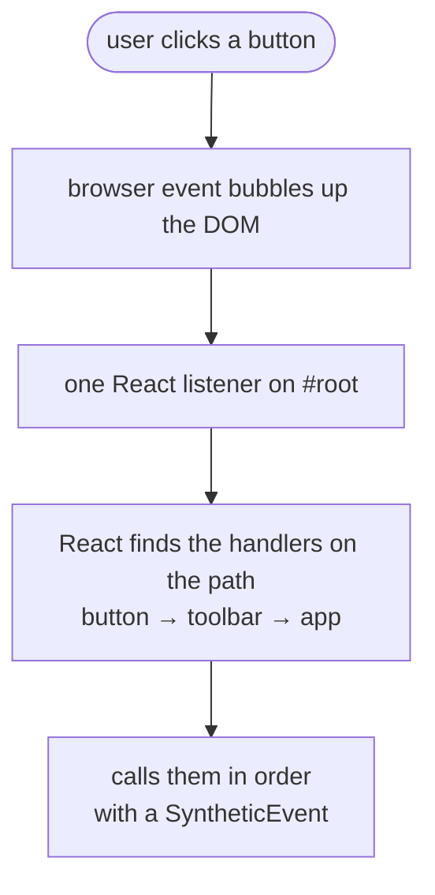

## The idea

To react to the user, you pass a **function** to an event prop like `onClick`. React calls that function when the event happens.

Think of a **doorbell**. You wire it up once: "when someone presses the button, ring this bell". You don't ring the bell while you install it. In the same way, you **give** React the function, and React **calls** it later, when the click happens.

## onClick and other event props

```jsx
function SaveButton() {
    function handleClick() {
        console.log("Saved!");
    }

    return <button onClick={handleClick}>Save</button>;
}
```

Event props are **camelCase**: `onClick`, `onChange`, `onSubmit`, `onKeyDown`, `onMouseEnter`, `onFocus`, `onBlur`. They go on HTML elements like `<button>` and `<input>`.

The handler is usually written **inside** the component, so it can read the component's props and state. Short handlers can be inline arrow functions:

```jsx
<button onClick={() => console.log("Saved!")}>Save</button>
```

## Pass the function, don't call it

This is the most common beginner bug, and interviewers like to show it.

| You write | What happens |
| --- | --- |
| `onClick={handleClick}` | ✓ Passes the function. React calls it **on click** |
| `onClick={() => handleClick()}` | ✓ Passes a new function that calls `handleClick` on click |
| `onClick={handleClick()}` | ✗ Calls `handleClick` **right now, during render**, and passes its result (`undefined`) |

The third one runs on every render instead of on click. If the handler sets state, it gets worse: setting state causes a render, which calls the handler again, which sets state again. React stops it with the error **"Too many re-renders"**.

When the handler needs an **argument**, wrap it in an arrow function:

```jsx
function TodoList({ todos, onDelete }) {
    return (
        <ul>
            {todos.map((todo) => (
                <li key={todo.id}>
                    {todo.text}
                    <button onClick={() => onDelete(todo.id)}>Delete</button>
                </li>
            ))}
        </ul>
    );
}
```

Each button gets its own small function, which remembers its own `todo.id` (a [closure](../../javascript/functions/closures.mdx)).

## The event object

React passes an **event object** to your handler. The most used parts:

| Property or method | What it gives you |
| --- | --- |
| `event.target` | The element the event started on |
| `event.target.value` | The current text of an input |
| `event.target.checked` | Whether a checkbox is ticked |
| `event.key` | The key pressed, like `"Enter"` or `"Escape"` |
| `event.preventDefault()` | Stops the browser's default action |
| `event.stopPropagation()` | Stops the event from reaching parent elements |

```jsx
function SearchBox() {
    function handleKeyDown(event) {
        if (event.key === "Enter") {
            console.log("Search for:", event.target.value);
        }
    }

    return <input onKeyDown={handleKeyDown} placeholder="Search" />;
}
```

## Forms and preventDefault

A browser form **reloads the page** when it's submitted. In a React app you almost always stop that, and handle the data yourself:

```jsx
function SignupForm() {
    function handleSubmit(event) {
        // Stop the browser from reloading the page.
        event.preventDefault();

        const data = new FormData(event.target);
        console.log("Email:", data.get("email"));
    }

    return (
        <form onSubmit={handleSubmit}>
            <input name="email" type="email" />
            <button type="submit">Sign up</button>
        </form>
    );
}
```

Put `onSubmit` on the **form**, not `onClick` on the button. The submit event catches every way of submitting, including Enter in a field, and it fires only after the browser's own checks (like `required` or `type="email"`) pass. In plain HTML, `return false` from a handler also stops the default action. **Not in React**: you must call `event.preventDefault()`.

React 19 also lets you pass a function to the form's `action` prop, and React handles the submit for you. See [Forms](../state-and-rendering/forms.mdx) and [What's New in React 19](../modern-react/react-19.mdx).

## Events bubble up

As in the DOM, an event first runs on the element you clicked, then on its parent, then on the parent's parent, and so on. This is **bubbling**. Here, clicking the button logs both lines:

```jsx
function Toolbar() {
    return (
        <div onClick={() => console.log("toolbar clicked")}>
            <button onClick={() => console.log("button clicked")}>Play</button>
        </div>
    );
}
```

The order is: `button clicked`, then `toolbar clicked`. To stop the event at the button, call `event.stopPropagation()` in the button's handler.

Events bubble through the **React tree**, not only the DOM tree. So a click inside a [portal](../patterns/portals.mdx) still reaches its React parents, even though the portal's DOM is somewhere else on the page.

To run a handler **before** the children's handlers, on the way down, add `Capture` to the name: `onClickCapture`.

## onChange fires on every key

In plain HTML, an input's `change` event fires only when the input **loses focus**. React's `onChange` fires on **every keystroke**, like the DOM's `input` event. That's what makes [controlled inputs](../state-and-rendering/forms.mdx) possible: the state updates as the user types.

## Synthetic events and delegation

Two details that come up in deeper interviews:

- **Synthetic events.** React wraps each browser event in its own object, a **SyntheticEvent**. It has the same properties and methods as the browser's event, and works the same in every browser. The original is in `event.nativeEvent`.
- **Delegation.** React does **not** add a listener to every button. It adds **one** listener per event type to the **root** of your app (the `#root` element; before React 17 it was `document`). When an event reaches the root, React works out which component's handler to call, in the right order. Thousands of buttons cost no more listeners than one.



Old interview question: "Why can't I read the event inside a `setTimeout`?" React 16 and older **reused** event objects (event pooling), so the fields were cleared after the handler finished. React 17 removed pooling, so today you can keep the event and read it later.

## Common mistakes

- **`onClick={handleClick()}`.** It runs during render, not on click, and can cause "Too many re-renders". Pass the function.
- **Lowercase event names.** `onclick` doesn't work in JSX. Use `onClick`.
- **`return false` to stop a form submit.** It doesn't work in React. Call `event.preventDefault()`.
- **`onClick` on the submit button instead of `onSubmit` on the form.** The click handler runs even when the browser's checks (like `required`) fail. `onSubmit` runs only after they pass.
- **Forgetting that events bubble.** A click on a button inside a clickable card runs both handlers. Call `event.stopPropagation()` if only the button should react.
- **Event handlers on a `<div>` instead of a `<button>`.** A div can't be reached with the Tab key or pressed with Enter. Use a real button for anything clickable.

## In the interview

> "I pass a function to an event prop like `onClick`, and React calls it with an event object when the event happens. I pass the function itself, not the result of calling it, and wrap it in an arrow function when I need an argument. React's events are synthetic: a cross-browser wrapper around the native event. And React uses delegation: one listener per event type at the root, not one per element."

**Likely follow-up:** "What's the difference between `onClick={handleClick}` and `onClick={handleClick()}`?"

**Answer:** "The first passes the function, so React calls it on click. The second calls it immediately while rendering and passes the return value. If that function sets state, it triggers another render, which calls it again: an endless loop, which React stops with 'Too many re-renders'."

**Another follow-up:** "How does React's `onChange` differ from the DOM's `change` event?"

**Answer:** "React's `onChange` fires on every keystroke, like the DOM's `input` event. The DOM's `change` event only fires when the input loses focus."

<Callout title="Remember this" type="success">
  - Pass a **function**: `onClick={handleClick}` or `onClick={() => remove(id)}`. **Never** `onClick={handleClick()}`.
  - Event props are **camelCase**. Handlers read **`event.target.value`**, **`event.key`**, and call **`event.preventDefault()`** (not `return false`).
  - Put **`onSubmit` on the form**, and call `event.preventDefault()` to stop the page reload.
  - Events **bubble** through the React tree. `event.stopPropagation()` stops them. `onClickCapture` runs on the way down.
  - React's **`onChange` fires on every keystroke**.
  - **SyntheticEvent** = a cross-browser wrapper. **Delegation** = one listener per event type at the **root**. No event pooling since React 17.
</Callout>
