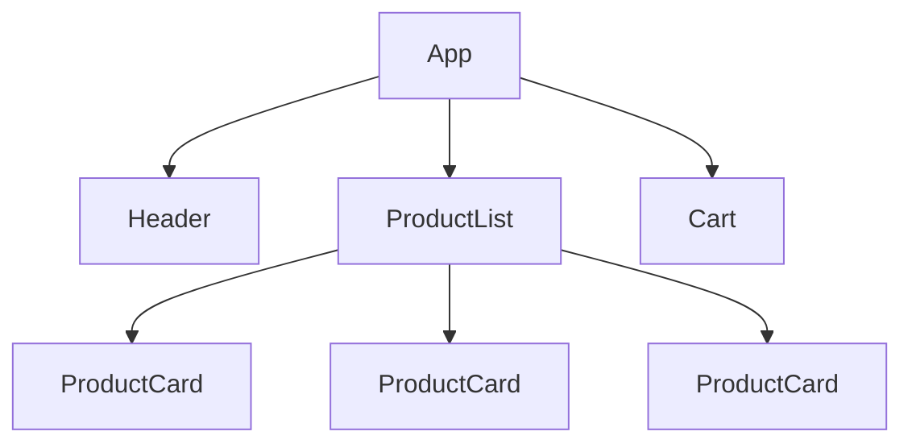
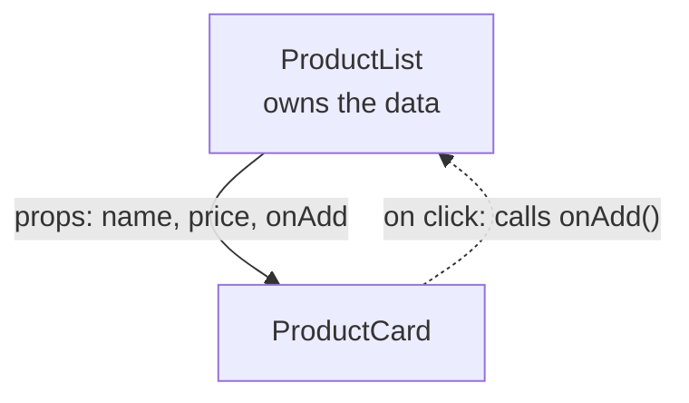

## The idea

**React** is a JavaScript library for building user interfaces. You describe **what the screen should look like** for the data you have right now. When the data changes, React works out what changed and updates the page for you.

Think of ordering in a restaurant. You say **what** you want, "a pizza with mushrooms", and you don't tell the cook each step. React works the same way: you say what the screen should show, and React does the steps.

## Imperative vs declarative

- **Imperative:** you give the steps. "Find the label. Change its text to 3 likes." In plain JavaScript, you find elements with `document.querySelector` and change them by hand.
- **Declarative:** you describe the result. "The label shows the number of likes." The library does the steps.

A like button in React. You only say what the button shows for the current `likes`:

```jsx
import { useState } from "react";

function LikeButton() {
    const [likes, setLikes] = useState(0);

    function handleClick() {
        setLikes(likes + 1);
    }

    // What the button looks like for the current number of likes.
    return <button onClick={handleClick}>{likes} likes</button>;
}
```

When `setLikes` changes the number, React calls `LikeButton` again and updates the text on the page. (`useState` is explained in [State with useState](../state-and-rendering/use-state.mdx).) When the same data shows in 5 places, plain JavaScript must update all 5 by hand; in React, each place reads the data, so all 5 stay right.

This idea is often written as **UI = f(state)**: the screen is a function of the data.

## Components

A React app is built from **components**: small, reusable pieces of UI. A component is a JavaScript function that returns what to show. A shop page might look like this:



`ProductCard` is written once and used three times, with different data each time. See [Components and Props](./components-and-props.mdx).

## One-way data flow

Data flows **one way: down**, from a parent to its children, as **props**. A child can't change its parent's data directly. Instead, it **calls a function** that the parent passed down, and the parent changes its own data.



This makes bugs easier to find: if some data on the screen is wrong, you look at the component that **owns** it.

## How React updates the page

When data changes, React does three things:

1. **Calls your component again** to get the new description of the screen.
2. **Compares** the new description with the old one, to find what changed.
3. **Updates only those parts** of the real page.

Steps 1 and 2 happen in memory, on plain JavaScript objects. That description is often called the **virtual DOM**. Only step 3 touches the real page. See [How Rendering Works](../state-and-rendering/how-rendering-works.mdx) and [Virtual DOM and Reconciliation](../state-and-rendering/virtual-dom-and-reconciliation.mdx).

## Putting React on a page

A React app starts from one empty element in the HTML page, `<div id="root"></div>`. One small file calls `createRoot(container).render(<App />)` to draw the top component, `App`, inside it. From then on, React owns everything inside `#root`.

There are two packages: **`react`** holds components and hooks, and **`react-dom`** puts them on a web page.

## Library vs framework, and SPAs

React is a **library**: it does the UI. Pages and URLs, data fetching and building come from other tools, like React Router, TanStack Query and Vite. A **framework** built on React, like Next.js, makes those choices for you.

Many React apps are **single-page applications (SPAs)**. The browser loads one HTML page once. After that, JavaScript swaps the content when you move around, without loading a new page from the server. Frameworks like Next.js can also build the HTML on the server first: see [SSR, SSG and Hydration](../modern-react/ssr-and-hydration.mdx).

## Common mistakes

- **Changing the page by hand** with `document.querySelector` inside a React app. React doesn't know about the change and can overwrite it. Change the data instead.
- **Lowercase component names.** `<likeButton />` is treated as an unknown HTML tag. Use a **capital letter**: `<LikeButton />`.
- **"The virtual DOM makes React faster than the DOM."** Not by itself: perfect hand-written DOM updates are faster. The virtual DOM lets React find what changed **for you**.

## In the interview

> "React is a JavaScript library for building user interfaces out of components. Instead of changing the page step by step, I describe what the UI should look like for the current state. When the state changes, React calls my components again, compares the new result with the old one, and updates only the parts of the DOM that changed. Data flows one way, from parents to children through props."

**Likely follow-up:** "Why use React instead of plain JavaScript?"

**Answer:** "Keeping the page in sync with the data is the hard part of UI code. With plain JavaScript, every change has to update every place that shows that data by hand. With React, I describe the UI for any state, and React keeps the page in sync. Components also make the UI reusable and easier to test. For a small static page, plain JavaScript is fine."

<Callout title="Remember this" type="success">
  - React is a **library** for UIs. You describe **what** to show; React does the steps. **UI = f(state)**.
  - An app is a tree of **components**: functions that return what to show. Names start with a **capital letter**.
  - **One-way data flow:** data goes **down** as props; children report events **up** by calling functions they got as props.
  - On a change, React **re-runs** components, **compares** the new result with the old, and updates **only what changed**.
  - `createRoot(container).render(<App />)` puts the app on the page. `react` = components and hooks; `react-dom` = the web page.
</Callout>
