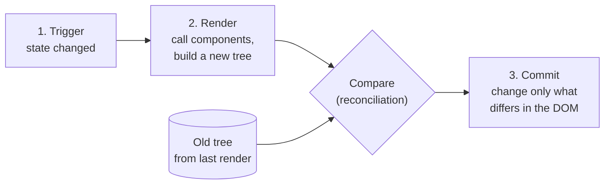

## The idea

Every screen update in React has three steps. Something **triggers** an update, like a state change. React **renders**: it calls your components to get a new description of the UI and compares it with the last one. Then React **commits**: it changes only the parts of the real page that are different.

Think of a **restaurant**. A guest orders (trigger). The kitchen cooks (render), out of sight. The waiter brings the plate to the table (commit). The guest only sees the finished plate.



## Why a component re-renders

A component renders again for one of three reasons:

1. **Its own state changed**, through a `useState` setter or a `useReducer` dispatch. If the new state is the same (`Object.is`), React skips it.
2. **Its parent re-rendered.** When a component renders, React renders **all its children** too.
3. **A context it reads changed.** See [Context and useContext](../hooks/use-context.mdx).

"Its props changed" isn't on the list. New props only arrive because the parent rendered, and the child renders **even when its props are the same**:

```jsx
import { useState } from "react";

function Page() {
    const [count, setCount] = useState(0);

    return (
        <div>
            <button onClick={() => setCount(count + 1)}>Count: {count}</button>
            <Footer />
        </div>
    );
}

function Footer() {
    console.log("Footer rendered");

    return <footer>Made by Ana</footer>;
}
// Every click logs "Footer rendered", although Footer has no props.
```

This is usually fine: rendering is cheap, and the page only changes where something is different. If a child is measurably slow, wrap it in **`React.memo`**, which skips its render when every prop is the same. See [useMemo and useCallback](../hooks/use-memo-and-use-callback.mdx).

## Rendering means calling your components

"Rendering" means React **calls your component function** to get its JSX. Then it calls the components that JSX contains, all the way down. Nothing on the page changes during this step. Two things follow:

- **A render isn't a DOM update.** A component can render and the page stays exactly the same.
- **Rendering must be pure.** Same props, state and context → same JSX, with no side effects like fetching data or changing outside variables. React may render a component more than once.

**Strict Mode** checks this for you. In development, `<StrictMode>` calls each component **twice**, and runs each effect's setup and cleanup one extra time when the component first appears. A pure component gives the same result twice; an impure one shows its bug. This only happens in **development**, never in production.

## The virtual DOM

JSX turns into **React elements**: plain JavaScript objects like `{ type: "h1", props: { className: "title", children: "Hello" } }`. See [JSX](../react-basics/jsx.mdx).

The tree of these objects for your whole UI is what people call the **virtual DOM**: a lightweight description of the page, kept in memory. Making objects is cheap; changing the real DOM is slower. So on every render React builds a **new** tree, compares it with the **old** one, and touches the real DOM only where they differ.

Inside React, each component in the tree has a **Fiber** node that holds its state and hooks. Fiber also lets React split rendering into small pieces and pause for urgent work, like typing. See [Concurrent Rendering and Transitions](../modern-react/concurrent-rendering.mdx).

## Reconciliation: the diffing rules

**Reconciliation** is React comparing the new tree with the old one to decide what to change. A perfect comparison of two trees is very slow, O(n³). React instead uses simple rules that work in **one pass, O(n)**:

1. **Different type → rebuild.** If a `<div>` becomes a `<section>`, or `<Counter>` becomes `<Profile>`, React removes the old one **with everything inside it**, state included, and creates the new one from scratch.
2. **Same type in the same place → keep.** React keeps the DOM node and the component's **state**, and only updates the props that changed.
3. **Keys match list items.** In a list, React matches children by **key**, not by position. See [Lists and Keys](../react-basics/lists-and-keys.mdx).

What happens to the state of a `Counter` between two renders:

| Between two renders | Counter's state |
| --- | --- |
| `<Counter />` stays `<Counter />` in the same place, with new props | **Kept** |
| `<Counter />` is replaced by `<p>` | **Lost** |
| `<div><Counter /></div>` becomes `<section><Counter /></section>` | **Lost**: the parent's type changed |
| `<Counter key="Ana" />` becomes `<Counter key="Ben" />` | **Lost**: new key, new component |

## State belongs to a position

React ties state to the **position in the tree**, not to the line of JSX. This surprises people:

```jsx
import { useState } from "react";

function Scoreboard() {
    const [isAnaPlaying, setIsAnaPlaying] = useState(true);

    return (
        <div>
            {isAnaPlaying ? <Counter person="Ana" /> : <Counter person="Ben" />}
            <button onClick={() => setIsAnaPlaying(!isAnaPlaying)}>Next player</button>
        </div>
    );
}

function Counter({ person }) {
    const [score, setScore] = useState(0);

    return (
        <div>
            <p>{person}: {score}</p>
            <button onClick={() => setScore(score + 1)}>Add one</button>
        </div>
    );
}
```

Ana scores 2, then you click "Next player". The screen shows **"Ben: 2"**. Both branches put a `Counter` in the same place, so React sees the same component with a new `person` prop, and keeps the score.

To make them two separate counters, give them different **keys**: `<Counter key="Ana" person="Ana" />` and `<Counter key="Ben" person="Ben" />`. Now switching shows "Ben: 0". Switching back shows "Ana: 0": a removed component's state is gone for good.

## Commit: changing the DOM

After rendering, React **commits**: it applies only the differences to the real DOM. If a render returns the same JSX as last time, React doesn't touch the DOM at all.

That's why an `<input>` keeps what the user typed, and its focus, while text next to it changes: React updates the text, and the input stays the **same** DOM node. After the commit, React runs your effects. See [useEffect](../hooks/use-effect.mdx).

## Common mistakes

- **Thinking a re-render changes the DOM.** Rendering only calls your function. The DOM changes only where the output is different.
- **Thinking a component re-renders only when its props change.** It re-renders whenever its parent does. `React.memo` skips that, when it's worth it.
- **Defining a component inside another component.** Every render makes a new function, so React sees a **new type** and resets its state: an input inside loses what you typed. Define components at the top level of the file.
- **Switching the wrapper element on a condition**, like `<div>` or `<section>`. Everything inside is rebuilt and loses its state. Keep the same element and change its props.
- **Side effects during render**, like fetching or changing outside variables in the component body. Put them in event handlers or effects.

## In the interview

**Likely question:** "What is the virtual DOM, and how does React update the page?"

> "The virtual DOM is a tree of plain JavaScript objects, React elements, that describes what the UI should look like. When state changes, React calls the affected components again to build a new tree, and compares it with the previous one. This comparison is called reconciliation. Then, in the commit phase, React changes only the parts of the real DOM that are different. Building objects is cheap and DOM changes are slower, so this keeps the DOM work small."

**Likely follow-up:** "When does a component re-render?"

**Answer:** "When its own state changes, when its parent re-renders, or when a context it reads changes. A child re-renders with its parent even if its props are the same, unless it's wrapped in `React.memo`. And a re-render doesn't always change the DOM: if the output is the same, the commit changes nothing."

**Another follow-up:** "How does React's diffing algorithm work?"

**Answer:** "React compares the old and new trees in one pass, O(n), using simple rules. If an element's type changes, like a `div` becoming a `section`, React throws away that whole subtree with its state and builds a new one. If the type is the same in the same place, it keeps the DOM node and the state, and updates only the changed props. In lists, keys tell React which child is which, so it can match items that moved."

<Callout title="Remember this" type="success">
  - **Trigger → render → commit.** Render = React **calls your components**; commit = React **changes the real DOM**, only where something differs.
  - A component re-renders when **its state changes**, **its parent re-renders**, or **a context it reads changes**. Same props don't stop it; **`React.memo`** does.
  - The **virtual DOM** is a tree of plain objects (React elements). Comparing the new tree with the old one is **reconciliation**.
  - **Different type → rebuild**, state lost. **Same type, same place → keep**, state kept. **Keys** match list items.
  - State belongs to a **position in the tree**. Never define a component **inside** another one.
  - **Strict Mode** renders twice, in **development only**, to catch impure components.
</Callout>
