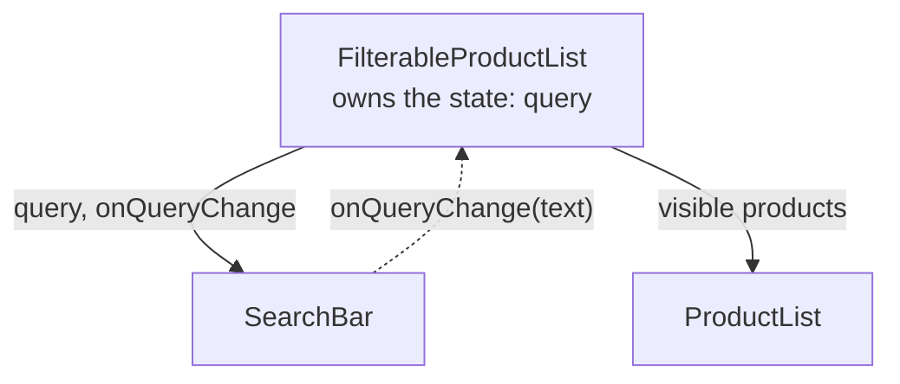

## The idea

When two components need the **same** changing data, neither of them should own it alone. Move the state **up** to their **closest common parent**, and pass it down as props, together with a function to change it. This is **lifting state up**.

Think of a **family calendar on the fridge**. If Ana and Ben each keep their own calendar, they soon disagree about what's planned for Saturday. With one calendar in a shared place, everyone reads and writes the same one.

## The problem: siblings can't share

A search page has a `SearchBar` and a `ProductList` side by side. If `SearchBar` keeps the search text in its own state, `ProductList` can't see it. Data only flows **down**, from a parent to its children, never sideways between siblings.

## Move the state to the common parent

Three steps:

1. **Remove** the state from the child.
2. **Add** it to the closest common parent.
3. **Pass it down**: the value as one prop, and a function to change it as another.



```jsx
import { useState } from "react";

function FilterableProductList({ products }) {
    const [query, setQuery] = useState("");

    const lowerQuery = query.toLowerCase();
    const visibleProducts = products.filter((product) =>
        product.name.toLowerCase().includes(lowerQuery)
    );

    return (
        <div>
            <SearchBar query={query} onQueryChange={setQuery} />
            <ProductList products={visibleProducts} />
        </div>
    );
}

function SearchBar({ query, onQueryChange }) {
    return (
        <input
            value={query}
            onChange={(event) => onQueryChange(event.target.value)}
            placeholder="Search products"
        />
    );
}

function ProductList({ products }) {
    return (
        <ul>
            {products.map((product) => (
                <li key={product.id}>{product.name}</li>
            ))}
        </ul>
    );
}
```

When you type "mi", `SearchBar` calls `onQueryChange("mi")`. The parent's state changes, the parent re-renders, and **both** children get the new values: the box shows "mi", and the list shows only the matching products.

`SearchBar` now has no state of its own. Its parent controls it completely through props, so it's called a **controlled** component. The same word is used for inputs: see [Forms: Controlled vs Uncontrolled](./forms.mdx).

## Single source of truth

Every piece of state should have **one owner**: the component that holds it with `useState`. Everyone else gets it through props. This is a **single source of truth**. Two habits follow:

- **Don't keep two copies** of the same data and sync them with an effect. Lift it to one place.
- **Don't store what you can calculate.** `visibleProducts` comes from `products` and `query`, so it's worked out during render. A second copy in state could go out of date.

Lift to the **lowest** common parent, not higher. When state changes, its owner and everything below it re-render. State at the very top re-renders the whole app on every keystroke.

## Prop drilling

Sometimes the common parent is many levels above the component that needs the data. Say `App` owns `user`, and only `Avatar` uses it, three levels down: `App` → `Layout` → `Sidebar` → `Avatar`. `Layout` and `Sidebar` must accept `user` and pass it on, without using it. This is **prop drilling**.

A few levels are fine. When it gets deep, there are three fixes, in this order:

- **Composition.** `App` renders `<Layout><Avatar user={user} /></Layout>`, and `Layout` just shows its `children`. The middle components never touch `user`. See [Composition and Children](../patterns/composition-and-children.mdx).
- **Context.** Put the value in context, and any component below reads it directly. See [Context and useContext](../hooks/use-context.mdx).
- **A store**, like Redux or Zustand, for big shared state that changes often. See [Choosing Where State Lives](../data-and-state/where-state-lives.mdx).

## Common mistakes

- **Keeping the same data in two components' state** and syncing them with `useEffect`. They drift apart. Lift it to one owner.
- **Storing derived data in state**, like the filtered list. Calculate it during render.
- **Lifting state higher than needed.** Every change re-renders everything below the owner. Use the lowest common parent.
- **Changing a prop in the child.** Props are read-only. Call the function the parent passed: `onQueryChange("milk")`.

## In the interview

**Likely question:** "Two sibling components need the same data. How do you share it?"

> "I lift the state up to their closest common parent. The parent holds it with `useState` and passes the value down as a prop to both children, along with a function to change it. When one child calls that function, the parent's state changes, it re-renders, and both children get the new value. That gives the data a single source of truth, instead of two copies that can disagree."

**Likely follow-up:** "What is prop drilling, and how do you avoid it?"

**Answer:** "It's passing a prop through several components that don't use it, only to reach a deep child. A few levels are fine. When it gets deep, I first try composition: passing JSX as `children`, so the middle components don't need the data. For data that many components read, like the current user or the theme, I use context. For large shared state that changes often, a store like Redux or Zustand."

**Another follow-up:** "How does a child change state that lives in its parent?"

**Answer:** "The parent passes a function down as a prop, like `onQueryChange`, and the child calls it with the new value. The child never changes the parent's state or its own props directly. Data goes down as props, and changes go up through these callbacks."

<Callout title="Remember this" type="success">
  - Two components need the same changing data → **lift the state** to their **closest common parent**.
  - The parent passes the **value down as a prop**, and a **function to change it**. Data goes down, changes go up.
  - **Single source of truth**: one owner per piece of state. No copies kept in sync with effects.
  - **Calculate derived data** during render instead of storing it in state.
  - Lift to the **lowest** common parent: everything below the owner re-renders when it changes.
  - **Prop drilling** → try **composition** (`children`) first, then **context**, then a **store**.
</Callout>
