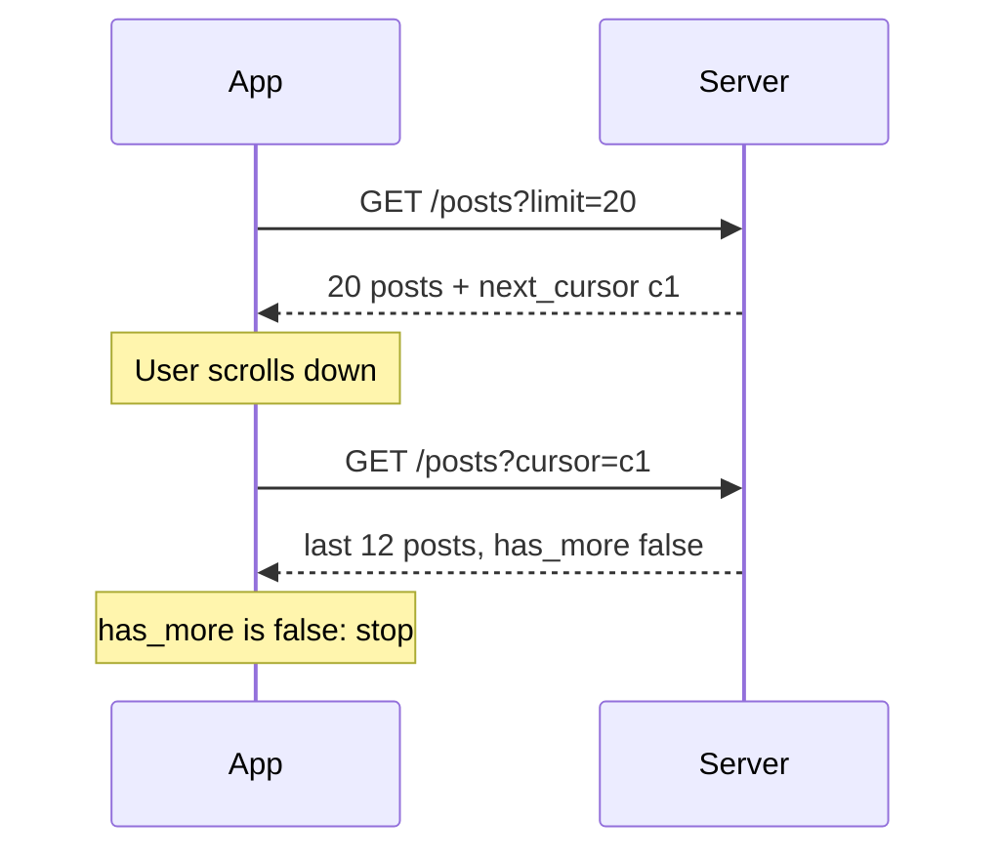
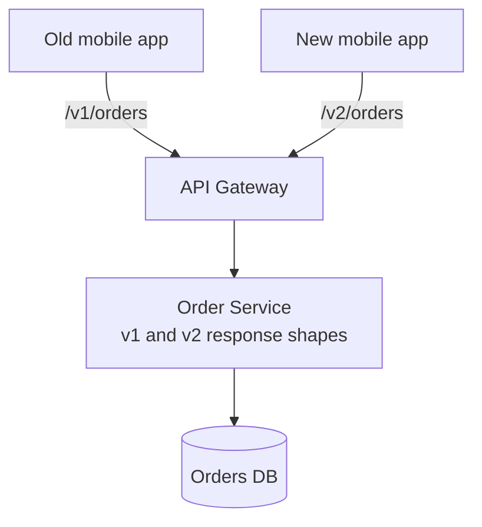

## What is it?

**Pagination** is like reading a long book. You never read all 900 pages in one go. There are two ways to pick up where you stopped:

- **"Go to page 37"**: you count pages from the start. That is **offset pagination**.
- **A bookmark**: you open the book right where you left off. That is **cursor pagination**.

**Versioning** is about promises. Once other apps use your API, they depend on its exact shape. Old mobile apps stay on people's phones for years. If you rename one field, those apps break. Versioning lets you change the API while the old shape keeps working.

## Why do we need it?

**Why paginate.** Never send a huge list in one response. 1 million orders in one reply is slow to build, uses a lot of memory on the server, and wastes the user's mobile data.

Instead, return **one page** (often 20 to 100 items) plus a way to get the next one. Always set a **maximum page size**, so a client can't ask for 1 million items with `limit=1000000`.

**Why version.** You can't make every client update at the same moment. Old app versions stay on phones for years, and other companies change their code on their own schedule, not yours. Without versions, every breaking change crashes someone's app. With versions, old clients keep the old shape while new clients get the new one.

## How it works inside

### Offset pagination

The client says how many items to **skip** (the **offset**) and how many to return (the **limit**):

```http
GET /posts?limit=20&offset=40
```

```sql
SELECT id, title, created_at
FROM posts
ORDER BY created_at DESC
LIMIT 20 OFFSET 40;   -- skip 40 rows, return the next 20
```

```json
{
  "data": [
    { "id": 912, "title": "My trip to Goa", "created_at": "2024-06-01T09:58:00Z" }
  ],
  "limit": 20,
  "offset": 40,
  "total": 1532
}
```

**Good:** very simple. You can jump to any page ("page 37") and show page numbers.

**Problem 1: deep pages are slow.** `OFFSET 100000` means the database finds 100,000 rows and **throws them away** before it returns your 20. The deeper you go, the slower it gets.

**Problem 2: items move while you read.** Say the newest posts are shown first, 3 per page:

- You load page 1 and get **F, E, D**.
- Someone publishes a new post **G**. The list is now G, F, E, D, C, B, A.
- You load page 2 with offset 3, and get **D, C, B**. You see **D twice**.

If a post is deleted instead, you **skip** one without knowing. For a fast-moving feed, this happens all the time.

### Cursor pagination

Instead of "skip 40", the client says **"give me 20 items after this one"**. The server sends back a **cursor**: a marker that points at the last item you got. You send it back to get the next page.

```http
GET /posts?limit=20
GET /posts?limit=20&cursor=eyJjIjoiMjAyNC0wNi0wMVQxMDowMDowMFoiLCJpZCI6OTgxfQ
```

The cursor is just the last item's sort values (its time and ID), packed into a string. The server decodes it and asks for rows **after** that point:

```sql
SELECT id, title, created_at
FROM posts
WHERE (created_at, id) < ('2024-06-01 10:00:00', 981)   -- after the last item seen
ORDER BY created_at DESC, id DESC
LIMIT 21;   -- 20 for the page, plus 1 to see if there is more
```

```json
{
  "data": [
    { "id": 980, "title": "Best pizza in Rome", "created_at": "2024-06-01T09:59:12Z" }
  ],
  "next_cursor": "eyJjIjoiMjAyNC0wNi0wMVQwOTo0MToxMFoiLCJpZCI6OTYxfQ",
  "has_more": true
}
```

To fill in `has_more`, the query asks for **one extra row** (`LIMIT 21` for a page of 20). If 21 rows come back, there is another page. Send only the first 20, and build `next_cursor` from the 20th.

Three details make it work well:

- **Add the ID as a tie-breaker.** Two posts can have the same time. Sorting by `(created_at, id)` gives every row a unique place, so none are skipped.
- **Index the sort columns.** With an index on `(created_at, id)`, the database **jumps straight** to the cursor, so page 5,000 is as fast as page 1.
- **Keep the cursor opaque.** Encode it (here with base64) so clients treat it as a black box. Then you can change what is inside later without breaking anyone. Base64 only hides the values, it doesn't protect them: anyone can decode and edit a cursor. So check every cursor you get back like any other input, and answer `400` if it is broken.



### API versioning

When you must make a change that would break old clients, you release a **new version** and keep the old one running for a while.

| Where the version goes | Example | Notes |
| --- | --- | --- |
| **URL path** | `/v1/orders`, `/v2/orders` | Most common. Easy to see, test and route |
| **Header** | `Api-Version: 2024-06-01` | Keeps URLs clean. Harder to try in a browser |
| **Query parameter** | `/orders?version=2` | Simple, but easy to forget |

Versions can be numbers (`v1`, `v2`) or **dates** (`2024-06-01`). With dates, each client is pinned to the API as it was on that day.

You rarely need two copies of the service. Usually **one service** has a thin layer per version that turns the shared data into the old or new shape:



## Changes that don't break clients

The best version change is the one you never need. Many changes are safe:

| Safe (non-breaking) | Breaking |
| --- | --- |
| Add a new endpoint | Remove or rename a field |
| Add a new **optional** field to a response | Change a field's type: `"price": 10` → `"price": "10.00"` |
| Add a new **optional** request parameter | Make an optional parameter required |
| Make a limit more generous | Change what a status code or error means |
| | Change the default sort order or page size |

For example, adding `currency` is safe. Old clients simply ignore it:

- Before: `{ "id": 42, "total": 500 }`
- After: `{ "id": 42, "total": 500, "currency": "INR" }`

Renaming `total` to `amount` is **breaking**. Every old client that reads `total` now gets nothing.

Two habits keep this working:

- **Clients ignore fields they don't know.** Then new fields never break them.
- **Deprecate before you remove.** Announce the change, send a `Sunset` header with the date the old version stops working, watch how much traffic still uses it, and only remove it when that traffic is close to zero.

Adding a new value to a list of options (like a new order status `"on_hold"`) is a gray area. It can break clients that only expect the old values, so announce it first.

## When to use which

**Offset or cursor?**

| | Offset | Cursor |
| --- | --- | --- |
| **Request** | `?offset=40&limit=20` | `?cursor=abc&limit=20` |
| **Deep pages** | Slow: skipped rows are still read | Fast at any depth |
| **New or deleted items** | Duplicates and skipped items | Stable |
| **Jump to page 37** | Yes | No, only next (and sometimes previous) |
| **Total count** | Easy to show | Usually not shown |
| **Best for** | Small admin tables with page numbers | Feeds, infinite scroll, big lists, public APIs |

**Default to cursor** for anything big or fast-changing.

**A new version or not?** Make a new version only for a breaking change you can't avoid. For everything else, add optional fields to the current version (the safe changes above).

## Alternatives

| Option | What it is | Pick it when |
| --- | --- | --- |
| **Bulk export** | A background job writes the whole list to a file in S3 and returns a download link | The client really needs everything, like a CSV of all orders |
| **"Changes since" sync** | The client asks only for items changed after a time or a sync token | A mobile app keeps a local copy up to date |
| **Never break, only add** | One version forever. Add fields, mark old ones as deprecated, remove them only when unused | You control most clients, or you use GraphQL. See [gRPC and GraphQL](../foundations/grpc-and-graphql.mdx) |
| **Version in the media type** | `Accept: application/vnd.myapp.v2+json` | You want URLs that never change. Less common |

## In the real world

**Stripe uses date-based versions.** Each Stripe account is pinned to the API version from when it started. A request can ask for another version with the `Stripe-Version` header. Inside, Stripe keeps old versions working by running each response through small "version change" steps that turn the newest shape back into the older one.

**Stripe and Slack use cursor pagination.** Stripe's list endpoints take `limit` and `starting_after` (the ID of the last item you saw), and return `has_more`. Slack's Web API also pages with cursors.

**GitHub puts the version in a header.** GitHub's REST API takes a date-based version in the `X-GitHub-Api-Version` header, such as `2022-11-28`.

## In the interview

When you write your API in the interview, add pagination to every list endpoint, and say which kind:

> "`GET /feed` uses cursor pagination: it takes `cursor` and `limit` and returns `next_cursor`. Offset would get slow on deep pages and show duplicates as new posts arrive. All endpoints live under `/v1`, and I'll only add optional fields, so old app versions keep working."

<Callout title="Remember this" type="success">
  - **Why:** huge lists are slow and waste memory and data. Old clients can't all update at once, so breaking changes need versions.
  - Always paginate lists, and cap the page size.
  - **Offset** (`LIMIT 20 OFFSET 40`): simple, can jump to a page, but **slow when deep** and shows **duplicates** when data changes.
  - **Cursor**: "after this item". `WHERE (created_at, id) < (...)` with an index. **Fast and stable.** Default for feeds.
  - Make the cursor **opaque** and add the **ID as a tie-breaker**.
  - Version in the **URL** (`/v1/`) or a **header**. Keep old versions running until traffic is gone.
  - **Adding optional things is safe. Removing, renaming or changing types breaks clients.**
  - **Alternatives:** a bulk export file, "changes since" sync, never break and only add, version in the media type.
</Callout>
