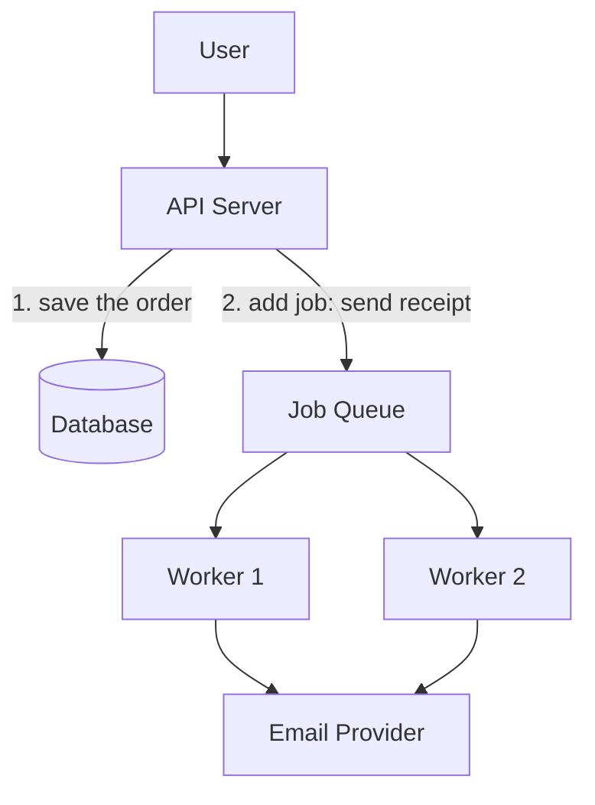
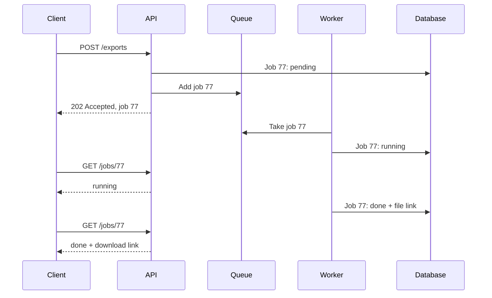
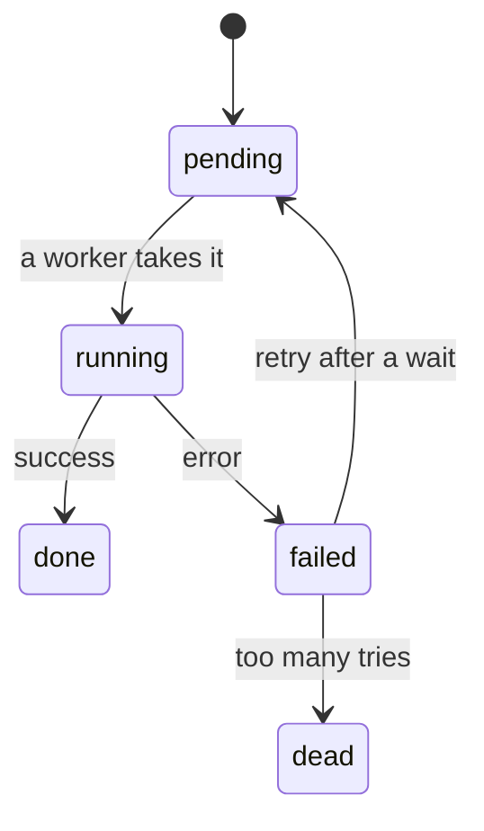

## The idea

Think of a **restaurant**. The waiter takes your order, says "it will be ready soon", and goes to the next table. He doesn't stand in the kitchen cooking while you wait at the counter. The order slip goes on a rail, and the **cooks** pick slips up one by one.

That is a **background job**. The request handler (the waiter) only **writes down the work** and answers the user fast. Separate **workers** (the cooks) do the slow part later. A **job queue** (the rail of order slips) sits between them.

Some work also runs **on a schedule**, like an alarm clock: "every night at 2 AM, make the sales report". That is a **scheduled job**.

## What belongs in the background

**The rule:** if the user doesn't need the result to see the next screen, do it later.

- Sending emails, SMS and push notifications
- Resizing images, encoding videos
- Making PDF invoices and reports
- Exporting a user's data
- Calling slow outside services
- Cleaning up old data

Doing this work later gives you **fast responses**, **retries** when something fails, a **buffer** for traffic spikes, and workers you can **scale on their own**.

## Job queues and workers



A **job** is a small message that says **what to do** and **with which inputs**. Keep it small: send IDs, not whole objects. The worker loads fresh data when it runs.

```json
{
  "jobId": "job_8f2a",
  "type": "send_receipt_email",
  "orderId": 1042,
  "attempt": 1,
  "createdAt": "2024-06-01T10:00:00Z"
}
```

A **worker** is a separate process that loops forever: take a job, do it, mark it done, take the next one. When the queue grows, add more workers.

**What if a worker crashes halfway?** Good queues don't delete a job when a worker takes it. They **hide** it for a while (SQS calls this the **visibility timeout**). The worker deletes the job only after it finishes. If the worker dies, the job becomes visible again and another worker takes it.

That means **a job can run twice**. So every job must be safe to run twice, which is called being **idempotent** (see [Idempotency](../messaging/idempotency.mdx)). For example: "send the receipt for order 1042, **unless** it was already sent."

**Races and duplicates.** Two more ways a job can be lost or run twice:

- **The API crashes between its two steps.** In the diagram, it saves the order, then adds the job. A crash in between keeps the order but loses the receipt job. Fix it with the [Outbox Pattern](../distributed-systems/outbox-pattern.mdx): save the job in the database, in the **same transaction** as the order, and let a relay put it on the queue. Or keep a `pending` row for each job and run a **sweeper**, a small scheduled job that re-queues rows still `pending` after a few minutes.
- **A job runs longer than the visibility timeout.** It becomes visible again, and a second worker starts it while the first is still working. Set the timeout longer than your slowest job, or let the worker extend it while it works.

The sweeper can also queue a job twice. That is fine, because every job is idempotent.

**Use separate queues for urgent and slow work.** A password-reset email should not wait behind 50,000 monthly reports. Give each its own queue and workers.

**Common tools:** Sidekiq (Ruby), Celery (Python) and BullMQ (Node.js), which usually keep jobs in Redis. AWS SQS with your own workers. **Temporal** for long jobs with many steps. More on queues in [Message Queues and Pub/Sub](../messaging/message-queues-pub-sub.mdx).

## Cron and scheduled jobs

**Cron** is a classic Unix tool that runs commands on a schedule. A schedule has 5 fields: minute, hour, day of month, month, day of week. A `*` means "every".

```bash
# minute  hour  day-of-month  month  day-of-week   command
0         2     *             *      *             run-daily-report      # every day at 2:00 AM
*/5       *     *             *      *             clean-expired-carts   # every 5 minutes
0         9     *             *      1             send-weekly-digest    # every Monday at 9:00 AM
```

**The trap with many servers.** If you put that cron file on all 10 app servers, the daily report runs **10 times**. Fixes:

- **One scheduler.** A single scheduler (a Kubernetes CronJob, AWS EventBridge Scheduler, or one small service) only **adds a job to the queue** when it is time. Workers do the actual work.
- **A lock.** Each server tries to take a lock before running, and only the winner runs it. See [Distributed Locking](../distributed-systems/distributed-locking.mdx).

**Millions of "run at" jobs.** For things like "remind each user 1 hour before their booking", cron is not enough. Store each job as a row with a `run_at` time, and let pollers pick up the ones that are due:

```sql
-- Each poller claims up to 100 due jobs that no one else is holding
UPDATE jobs
SET status = 'running', started_at = now()
WHERE id IN (
  SELECT id FROM jobs
  WHERE status = 'pending' AND run_at <= now()
  ORDER BY run_at
  LIMIT 100
  FOR UPDATE SKIP LOCKED
)
RETURNING id;
```

The inner `FOR UPDATE SKIP LOCKED` locks the rows it picks and **skips rows another poller already locked**. The outer `UPDATE` marks them `running` in the same statement, so the claim stays even after the locks are let go. So many pollers can work side by side without taking the same job.

A bare `SELECT … FOR UPDATE SKIP LOCKED` is not enough on its own. Outside a transaction, its locks are released as soon as it returns, and the rows are still `pending`, so a second poller can pick the same job. The `started_at` time lets a cleanup job find jobs stuck in `running` after a worker crash and set them back to `pending`. The full design is in [Design a Job Scheduler](../questions/job-scheduler.mdx).

## Tracking job status

Some jobs are started by a user who wants to know when they finish, like "Export my data", which takes 5 minutes. The API should **not** wait 5 minutes. Instead:

1. It creates the job and answers **`202 Accepted`** with a **job ID**.
2. The client checks `GET /jobs/77` every few seconds, or the server tells it when done (by WebSocket, push or email, see [Polling, WebSockets and SSE](../foundations/polling-websockets-sse.mdx)).



If the API crashes after saving job 77 but before adding it to the queue, the row stays `pending`. The sweeper finds it and queues it again.

A job moves through a few **states**:



## Retries and failed jobs

Jobs fail: the email provider is down, the network times out. Rules that keep this under control:

- **Retry with backoff.** Wait longer after each failure (1 s, 2 s, 4 s, 8 s...) and add a little randomness, so all failed jobs don't retry at the same moment. See [Retries, Backoff and Timeouts](../messaging/retries-backoff-timeouts.mdx).
- **Only retry errors that can fix themselves.** A timeout or `503`: retry. "User not found": retrying won't help.
- **Set a maximum.** After, say, 5 tries, move the job to a **dead-letter queue**, a parking place where a person can look at it. See [Dead-Letter Queues](../messaging/dead-letter-queues.mdx).
- **Set a time limit.** A job stuck for an hour should be stopped and retried.
- **Make every job idempotent**, because retries and crashes mean some jobs run twice.
- **Watch the queue.** Alert on **queue length**, the **age of the oldest job**, and the **failure rate**. A growing queue means workers can't keep up.

## In the real world

**Airbnb created Airflow.** Airbnb built **Apache Airflow** to schedule and run its data pipelines, where each job waits for the ones before it. It was open-sourced and is now an Apache project used by many companies.

**Uber created Cadence, and Temporal came from it.** Uber built **Cadence** to run long, multi-step jobs that survive crashes. Its creators later started **Temporal**, which began as a fork of Cadence.

**GitLab runs on Sidekiq.** GitLab's own documentation describes how it uses **Sidekiq** workers, with Redis, for its background jobs.

**Kubernetes has CronJobs built in.** A Kubernetes **CronJob** starts a job on a cron schedule, so you don't need a cron file on every server.

## In the interview

Whenever something slow happens after a user action, say "background job":

> "Placing the order returns right away. Sending the receipt email and making the invoice PDF go on a job queue. Workers retry with backoff, every job is idempotent, and after 5 failures a job moves to a dead-letter queue."

<Callout title="Remember this" type="success">
  - If the user doesn't need it **now**, put it on a **job queue** and let **workers** do it.
  - Jobs carry **IDs**, not whole objects. A crashed worker's job comes back, so jobs must be **idempotent**.
  - A crash between saving the data and queuing the job loses the job. Use an **outbox**, or a **sweeper** that re-queues old `pending` rows.
  - Cron on every server runs a job **many times**. Use **one scheduler** or a **lock**.
  - Many "run at" jobs: rows with `run_at`, claimed with `UPDATE … SKIP LOCKED … RETURNING`.
  - Long jobs: return **`202 Accepted` + job ID**, and let the client check the status.
  - **Retry with backoff**, cap the tries, then send to a **dead-letter queue**.
</Callout>
