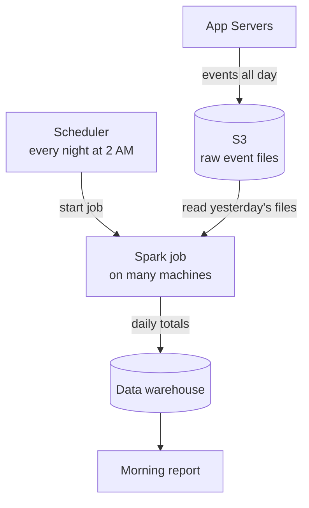
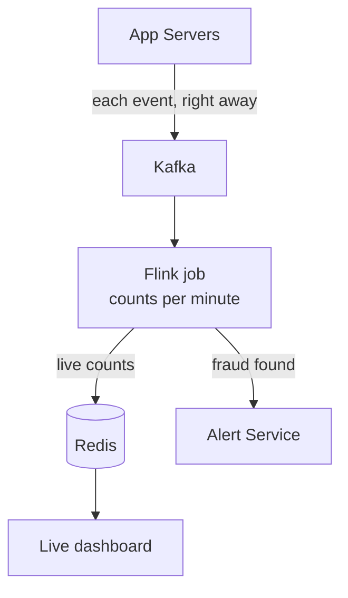

## The idea

Think about your **bank**. It sends you two kinds of messages:

- A **monthly statement**: once a month, it collects all your payments and makes one big report. That is **batch processing**.
- An **SMS alert** for each card payment, a few seconds after you pay. That is **stream processing**.

Both look at the same payments. The difference is **when** the work happens: all at once later, or bit by bit, right away.

## Batch processing

Batch processing **collects data for a while** (an hour, a day), then **processes all of it in one big job**.

- The input has a **clear end**: "all of yesterday's orders".
- Very **efficient**: big jobs on many machines can crunch terabytes.
- Easy to **fix mistakes**: found a bug? Fix the code and run the job again on the same input.
- But the results are **late**: hours, sometimes a day.

**Examples:** daily sales reports, monthly bills, payroll, training a machine learning model, rebuilding a search index every night.

### How a batch job splits the work

The classic model is **MapReduce**. Say you want to count how often each word appears in a billion web pages:

1. **Map:** each machine reads its own slice of the pages and writes pairs like `(pizza, 1)`.
2. **Shuffle:** all pairs for the same word are sent to the same machine.
3. **Reduce:** that machine adds them up: `(pizza, 48211)`.

Many machines work at the same time, each on a small piece. Modern tools like Spark use the same idea, but are much faster.

## Stream processing

Stream processing handles **each event as it arrives**, within seconds or less.

- The input **never ends**. Events keep coming.
- **Low delay**: you see results right away.
- **Harder** to build: the job must remember things between events (called **state**), survive crashes without losing or double-counting, and handle events that arrive late.

**Examples:** catching card fraud while the payment is happening, live dashboards, trending hashtags, surge pricing, alerts when error rates jump.

The events usually come from [Kafka](../messaging/kafka.mdx), which keeps them in order and lets you read them again later.

## Side by side

| | Batch | Stream |
| --- | --- | --- |
| **Input** | A fixed chunk with an end | Never-ending events |
| **When it runs** | On a schedule (every hour, every night) | All the time |
| **Delay** | Minutes to hours | Milliseconds to seconds |
| **Hard parts** | Big data volume | State, late events, crashes |
| **Fixing a bug** | Easy: run the job again | Harder: replay old events |
| **Examples** | Reports, bills, ML training | Fraud checks, live counts, alerts |

**How to choose:** ask **"how fresh must the answer be?"** If tomorrow morning is fine, use batch. It is simpler and cheaper. If the answer is useless in an hour (fraud, surge pricing), use stream.

## Tools: Spark, Flink, Kafka Streams

| Tool | Type | In one line |
| --- | --- | --- |
| **Hadoop MapReduce** | Batch | The first big open-source batch tool. Mostly replaced by Spark today |
| **Apache Spark** | Batch, plus "micro-batch" streaming | Keeps data in memory between steps, so it is much faster than MapReduce. Its streaming mode runs tiny batches every second or so |
| **Apache Flink** | Stream first (can do batch too) | Handles truly one event at a time. Strong at state, windows and exactly-once counting |
| **Kafka Streams** | Stream | A Java library, not a separate cluster. It runs inside your own service, reading from and writing to Kafka |

For interviews: **Spark for batch, Flink for streaming**, with Kafka in front. That covers most answers.

## Windows: counting per minute, per hour

A stream never ends, so "how many clicks?" has no final answer. You must ask **"how many clicks per minute?"**. A time bucket like this is called a **window**.

| Window type | How it works | Example |
| --- | --- | --- |
| **Tumbling** | Fixed size, no overlap. Each event is in exactly one window | Clicks per minute: 10:00–10:01, 10:01–10:02, ... |
| **Sliding** (also called hopping) | Fixed size, but windows overlap | "Clicks in the last 5 minutes", updated every minute |
| **Session** | Groups one user's events. Closes after a gap with no activity | One visit to a website, ending after 30 quiet minutes |

A small tumbling example. Clicks arrive at **10:00:20, 10:00:50, 10:01:10** and **10:02:30**:

| Window | Clicks |
| --- | --- |
| 10:00–10:01 | 2 |
| 10:01–10:02 | 1 |
| 10:02–10:03 | 1 |

### Late events

Each event carries the time it **happened** (called **event time**). It may reach the server much later (**processing time**). A phone in airplane mode can send its clicks hours late.

So when can the job close the 10:00–10:01 window and publish "2 clicks"? Stream tools use a **watermark**: a marker that says "I believe all events up to 10:01 have now arrived". The job waits a little for stragglers, then closes the window. Events that come after that are either dropped or used to fix the result.

## Using both together

Many systems run both, on the same events:

- **Stream** gives fast numbers now, which may be slightly off.
- **Batch** recounts everything later from the raw events, and the exact numbers replace the fast ones.

This mix is called the **Lambda architecture**. Its cost is that you write the same logic twice. The **Kappa architecture** uses **only** streaming. To fix old results, you replay the old events from Kafka through the stream job again. The [Ad Click Aggregator](../questions/ad-click-aggregator.mdx) question is the classic place for this.

## In the real world

**MapReduce came from Google.** Google described MapReduce in a 2004 paper. **Hadoop** was the open-source version that many companies then used for big batch jobs.

**Spark came from a university.** Apache Spark started as a research project at **UC Berkeley**. It became popular because keeping data in memory made many jobs much faster than Hadoop MapReduce.

**Kafka came from LinkedIn.** LinkedIn built Kafka to move huge streams of events, and open-sourced it in 2011. Kafka Streams is now part of the Apache Kafka project.

**Netflix streams with Flink.** Netflix's real-time data platform, called **Keystone**, moves events through Kafka and runs stream processing jobs on Flink.

## In the interview

When a question needs **counts, totals or analytics**, say which kind you pick and why:

> "For the live dashboard, a Flink job reads clicks from Kafka and counts them in one-minute tumbling windows. Every night, a Spark job recounts from the raw events in S3, so billing uses exact numbers."

<Callout title="Remember this" type="success">
  - **Batch** = big chunk, on a schedule, results later. Simple, cheap, easy to rerun. Tool: **Spark**.
  - **Stream** = each event right away. Fresh results, but harder. Tool: **Flink** (or Kafka Streams), reading from **Kafka**.
  - Choose by asking: **"How fresh must the answer be?"**
  - Streams are counted in **windows**: **tumbling** (no overlap), **sliding** (overlap), **session** (per visit).
  - **Event time** vs **processing time**. A **watermark** decides when to close a window.
  - Fast numbers from stream, exact numbers from batch = **Lambda**. Stream only, replay to fix = **Kappa**.
</Callout>
