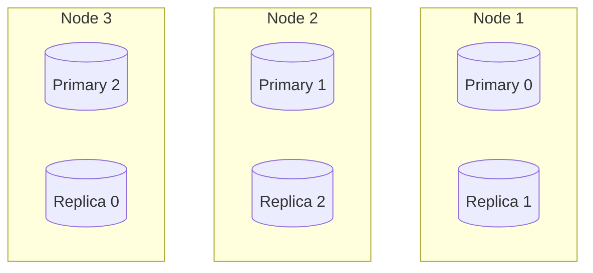
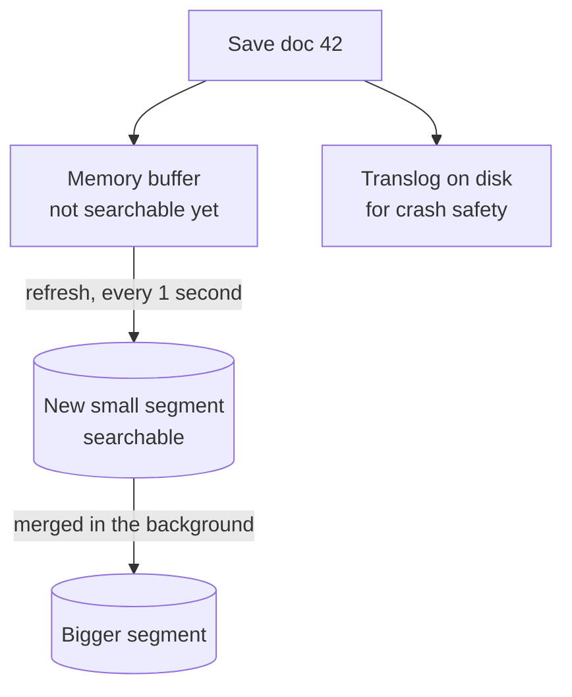
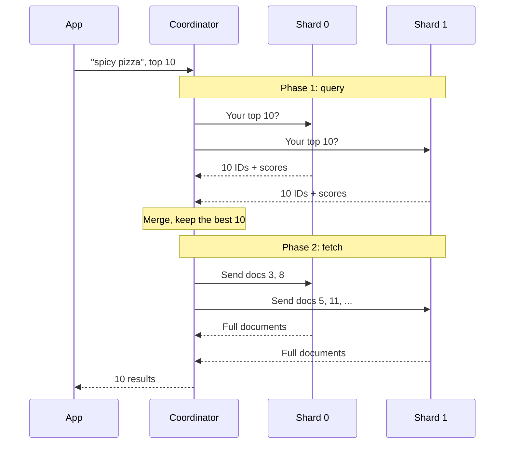
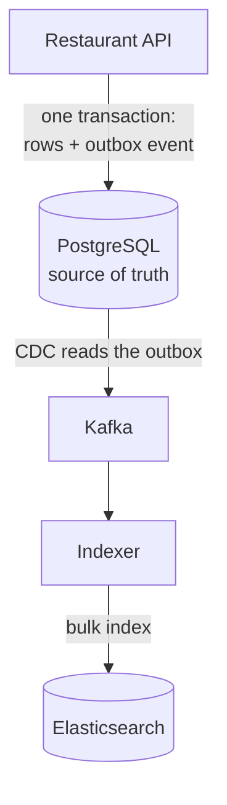
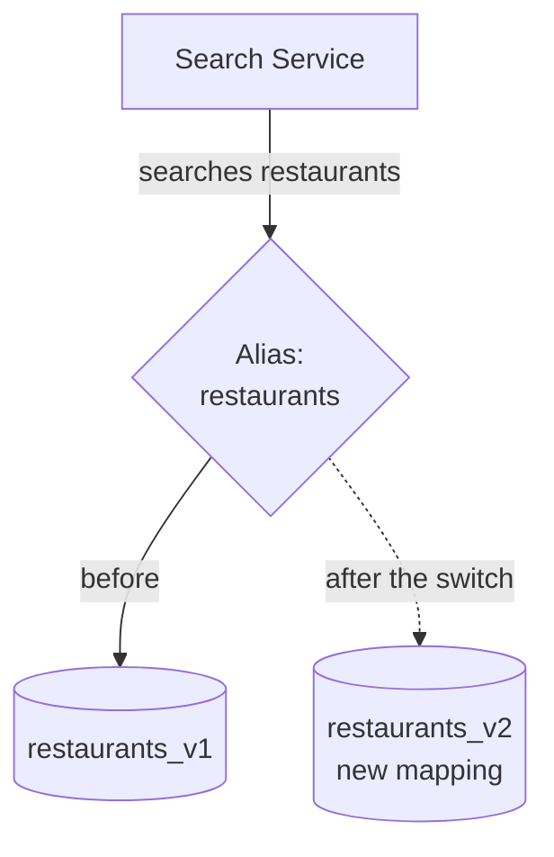

## The idea

Think of a big library with **five librarians**. Each one keeps the catalog for one part of the books. You give your question to the **head librarian**. She asks all five at once, each one sends back their best few books, and she hands you the best ten overall.

**Elasticsearch** works the same way. Your data is split into pieces called **shards**, spread over many machines. A search goes to **every shard**, and one machine merges the answers. Each shard finds words fast with an **inverted index**.

The basics (the inverted index, analyzers, ranking with BM25, and a first look at shards) are in [Search and Inverted Indexes](./search.mdx). This page goes one level deeper: how Elasticsearch stores, writes and searches data, and how to keep it in sync with your database.

Everything here works the same in **OpenSearch**, the open-source copy of Elasticsearch that AWS started.

## The inverted index, in one minute

For every word, the inverted index keeps a list of the documents that contain it: `pizza → docs 1, 2`. A search looks up each word and combines the lists, instead of reading every document. The full story is in [Search](./search.mdx).

Elasticsearch is built on **Apache Lucene**, a search library. Each shard is one Lucene index. Next to the inverted index, each shard also keeps:

- **The original JSON** of each document (called `_source`), so it can return it in results.
- **Column data** for each field (called **doc values**), used for **sorting** and **counting**.

## Mappings: text vs keyword

A **mapping** is the schema of an index: the type of each field. The most important choice is how to store words:

| Type | What happens | Use it for | Example query |
| --- | --- | --- | --- |
| `text` | Run through the analyzer: lowercased, split into words | Full-text search | "spicy pizza" finds "Spicy Pepperoni **Pizza**" |
| `keyword` | Stored as one exact value | Filters, sorting, counts | `cuisine = "italian"` |

Here is an index for a restaurant search, like Yelp:

```http
PUT /restaurants
Content-Type: application/json

{
  "settings": {
    "number_of_shards": 3,
    "number_of_replicas": 1
  },
  "mappings": {
    "properties": {
      "name":        { "type": "text" },
      "description": { "type": "text" },
      "cuisine":     { "type": "keyword" },
      "rating":      { "type": "float" },
      "location":    { "type": "geo_point" },
      "updated_at":  { "type": "date" }
    }
  }
}
```

- If you skip the mapping, Elasticsearch **guesses** the types from the first document. Set it yourself for the fields that matter.
- **You can add new fields later, but not change a field's type.** To change it, you build a new index and copy everything in (see the alias trick below).
- `geo_point` lets you search by distance: "pizza within 5 km". See [Geospatial Indexing](./geospatial-indexing.mdx).

## Nodes, shards and replicas

A **cluster** is a group of Elasticsearch servers, called **nodes**. An index is split into **primary shards**. Each primary has **replica** copies on other nodes.

Here is the `restaurants` index above, with 3 primary shards and 1 replica each, on 3 nodes:



- **A primary and its replica are never on the same node.** If Node 1 dies, Replica 0 on Node 3 becomes the new primary, and nothing is lost.
- **Replicas also answer searches.** More replicas = more searches per second. You can change the number of replicas at any time.
- **Each document lives in one shard.** Elasticsearch picks it from the document ID, roughly `hash(id) % number of primary shards`.
- **So the number of primary shards is hard to change.** Change it and every document would belong to a different shard. You choose it when you create the index. To change it later, you build a new index. (Kafka has the same problem with partitions, see [Kafka](../messaging/kafka.mdx).)

## Writing a document: why search is "near real time"

A new document is not searchable at once. Here is what happens when you save one:



1. The document goes to its **primary shard**. The primary adds it to a **buffer in memory**, and writes it to a log on disk called the **translog**, so a crash loses nothing.
2. The primary sends it to its **replicas**. When they have it too, you get "OK".
3. About **once a second**, a **refresh** turns the buffer into a new small **segment**: a piece of the inverted index. **Now** the document can be found by search.
4. Segments are **never changed** once written. In the background, small segments are **merged** into bigger ones. This is the same idea as the LSM tree in [Indexes](../databases/indexes.mdx).

What follows from this:

- **An update is a delete + a new document.** The old version is marked as deleted, and goes away at the next merge.
- **Get by ID is real time.** `GET /restaurants/_doc/42` sees the new version right away. Only **search** waits for the refresh.
- **Need to see your own write in search?** Add `?refresh=wait_for` to the save. The call waits until the next refresh before it answers. Use it for rare cases, like "show my new listing in my search results".
- **Loading millions of documents?** Use the `_bulk` API (many documents in one request), and refresh less often, like every 30 seconds, while it runs.

## How a search runs: query, then fetch

A search on `restaurants` goes to **one copy of every shard** (the primary or a replica). It happens in two phases:



1. **Query phase.** The node that got the request is the **coordinator**. It asks every shard for its own top 10. Each shard sends back only **IDs and scores**, which is small.
2. The coordinator merges the lists and keeps the **best 10 overall**.
3. **Fetch phase.** It asks for the **full documents** of just those 10, and returns them.

This is **scatter-gather**. Two things follow:

- **The slowest shard decides the speed.** If one shard is busy, the whole search waits.
- **Deep pages are costly.** Page 1,000 (results 9,991 to 10,000) means **every shard** must find and sort its top 10,000. So Elasticsearch stops plain paging at 10,000 results by default. For "next page" deep down, use `search_after`: pass the sort values of the last result, like a cursor. See [API Pagination](./api-pagination-versioning.mdx).

## Queries, filters and counts

A real search mixes **words** with **rules**. A **bool query** does both:

```http
GET /restaurants/_search
Content-Type: application/json

{
  "query": {
    "bool": {
      "must": [
        { "match": { "description": "spicy pizza" } }
      ],
      "filter": [
        { "range": { "rating": { "gte": 4 } } },
        { "geo_distance": {
            "distance": "5km",
            "location": { "lat": 40.73, "lon": -73.99 }
        } }
      ]
    }
  },
  "aggs": {
    "by_cuisine": { "terms": { "field": "cuisine" } }
  }
}
```

- **`must`** is for words. Matches get a **score**, and the best score comes first.
- **`filter`** is a plain yes or no: rating 4 or more, within 5 km. No score, so it is faster, and Elasticsearch can cache it. **Put every rule that is not about words in `filter`.**
- **`aggs`** (aggregations) **count** the results by a field: "Italian (120), Thai (45)". This builds the filter list on the side of a shopping or restaurant site. It uses the `keyword` field.

**Relevance, in one paragraph.** The score comes from **BM25**: a match is stronger when the word appears often in this document, is rare across all documents, and sits in a short field (details in [Search](./search.mdx)). Real products then mix in business signals, with a `function_score` query: boost places that are closer, newer, more popular or better rated. Getting the order right is often more work than finding the matches.

## Not the source of truth

Keep the real data in a database like PostgreSQL. Elasticsearch holds a **copy, shaped for searching**. Reasons:

- **No transactions across documents.** You can't change two documents and be sure both changes happen together.
- **No rules between records.** No foreign keys or unique checks across documents.
- **Search is a second behind** every write.
- **You will rebuild it.** Changing a field's type, or the analyzer, means building a new index. You need the full data somewhere else to fill it.

If Elasticsearch is lost, you rebuild it from the database. If the database is lost, Elasticsearch can't replace it.

## Keeping it in sync with the database

The ways to do it (dual write, CDC, nightly rebuild) are compared in [Search](./search.mdx). The usual answer is **CDC** (Change Data Capture): read every change from the database's log and send it through Kafka to an **indexer** that writes to Elasticsearch. See [Change Data Capture](../distributed-systems/change-data-capture.mdx).

When one search document is built from **several tables** (a restaurant, its tags and its city), use the **outbox**: in the same transaction as the change, save a `RestaurantChanged` event with everything the indexer needs. CDC reads only the outbox table. See [Outbox Pattern](../distributed-systems/outbox-pattern.mdx).



Make the indexer safe:

- **Use the database ID as the document ID.** Events can arrive twice. Saving document `42` again just overwrites it, so a repeat does no harm. See [Idempotency](../messaging/idempotency.mdx).
- **Don't let an old event win.** Events can arrive out of order. Send the row's version number with each save, and set `version_type=external`. Elasticsearch then rejects a save whose version is not higher than the one it already has. The indexer can safely skip that error.
- **Copy the data into one document.** Elasticsearch has no real joins, so put the city name and tags **inside** each restaurant document. The cost: when a city is renamed, many documents must be updated.
- **Handle deletes.** A delete in the database must become a delete in Elasticsearch.

**Rebuilding with no downtime: aliases.** An **alias** is a second name for an index. The app always searches `restaurants`, which is an alias:



1. Create `restaurants_v2` with the new mapping.
2. Fill it from the database, while the indexer writes new changes to **both** indexes.
3. Point the alias at `restaurants_v2`. This switch happens in **one step**, so searches never fail.
4. Delete `restaurants_v1`.

## When to use it in an interview

| Use Elasticsearch for | Don't use it for |
| --- | --- |
| A **search box**: free text, typos, best match first | The **main copy** of your data |
| **Filters and counts** on the side of results | **Looking up one item by ID**. Use the database or a cache |
| **Text plus distance**: "pizza near me" | Data that must be correct **right after** every write |
| **Autocomplete**, with its completion suggester (see [Search Autocomplete](../questions/search-autocomplete.mdx)) | **Transactions**, like money or stock counts |
| **Searching logs** from thousands of servers (see [Logging and Metrics](../questions/logging-metrics.mdx)) | A small app. PostgreSQL's own full-text search may be enough |

That last point is worth saying out loud. For a few million rows and simple search, PostgreSQL's full-text search (a `tsvector` column with a **GIN** index) avoids running a second system. Bring in Elasticsearch when you need better ranking, typo tolerance, facet counts, or more scale.

## In the real world

**It began as a recipe search.** Shay Banon started the project that led to Elasticsearch while building a recipe search app for his wife, who was learning to cook. The first version of Elasticsearch came out in 2010.

**The ELK stack for logs.** Elasticsearch is often used with **Logstash** (collects and cleans logs) and **Kibana** (charts and a search screen). Together they are called the **ELK stack**, and many companies use it to search their server logs.

**Stack Overflow's search.** Stack Overflow's engineers have written that its site search runs on Elasticsearch, next to its main SQL Server database: the same "database for truth, Elasticsearch for search" split.

## In the interview

Say where the truth lives, how the copy is fed, and how a search runs:

> "Restaurants live in PostgreSQL, the source of truth. Changes go through CDC and Kafka to an indexer, which writes to Elasticsearch using the restaurant ID as the document ID, so a replayed event just overwrites. The description is a text field for full-text search. Cuisine is a keyword, and location is a geo point. A search is a bool query: match on the words, filters for rating and distance, and an aggregation for the cuisine counts. Results can be about a second behind, which is fine. The detail page reads from PostgreSQL."

<Callout title="Remember this" type="success">
  - An index is split into **primary shards** (fixed when you create it) with **replicas** on other nodes.
  - **`text`** fields are analyzed for full-text search. **`keyword`** fields are exact, for filters, sorting and counts.
  - Search is **near real time**: a **refresh**, about once a second, makes new documents searchable. Get by ID is instant.
  - A search is **scatter-gather** in two phases: **query** (IDs and scores from every shard), then **fetch** (full documents for the winners). Deep pages are costly: use `search_after`.
  - Words go in **`must`** (scored). Everything else goes in **`filter`** (yes or no, cached).
  - It is **not the source of truth**. Feed it with **CDC or the outbox**, use the database ID as the document ID, and rebuild with an **alias** swap.
</Callout>
