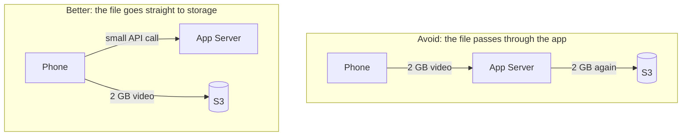
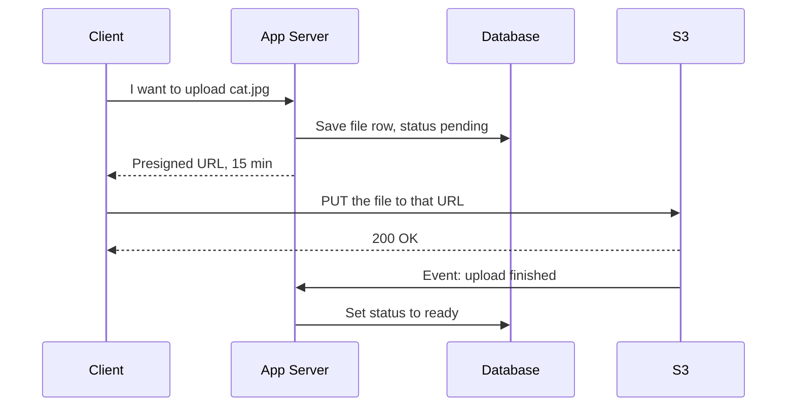
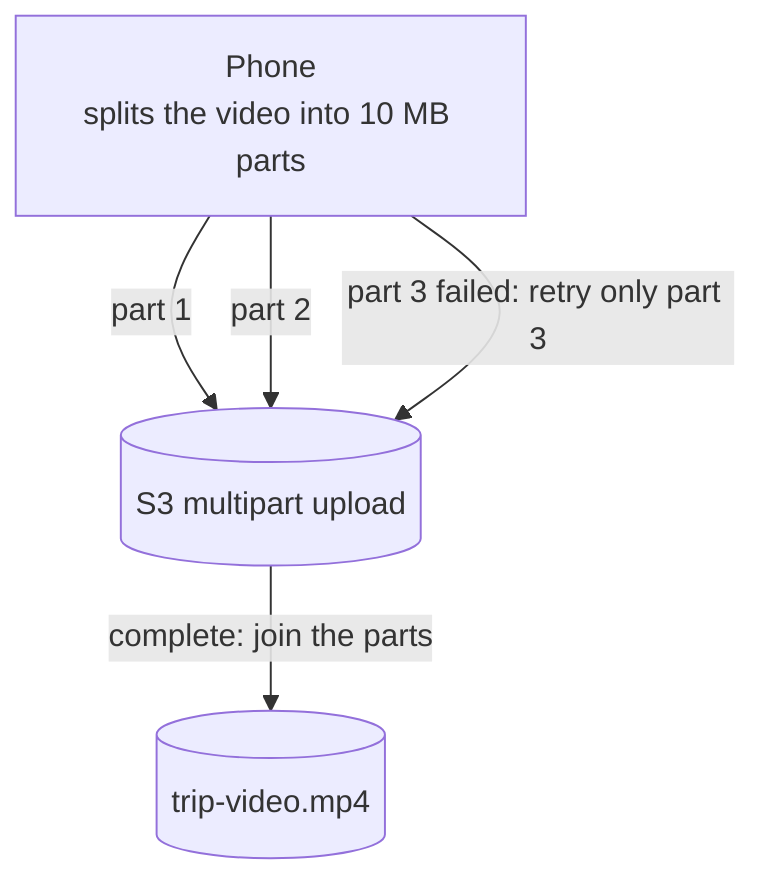
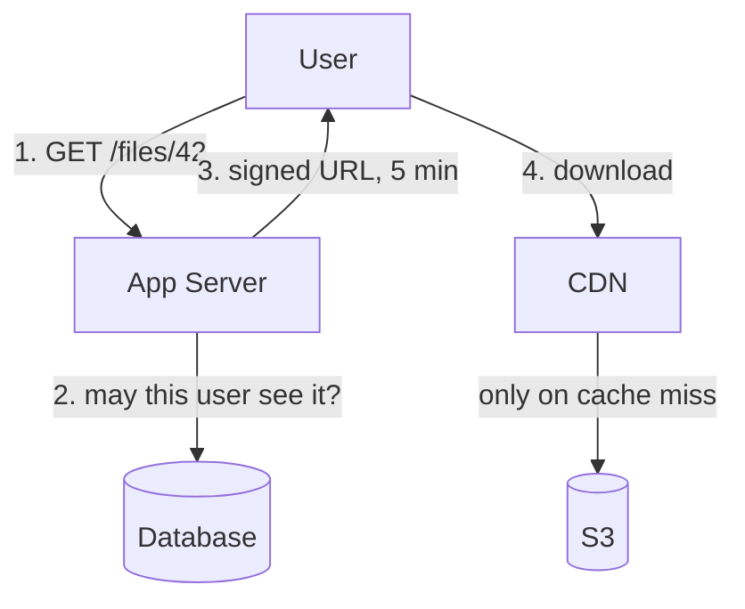

## The idea

Think of a **shop owner** who orders a huge sofa. She doesn't make the delivery truck drive through her small shop. She gives the driver a **short-lived pass** to the warehouse at the back: "Good for this one sofa, today only." The driver drops it off directly, and the shop keeps serving customers.

Big file uploads work the same way. Your app server is the small shop. It should **hand out a pass** (a **presigned URL**) and let the file go **straight to storage** like S3. It never carries the heavy bytes itself.

## Why files shouldn't go through your servers

If a 2 GB video goes `phone → app server → S3`:

- **It ties up the server.** App servers are built for many short API calls. One slow upload holds a connection and memory for minutes.
- **You move every byte twice:** once into your server, once out to S3. Double the network cost.
- **It hits limits.** Load balancers and gateways often cap request size and time. For example, AWS API Gateway rejects request bodies larger than 10 MB.
- **It breaks the "stateless server" idea.** Half-uploaded files sitting on one server's disk are lost if that server dies. See [Stateless vs Stateful Servers](../hld-basics/stateless-vs-stateful.mdx).



## Presigned URLs

A **presigned URL** is a normal S3 link with two extra things inside it: an **expiry time** and a **signature**. The app server makes the signature with its own secret key. It never sends the key itself.

Whoever holds the URL can do **exactly one thing** (like "upload one file to the key `uploads/42/a1b2.jpg`") until it **expires**. It is not single-use: it works again and again until then. After that, the URL is useless.

### The upload, step by step



1. The client asks your API for permission, and says the file name, type and size.
2. The app checks the user may upload, picks the S3 key, and saves a **metadata row** in the database with status `pending`.
3. The app signs a URL and returns it.
4. The client uploads the bytes **directly to S3**.
5. S3 sends an **event**, usually through a queue like SQS. (Or the client calls your API to say "done", but the event is more reliable.)
6. The app marks the file `ready`, and can start work like making thumbnails.

**Races and duplicates.** Two things can go wrong between these steps:

- **The S3 event can arrive twice.** So marking the file `ready` must be safe to repeat: if it is already `ready`, do nothing (see [Idempotency](../messaging/idempotency.mdx)).
- **The upload may never finish.** The client gives up, or the event is never handled, so the row stays `pending` forever. Run a **sweeper**, a small scheduled job, over old `pending` rows: if the object is in S3, mark it `ready`; if not, delete the row.

Making the URL takes a few lines:

```js
import { S3Client, PutObjectCommand } from "@aws-sdk/client-s3";
import { getSignedUrl } from "@aws-sdk/s3-request-presigner";

const s3 = new S3Client({ region: "ap-south-1" });

// The server picks the key, never the user
const key = `uploads/${userId}/${crypto.randomUUID()}.jpg`;

const url = await getSignedUrl(
  s3,
  new PutObjectCommand({ Bucket: "my-app-uploads", Key: key, ContentType: "image/jpeg" }),
  { expiresIn: 900 } // valid for 15 minutes
);
```

### Keeping it safe

- **Short expiry**, a few minutes.
- **The server picks the key.** Then a user can't overwrite someone else's file.
- **Limit size and type.** S3's presigned **POST** form lets you set a maximum file size.
- **The bucket stays private.** Nothing is public by default.
- **Check the file after upload** (real file type, virus scan) before you mark it `ready` and show it to anyone.

## Chunked and resumable uploads

A phone uploads a 2 GB video. At 1.9 GB, the train goes into a tunnel and the connection drops. Starting again from zero would be painful.

The fix is to **split the file into parts** (also called **chunks**), say 10 MB each:

- Each part is uploaded **on its own**, and several can go **at the same time**.
- If a part fails, **only that part** is sent again.
- If the app crashes, it asks which parts already arrived and **resumes** from there.
- At the end, storage **joins the parts** into one file.

S3 has this built in, called **multipart upload**:

1. **Start:** ask S3 for an **upload ID**.
2. **Upload parts:** each part gets its own presigned URL. S3 returns a receipt (an **ETag**) for each part.
3. **Complete:** send the list of parts. S3 joins them into one object.



Two more tricks:

- **Skip parts the server already has.** Hash each part. If a part with that hash is already stored, don't upload it again. S3 multipart upload can't do this for you: it needs your own **block store**, where each part is saved as its own object named by its hash, plus a list of which parts make up each file. This is how sync apps upload only the changed parts of a big file. See [Design Google Drive](../questions/google-drive.mdx).
- **Clean up.** Uploads that were started but never finished still take space. In S3, set a **lifecycle rule** that deletes unfinished multipart uploads after a few days.

## Downloads through a CDN

Downloads should also skip your app servers.

- **Public files** (product photos, public videos): put a **CDN** in front of S3. The CDN keeps copies in cities close to users, so downloads are fast and S3 is rarely touched. See [CDN and Edge Caching](../caching/cdn.mdx).
- **Private files** (your invoices, paid courses): the app first checks the user is allowed, then returns a **short-lived signed URL**, either an S3 presigned GET URL or a CDN signed URL.



**Range requests** let a client ask for **part** of a file. A video player uses this to jump to the middle of a film, and a download manager uses it to resume a broken download:

```http
GET /videos/trip.mp4 HTTP/1.1
Range: bytes=1048576-2097151

HTTP/1.1 206 Partial Content
Content-Range: bytes 1048576-2097151/52428800
```

`206 Partial Content` means "here is just the piece you asked for".

## In the real world

**S3 multipart limits.** In S3, each part can be **5 MB to 5 GB** (the last part can be smaller), one upload can have up to **10,000 parts**, so a single object can be up to **50 TB** (raised from 5 TB in December 2025). AWS suggests multipart upload for files over about 100 MB.

**YouTube supports resumable uploads.** The YouTube Data API has a resumable upload mode. If the connection drops, the client asks how much arrived and continues from there. Google Cloud Storage offers the same kind of resumable upload.

**Dropbox uploads in blocks.** Dropbox splits files into **4 MB blocks** and identifies each block by its hash. When you change part of a big file, only the changed blocks are uploaded.

## In the interview

Any question with photos, videos or documents (Instagram, YouTube, Google Drive, WhatsApp media) needs this:

> "The client asks my API for a presigned URL and uploads the video straight to S3, in parts, so it can resume after a dropped connection. S3 sends an event when the upload is done, and a worker starts processing. Downloads go through a CDN, with signed URLs for private files."

<Callout title="Remember this" type="success">
  - **Don't send big files through app servers.** It wastes them and hits size and time limits.
  - **Presigned URL** = a signed, short-lived link to upload or download **one** object directly from S3.
  - Save a **metadata row** (`pending`), upload, then mark it **ready** when S3's event arrives. A **sweeper** cleans up rows stuck in `pending`.
  - Big files: **multipart upload**. Parts in parallel, retry only failed parts, **resume** after a crash.
  - Downloads: **CDN** for public files, **signed URLs** for private ones, **range requests** to resume and seek.
</Callout>
