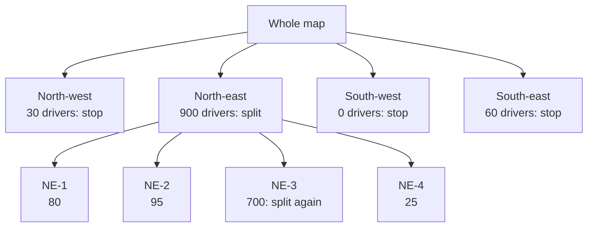
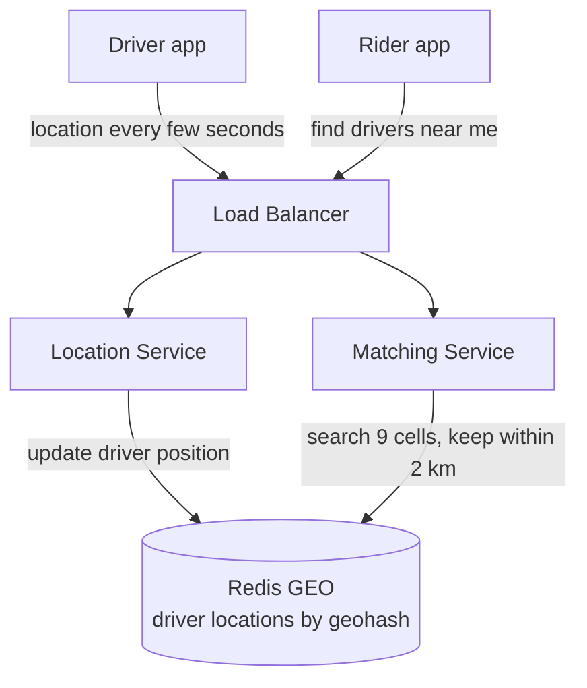

## What is it?

Think of a **paper city map** with a grid on it. Squares are named like "B4" or "C5". If you are standing in square B4 and want a café nearby, you don't search the whole city. You look in B4, and maybe in the squares right around it.

A **geospatial index** does the same for computers. It splits the map into named squares (called **cells**), so "what is near me?" becomes "what is in my square and the squares next to it?". That is a fast lookup instead of a scan of the whole world.

The example on this page: a rider opens a ride app and asks, **"which drivers are within 2 km of me?"**

## Why do we need it?

A location is two numbers: **latitude** (how far north or south) and **longitude** (how far east or west). The first idea is to store them as two columns and search a box around the rider:

```sql
SELECT id FROM drivers
WHERE lat BETWEEN 12.95 AND 12.99
  AND lng BETWEEN 77.57 AND 77.61;
```

A normal index (a **B-tree**, see [Indexes](../databases/indexes.mdx)) sorts by one value at a time. An index on `lat` quickly finds every driver in that latitude range. But that range is a **thin strip around the whole Earth**, passing through many cities. The database must then check `lng` for every driver in that strip.

What we really want is only the small square where the two strips cross. A normal index can't jump straight there. We need an index that understands **"close in both directions at once"**.

## How it works inside

### Geohash: turn a location into a short string

A **geohash** turns a latitude and longitude into a short string, like `tdr1v9`. It works like this:

1. Split the world map in half, left or right. Note which half the point is in.
2. Split that half in half, top or bottom. Note which one.
3. Keep splitting, switching between left/right and top/bottom.
4. Every 5 of these choices becomes **one character** of the string.

So **every extra character means a smaller square**:

| Geohash | Cell size, about | Covers |
| --- | --- | --- |
| `tdr1` | 39 km × 20 km | A big part of a city region |
| `tdr1v` | 4.9 km × 4.9 km | A few neighborhoods |
| `tdr1v9` | 1.2 km × 0.6 km | A few streets |
| `tdr1v9q` | 150 m × 150 m | One city block |

These are real cells for central Bengaluru (latitude 12.9716, longitude 77.5946).

**The key trick: places that share a prefix are in the same square.** Every driver whose geohash starts with `tdr1v9` is inside the same 1.2 km cell. And a prefix search works with a normal B-tree index:

```sql
-- Drivers in the same 1.2 km cell as the rider
SELECT id FROM drivers WHERE geohash LIKE 'tdr1v9%';
```

Unlike `LIKE '%pizza%'`, this pattern starts with fixed text, so the index can jump straight to it. Geohash turned a 2D problem into a 1D string, which every database already knows how to index.

#### The edge problem, and the 3×3 fix

A rider standing at the **edge** of their cell can have a driver 50 m away who is in the **next** cell, with a different geohash. So we never search just one cell. We search the rider's cell **plus the 8 cells around it**.

**Pick the cell size from the search radius.** The 3×3 block reaches only **one cell** past the rider's own cell. So each cell must be **at least as big as the search radius**. For 2 km, a 6-character cell (1.2 km × 0.6 km) is too small: a driver 1.5 km north could be two or three cells away, and we would miss them. A 5-character cell (about 4.9 km) is big enough.

For our rider, the 9 cells are:

| | West | Middle | East |
| --- | --- | --- | --- |
| **North** | `tdr4h` | `tdr4j` | `tdr4n` |
| **Middle** | `tdr1u` | **`tdr1v`** (rider is here) | `tdr1y` |
| **South** | `tdr1s` | `tdr1t` | `tdr1w` |

Notice that a neighbor can look quite different (`tdr1v` vs `tdr4j`). That is why we compute the 8 neighbor names, instead of only matching the prefix.

Together, these 9 cells cover about 15 km × 15 km, much more than a 2 km circle. So after the lookup, we **check the real distance** to each driver and drop anyone farther than 2 km.

### Quadtrees

Geohash cells all have the **same size** at each length. That is a problem when the map is uneven: one cell in the city center may hold 5,000 drivers, while a cell in the countryside holds none.

A **quadtree** fixes this. "Quad" means four.

- Start with the whole map as one square.
- If a square holds **too many points** (say, more than 100 drivers), split it into **4 smaller squares**.
- Keep splitting crowded squares. Leave empty or quiet squares alone.

So a busy city gets many tiny squares, and an empty desert stays one big square. Every square ends up with a manageable number of points.



| | Geohash | Quadtree |
| --- | --- | --- |
| **Cell size** | Fixed for each string length | Adapts to how crowded an area is |
| **Where it lives** | A string column in any database, or Redis | Usually a tree kept in memory by a service |
| **Updates** | Easy: compute a new string | Harder: squares may need to split or merge |
| **Good for** | Things that move a lot, like drivers | Places that rarely move, with very uneven density, like restaurants |

## Example: finding nearby drivers

1. Every driver's app sends its location **every few seconds**.
2. The **Location Service** stores it, keyed by geohash. Redis is a good fit, because locations change all the time and only the latest one matters.
3. When a rider asks for a car, the **Matching Service** looks up the rider's 5-character cell and the 8 cells around it. Each cell is about 4.9 km, so the whole 2 km circle is inside.
4. It computes the **real distance** to each driver found, drops anyone farther than 2 km, sorts the rest, and offers the ride to the closest ones.
5. If it finds too few drivers, it **widens** the search by using a shorter geohash (bigger cells).



## Tools

You almost never build this by hand. Name a tool:

**Redis GEO.** Built into Redis (see [Redis](../caching/redis.mdx)). It stores each point in a sorted set, using its geohash as the score.

```bash
# Add or update a driver (note: longitude first, then latitude)
GEOADD drivers 77.5946 12.9716 "driver:42"

# The 10 closest drivers within 2 km of the rider, nearest first
GEOSEARCH drivers FROMLONLAT 77.5950 12.9720 BYRADIUS 2 km ASC COUNT 10 WITHDIST
```

**PostGIS.** An extension that adds maps and locations to PostgreSQL. It uses a **GiST index**, which works like an **R-tree**: it groups nearby points into boxes, and those boxes into bigger boxes, so a search can skip whole areas at once.

```sql
-- location is a geography(Point, 4326) column, so distances are in meters
CREATE INDEX ON restaurants USING GIST (location);

-- Restaurants within 2,000 meters of the user
SELECT name
FROM restaurants
WHERE ST_DWithin(
  location,
  ST_SetSRID(ST_MakePoint(77.5946, 12.9716), 4326)::geography,
  2000
);
```

**Others:** Elasticsearch (`geo_point` fields with a `geo_distance` query) and MongoDB (`2dsphere` index) also support "near me" searches.

**Simple rule:** fast-moving things like drivers → **Redis GEO**. Places that rarely move, with other filters like "open now" and "rating above 4" → **PostGIS** or **Elasticsearch**.

## When to use it

- **"Near me" searches**: drivers near a rider, restaurants near a user, people nearby in a dating app.
- **Nearest K**: the 10 closest couriers to a store.
- **Grouping by area**: count riders and drivers per cell to set surge prices.

**Don't use it when:**

- You only filter by a **named area** (city, zip code). A plain column with a normal index is enough.
- There are only a **few thousand points**. Compute the distance to each one in memory.
- You need **travel time**, not straight-line distance. A river or a one-way street changes everything. Use the index to find candidates, then a routing service for the real time.

## Alternatives

| Option | What it is | Pick it when |
| --- | --- | --- |
| **Two columns and a box** | `lat` and `lng` columns with a normal index, searched with a box | Small tables, where a slower query is fine |
| **A named-area column** | Store the city or zip code, and filter on it | "Restaurants in Bengaluru" is good enough, no real distance needed |
| **Scan in memory** | Keep every point in a list and compute each distance | A few thousand points |
| **H3 or S2 cells** | Libraries that give every cell an ID, like geohash, with hexagons (H3) or cells on a sphere (S2) | Analytics and pricing by area, where cells of a more even shape and size help |

## In the real world

**Uber built H3.** Uber created **H3**, a grid that covers the Earth with **hexagons** instead of squares, and made it open source in 2018. With hexagons, all 6 neighbors are the same distance from the center, which makes "nearby" math simpler. Uber uses it to split cities into areas for things like pricing and analysis.

**Google's S2.** Google made the **S2** library open source. It divides the Earth (as a sphere, not a flat map) into cells, with the same idea: every cell has an ID, and nearby places have nearby IDs.

**Redis uses geohash inside.** The Redis GEO commands store each location's geohash as the score of a sorted set. That is how a radius search can be fast.

## In the interview

Bring this up in any "near me" question: ride hailing, food delivery, "restaurants near you", dating apps.

> "Drivers send their location every few seconds. I'll keep them in Redis GEO, which indexes by geohash. To find drivers within 2 km, I use 5-character cells, which are bigger than the radius. I search the rider's cell and the 8 cells around it, drop anyone farther than 2 km, and sort the rest by real distance. If there are too few, I widen the search."

<Callout title="Remember this" type="success">
  - **Why:** a normal index sorts one value. A location has **two**, so it can't find "near me" fast.
  - **Geohash** turns a location into a string. **Longer = smaller square. Same prefix = same square.**
  - Pick a cell **at least as big as the search radius** (5 characters for 2 km). Search **your cell + its 8 neighbors**, then filter and sort by real distance.
  - **Quadtree** splits crowded squares into 4. Good for **uneven density**.
  - Tools: **Redis GEO** for moving drivers, **PostGIS** or **Elasticsearch** for places.
  - Uber uses hexagons (**H3**). Google uses **S2** cells.
  - **Alternatives:** two columns and a box (small tables), a city or zip column, a scan in memory (few points), H3 or S2.
</Callout>
