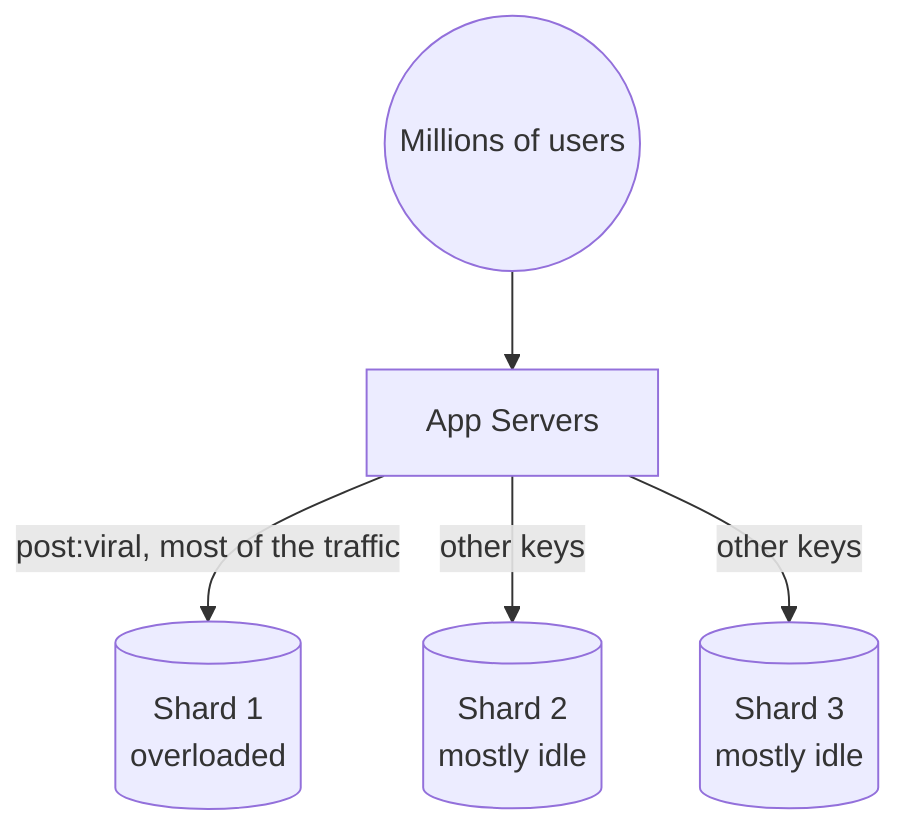
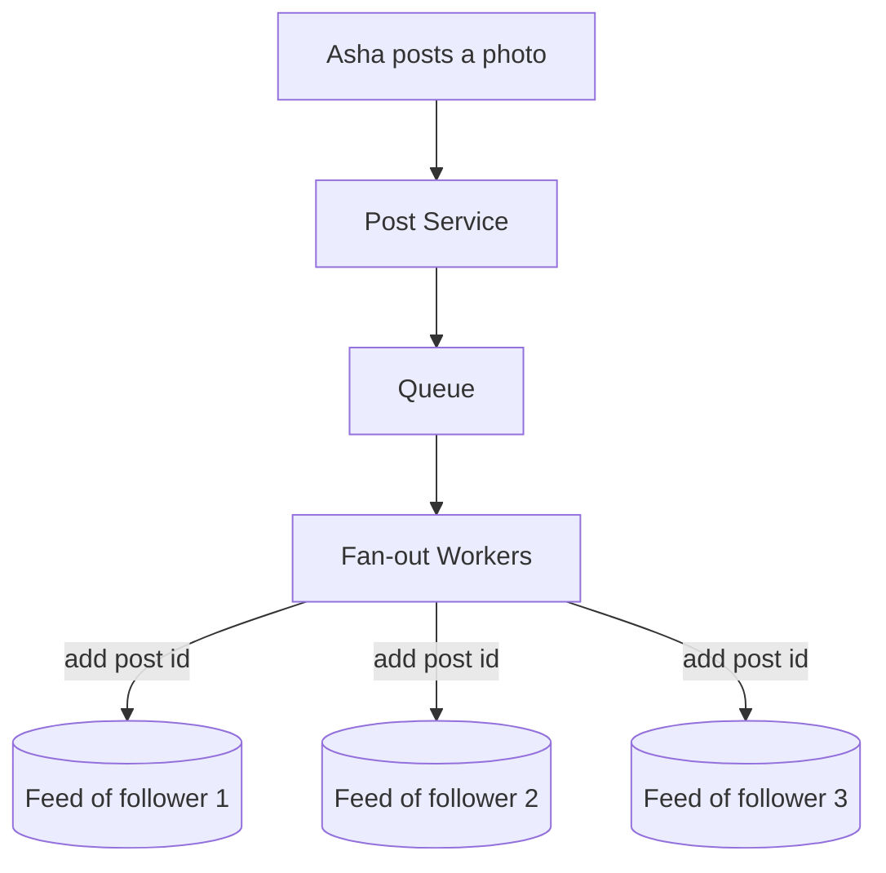
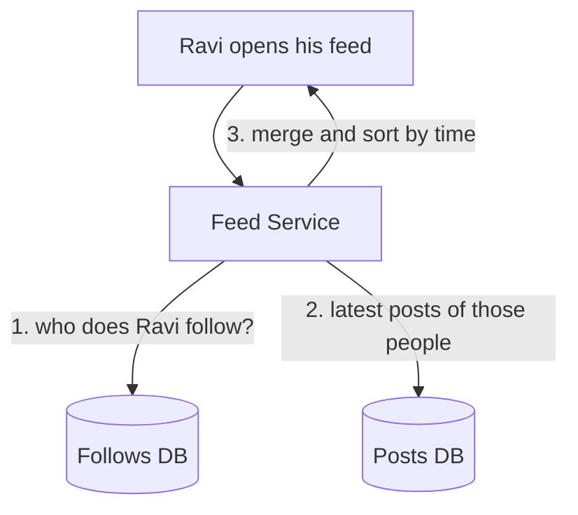
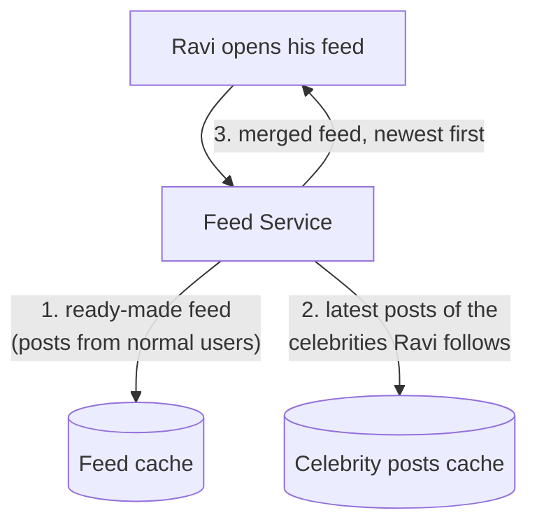

## What is it?

Picture a supermarket with **10 checkout counters**. A famous film star is working at counter 3 for one day. Everyone queues at counter 3. The other 9 counters stand empty. Opening more counters doesn't help, because nobody wants to use them.

That is a **hot key**. You spread your data across many machines to share the load. But if one item gets most of the traffic, **one machine does all the work** and the rest sit idle.

**Fan-out** is the other side of popularity. When someone with many followers posts, that one post must reach **millions of feeds**. Like a newspaper that has to be delivered to every subscriber's door.

## Why do we need it?

We split data across many machines so that each one carries a **fair share** of the load (see [Partitioning and Sharding](../databases/partitioning-sharding.mdx)). That plan assumes traffic is spread out. Real traffic is not:

- **Popularity is very uneven.** A few posts, products or accounts get most of the views. One viral post can get more traffic than millions of normal posts together.
- **Adding machines doesn't help.** Each key lives on **one** machine. Add ten more machines, and the hot key still sits on one of them.
- **Popular people make writes explode.** One post from an account with 100 million followers can mean 100 million feed updates.

If you don't plan for this, one machine is overloaded and slows down or fails. Everyone whose data sits on it suffers too, even though the system as a whole has plenty of spare capacity.

## How it works inside

### Hot keys and hot partitions

Big databases and caches split data across machines by key (see [Partitioning and Sharding](../databases/partitioning-sharding.mdx)). Hashing spreads the **keys** evenly. But it does not spread the **traffic** evenly.

- A **hot key** is one key that gets far more requests than others: a viral post, a celebrity's profile, a flash-sale product, the ticket page for a World Cup final.
- A **hot partition** (or **hot shard**) is the machine that holds that key. It gets overloaded while the others are quiet.



A **bad shard key** causes the same problem for writes. If you shard by **date**, every write today goes to the one shard that holds today. Pick keys that spread new writes out, like a user ID.

### Spotting hot keys

You can't fix a hot key until you know which key it is. Ways to find it:

- **Compare the machines.** If one shard's CPU, network or request count is far above the others, it probably holds a hot key. Look at each shard on its own: an average over all shards hides the one that is on fire.
- **Count requests per key.** The app, or a proxy in front of the cache, counts how often each key is asked for and keeps a short "top 10" list. At high traffic, count only a sample of requests, or use a **Count-Min Sketch** to save memory (see [Bloom Filter, HyperLogLog, Count-Min Sketch](./probabilistic-data-structures.mdx)).
- **Use the database's own tools.** Redis can list its busiest keys with `redis-cli --hotkeys` (this needs an **LFU** eviction policy, like `allkeys-lfu`: when memory is full, Redis removes the least-often-used keys). DynamoDB's **CloudWatch Contributor Insights** shows the most used and most throttled keys. Google Bigtable's **Key Visualizer** draws a heat map of which keys get the traffic.
- **Expect the obvious ones.** Some hot keys are easy to predict: the flash-sale product, the World Cup final page, an account with millions of followers. Prepare for them before the traffic arrives.

### Fixes for hot keys

**When the hot key is read a lot:**

- **Cache it**, and also keep a copy **inside each app server's memory** for a few seconds. Then most requests never even reach Redis. More on this in [Cache Problems](../caching/cache-problems.mdx).
- **Make copies of the key.** Store the same value as `post:123:copy1` ... `post:123:copy10`. Each name is hashed on its own, so the copies usually land on several different machines (not always, so check). Each reader picks one copy at random. When the value changes, update or delete **every** copy.
- **Use a CDN** for anything public, like images and public pages (see [CDN](../caching/cdn.mdx)).
- **Combine identical requests.** If 1,000 requests ask for the same missing key at once, send **one** to the database and give the answer to all 1,000.

**When the hot key is written a lot** (like the like-counter of a viral post):

- **Split the counter.** Keep 10 small counters instead of one. Each write adds 1 to a random one. To read, add all 10 together.
- **Buffer and batch.** Count likes in memory for a second, then write "+500" once, instead of 500 separate writes.

**Write:** add 1 to one of the 10 sub-counters, picked at random.

```js
const COUNTER_COUNT = 10;

async function addLike() {
    // A random number from 0 to 9
    const counterNumber = Math.floor(Math.random() * COUNTER_COUNT);

    await redis.incr(`likes:post123:${counterNumber}`);
}
```

**Read:** ask for all 10 sub-counters at the same time, then add them up.

```js
async function countLikes() {
    // Start all 10 reads without waiting for each one
    const requests = [];

    for (let i = 0; i < COUNTER_COUNT; i++) {
        const request = redis.get(`likes:post123:${i}`);
        requests.push(request);
    }

    // Promise.all waits until all 10 answers are back
    const values = await Promise.all(requests);

    // A sub-counter that was never written comes back as null: skip it
    let total = 0;

    for (const value of values) {
        if (value !== null) {
            total = total + Number(value);
        }
    }

    return total;
}
```

The 10 sub-keys usually land on different machines, so the writes are shared. Reads get a little more costly, which is fine when writes are the problem.

### Fan-out: one post, many feeds

When a user posts, all their followers should see it in their **home feed**. There are two ways to do this.

#### Fan-out on write (push)

**When the post is created**, copy its ID into the feed list of **every follower**, right away. Reading a feed is then one quick lookup of a ready-made list.

Like a newspaper delivered to every subscriber's door each morning.



#### Fan-out on read (pull)

**Store the post once.** When a user opens their feed, look up who they follow, fetch everyone's latest posts, then merge and sort them.

Like walking to the newsstand and picking up each paper yourself.



#### Side by side

| | Fan-out on write (push) | Fan-out on read (pull) |
| --- | --- | --- |
| **Posting** | Slow and heavy: one write per follower | Fast: one write |
| **Reading a feed** | Very fast: the list is ready | Slow: many lookups, then merge |
| **Wasted work** | Feeds of inactive users get filled too | None |
| **Best for** | Users with a normal number of followers | Accounts with huge numbers of followers |

Most apps have far more reads than writes, so **push is usually the default**. But it has one big weakness.

### The celebrity problem

Imagine an account with **100 million followers**. With fan-out on write, one post means **100 million feed writes**. That takes a long time, keeps the workers busy for everyone else, and followers at the end of the line see the post late.

The fix is a **hybrid**:

- **Normal users** → fan-out on write. Their posts are pushed into followers' feeds.
- **Celebrities** (accounts above a follower limit you choose) → **not** pushed. Their posts are stored once.
- When you open your feed, the Feed Service takes your **ready-made feed** and **merges in** recent posts from the few celebrities you follow.



Celebrity posts are now read by millions of people. That makes them **hot keys**, so they get the read fixes from above: caching, copies and in-memory caches. See [Design a News Feed](../questions/news-feed.mdx) for the full design.

## When to use which

| Situation | Use |
| --- | --- |
| One key is **read** a lot | A cache, a short copy in each app server's memory, key copies. A CDN if it is public |
| One key is **written** a lot | A split counter, or buffer and batch the writes |
| A feed, most users have a normal number of followers | **Fan-out on write** (push) |
| Some accounts have millions of followers | **Hybrid**: push for normal users, pull for celebrities |
| Few people read feeds, or follow lists change a lot | **Fan-out on read** (pull) |

**Don't use these fixes when:**

- The key is **not actually hot**. Key copies and split counters make reads and updates harder. Use them only for keys you measured or can predict.
- The followers are **inactive** (for push). Filling feeds for users who never come back wastes work. You can skip them, and build their feed on read when they return.

## Alternatives

| Option | What it is | Pick it when |
| --- | --- | --- |
| **A bigger machine for the hot shard** | Give just that node more CPU and memory | A short spike you can predict, like a sale. It buys time, it doesn't fix the cause |
| **Limit or queue the hot item** | Let only so many requests per second reach it. The rest wait in a queue or get "try again" | Ticket drops and flash sales. See [Rate Limiting](../reliability-security/rate-limiting.mdx) and [Dealing with Contention](../distributed-systems/dealing-with-contention.mdx) |
| **Let the service split it** | DynamoDB and Bigtable move or split busy partitions on their own | You already use them. One single item still can't go past one partition's limit |
| **Precompute the answer** | Build the hot result once (the World Cup page, the top posts) and serve it as a file | The content is the same for everyone |

## In the real world

**Twitter used the hybrid model.** In talks about how Twitter's timelines worked (around 2012 and 2013), Twitter engineers explained that each user's home timeline was kept as a list in **Redis**. A new tweet was pushed into the timelines of the author's followers. For accounts with a very large number of followers, the tweets were not pushed. They were merged into the timeline when it was read.

**DynamoDB recommends splitting hot keys.** AWS's DynamoDB guide suggests adding a random or calculated **suffix** to a partition key, like `2024-06-01.7`, so writes for one busy key are spread over several partitions. This is the same idea as the split counter.

## In the interview

In any feed, social or "popular item" question, say the word **"hot key"** before the interviewer does:

> "Most users get fan-out on write, so feeds load fast. Celebrities with millions of followers are not fanned out. Their posts are merged in when a feed is read, and cached heavily, because they are hot keys."

<Callout title="Remember this" type="success">
  - **Why:** sharding spreads **keys**, not **traffic**. One popular key lives on one machine, and adding machines doesn't move it.
  - **Hot key** = one key with far more traffic. **Hot partition** = the one machine holding it.
  - Spot them by comparing shards, counting requests per key, or the database's own tools (like `redis-cli --hotkeys`).
  - Read fixes: **cache, in-memory copy, key copies, CDN, combine identical requests**.
  - Write fixes: **split the counter** into sub-keys, **buffer and batch** writes.
  - **Fan-out on write** (push): fast reads, heavy posting. **Fan-out on read** (pull): cheap posting, slow reads.
  - **Celebrity problem:** pushing to millions of feeds is too slow. Use a **hybrid**: push for normal users, pull for celebrities.
  - **Alternatives:** a bigger machine (buys time), limit or queue the hot item, let DynamoDB or Bigtable split it, precompute the answer.
</Callout>
