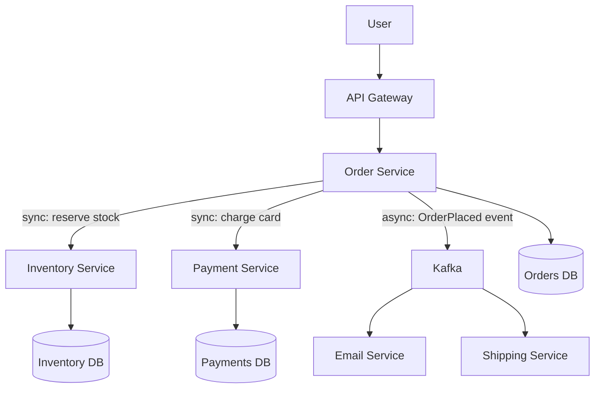
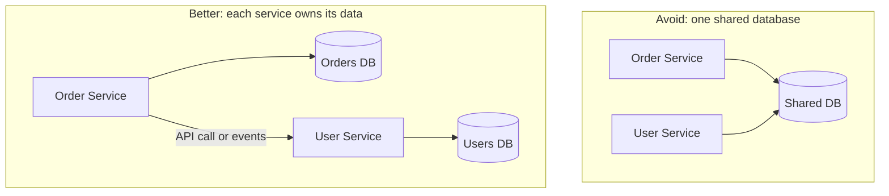

## The idea

Think of a **big restaurant kitchen** split into stations: grill, salads, desserts. Each station has **its own cook, its own fridge and its own job**.

- When the grill cook needs an answer right now ("are there any buns left?"), they **ask and wait**. That is a **synchronous** call.
- When they just need to tell others something ("table 5's burger is out"), they **put a slip on the rail** and keep working. That is an **asynchronous** message.
- And nobody walks into another station's fridge and moves things around. Each station **owns its own food**.

Microservices work the same way. Whether to use them at all is covered in [Monolith vs Microservices](../hld-basics/monolith-vs-microservices.mdx). This page is about **doing it well**: how services talk, where to draw the lines, and who owns which data.

## Sync vs async calls between services

| | Synchronous (sync) | Asynchronous (async) |
| --- | --- | --- |
| **How** | REST or gRPC call. The caller **waits** for the answer | Send an event or message to a queue (like Kafka). The sender **moves on** |
| **Good** | Simple. You get the answer right away | Services don't depend on each other being up. Absorbs spikes |
| **Bad** | If the other service is slow or down, so are you | The result comes later (eventual consistency). Harder to debug |
| **Use when** | You **need the answer** to continue | You are **telling others something happened** |

**The danger of long sync chains.** If Order calls Inventory, which calls Pricing, which calls Promotions, then any slow link makes the whole request slow. Uptime also multiplies: if each of 3 services is up 99.9% of the time, a request that needs all 3 works only about **99.7%** of the time (0.999 × 0.999 × 0.999).

A typical checkout uses **both**:

Checkout **must know** that stock is reserved and the card is charged, so those are sync. The email and the shipping label can happen a few seconds later, so those are async.

Protect every sync call with a **timeout**, a few **retries**, and a **circuit breaker** (see [Circuit Breaker](../reliability-security/circuit-breaker.mdx)). More on the two styles: [Sync vs Async Communication](../messaging/sync-vs-async.mdx) and [Event-Driven Architecture](../messaging/event-driven-architecture.mdx).

## How to split a system into services

**Split by business area, not by technical layer.** Ask "what does the business do?": take orders, take payments, manage the catalog, ship packages. Each answer is a candidate service.

| Good split (by business area) | Bad split (by technical layer) |
| --- | --- |
| Orders, Payments, Catalog, Shipping, Users | Frontend service, Business logic service, Database service |
| Adding "gift wrap" changes mostly Orders | Adding "gift wrap" changes all three services |

**Each area has its own meaning of a word.** To the **Catalog** service, a "product" is a name, photos and a description. To the **Shipping** service, a "product" is a weight and a box size. That is fine, and even good. Each service keeps **its own model**, with only the fields it needs. In Domain-Driven Design, this area with its own meaning of words is called a **bounded context**.

**Signs of a good boundary:**

- One team can change and **deploy the service on its own**.
- Most new features touch **one** service.
- One user request needs **few** calls between services.

**Services follow teams.** **Conway's law** says that a system ends up shaped like the teams that build it. So give each service **one owning team**, and draw service lines where team lines are.

**Split out a piece only for a real reason:** it needs to scale differently (video encoding), a separate team owns it, it changes at a different speed, or it needs stricter security (payments).

## Each service owns its data

**Only the owning service reads and writes its database.** Other services must ask it through its API, or listen to its events. No one else connects to its tables.

Why it matters: with a shared database, the User team can't rename a column without breaking Orders, and one service's slow query slows down everyone. The services are separate in name only.

**"But I need data from another service."** Three ways:

1. **Ask for it:** call the other service's API when you need it.
2. **Keep a local copy:** listen to `UserUpdated` events and store only the fields you need. The Order service keeps the customer's name and address on the order itself. Copying data like this is **normal** in microservices.
3. **Build a read model:** a separate store that combines data from many services, just for reading. See [CQRS](../distributed-systems/cqrs.mdx).

**"But I need a transaction across services."** You can't wrap two databases in one normal transaction. Use a **saga**: a chain of local steps, where each step has an "undo" step if a later one fails. See [Saga Pattern](../distributed-systems/saga-pattern.mdx). To save data and publish its event safely together, use the [Outbox Pattern](../distributed-systems/outbox-pattern.mdx).

## Common mistakes

| Mistake | What it looks like | Fix |
| --- | --- | --- |
| **Distributed monolith** | Services must be deployed together, or share one database | Own your data. Talk through stable APIs and events |
| **Too small** | One service per function. Dozens of network calls per request | Merge services that always change together |
| **Chatty calls** | One page load makes 30 calls in a row | Batch APIs, local copies of data, or merge services |
| **Long sync chains** | A calls B calls C calls D. One down means all down | Go async where you don't need the answer |
| **Splitting too early** | A team of 5 people running 20 services | Start with a well-organized monolith. Split when there is a reason |
| **No tracing** | Nobody can follow a request across 10 services | Pass a request ID everywhere and use distributed tracing. See [Observability](../production/observability.mdx) |

## In the real world

**Netflix moved to microservices after a database failure.** In 2008, a major database corruption stopped Netflix from shipping DVDs for three days. Netflix then moved from one big app in its own data center to many small services on AWS, finishing the move in 2016.

**Amazon uses "two-pizza teams".** Amazon is known for small teams, small enough to be fed by two pizzas, each owning its own services from end to end.

**Segment went back to a monolith.** In 2018, Segment wrote a well-known post called "Goodbye Microservices". It had one service per outside integration, and the many small services became too hard to run and keep up to date. It merged them back into one service, which its engineers found much easier to work with.

**Amazon Prime Video merged a service.** In 2023, the Prime Video team wrote that its video quality monitoring tool, built from many small serverless pieces, moved into a **single process**. This cut the tool's infrastructure cost by **over 90%**.

## In the interview

Draw services by business area, give each its own database, and label each arrow as sync or async:

> "I'll split by business area: orders, payments, inventory and notifications, each with its own database. Checkout calls inventory and payments synchronously, because it needs the answer. Then it publishes an OrderPlaced event, and email and shipping react to it asynchronously."

<Callout title="Remember this" type="success">
  - **Sync** when you need the answer now. **Async** (events) to tell others something happened.
  - Long sync chains are slow and fragile. Use **timeouts, retries and circuit breakers**.
  - **Split by business area**, not by technical layer. One team owns each service.
  - **Each service owns its data.** No shared database. Copying some data is normal.
  - Cross-service transactions: **saga** + **outbox**.
  - Watch for the **distributed monolith**, too-small services and chatty calls.
</Callout>
