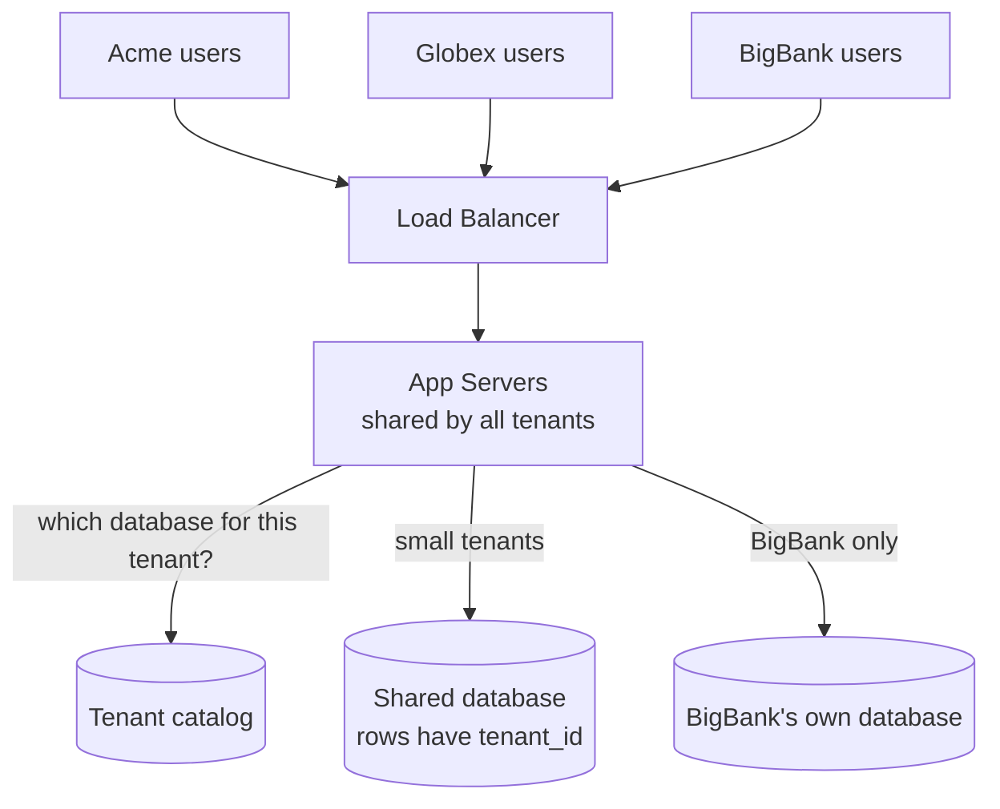

## The idea

Think of an **apartment building**. Many families live there. They share the walls, the water pipes and the lift, which keeps rent low. But each family has its **own locked flat**, and no one can walk into another family's home. If one neighbor plays loud music at night, though, everyone hears it.

The other choice is for every family to have its **own house**. Very private, nobody hears the neighbors, but far more expensive.

A **multi-tenant** system is the apartment building. One running system, with the same code and the same servers, serves **many customer companies**. Each customer is a **tenant**. They share the machines, but each must only ever see **their own data**.

## What a tenant is

A **tenant** is one customer **organization** using your product, with all of its users.

- On **Slack**, each company workspace is a tenant.
- On **Shopify**, each shop is a tenant.
- On a school app, each school is a tenant.

This is normal for **SaaS** products (Software as a Service: software you rent online instead of installing). The opposite is **single-tenant**: a separate copy of the whole system for each customer.

The one rule that must never break: **tenant A must never see tenant B's data.**

## Three ways to store tenant data

| | Shared tables | Schema per tenant | Database per tenant |
| --- | --- | --- | --- |
| **How** | One set of tables. Every row has a `tenant_id` column | Each tenant gets its own copy of the tables, like `acme.orders` | Each tenant gets a whole database of its own |
| **Keeping data apart** | Weakest: one missing filter leaks data | Medium | Strongest |
| **Cost** | Cheapest | Medium | Highest |
| **Schema changes** | Run once | Run once per tenant | Run once per tenant |
| **Noisy neighbors** | Most affected | Some | Least |
| **Good for** | Many small customers | Hundreds of medium customers | Few big customers, strict rules (banks, hospitals) |

AWS calls these the **pool** model (shared), the **silo** model (separate) and the **bridge** model (in between).

**Most real systems mix them.** Small tenants share a database. The biggest tenants, or those with strict legal rules, get their own. A small **tenant catalog** table says where each tenant's data lives:



## Keeping data apart

The worst bug in a multi-tenant system is showing one company's invoices to another company. Layers of protection:

**1. Take the tenant from the login, never from the request.** The tenant ID comes from the user's verified token or session. Never trust a `tenant_id` sent in the URL or the request body, because a user can change it.

**2. Filter every query by tenant.** Every query needs `WHERE tenant_id = ...`. Don't rely on each developer remembering it. Put the filter in **one shared data-access layer** that adds it automatically.

**3. Let the database enforce it.** PostgreSQL has **Row-Level Security (RLS)**: a rule on the table that hides other tenants' rows, even if the app forgets the filter.

```sql
ALTER TABLE invoices ENABLE ROW LEVEL SECURITY;

-- Only rows of the current tenant are visible
CREATE POLICY tenant_isolation ON invoices
  USING (tenant_id = current_setting('app.tenant_id'));

-- For each request, the app opens a transaction and sets the tenant first...
BEGIN;
SET LOCAL app.tenant_id = 'acme';
-- ...then even a query with no filter only sees Acme's rows
SELECT * FROM invoices;
COMMIT;
```

Use `SET LOCAL`, not plain `SET`. `SET LOCAL` lasts only until the transaction ends. A plain `SET` stays on the connection, and with a connection pool the next request, maybe for Globex, could get that same connection with Acme's tenant still set.

The app must connect as a normal database user. Superusers and (by default) the table's owner skip these rules.

**4. Tenant ID everywhere, not just the database.** Put it in **cache keys** (`acme:user:42`), **file paths** in S3 (`acme/invoices/...`), **search indexes** and **logs**. A cache key without the tenant is a classic way to leak data: Acme's dashboard gets cached as `dashboard:home`, and Globex sees it.

**5. Test it.** Write tests that log in as tenant A and try to read tenant B's data.

## Noisy neighbors

A **noisy neighbor** is a tenant that uses so much of the shared system that everyone else slows down. One customer imports 50 million rows, or their app has a traffic spike, and every other tenant's pages get slow.

Fixes:

- **Per-tenant limits.** Rate limits and quotas per tenant, not just per user. See [Rate Limiting](../reliability-security/rate-limiting.mdx).
- **Fair queues.** Give each tenant a fair share of the background workers, so one tenant's million jobs can't block everyone else's ten.
- **Measure per tenant.** Tag metrics with the tenant ID, so you can see **who** is causing the load.
- **Move big tenants out.** Put your largest customers on their own shard or database. See [Partitioning and Sharding](../databases/partitioning-sharding.mdx).
- **Keep pools separate.** Separate worker pools or connection pools for big tenants, so a problem stays in one place. See [Bulkhead Pattern](../reliability-security/bulkhead.mdx).

**Shard by tenant.** When the shared database grows too big, split it by `tenant_id`. Then all of one tenant's data sits on one shard, and most queries touch only one machine.

## In the real world

**Salesforce is the classic example.** Salesforce has described its multi-tenant design in detail: all customers share the same database tables, and every row carries an **organization ID** that says which customer it belongs to. Every query is filtered by that ID.

**AWS gives the models names.** AWS's guidance for building SaaS uses the words **silo**, **pool** and **bridge** for "separate", "shared" and "mixed" tenant setups.

**Citus shards Postgres by tenant.** Citus, a tool that spreads PostgreSQL across many machines, recommends using `tenant_id` as the shard key for multi-tenant apps, so each tenant's data stays together on one machine.

**Slack outgrew sharding by workspace.** Slack first split its MySQL data by workspace, with all of a company's data on one shard. As some workspaces grew very large, their shards became hot spots. This was one reason Slack moved to **Vitess**, which let it split data in other ways, such as by channel.

## In the interview

Bring this up in any **B2B** question (a product sold to companies), like a CRM, a team chat tool or an online store builder:

> "This is a B2B product, so I'll use a shared database with a `tenant_id` on every table, taken from the login token, and Row-Level Security as a safety net. Each tenant has its own rate limits, and our biggest customers can move to their own database."

<Callout title="Remember this" type="success">
  - **Tenant** = one customer organization. **Multi-tenant** = one system serves all of them.
  - Three models: **shared tables** (`tenant_id`, cheapest), **schema per tenant**, **database per tenant** (safest, costliest). Most systems **mix** them.
  - Take the tenant ID from the **login token**, never from the request.
  - Protect in layers: shared query filter, **Row-Level Security**, tenant ID in **cache keys and file paths**.
  - **Noisy neighbors:** per-tenant rate limits, fair queues, move big tenants to their **own shard**.
</Callout>
