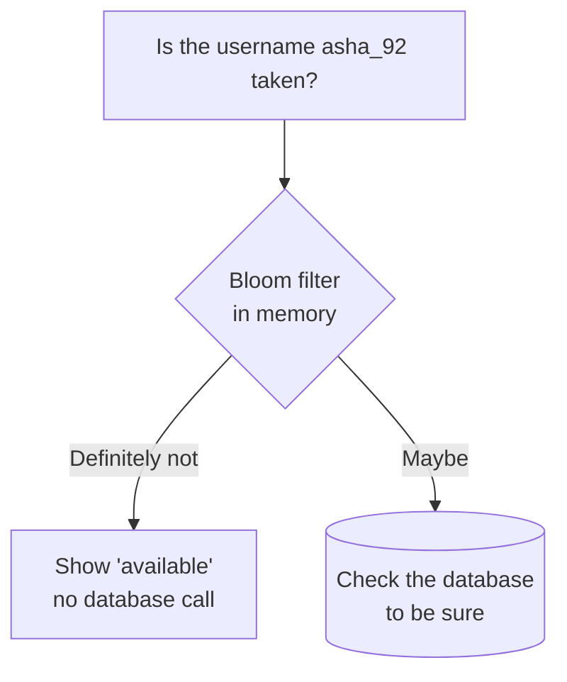

## What is it?

Think of a **bouncer at a big party** who has a fuzzy memory for faces. If he says "I have **never** seen you", he is always right. If he says "I **think** I've seen you", he is sometimes wrong. But he doesn't need a guest list with 10,000 names. He just remembers.

**Probabilistic data structures** work the same way. They give answers that are **almost right**, and in return they use **tiny amounts of memory** and are very fast.

| Structure | Question it answers | Mistake it can make |
| --- | --- | --- |
| **Bloom filter** | "Have I seen this before?" | Can say "maybe yes" when the true answer is no |
| **HyperLogLog** | "How many **unique** items?" | The count is off by about 1% |
| **Count-Min Sketch** | "How many **times** did I see this?" | Can count too high, never too low |

All three use **hash functions**. A hash function turns any input (like `"alice"`) into a number that looks random. The same input always gives the same number.

## Why do we need it?

Exact answers can be huge. Counting the unique visitors of a big site exactly means storing **every visitor ID** you have seen: gigabytes of memory. A HyperLogLog does it in **12 KB**, and is off by about 1%. For a view counter, nobody notices 1%.

The same problem shows up everywhere at scale:

- A crawler that remembers **every URL** it has visited needs a set of billions of strings.
- Counting **every hashtag** in a live stream needs one counter per hashtag, and there are millions.
- Each of these grows with the data. Soon it doesn't fit in RAM, and going to disk or a database for every check is slow.

Probabilistic data structures use a **small, fixed amount of memory**, no matter how much data goes in. In return, they are sometimes a little wrong, in a way you know in advance.

## How it works inside

### Bloom filter: have I seen this before?

A Bloom filter is a row of **bits** (each one 0 or 1), all starting at 0, plus a few hash functions.

- **To add** an item: run it through each hash function. Each gives a position. Set those bits to 1.
- **To check** an item: look at its positions.
  - **Any bit is 0** → the item was **definitely never added**.
  - **All bits are 1** → the item was **maybe** added.

#### A worked example

10 bits (positions 0 to 9) and 2 hash functions. Add "alice" (her positions are 1 and 4), then "bob" (positions 4 and 7):

| Position | 0 | 1 | 2 | 3 | 4 | 5 | 6 | 7 | 8 | 9 |
| --- | --- | --- | --- | --- | --- | --- | --- | --- | --- | --- |
| Start | 0 | 0 | 0 | 0 | 0 | 0 | 0 | 0 | 0 | 0 |
| Add "alice" (1, 4) | 0 | **1** | 0 | 0 | **1** | 0 | 0 | 0 | 0 | 0 |
| Add "bob" (4, 7) | 0 | 1 | 0 | 0 | 1 | 0 | 0 | **1** | 0 | 0 |

Now check two names that were **never added**:

- **"carol"** has positions 2 and 7. Bit 2 is 0. → **Definitely not seen.** Correct.
- **"dave"** has positions 1 and 7. Both are 1 (set by alice and bob). → **Maybe seen.** Wrong! This is a **false positive**.

That is the whole trade: a Bloom filter **never says "no" by mistake**, but it can say "maybe" by mistake.

Things to know:

- **Size it in advance.** As it fills up, more bits are 1 and false positives grow. About **10 bits per item** gives roughly a **1%** false positive rate.
- **You can't remove items.** Clearing a bit might also "remove" another item that shares it.

The common pattern: **ask the Bloom filter first, and only do the slow, expensive check when it says "maybe"**.



### HyperLogLog: how many unique items?

**The idea only.** Think of flipping a coin. If a friend says "my longest run of heads in a row was 2", they probably only flipped a few times. If they say "my longest run was 20", they must have flipped **a huge number** of times, because a run of 20 is very rare. **The rarest thing you saw tells you roughly how many tries there were.**

HyperLogLog does this with hashes:

1. Hash each item. The hash looks like random bits: `0010110...`
2. Count how many **zeros it starts with**. Starting with 1 zero is common. Starting with 20 zeros is very rare.
3. Remember the **longest** run of starting zeros seen so far.
4. If the longest is **k**, there were about **2 to the power k** unique items.

A tiny example:

| Item | Hash starts with | Leading zeros |
| --- | --- | --- |
| user_17 | `1011...` | 0 |
| user_42 | `0010...` | 2 |
| user_17 (again) | `1011...` | 0 (same hash, changes nothing) |
| user_99 | `0001...` | 3 |

The longest run is 3, so the guess is about 2 × 2 × 2 = **8** unique users. With only 3 items the guess is rough. Two points make it work at scale:

- **Duplicates don't count twice.** The same user always gives the same hash. That is why it counts **unique** items.
- **Averaging fixes the luck.** One guess is noisy, so HyperLogLog splits items into many small buckets, keeps the longest run in each, and averages them. With millions of items, it lands within about 1%.

Redis has it built in:

```bash
PFADD visitors:2024-06-01 "user_17" "user_42" "user_17" "user_99"
PFCOUNT visitors:2024-06-01        # 3

# Monthly uniques: merge the daily ones. (Adding daily counts would count a user many times.)
PFMERGE visitors:2024-06 visitors:2024-06-01 visitors:2024-06-02
```

### Count-Min Sketch: how many times?

A Count-Min Sketch is a small **table of counters**. Each row has its own hash function.

- **To add** an item: in every row, hash it to a column and **add 1** there.
- **To count** an item: look at its counter in every row and take the **smallest** one.

Why the smallest? Different items can land in the **same counter** (a **collision**). Collisions only ever push a counter **up**. So the smallest counter has the least extra noise.

#### A worked example

2 rows, 5 columns. A stream of tags comes in: **cats, dogs, cats, food**. Their columns:

- **cats** → row A column 1, row B column 3
- **dogs** → row A column 1 (same as cats: a collision!), row B column 0
- **food** → row A column 4, row B column 2

After the stream:

| | Col 0 | Col 1 | Col 2 | Col 3 | Col 4 |
| --- | --- | --- | --- | --- | --- |
| **Row A** | 0 | **3** (cats 2 + dogs 1) | 0 | 0 | 1 |
| **Row B** | 1 | 0 | 1 | 2 | 0 |

- **How many "dogs"?** Row A says 3, row B says 1. The smallest is **1**. Correct.
- **How many "cats"?** Row A says 3, row B says 2. The smallest is **2**. Correct.

Row A alone would have said 3 dogs. The second row saved us. Real sketches use a few rows with thousands of columns, and still fit in tens of KB.

## When to use it

| Where | Structure | Why |
| --- | --- | --- |
| Databases built on LSM trees (Cassandra, HBase, RocksDB) | Bloom filter | Skip data files on disk that surely don't have the key (see [Indexes](../databases/indexes.mdx)) |
| [Web crawler](../questions/web-crawler.mdx) | Bloom filter | "Have I already crawled this URL?" Missing a few pages is fine |
| Blocking known bad links or spam | Bloom filter | A fast first check before a slow, exact one |
| Unique visitors, unique searches | HyperLogLog | Count uniques in about 12 KB |
| [Trending topics](../questions/top-k.mdx), heavy users | Count-Min Sketch | Count how often each item appears in a huge stream |

**Don't use it when:**

- The answer must be **exact**: money, stock counts, billing. (A Bloom filter's "maybe" is fine only when you then check for real.)
- The data is **small**. A plain `Set` or `Map` in memory is exact and simple.
- You need to **delete** items from a Bloom filter, or **list** the items. HyperLogLog can count visitors, but it can't tell you who they were.

## Alternatives

| Option | What it is | Pick it when |
| --- | --- | --- |
| **Exact set or map** | Store every item or every counter, in memory or in Redis | The data fits in memory, or the answer must be exact |
| **A database query** | `COUNT(DISTINCT user_id)`, or a unique index check | Small data, or a report that may run slowly |
| **Cuckoo filter** | Like a Bloom filter, but you can delete items. Redis has one (`CF.ADD`) | You need "seen it?" and also need to remove items |
| **Sampling** | Look at, say, 1% of the events and scale the numbers up | Rough totals are fine and the stream is huge |

## In the real world

**Cassandra uses Bloom filters on every read.** Cassandra stores data in many files on disk, called **SSTables**. Each one has a Bloom filter in memory. Before opening a file, Cassandra asks its filter "could this row be here?" and skips every file that says "definitely not".

**Redis has HyperLogLog built in.** The `PFADD` and `PFCOUNT` commands use at most **12 KB per counter**, with a standard error of **0.81%**, no matter how many unique items you add. Since Redis 8, Bloom filters and Count-Min Sketch are built in too (`BF.ADD`, `CMS.INCRBY`). Older versions needed the RedisBloom module.

**BigQuery uses HyperLogLog.** Google BigQuery's `APPROX_COUNT_DISTINCT` function uses HyperLogLog++, an improved HyperLogLog, to count distinct values over huge tables fast.

**Reddit counts views this way.** Reddit wrote about counting unique views on posts using HyperLogLog in Redis, so it would not have to store the full list of viewers for every post.

## In the interview

Bring these up when a question says **"unique"**, **"have we seen this?"** or **"most frequent"** at huge scale, and say what you trade:

> "To count unique viewers per video, I'll use a HyperLogLog in Redis. It takes about 12 KB per video and is off by less than 1%, which is fine for a view count. Storing every viewer ID would take gigabytes."

<Callout title="Remember this" type="success">
  - Trade a **small error** for **tiny memory** and high speed.
  - **Why:** exact answers need memory that **grows with the data** (every ID, every counter). These use a small, fixed amount.
  - **Bloom filter:** "seen it?" Answers **"definitely not"** or **"maybe"**. No false negatives. Can't delete.
  - **HyperLogLog:** counts **unique** items in about **12 KB**, about 1% off. Idea: the longest run of leading zeros.
  - **Count-Min Sketch:** "how many times?" Take the **smallest** counter. Can be too high, never too low.
  - Classic uses: Bloom filters in **Cassandra** reads and **crawlers**, HyperLogLog for **unique views**, Count-Min Sketch for **trending**.
  - **Alternatives:** an exact set or map (small data), a database query, a cuckoo filter (can delete), sampling.
</Callout>
