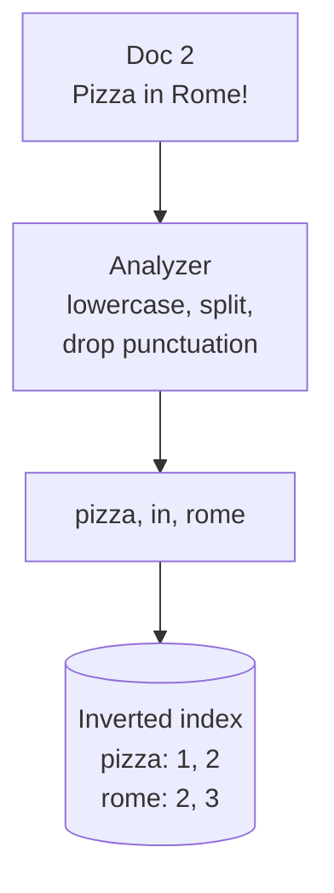
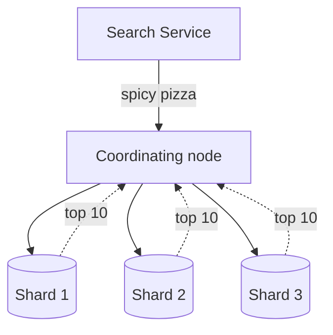
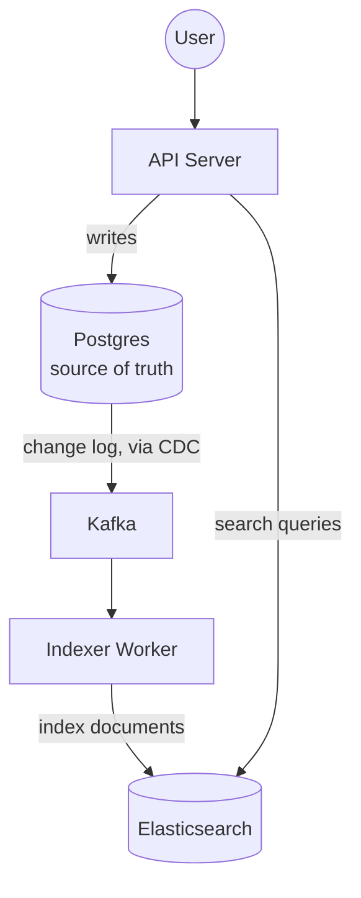

## What is it?

Think of the **index at the back of a book**. If you want every page that mentions "Paris", you don't read the whole book. You look up "Paris" in the index, and it says "pages 12, 87, 140".

A search engine does the same thing for text. It keeps a list of **every word**, and for each word, **which documents contain it**. This list is called an **inverted index**.

## Why do we need it?

Say you want every post that contains the word "pizza":

```sql
SELECT * FROM posts WHERE body LIKE '%pizza%';
```

The `%` at the start means "anything can come before". A normal database index can't help with that, so the database reads **every row**. With 100 million posts, that is far too slow.

It also gets the answer wrong in other ways:

- "Pizza" (capital P) or "pizzas" may not match.
- A typo like "piza" finds nothing.
- There is no order. The best match is not shown first.

A search engine fixes all three: it finds words without reading every row, it matches word forms and typos, and it puts the best match first.

## How it works inside

### The inverted index

Take three tiny documents:

| Doc | Text |
| --- | --- |
| 1 | "I love pizza" |
| 2 | "Pizza in Rome" |
| 3 | "I love Rome" |

The search engine makes every word lowercase, splits the text into words, and writes down which documents have each word:

| Word | Documents |
| --- | --- |
| i | 1, 3 |
| love | 1, 3 |
| pizza | 1, 2 |
| in | 2 |
| rome | 2, 3 |

Now a search is just a few quick lookups:

- **"pizza"** → look up one word → docs **1, 2**.
- **"love rome"** → "love" is in 1, 3 and "rome" is in 2, 3. Docs that have **both** words: **3**. Docs with **either** word: 1, 2, 3, with doc 3 first, because it matches both.

It is called **inverted** because it flips the normal direction. A normal list goes "document → its words". This one goes "word → its documents". The list of documents for one word is called a **posting list**.

Each posting list is kept **sorted by document ID**. So finding the docs that have both words is one quick walk through two sorted lists. The index can also store the **position** of each word inside the document. That is how phrase search works: "love rome" as two words right next to each other.



### Analyzers: making words match

The step that cleans up the text is called the **analyzer**. It runs when a document is saved, and again on the user's search text, so both sides look the same.

| Step | What it does | Example |
| --- | --- | --- |
| **Lowercase** | Ignore capital letters | "Pizza" → "pizza" |
| **Tokenize** | Split text into words, called **tokens** | "Pizza in Rome!" → pizza, in, rome |
| **Stop words** (optional) | Drop very common words | drop "the", "a", "in" |
| **Stemming** | Cut a word down to its root | "running", "runs" → "run" |
| **Synonyms** | Treat some words as the same | "tv" = "television" |

On top of that, **fuzzy search** allows small typos. "piza" is one letter away from "pizza", so it still matches.

### Ranking: which result comes first

Finding matches is half the job. The other half is putting the **best match first**. The classic ideas:

- **Term frequency (TF):** a document that says "pizza" five times is probably more about pizza than one that says it once.
- **Inverse document frequency (IDF):** **rare words matter more.** "the" is in every document, so matching it means almost nothing. "lasagna" is rare, so matching it means a lot.
- **Shorter is stronger:** "pizza" in a 10-word title counts more than "pizza" once in a 5,000-word article.

**BM25** is the standard formula that mixes these three. It is the default in Elasticsearch.

Real products then add **business signals**: newer posts, more likes, higher ratings, or places closer to the user get a boost.

## Elasticsearch basics

**Elasticsearch** is the most common search engine in system design answers. It is built on **Apache Lucene**, a search library that does the inverted index work.

| Elasticsearch word | Meaning | Like in SQL |
| --- | --- | --- |
| **Document** | One JSON item, like one restaurant | A row |
| **Index** | A collection of documents | A table |
| **Shard** | One piece of an index. An index is split into shards across machines | One partition of a table |
| **Replica** | A copy of a shard, for safety and more reads | A read replica |

You talk to it with JSON over HTTP:

```http
GET /restaurants/_search
Content-Type: application/json

{
  "query": { "match": { "description": "spicy pizza" } }
}
```

A search goes to **every shard**. Each shard returns its own best results, and one node merges them into the final top list. This is called **scatter-gather**.



Two things to know:

- **Near real time.** A new document becomes searchable after a **refresh**, which happens about **once a second** by default. Not instantly.
- **It is not your main database.** Keep the real data in Postgres or similar. Elasticsearch holds a **copy** made for searching. If it breaks, you can rebuild it from the database.

## Keeping search in sync with the database

The database is the **source of truth** (the one place where data is always right). Search must follow it. Three common ways:

| Way | How | Problem |
| --- | --- | --- |
| **Dual write** | The app writes to the database, then to Elasticsearch | If the second write fails, they no longer match |
| **CDC (Change Data Capture) through Kafka** | Read every change from the database's log, send it through Kafka, and an indexer writes it to Elasticsearch | More moving parts, but nothing gets lost |
| **Nightly rebuild** | A batch job re-indexes everything | Search is hours old. Still useful to fix any drift |

The usual answer is **CDC** (see [Change Data Capture](../distributed-systems/change-data-capture.mdx)):



This makes search **eventually consistent**: a new post shows up in search a second or two after it is saved. For search, that is almost always fine. See [Kafka](../messaging/kafka.mdx) for how the log part works.

## When to use it

- A **search box over text**: products, posts, restaurants, messages, help articles.
- Users make **typos** or use other word forms, and the **best match must come first**.
- Text search **plus filters**: "pizza", open now, rating above 4.
- Searching huge amounts of **logs** by any word.

**Don't use it when:**

- You look things up by **ID or exact value**. A normal database index already does that.
- The data is **small** (thousands of rows). Postgres full-text search is enough, with no second system to keep in sync.
- You need it as the **source of truth**, or a write must show up in search **at once**. Search is a copy, about a second behind.
- Users search by **meaning**, not words ("cheap places to eat" should find "budget restaurants"). Use vector search.

## Alternatives

| Option | What it is | Pick it when |
| --- | --- | --- |
| **Postgres full-text search** | A `tsvector` column with a GIN index, built into Postgres | The data already lives in Postgres and search needs are simple |
| **Prefix index or trie** | A normal index can often serve `LIKE 'piz%'` (the start of a word). A trie holds popular queries | Autocomplete. See [Search Autocomplete](../questions/search-autocomplete.mdx) |
| **Algolia, Meilisearch, Typesense** | Search engines that are simpler to run, or run for you | Small to medium data, and you want typo-friendly search fast |
| **Vector search** | Finds items with a similar meaning, using embeddings | Users describe what they want in their own words. See [Vector Databases](./vector-databases.mdx) |

## In the real world

**Elasticsearch and OpenSearch.** In 2021 Elastic changed the license of Elasticsearch. In response, AWS started **OpenSearch**, an open-source copy (a **fork**) of Elasticsearch. In 2024 both changed again: Elastic added an open-source license (AGPLv3) as an option, so Elasticsearch is open source again, and OpenSearch moved to the **Linux Foundation**, a neutral non-profit. Both work the same way at the level you need for interviews.

**Wikipedia's search moved to OpenSearch.** Its search system, called **CirrusSearch**, searches the text of millions of articles. It was built on Elasticsearch, and moved to OpenSearch in 2025.

**GitHub built its own engine for code.** Code is not like normal text: symbols like `.` and `(` matter, and people search for exact pieces of code. GitHub said general search engines did not fit well, so it built its own engine in Rust, called **Blackbird**, for its new code search.

## In the interview

Any time the question has a **search box** (products, posts, restaurants, messages), bring this up:

> "Posts are stored in Postgres. For search, I'll stream changes through CDC and Kafka into Elasticsearch, which keeps an inverted index and ranks results with BM25. New posts may take a second to appear in search, and that's fine."

<Callout title="Remember this" type="success">
  - **Why:** `LIKE '%word%'` reads every row, misses "Pizzas" and typos, and has no ranking.
  - Search engines use an **inverted index**: **word → list of documents**, each list sorted by doc ID.
  - The **analyzer** lowercases, splits into words, and cuts words to their root, on both documents and queries.
  - **Ranking:** frequent in this doc, rare overall, short field = better match. Elasticsearch uses **BM25**.
  - Elasticsearch splits an index into **shards** and asks all of them (**scatter-gather**).
  - Search is a **copy**. The database stays the source of truth.
  - Keep them in sync with **CDC + Kafka**. Search is a second or so behind.
  - **Alternatives:** Postgres full-text search (small, simple), a trie (autocomplete), Algolia or Meilisearch, vector search (meaning).
</Callout>
