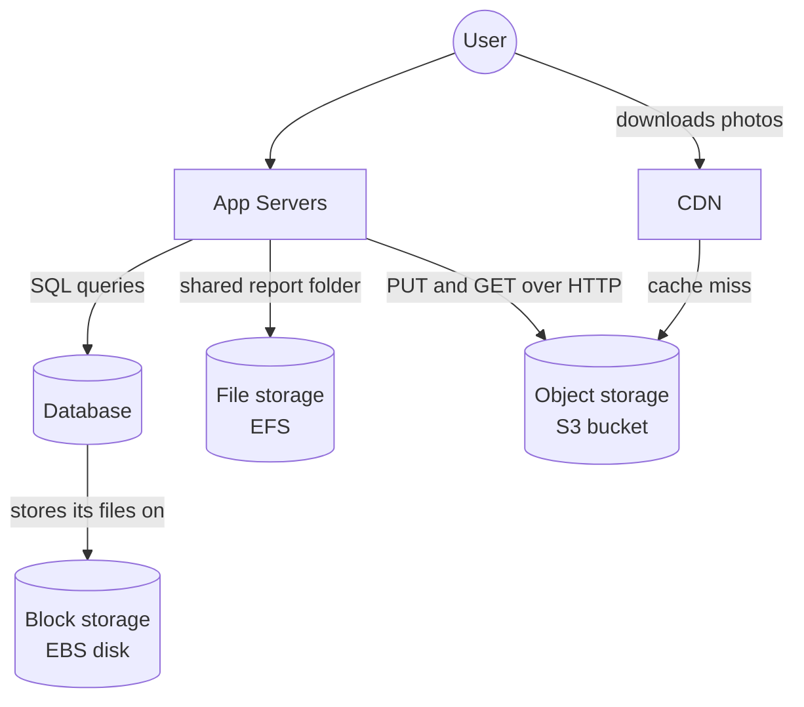
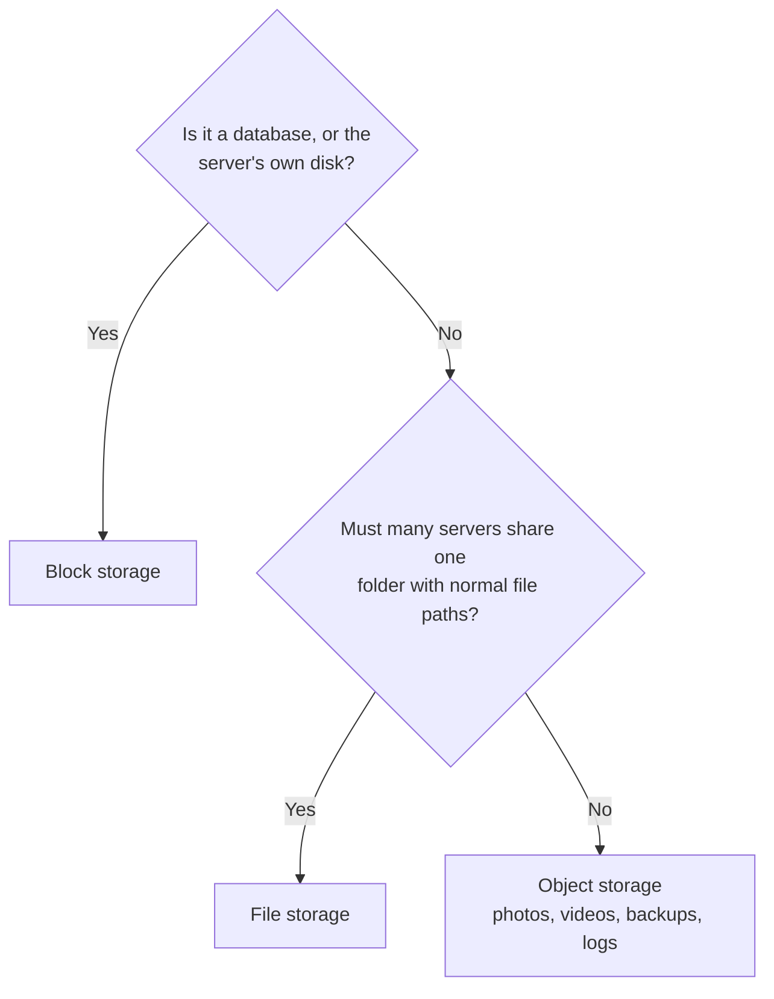

## The idea

Every system has to keep data somewhere: database files, user photos, videos, logs, backups. In the cloud there are three main kinds of storage. They differ in **how they hand the data to you**.

Think of three ways to keep your things:

- **Block storage** is like an **empty hard disk** plugged into one computer. The computer decides how to organize it.
- **File storage** is like a **shared office cupboard** with labelled folders. Many people can open it at the same time and find things by folder and name.
- **Object storage** is like a **coat check** at a big event. You hand over your coat and get a ticket. Later you show the ticket and get the whole coat back. You don't care which shelf it was on.

## Block storage

Block storage splits a disk into small pieces of the same size, called **blocks**. Each block has a number. The storage knows nothing about files. It only understands "write these bytes into block 1042".

The **operating system** (Linux or Windows) puts a **file system** on top. That is the part that turns blocks into the files and folders that programs see.

- **Attached to one server** at a time, like the disk inside a laptop.
- **Very fast**, with very low delay.
- You can **change a few bytes in the middle** of a big file.
- **Example:** AWS **EBS** (Elastic Block Store), the disk you attach to a cloud server.
- **Used for:** databases and the server's own system disk.

Databases love block storage, because they keep changing small parts of very large files.

## File storage

File storage is a **shared folder over the network**. Many servers can connect to it at once and see the same files, like a shared drive at work.

- Normal **folders and file names**: `/reports/2024/march.pdf`.
- **Shared by many servers** at the same time.
- Servers talk to it with a network file protocol: **NFS** (Network File System, common on Linux) or **SMB** (common on Windows).
- **Example:** AWS **EFS** (Elastic File System), or an office's shared network drive.
- **Used for:** older apps that expect a normal folder, files that many servers must share, and users' home folders.

It is easy to use, because programs treat it like a local folder. But it is harder to grow to huge sizes than object storage, and it usually costs more per GB.

## Object storage

Object storage keeps each file as one **object**. An object has three parts:

- the **data** itself (the bytes of the photo),
- a **key**, which is its unique name, like `photos/2024/cat.jpg`,
- **metadata**: extra facts about it, like its type (`image/jpeg`) or who uploaded it.

Objects live in a **bucket**, which is one big flat container. There are no real folders. A key like `photos/2024/cat.jpg` only **looks** like a path.

- You use it over **HTTP**: `PUT` to upload, `GET` to download, `DELETE` to remove.
- **Almost no size limit**, and it is the **cheapest** per GB.
- You **cannot change part of an object**. To change one byte, you upload the whole object again.
- Each request is slower than a local disk, because it is a web call. But it can serve huge amounts of data to many users at once.
- **Examples:** AWS **S3**, Google Cloud Storage, Azure Blob Storage.
- **Used for:** images, videos, backups, logs, user uploads and data for analytics.

```http
PUT /photos/2024/cat.jpg HTTP/1.1
Host: my-app-uploads.s3.amazonaws.com
Content-Type: image/jpeg

(the bytes of the image)
```

## How they fit in one system

Most real systems use all three, each for a different job:



## Side by side

| | Block | File | Object |
| --- | --- | --- | --- |
| **Shape of data** | Numbered blocks | Folders and files | Flat bucket of objects with keys |
| **Who can use it** | Usually one server | Many servers at once | Anyone allowed, over HTTP |
| **Speed** | Fastest, lowest delay | Medium | Slower per request, huge total capacity |
| **Change part of a file?** | Yes | Yes | No, replace the whole object |
| **How big can it get** | Size of one disk | Large | Almost unlimited |
| **Cost per GB** | Medium | Highest | Lowest |
| **AWS example** | EBS | EFS | S3 |
| **Used for** | Databases, system disks | Shared folders, older apps | Photos, videos, backups, logs |

## Which one to use



**The rule that matters most in interviews:** don't put big files inside your database. A database full of videos is slow to back up, slow to copy to replicas, and costly. Instead:

1. Put the file in **object storage** (S3).
2. Save only its **key** and a few facts in the database row.

```sql
-- The database keeps a small row. The photo itself lives in S3.
CREATE TABLE photos (
  id         BIGINT PRIMARY KEY,
  owner_id   BIGINT NOT NULL,
  s3_key     TEXT NOT NULL,        -- 'photos/2024/42/cat.jpg'
  size_bytes BIGINT,
  created_at TIMESTAMP DEFAULT now()
);
```

How the file gets into S3 without passing through your servers is covered in [File Upload and Download](./file-upload-download.mdx). How it reaches users fast is covered in [CDN and Edge Caching](../caching/cdn.mdx).

## In the real world

**S3 is built not to lose data.** AWS says S3 is designed for **99.999999999% durability** ("eleven nines"). It does this by keeping copies of every object on many devices, in several separate data centers.

**S3 became strongly consistent in 2020.** Since December 2020, after a successful write to S3, the next read returns the new data. Before that, a read right after an overwrite could still return the old version for a short time.

**Netflix keeps its video files in S3.** The master copies and encoded versions of shows are stored in S3. Viewers don't stream from S3, though. Netflix copies the videos to its own CDN, called **Open Connect**, which sits close to viewers.

**Dropbox built its own object storage.** Dropbox first stored users' files on S3. In 2016 it moved most of them to its own storage system, called **Magic Pocket**, to save cost and have more control.

## In the interview

Whenever users upload anything (photos, videos, documents), say where the bytes go and where the facts go:

> "Uploaded photos go to S3, which is cheap and almost unlimited. The database only stores the photo's S3 key, owner and size. A CDN sits in front of S3 for downloads."

<Callout title="Remember this" type="success">
  - **Block** = raw disk for one server. Fastest. Use it for **databases**.
  - **File** = shared network folder (NFS). Use it when many servers need **the same folder**.
  - **Object** = flat bucket of objects with keys, over **HTTP**. Cheap and almost unlimited. Use it for **photos, videos, backups, logs**.
  - You **can't edit part of an object**. You replace the whole thing.
  - Never store big files in the database. Store them in **S3** and keep the **key** in the database.
  - AWS names: **EBS** (block), **EFS** (file), **S3** (object).
</Callout>
