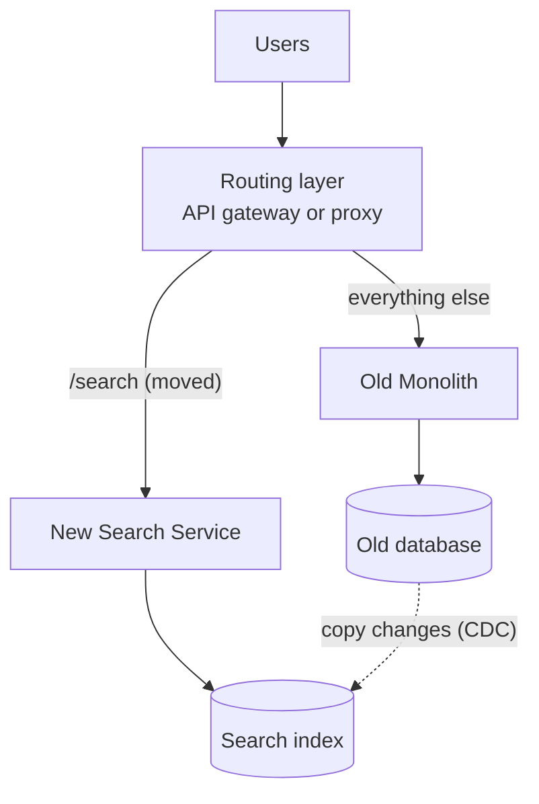

## The idea

A **strangler fig** is a plant that starts high up on an old tree. It sends roots down and slowly grows around the tree. Years later, the old tree has rotted away, and the fig stands on its own in the same place.

The **strangler pattern** replaces an old system the same way. You don't switch it off and launch a new one on one big day. You **grow the new system around the old one**, one feature at a time, until the old one has nothing left to do. Then you turn it off.

Martin Fowler gave the pattern this name in 2004, after seeing these trees in Australia.

It is like **renovating a house room by room** while you still live in it, instead of moving out and rebuilding from the ground up.

## The problem with big rewrites

The tempting plan is "let's rewrite the whole thing from scratch". It usually goes badly:

- **The target keeps moving.** The old system still gets new features and fixes while you rewrite, so you are always catching up.
- **Nothing ships for a long time.** Months or years of work with no real users and no feedback.
- **Hidden rules get lost.** Old code is full of small fixes for strange cases that nobody wrote down. The rewrite forgets them.
- **One huge switch day.** Everything changes at once, so if something breaks, everything breaks.

## Moving traffic piece by piece

The key part is a **routing layer** in front of everything, often called a **facade**. It can be an [API gateway](../hld-basics/api-gateway.mdx) or a [reverse proxy](../foundations/proxies.mdx). Users only talk to it. It decides, per request, whether the old or the new system answers.

<Steps>
<Step>

**Put the routing layer in front.** At first it sends **everything** to the old system. Nothing changes for users.

</Step>
<Step>

**Build one feature in the new system.**

</Step>
<Step>

**Move its traffic over.** Send 1% of that feature's requests to the new system, then 10%, then 100%. If something goes wrong, flip the route back.

</Step>
<Step>

**Delete that feature from the old system.** Then pick the next feature and repeat.

</Step>
<Step>

**Turn the old system off** when no traffic reaches it anymore.

</Step>
</Steps>

**Data is the hardest part.** While both systems run, they often need the same data. Common ways: copy changes from the old database into the new store with [Change Data Capture](../distributed-systems/change-data-capture.mdx), or let the new service call the old system's API for data it doesn't own yet.

## An example

An online shop runs on one old monolith. The team moves it out in this order:

1. **Product search first.** It only reads data, so it is low risk. It is also easy to separate, and a better search engine helps users right away.
2. **Product reviews next.** A small, clear feature with its own data.
3. **Checkout last.** It handles money and touches everything, so it waits until the team has practice and good tooling.

Two habits make each step safe:

- **Shadow traffic.** Send a **copy** of real requests to the new service too, compare its answers with the old ones, and show users only the old answer until they match.
- **A switch to go back.** Every route can be flipped back to the old system in seconds.

## In the real world

**Martin Fowler named it.** Fowler described the "strangler fig application" in a 2004 article. It is now a standard way to move from a monolith to services. See [Monolith vs Microservices](../hld-basics/monolith-vs-microservices.mdx).

**Netscape's rewrite is the classic warning.** In his 2000 essay "Things You Should Never Do", Joel Spolsky called rewriting code from scratch the worst strategic mistake a software company can make. His example was Netscape, which spent years rewriting its browser while competitors moved ahead.

## In the interview

Use this when the question says "we have an old system" or "how would you migrate":

> "I won't rewrite the monolith in one go. I'll put a gateway in front, move search out first, and shift its traffic to the new service bit by bit, with the old route ready as a fallback."

<Callout title="Remember this" type="success">
  - **Big-bang rewrites** are risky: moving target, no feedback, lost rules, one huge switch day.
  - **Strangler:** put a **routing layer** in front, move **one feature at a time**, then delete the old part.
  - Move traffic **slowly** (1%, 10%, 100%) and keep a way to **switch back**.
  - Start with **low-risk, read-only** features. Do money flows last.
  - Keep data in sync during the move, for example with **CDC**.
</Callout>
