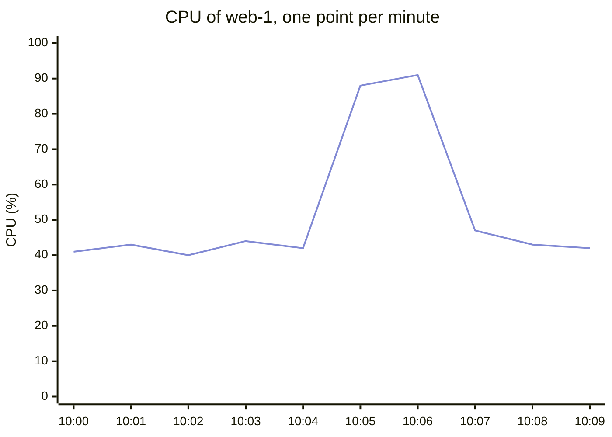
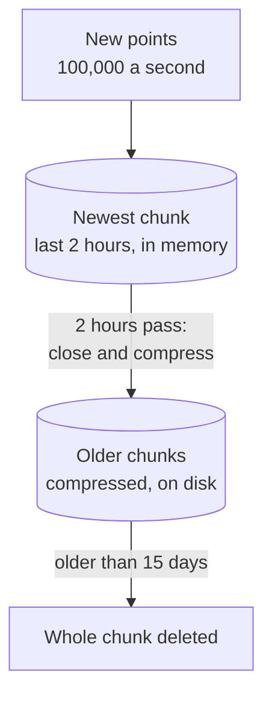
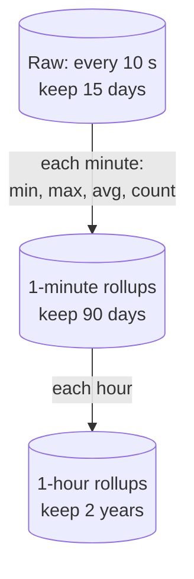
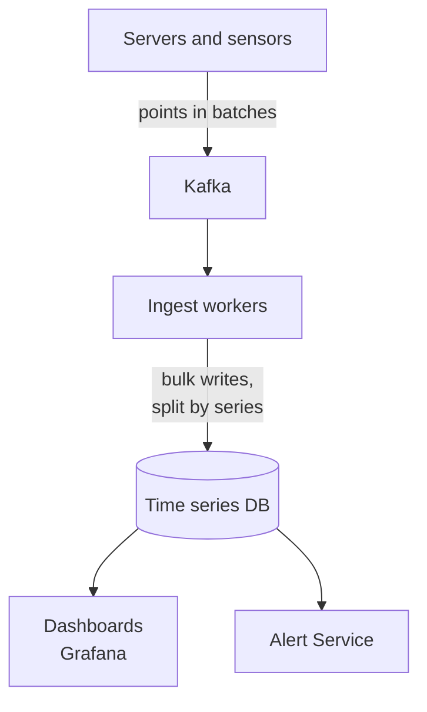

## The idea

Think of a **weather station** with a logbook. Every minute, someone writes down the temperature on the **next empty line**. Nobody ever goes back to change an old line. Questions are always about a **stretch of time**: "what was the hottest hour yesterday?". And after a year, nobody needs every minute from last January, so old pages are **summarized** into daily highs and lows, and the **old notebooks are thrown away**.

A **time series database (TSDB)** is built for exactly this kind of data. It writes new points very fast, stores them in very little space, answers "this stretch of time" questions quickly, and summarizes and deletes old data on its own.

## What time-series data is

A **time series** is a list of `(time, value)` points for one thing you measure. Examples:

- **Server metrics:** CPU, memory and request counts of every server, every 10 seconds.
- **Sensors (IoT):** a smart electricity meter sending a reading every 15 minutes, or a factory machine sending its temperature every second.
- **Stock prices:** the price of a stock at every trade.

A few rows look like this:

| time | host | metric | value |
| --- | --- | --- | --- |
| 10:00:00 | web-1 | cpu | 41.2 |
| 10:00:00 | web-2 | cpu | 38.7 |
| 10:00:10 | web-1 | cpu | 42.0 |
| 10:00:10 | web-2 | cpu | 39.1 |

And this is what one series looks like on a dashboard:



This data has a special shape:

- **Append-only.** New points are added at the end. Old points **never change**.
- **Time-ordered.** Points arrive roughly in time order.
- **Read by time range.** "CPU of web-1 for the **last 6 hours**", usually summarized: "average **per 5 minutes**".
- **Recent data is hot.** Last hour is read all the time. Last year is read rarely, and only in summary.
- **Labels pick the series.** `host` and `metric` here are **labels** (also called **tags**). Each different set of labels is its own series: `cpu` on `web-1` is one series, `cpu` on `web-2` is another. (Too many label values is a classic trap. See [Logging and Metrics](../questions/logging-metrics.mdx).)

## Why a normal database struggles

Take a real monitoring setup: **10,000 servers × 100 metrics**, one reading every **10 seconds**.

- That is 1 million series, so **100,000 new rows a second**.
- **8.64 billion rows a day.** At about 50 bytes per row, that is **over 400 GB a day**, before indexes.

Put this in one normal PostgreSQL or MySQL table and four things hurt:

| Problem | Why it hurts |
| --- | --- |
| **Write volume** | Every insert also updates the B-tree indexes (on time, on host). 100,000 a second means a lot of random disk writes. See [Scaling Writes](../hld-basics/scaling-writes.mdx) |
| **Huge tables** | After a few days, the indexes no longer fit in memory. Every insert and every query gets slower |
| **Range scans** | "Average CPU per minute for 7 days" reads millions of rows. Rows of different servers are mixed together on disk, and each row carries every column, even though we only need `value` |
| **Deleting old data** | `DELETE ... WHERE time < 30 days ago` removes billions of rows one by one. It is slow, heavy, and in PostgreSQL it leaves dead rows that must be cleaned up later |

## How a TSDB handles it

### 1. Split the data by time into chunks

A TSDB splits the data into **chunks**, one per stretch of time (say, every 2 hours or every day). Each chunk is like its own small table.



- **Writes are fast.** All new points go to the **newest chunk** only. Its index is small and fits in memory. Points are gathered in memory and written to disk in big batches, with a log on disk for crash safety.
- **Range queries are fast.** A query for "the last 6 hours" opens only the chunks for those 6 hours, and skips the rest.
- **Old chunks never change.** So they can be squeezed hard (next section) and moved to cheaper disks.

**Prometheus** keeps the newest 2 hours in memory, then writes them to disk as a 2-hour **block**. **TimescaleDB** calls the big table a **hypertable** and splits it into chunks of 7 days by default.

### 2. Columnar compression

A normal database stores data **row by row**: time, host, metric and value of one reading together. A TSDB stores it **column by column**: all the times of one series together, then all the values together. Similar values side by side compress very well.

**Times.** Points come every 10 seconds. Instead of saving each full time, save the first one, then only the gap, then "same gap as before":

| Time | Stored as |
| --- | --- |
| 10:00:00 | 10:00:00 (in full) |
| 10:00:10 | +10 seconds |
| 10:00:20 | same gap |
| 10:00:30 | same gap |

"Same gap" takes about **one bit**.

**Values.** CPU goes 41.2, 41.3, 41.1. Save only **how much it changed** from the last value, which is a small number.

**Labels.** `web-1` repeats on every point of the series. Save it **once** for the whole chunk.

How well does it work? Facebook's **Gorilla** paper (2015) squeezed each point from **16 bytes to about 1.37 bytes** on average, about 12 times smaller. A bonus: a query that needs only `value` reads only the value column.

### 3. Downsampling (rollups)

A chart of the last year doesn't need a point every 10 seconds. So a TSDB keeps **summaries** of old data, called **rollups**, at lower detail:



The saving, for one series:

| Data | Points for its time span |
| --- | --- |
| Raw, every 10 seconds, for 1 year | 3,153,600 |
| 1-minute rollups for 90 days | 129,600 |
| 1-hour rollups for 2 years | 17,520 |

**Keep the max, not just the average.** Look at the CPU chart above: the average of those 10 minutes is about **52%**, and the spike to **91%** disappears. Store **min, max, average and count** in every rollup. (And never average percentiles. Keep histograms instead: see [Latency Percentiles](../production/latency-percentiles.mdx).)

### 4. Retention: drop old data for free

A **retention policy** says how long to keep data: "raw points for 15 days, 1-hour rollups for 2 years". Because the data is split into time chunks, deleting old data means **deleting a whole chunk** at once. That is instant, like throwing away an old notebook instead of erasing it line by line.

Some systems move old chunks to cheap object storage like S3 instead of deleting them. Prometheus keeps 15 days of data by default.

## Writing and querying: an example

**TimescaleDB** is an extension for PostgreSQL. You write normal SQL:

```sql
CREATE TABLE metrics (
  time   TIMESTAMPTZ NOT NULL,
  host   TEXT NOT NULL,
  metric TEXT NOT NULL,
  value  DOUBLE PRECISION
);

-- Turn it into a hypertable, split into chunks by time
SELECT create_hypertable('metrics', 'time');

-- Average CPU of web-1 per 5 minutes, for the last 6 hours
SELECT time_bucket('5 minutes', time) AS bucket,
       avg(value) AS avg_cpu
FROM metrics
WHERE host = 'web-1'
  AND metric = 'cpu'
  AND time > now() - INTERVAL '6 hours'
GROUP BY bucket
ORDER BY bucket;
```

Compression and retention are policies that run on their own:

```sql
-- Compress chunks older than 7 days
ALTER TABLE metrics SET (timescaledb.compress, timescaledb.compress_segmentby = 'host');
SELECT add_compression_policy('metrics', INTERVAL '7 days');

-- Drop chunks older than 15 days
SELECT add_retention_policy('metrics', INTERVAL '15 days');
```

**InfluxDB** takes points in a plain text format called **line protocol**: the measurement, the tags, the values, and a timestamp in nanoseconds:

```text
cpu,host=web-1,region=eu usage=41.2 1732000000000000000
```

**Prometheus** has its own query language, **PromQL**. This is "requests per second to checkout, averaged over 5 minutes":

```text
rate(http_requests_total{service="checkout"}[5m])
```

## How it fits in a system



- **Kafka absorbs spikes.** If the TSDB is slow for a minute, points wait in Kafka instead of being lost.
- **Ingest workers write in batches**, thousands of points per request, never one at a time (see [Scaling Writes](../hld-basics/scaling-writes.mdx)).
- **Split by series across machines:** `hash(metric + labels)` picks the machine, so all points of one series sit together.
- **Pre-count in a stream.** For raw events like ad clicks, a stream processor like Flink can count **per minute** before writing, so the TSDB stores one row per minute instead of every event. See [Batch vs Stream Processing](./batch-vs-stream.mdx).
- **Dashboards and alerts** read from the TSDB. See [Observability](../production/observability.mdx).

## The options, and when to pick which

| Option | What it is | Best for | Watch out |
| --- | --- | --- | --- |
| **InfluxDB** | A database built only for time series, with retention built in | Sensors (IoT), app and business metrics | A separate system to learn and run |
| **TimescaleDB** | A PostgreSQL extension: hypertables, compression, rollups | You already use PostgreSQL and want SQL and **joins** (readings + the `devices` table) | Scaling to many machines is harder than with ClickHouse |
| **Prometheus** | A monitoring system with its own TSDB. It **pulls** metrics from servers. PromQL and alerts | Monitoring servers, services and Kubernetes | One server, local disk. For long-term storage and many servers, add **Thanos** or **Grafana Mimir**. Not for exact numbers like billing |
| **ClickHouse** | A column-store database for analytics (OLAP) | Counting and grouping **billions of events** by any column: clicks, logs, ad events | Not for many small updates or single-row lookups |
| **Apache Druid** | A real-time analytics database that reads straight from Kafka | Fast dashboards on live event streams, for many users at once | More moving parts to run |

**TSDB or OLAP?** A TSDB is best at "**one series over time**" with a few labels. An OLAP database like ClickHouse or Druid is best at "**slice billions of events by any column**", including columns with millions of values, like user ID. The same user ID label would create millions of series and hurt Prometheus.

**Simple rule:**

- Monitoring your own servers → **Prometheus** + Grafana.
- Already on PostgreSQL, need SQL and joins → **TimescaleDB**.
- A sensor or IoT platform → **InfluxDB** or **TimescaleDB**.
- Analytics over billions of events (like the [Ad Click Aggregator](../questions/ad-click-aggregator.mdx)) → **ClickHouse** or **Druid**.

## When to use it in an interview

| Use a time series database for | Don't use it for |
| --- | --- |
| **Metrics and monitoring**: CPU, latency, error rates | **Searching log text**. Use a log store like Elasticsearch |
| **Sensor readings** from thousands of devices | Data that **changes in place**: user profiles, orders, balances |
| **Stock prices** and charts over time | **Transactions**, like moving money |
| **Per-minute counts** for dashboards | **Small volume.** A few hundred writes a second fit in a normal table with an index on time |

## In the real world

**Netflix built Atlas.** Netflix built **Atlas**, an in-memory time series database for its operational metrics, and made it open source in 2014.

**Uber built M3.** Uber built **M3** to store its metrics at huge scale, and made it open source in 2018. It can be used as long-term storage for Prometheus.

**Cloudflare uses ClickHouse.** Cloudflare has written about running its HTTP analytics on **ClickHouse**, counting and grouping the traffic of millions of requests per second.

**Facebook's Gorilla.** The 2015 Gorilla paper's compression of times ("same gap as before") and values ("only the changed bits") inspired later TSDBs, including Prometheus.

## In the interview

Say the numbers, how points are written, how data shrinks with age, and how it is deleted:

> "10,000 servers with 100 metrics each, every 10 seconds, is 100,000 points a second, so a normal table would drown. Agents send points to Kafka, and ingest workers write them in batches to a time series database, split across machines by a hash of the series. Inside, data is split into 2-hour chunks and compressed by column, down to a couple of bytes per point. We keep raw points for 15 days, 1-minute rollups for 90 days and 1-hour rollups for 2 years, each with min, max, average and count. Old chunks are dropped by a retention policy, which is instant. Dashboards read the rollups for long ranges."

**Likely follow-up:** "Why not just use PostgreSQL?"

**Answer:** "At 100,000 writes a second and 8.6 billion rows a day, a plain table's indexes stop fitting in memory, range scans read far too much, and deleting old rows one by one is too slow. If I want to stay on PostgreSQL, I'd use TimescaleDB. It adds time chunks, compression, rollups and retention on top, and I keep SQL and joins."

<Callout title="Remember this" type="success">
  - Time-series data is **append-only**, **time-ordered**, and **read by time range**. Each set of labels is one **series**.
  - A normal table struggles with **write volume**, **huge indexes**, **range scans** and **deleting** old rows.
  - **Chunks by time:** writes hit only the newest chunk, queries skip old chunks, and old chunks never change.
  - **Columnar compression:** store gaps and changes, not full values. Gorilla: 16 bytes down to about **1.37 bytes** a point.
  - **Downsampling:** raw → 1-minute → 1-hour rollups. Keep **min, max, avg, count**, not just the average.
  - **Retention:** drop a whole chunk at once, which is instant.
  - Prometheus for **monitoring**, TimescaleDB if you are on **PostgreSQL**, InfluxDB for **sensors**, ClickHouse or Druid for **event analytics**.
</Callout>
