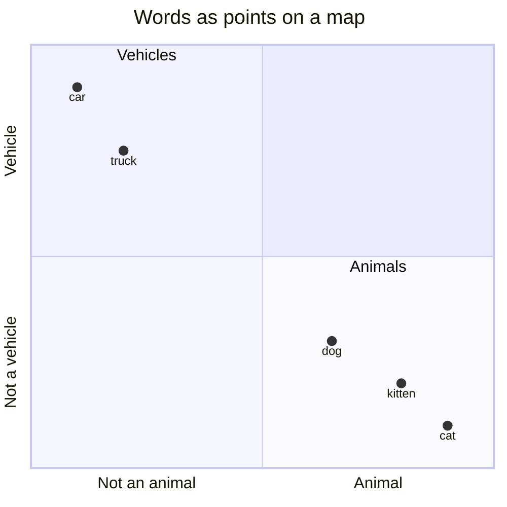
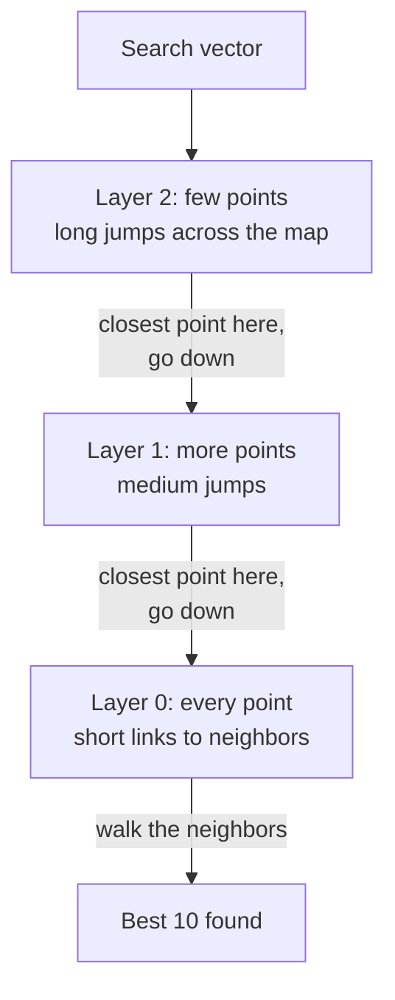
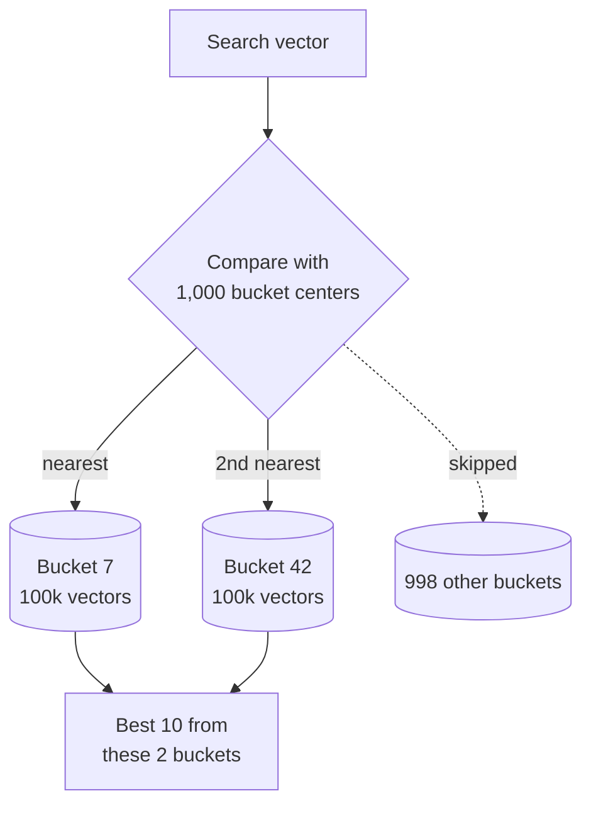
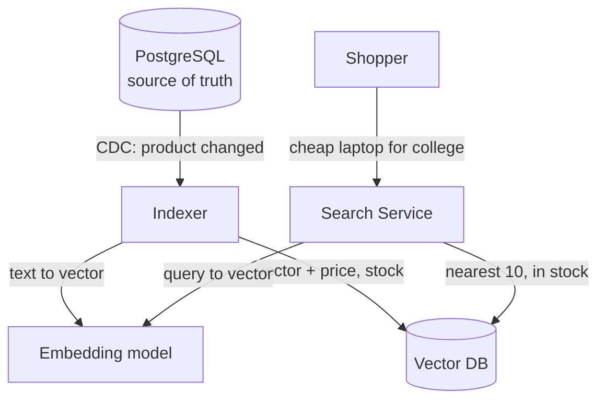
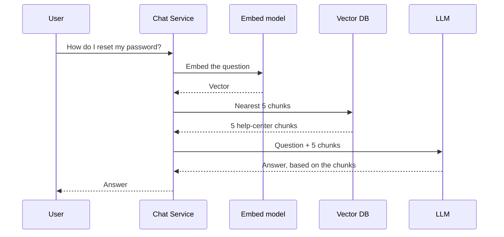

## The idea

Think of a **supermarket**. Similar things sit close together: apples next to pears, pasta next to pasta sauce, and soap far away in another aisle. If you hold an apple and want "something like this", you don't walk the whole store. You look at the shelves **around you**.

A **vector database** does the same with meaning. Every item (a product, a sentence, a photo, a song) gets a spot on a giant map, where **similar meaning = close together**. A search becomes "what is near this spot?".

Why this matters: a shopper types **"cheap laptop for college"**. A product called **"Budget notebook for students"** shares **no words** with that query, so a keyword search (see [Search](./search.mdx)) misses it. A search by meaning finds it, because the two sit close together on the map. This is called **semantic search**.

## Embeddings: meaning as a list of numbers

An **embedding model** (a trained AI model) reads a piece of text and returns a list of numbers, called a **vector** or an **embedding**. For example, OpenAI's `text-embedding-3-small` model returns **1,536 numbers** for any text you give it.

Here is a tiny, made-up version with only **2 numbers** per word: "how much is it about animals" and "how much is it about vehicles".



| Word | Vector | Distance to "kitten" |
| --- | --- | --- |
| kitten (the search) | `[0.8, 0.2]` | — |
| cat | `[0.9, 0.1]` | **0.14** (closest) |
| dog | `[0.65, 0.3]` | 0.18 |
| truck | `[0.2, 0.75]` | 0.81 |
| car | `[0.1, 0.9]` | 0.99 (farthest) |

Search for "kitten", and the closest points are **cat**, then **dog**. Car and truck are far away. Nobody wrote a rule saying "kittens are like cats". The numbers say it.

Things to know:

- **Nobody picks the numbers by hand.** The model learned them from huge amounts of text. Real embeddings have **hundreds or thousands** of numbers, and each number is not a clear label like "animal". The 2-number map is only a way to picture it.
- **Images work too.** Models like OpenAI's **CLIP** put images and text on the **same** map, so the text "red running shoes" lands near photos of red running shoes.
- **Use the same model for everything.** The stored items and the search text must be turned into vectors by the **same model**. Vectors from two different models can't be compared. Change the model, and you must re-embed every item.

## Measuring "close"

There are three common ways to measure how close two vectors are:

| Measure | What it checks | Meaning |
| --- | --- | --- |
| **Euclidean distance** (L2) | The straight-line distance between the two points | Smaller = more similar |
| **Cosine similarity** | Whether the two arrows **point the same way**, ignoring their length | 1 = same direction, 0 = unrelated, -1 = opposite |
| **Dot product** | Direction and length together | Bigger = more similar |

**Cosine similarity** is the usual choice for text. Here it is in JavaScript. It multiplies the two vectors number by number, and divides by their lengths:

```js
// How much two vectors point the same way (1 = exactly the same way)
function cosineSimilarity(vectorA, vectorB) {
    let dotProduct = 0;
    let lengthA = 0;
    let lengthB = 0;

    for (let i = 0; i < vectorA.length; i++) {
        dotProduct = dotProduct + vectorA[i] * vectorB[i];
        lengthA = lengthA + vectorA[i] * vectorA[i];
        lengthB = lengthB + vectorB[i] * vectorB[i];
    }

    lengthA = Math.sqrt(lengthA);
    lengthB = Math.sqrt(lengthB);

    return dotProduct / (lengthA * lengthB);
}

const kitten = [0.8, 0.2];
const cat = [0.9, 0.1];
const car = [0.1, 0.9];

console.log(cosineSimilarity(kitten, cat).toFixed(2)); // 0.99
console.log(cosineSimilarity(kitten, car).toFixed(2)); // 0.35
```

Many models return vectors that all have length 1. Then cosine and dot product give the **same order** of results. In practice, use the measure the model's docs recommend.

## Why exact search is too slow

The simple way to find the 10 nearest vectors: compare the search vector with **every** stored vector, and keep the best 10. This is **exact** search (also called brute force, or flat search). It is perfect, and it is fine for a few thousand items.

Now try it at scale: **100 million** products, 1,536 numbers each.

- **One search** = 100 million × 1,536 ≈ **154 billion** multiplications.
- **Memory:** 100 million × 1,536 numbers × 4 bytes ≈ **614 GB** of vectors.
- At 1,000 searches a second, this is hopeless.

A normal **B-tree index** (see [Indexes](../databases/indexes.mdx)) can't help. It sorts by one value. There is no way to sort points so that "close in 1,536 directions at once" sits side by side. This is the same problem as "near me" with 2 numbers in [Geospatial Indexing](./geospatial-indexing.mdx), but much worse.

The answer is **approximate nearest neighbor (ANN)** search: find **almost** the best 10, by checking only a small part of the data. We give up a tiny bit of accuracy for a huge gain in speed, the same trade as in [Probabilistic Data Structures](./probabilistic-data-structures.mdx).

## ANN indexes

### HNSW: a graph of shortcuts

Think of travelling from a small village in one country to a small village in another. You take a **flight** between two big cities, then a **train** to the nearest town, then a **local bus** to the exact street. Big jumps first, small steps last.

**HNSW** (Hierarchical Navigable Small World) builds that for vectors:

- Every vector is a **point**, linked to its **nearest neighbors**. These links make a **graph**.
- The graph has **layers**. The **bottom layer** has every point, with short links. Each layer above has **fewer points**, with **longer links**, like flights between big cities.
- **To search:** start at the top layer. Keep jumping to whichever neighbor is **closer to the search vector**. When no neighbor is closer, drop down one layer and repeat. On the bottom layer, return the best 10 found.



A search touches only a few thousand points, not 100 million. HNSW is fast and finds most of the true nearest neighbors. The costs: it uses **a lot of memory** (the vectors and all the links are kept in RAM), and it is **slow to build**.

### IVF: buckets

Think of a **library** sorted into sections. For a cooking question, you search the cooking section and maybe the one next to it, not the whole building.

**IVF** (inverted file index) does that:

1. **Build:** group all vectors into, say, **1,000 buckets** of similar vectors. Each bucket has a **center** point.
2. **Search:** compare the search vector with the 1,000 centers only. Pick the few **nearest buckets**, and search every vector inside them.



With 100 million vectors in 1,000 buckets, each bucket holds about 100,000. Searching 2 buckets checks **200,000 vectors instead of 100 million**: 500 times less work.

The catch is the same **edge problem** as geohash cells: a close match can sit just across the border, in a bucket you skipped. Search more buckets to miss less. That setting is often called **probes**.

### HNSW vs IVF

| | HNSW | IVF |
| --- | --- | --- |
| **Idea** | Graph of shortcuts, big jumps then small | Buckets of similar vectors |
| **Speed and accuracy** | Very good at both | Good. Depends on how many buckets you search |
| **Memory** | High: vectors plus links | Lower |
| **Build** | Slow, but you can add items any time | Needs data first, to make the buckets. Rebuild as data changes |
| **The knob** | `ef_search`: how many candidates to keep while searching | `probes`: how many buckets to search |

HNSW is the usual default today. To save memory at huge scale, systems also use **quantization**: store each number in fewer bytes (for example, 1 byte instead of 4). Memory drops about 4 times, and accuracy drops a little.

## Recall vs speed

ANN results are "almost right". We measure how close with **recall**:

> Run an **exact** search to get the true top 10. Run the ANN search. If 9 of its 10 results are in the true top 10, recall is **90%**.

Every ANN index has a knob that trades speed for recall:

| Setting | Speed | Recall |
| --- | --- | --- |
| Low (`ef_search` = 20, or 1 bucket) | Fastest | Lower: more true matches missed |
| High (`ef_search` = 200, or 20 buckets) | Slower | Higher: closer to exact search |

For search and recommendations, a recall of about 95% is usually fine. A shopper won't notice that the 9th best laptop was really the 11th best. Pick the setting by **measuring**: keep a test set of searches, compare with exact search, and raise the knob until recall is good enough at your speed target.

## Filtering with metadata

Real searches have rules too: "dresses **like this one**, **under $50**, **in stock**, **size M**". So each vector is stored with **metadata**: price, stock, size, and, in a [multi-tenant](./multi-tenancy.mdx) app, the `tenant_id`.

There are three ways to mix the two:

| Way | How | Problem |
| --- | --- | --- |
| **Filter after** | Find the 10 nearest, then drop the ones that fail the rules | If 8 are out of stock, only 2 results are left. Maybe 0 |
| **Filter first** | Find everything that passes the rules, then search only those | Fine for a small set. For a big set, it breaks the shortcuts in the HNSW graph |
| **Filter during** | Check the rules **while** walking the index, and skip failing points | The best answer. Dedicated vector databases are built to do this |

The "filter after" problem is real. pgvector's own docs warn that if a filter matches 10% of rows, an HNSW search with the default settings returns only about **4 rows** on average. Fixes: ask for more candidates (raise `ef_search`), use newer pgvector versions that keep scanning until enough rows pass, or give a common filter its own index.

## Where it is used

**Semantic search.** Search by meaning: "cheap laptop for college" finds "budget notebook for students". The vectors are a **copy**, made from the real data, so keep them in sync with **CDC**, exactly like an Elasticsearch index (see [Elasticsearch](./elasticsearch.mdx)):



**Recommendations.** "More like this": find the songs, products or videos whose vectors are nearest to the one you just liked.

**RAG for chatbots.** RAG means **Retrieval-Augmented Generation**. A chatbot for a help center can't know your company's docs by heart. So:

1. **Before:** split every help article into small pieces (**chunks**), embed each one, and store them in the vector database.
2. **At question time:** embed the question, find the 5 nearest chunks, and send the question **plus those chunks** to the LLM (the large language model). It answers using your docs.



**Others:** image search ("find similar photos"), and finding near-duplicates (the same product listed twice with different words).

### Keyword vs semantic, and hybrid search

Neither search wins every time:

| | Keyword search (BM25) | Semantic search (vectors) |
| --- | --- | --- |
| **Good at** | Exact words: names, model numbers, error codes like `E1045` | Meaning: synonyms, other phrasings, other languages |
| **Bad at** | "cheap laptop" vs "budget notebook" | Exact codes: `E1045` and `E1046` look almost the same to it |

So real products often run **both** and merge the two lists. This is **hybrid search**. A common way to merge is **Reciprocal Rank Fusion (RRF)**: each result gets `1 / (60 + its rank)` points from each list, the points are added up, and the highest total wins. A result that is high in **both** lists comes first:

| Result | Keyword rank | Vector rank | Points | Final |
| --- | --- | --- | --- | --- |
| Doc A | 1 | 2 | 1/61 + 1/62 = 0.0325 | **1st** |
| Doc C | 3 | 1 | 1/63 + 1/61 = 0.0323 | 2nd |
| Doc B | 2 | — | 1/62 = 0.0161 | 3rd |
| Doc D | — | 3 | 1/63 = 0.0159 | 4th |

Elasticsearch and OpenSearch can do keyword and vector search **in one query**, which makes hybrid search easy if you already run them.

## Example: pgvector

**pgvector** is an extension that adds a `vector` column type and ANN indexes to PostgreSQL:

```sql
CREATE EXTENSION vector;

CREATE TABLE products (
  id        BIGSERIAL PRIMARY KEY,
  title     TEXT,
  price     NUMERIC,
  in_stock  BOOLEAN,
  embedding vector(1536)
);

-- HNSW index that compares by cosine distance
CREATE INDEX ON products USING hnsw (embedding vector_cosine_ops);

-- The 10 nearest products that are in stock and under $50.
-- $1 is the search text, turned into a vector by the same model.
SELECT id, title, price
FROM products
WHERE in_stock AND price < 50
ORDER BY embedding <=> $1
LIMIT 10;
```

- `<=>` is **cosine distance**: 0 means the same direction, so **smaller is closer**. (`<->` is straight-line distance.)
- For an IVF index, use `USING ivfflat ... WITH (lists = 1000)`, and set `ivfflat.probes` to choose how many buckets to search.
- The big win: the vectors sit next to the real data. You can join, filter and use transactions in plain SQL, with no second system to run. More on PostgreSQL's add-ons in [PostgreSQL vs MySQL](../databases/postgresql-vs-mysql.mdx).

## The options, and when to pick which

| Option | What it is | Pick it when |
| --- | --- | --- |
| **pgvector** | A PostgreSQL extension | You already use PostgreSQL, have millions (not billions) of vectors, and want joins and transactions in one place |
| **Elasticsearch / OpenSearch** | Vector fields (`dense_vector`, `knn_vector`) next to normal text fields | You already run it for keyword search and want **hybrid** search in one query |
| **Pinecone** | A fully managed vector database, cloud only | You want no servers to run, and to grow big without tuning |
| **Weaviate** | Open source. Can call the embedding model for you. Hybrid search built in | You want open source with batteries included |
| **Milvus** | Open source, built for billions of vectors, many index types | Very large scale, and a team to run it (Zilliz Cloud is the managed version) |
| **Qdrant** | Open source, written in Rust, strong filtering | Lots of metadata filters, self-hosted or in its cloud |

**Simple rule:** start with what you already run. PostgreSQL → **pgvector**. Elasticsearch → its **vector fields**. Move to a **dedicated** vector database when you reach hundreds of millions of vectors, need very high search rates, or have heavy filtering that the general tools handle badly.

## When to use it in an interview

| Use a vector database for | Don't use it for |
| --- | --- |
| **Search by meaning**: "cheap laptop for college" | **Exact lookups**: an ID, an email, a SKU. Use the database |
| **"More like this"** recommendations | **Filters only**, like "price under $50". A normal index does it |
| **RAG**: giving a chatbot your own documents | The **main copy** of your data. Vectors are made from it |
| **Similar images**, near-duplicate listings | **Exact codes and names** alone. Keyword search is better, or use hybrid |

## In the real world

**Meta's FAISS.** Facebook AI Research released **FAISS** (Facebook AI Similarity Search) as open source in 2017. It is a library for fast similarity search over up to billions of vectors. Milvus and OpenSearch can use it as the search engine inside.

**Spotify's Annoy.** Spotify built **Annoy** (Approximate Nearest Neighbors Oh Yeah) for music recommendations, and made it open source: songs are vectors, and "songs like this one" are the nearest neighbors.

**HNSW is everywhere.** HNSW was described by Yury Malkov and Dmitry Yashunin in a paper first published in 2016. pgvector, Apache Lucene (inside Elasticsearch and OpenSearch), Qdrant and Weaviate all use it.

**RAG came from Facebook AI Research.** The name "Retrieval-Augmented Generation" comes from a 2020 paper by Patrick Lewis and others at Facebook AI Research. It is now the standard way to let a chatbot answer from a company's own documents.

## In the interview

Say how vectors are made, kept in sync, searched and filtered, and what you trade:

> "Products live in PostgreSQL. When a product changes, CDC sends it to an indexer. The indexer turns the title and description into a 1,536-number embedding, using the same model we use for search text, and saves it with price and stock as metadata. We already run Elasticsearch for keyword search, so I'll add a vector field there. A search runs keyword and vector search in one query, filtered by stock and price, and merges them with Reciprocal Rank Fusion. Keyword catches exact model numbers; vectors catch meaning. The vector index is HNSW, so it's approximate. I'll raise the number of candidates it checks until recall is about 95% on a test set."

**Likely follow-up:** "What happens when you switch to a better embedding model?"

**Answer:** "Vectors from different models can't be compared, so I re-embed every product into a **new** index in the background, while the old one keeps serving. When it's full, I switch the alias to the new index in one step, like any Elasticsearch rebuild. The source text stays in PostgreSQL, so I can always rebuild."

<Callout title="Remember this" type="success">
  - An **embedding** turns text or images into a list of numbers. **Similar meaning = close together.** Use the **same model** for items and searches.
  - Measure closeness with **cosine similarity** (same direction) or distance.
  - **Exact search** compares with every vector: too slow at scale. **ANN** finds almost the best, much faster.
  - **HNSW** = a graph of shortcuts, big jumps then small (fast, memory-hungry). **IVF** = buckets, search only the nearest few.
  - **Recall vs speed:** raise `ef_search` or `probes` for better recall, at a slower speed.
  - **Filter during** the search, not after, or you get too few results.
  - Uses: **semantic search**, **recommendations**, **RAG**. Mix with keyword search for **hybrid** search (RRF).
  - Start with **pgvector** or **Elasticsearch** if you have them. Go **dedicated** (Pinecone, Weaviate, Milvus, Qdrant) at huge scale.
</Callout>
