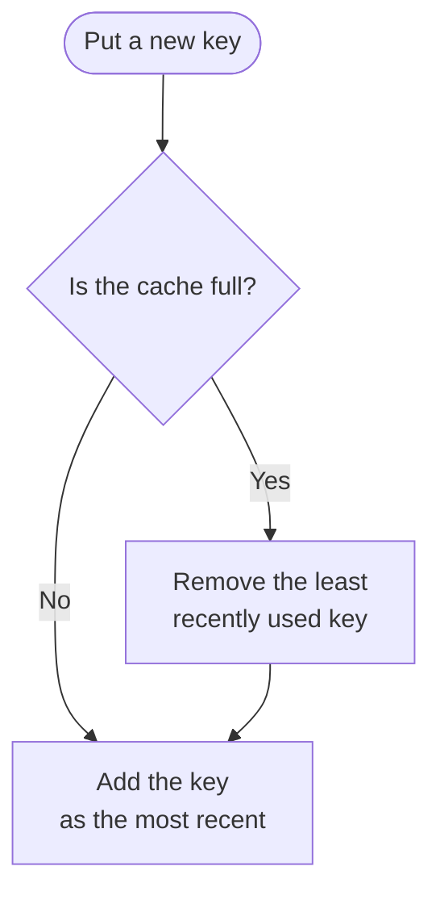

## The idea

A cache lives in memory, and memory is small and costly. Sooner or later the cache is **full**, and something must go to make room for new data. Removing items to make room is called **eviction**. The rule that picks what to remove is the **eviction policy**.

Think of your **fridge**. When it is full and you come home with new groceries, you must take something out. You could remove:

- the thing you **haven't touched for the longest time** (LRU),
- the thing you **use least often** (LFU),
- the thing that **went in first** (FIFO).

Each rule is good in some homes and bad in others. Caches have the same choice.

**Eviction is not expiry.** Expiry removes a key because its **TTL** ran out (see [Cache Invalidation and TTL](./cache-invalidation-ttl.mdx)). Eviction removes a key because the cache is **full**, even if its TTL has not run out.

## LRU: least recently used

**Remove the item that was used longest ago.** The idea: if nobody asked for it recently, nobody will ask soon.

Every time an item is read or written, it becomes the **most recent**. When the cache is full, the **least recent** item goes.

### Step by step

A cache that holds **3 items**. The last column lists items from **least recent** (left, evicted next) to **most recent** (right).

| Step | Action | What happens | Cache after (least → most recent) |
| --- | --- | --- | --- |
| 1 | Put A | Added | A |
| 2 | Put B | Added | A, B |
| 3 | Put C | Added. The cache is now full | A, B, C |
| 4 | Get A | **Hit.** A becomes the most recent | B, C, A |
| 5 | Put D | Full. **Evict B** (least recent) | C, A, D |
| 6 | Get B | **Miss.** B was evicted | C, A, D |
| 7 | Get C | **Hit.** C becomes the most recent | A, D, C |
| 8 | Put E | Full. **Evict A** | D, C, E |

Notice step 4: reading A "saved" it. Without that read, A would have been evicted at step 5 instead of B.



### LRU in JavaScript

A JavaScript `Map` remembers the **order in which keys were added**. That makes LRU short: the first key in the map is always the least recently used one. To mark a key as "just used", delete it and add it again, so it moves to the end.

```js
class LRUCache {
  constructor(capacity) {
    this.capacity = capacity;
    this.map = new Map(); // oldest first, newest last
  }

  get(key) {
    if (!this.map.has(key)) return undefined; // miss
    const value = this.map.get(key);
    this.map.delete(key); // move the key to the end:
    this.map.set(key, value); // it is now the most recent
    return value;
  }

  set(key, value) {
    if (this.map.has(key)) this.map.delete(key);
    this.map.set(key, value);
    if (this.map.size > this.capacity) {
      const oldest = this.map.keys().next().value; // the first key
      this.map.delete(oldest); // evict the least recently used
    }
  }
}

const cache = new LRUCache(3);
cache.set('A', 1);
cache.set('B', 2);
cache.set('C', 3);
cache.get('A'); // A is now the most recent
cache.set('D', 4); // full, so B is evicted
cache.get('B'); // undefined: B is gone
```

Both `get` and `set` take the same short time no matter how many items there are. People write this as **O(1)**. In coding interviews, the classic version uses a **hash map plus a doubly linked list**. A `Map` does the same job.

**LRU's weak spot:** one big job that reads every item once (for example, a nightly report that scans all products) fills the cache with items nobody needs again, and pushes out the truly popular ones.

## LFU: least frequently used

**Remove the item that was used the fewest times.** Each item keeps a counter of how often it was read.

Example. A full cache holds: A (read 50 times), B (read 2 times), C (read 9 times). A new item D arrives. **B is evicted**, because it has the lowest count.

**Good:** items that are popular day after day stay in the cache, even if a big scan passes through.

**Weak spots:**

- **Old favorites never leave.** An item that was hugely popular last week has a huge count, so it stays even when nobody reads it anymore.
- **New items are fragile.** A new item starts at count 1, so it is the first to be evicted, even if it is about to become popular.

The fix for both: make counts **slowly shrink over time**, so old popularity fades. Redis does this.

## FIFO: first in, first out

**Remove the item that was added first**, like the line at a shop counter: whoever came first leaves first. It ignores how the items are used.

**Good:** very simple and cheap.

**Bad:** it can throw away the most popular item just because it is old. If the home page config was the first thing loaded, FIFO evicts it first, even though it is read every second. That is why FIFO is rarely the best choice for an app cache.

## Which one to use

| Policy | Removes | Good for | Weak spot |
| --- | --- | --- | --- |
| **LRU** | Item used longest ago | Most apps. **The default** | One big scan can push out popular items |
| **LFU** | Item used least often | Stable popular items (top products, top songs) | Old favorites stay, new items leave fast |
| **FIFO** | Item added first | Very simple caches | Ignores how popular an item is |
| **Random** | Any item | When tracking use costs too much | Can remove a hot item by bad luck |

**Start with LRU.** Move to LFU if you see popular keys being pushed out by one-time reads.

## In the real world

**Redis lets you pick the policy.** You set a memory limit and a policy:

```bash
# redis.conf
maxmemory 2gb
maxmemory-policy allkeys-lru
```

| Policy | What it does |
| --- | --- |
| `noeviction` | **The default.** Evicts nothing. New writes fail with an error when memory is full |
| `allkeys-lru` | LRU across all keys. The usual choice for a pure cache |
| `allkeys-lfu` | LFU across all keys |
| `volatile-lru` | LRU, but only among keys that have a TTL |
| `volatile-ttl` | Removes the keys closest to expiring |
| `allkeys-random` | Removes random keys |

Because the default is `noeviction`, a Redis used as a cache should have its policy changed, or writes start failing when it fills up.

**Redis LRU is "almost LRU".** Keeping a perfect order of every key costs memory. So Redis picks a small random **sample** of keys (5 by default) and evicts the least recently used one in that sample. In practice, this is very close to true LRU. Redis added **LFU** in version 4.0, with counters that shrink over time.

**Memcached** also uses LRU to decide what to evict when its memory is full.

## In the interview

You rarely need more than one sentence, unless the question is "design a cache":

> "The cache has limited memory, so I'll set an eviction policy of LRU. Popular items stay, and items nobody reads get removed first. In Redis, that's `allkeys-lru`."

If you are asked to build an LRU cache in code, use a hash map plus a doubly linked list, or a `Map` in JavaScript.

<Callout title="Remember this" type="success">
  - **Eviction** = removing items because the cache is **full**. Expiry = because the **TTL** ran out.
  - **LRU:** remove the item used **longest ago**. The default choice.
  - **LFU:** remove the item used **least often**. Good for stable favorites.
  - **FIFO:** remove the item **added first**. Simple, but ignores popularity.
  - LRU in JS: a `Map`. On read, delete and re-add the key. When full, remove the **first** key.
  - Redis defaults to `noeviction`. For a cache, set `allkeys-lru`.
</Callout>
