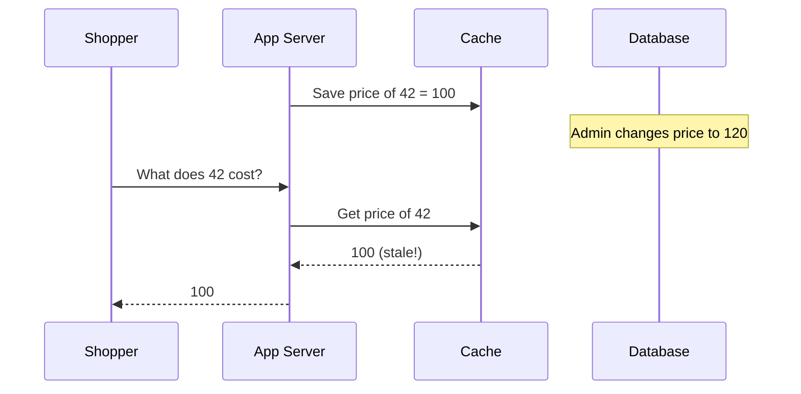
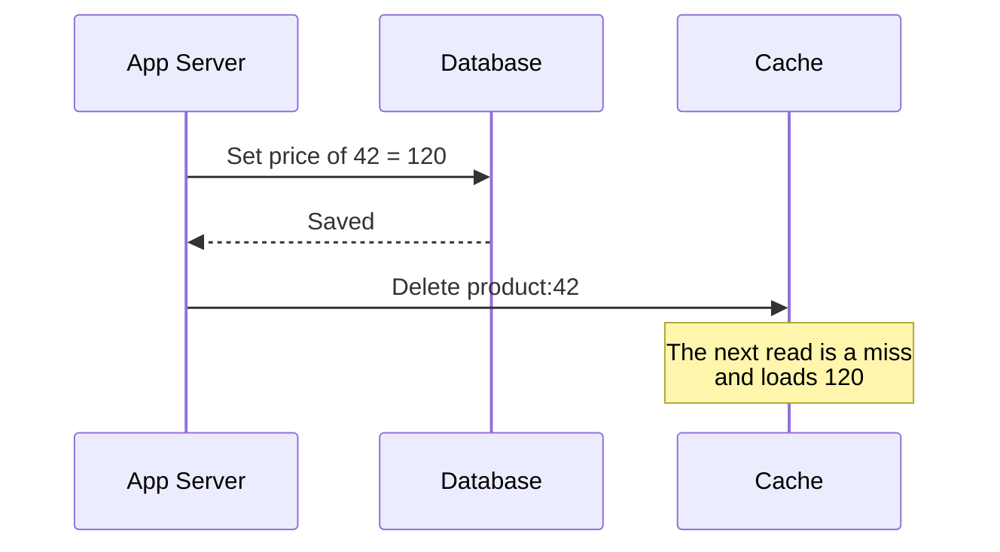
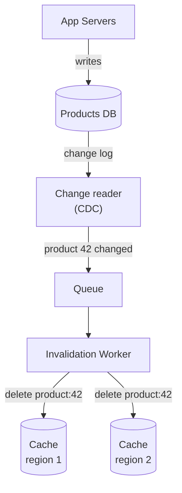

## The idea

A cache holds a **copy**. When the real data changes, the copy is now wrong. Wrong, old data in a cache is called **stale data**. **Invalidation** means removing (or fixing) the stale copy.

Think of a **restaurant's printed menus**. When the owner raises the price of a pizza, every printed menu on the tables is now stale. There are two simple fixes:

1. **Throw the old menus away** the moment the price changes. Waiters print fresh ones when they need them. This is **delete on write**.
2. **Reprint all menus every month**, no matter what. A wrong price can only live for one month. This is a **TTL** (time to live).

Most systems use **both**: delete when you know something changed, and a TTL to catch anything you missed.

## Why stale data happens

The database and the cache are two separate places. A write to one does not change the other by itself:



The shopper sees 100, but the real price is 120. They will be unhappy at checkout.

## Delete on write

When the app changes data, it **updates the database first, then deletes the cache key**:



```js
async function updatePrice(id, price) {
  await db.query('UPDATE products SET price = $1 WHERE id = $2', [price, id]);
  await redis.del(`product:${id}`);
}
```

### Why delete, and not update the cached value?

It looks smarter to write the new value into the cache. But two writes at the same time can arrive in the wrong order:

1. Writer A sets the price to **100** in the database.
2. Writer B sets the price to **120** in the database. The database now says 120.
3. Writer B writes **120** into the cache.
4. Writer A is a little slow, and writes **100** into the cache.

Now the database says 120 and the cache says 100, and it stays wrong until the TTL ends. A **delete** has no value in it, so the order does not matter: after both deletes, the next read loads the real price from the database.

### Why the database first?

If you delete the cache key first, a read can sneak in between: it misses, reads the **old** price from the database (not updated yet), and puts it back in the cache. Updating the database first makes this much less likely.

### What if the delete fails?

The database is updated, but the cache delete fails (a network error). The cache now holds stale data. Options:

- **Retry the delete**, for example through a queue.
- **Rely on the TTL.** The stale copy dies on its own after a while.

This is why delete on write is never used alone. **Always add a TTL.**

## TTL: let data expire

A **TTL** (time to live) is a timer on each cache key. When it runs out, the key is removed. The next read is a miss and loads fresh data.

```bash
# Keep this product in the cache for 5 minutes (300 seconds)
SET product:42 '{"name":"Lamp","price":120}' EX 300
TTL product:42     # how many seconds are left, e.g. 287
```

TTL is simple and needs no extra code on writes. Its weakness: data can be stale **for up to the full TTL**. With a 5-minute TTL, a user may see an old price for up to 5 minutes.

## Picking a good TTL

Ask three questions:

1. **How bad is old data?** A like count a minute old is fine. A seat map a minute old is not: people keep clicking seats that are already gone.
2. **How often does it change?** Data that changes once a year can live in the cache much longer.
3. **How costly is a miss?** A slow, heavy query is worth caching longer.

| Data | Example TTL | Why |
| --- | --- | --- |
| Seat map for a concert | 1-2 seconds, for display only | Changes fast. Holding a seat always checks the database, so old data can't sell a seat twice |
| Like and view counts | 10-60 seconds | A little behind is fine |
| Product details, user profile | 5-60 minutes | Changes rarely, delete on write handles edits |
| Short URL to long URL | Hours to a day | Almost never changes |
| Images and JS files with a version in the name | 1 year | A new version gets a new name. See [CDN](./cdn.mdx) |

**Add a little randomness (jitter).** If you load 10,000 keys at the same moment, all with a TTL of 600 seconds, they will all expire at the same moment too, and the database gets 10,000 misses at once. Add a few random seconds to each TTL to spread them out:

```js
const ttl = 600 + Math.floor(Math.random() * 60); // 10 to 11 minutes
await redis.set(key, value, 'EX', ttl);
```

More on this in [Cache Problems](./cache-problems.mdx).

## Invalidation by events

Sometimes many services write to the database, or many caches hold the same data. Asking every writer to remember every cache delete gets messy. Instead, **watch the database for changes**, and delete keys from there:



**CDC** (change data capture) reads the database's own log of changes. Every change becomes an event, and a worker deletes the matching cache keys. See [Change Data Capture](../distributed-systems/change-data-capture.mdx).

## In the real world

**"There are only two hard things in Computer Science: cache invalidation and naming things."** This famous joke is credited to Phil Karlton, a software engineer at Netscape. Engineers still quote it because it is true.

**Facebook deletes, it doesn't update.** In "Scaling Memcache at Facebook" (2013), Facebook explains that on a write it deletes the cache key instead of updating it, because deletes are safe to repeat. It also runs a program called **mcsqueal** on its database servers. mcsqueal reads the database's change log and sends the matching deletes to the caches. This is invalidation by events.

**DNS uses TTL.** Every DNS answer comes with a TTL. That is why changing a website's IP address can take minutes or hours to reach everyone. See [DNS](../foundations/dns.mdx).

## In the interview

When you add a cache, the interviewer will often ask: "What happens when the data changes?" Have this ready:

> "On every update, I write to the database first and then delete the cache key. I also set a TTL of 10 minutes, so even if a delete is missed, stale data can't live longer than that. For the seat map, I'll cache seat status for only 1 to 2 seconds, just for display. Holding a seat is an atomic update in the database, so a stale cache can't cause a double booking. At worst, the user sees 'Sorry, just taken'."

<Callout title="Remember this" type="success">
  - **Stale data** = the cache still has the old copy after the database changed.
  - **Delete on write:** update the database **first**, then **delete** the key.
  - **Delete, don't update** the cached value. Deletes can't arrive "in the wrong order".
  - **TTL** = an expiry timer. A safety net for anything you missed.
  - Pick the TTL by asking **how bad old data is**. Add **jitter** so keys don't expire together.
  - Decisions that must be exact, like **holding a seat** or **paying from a balance**, always **check the database**. A cache with a very short TTL only helps **show** that data.
</Callout>
