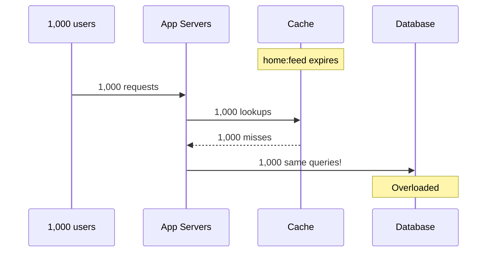
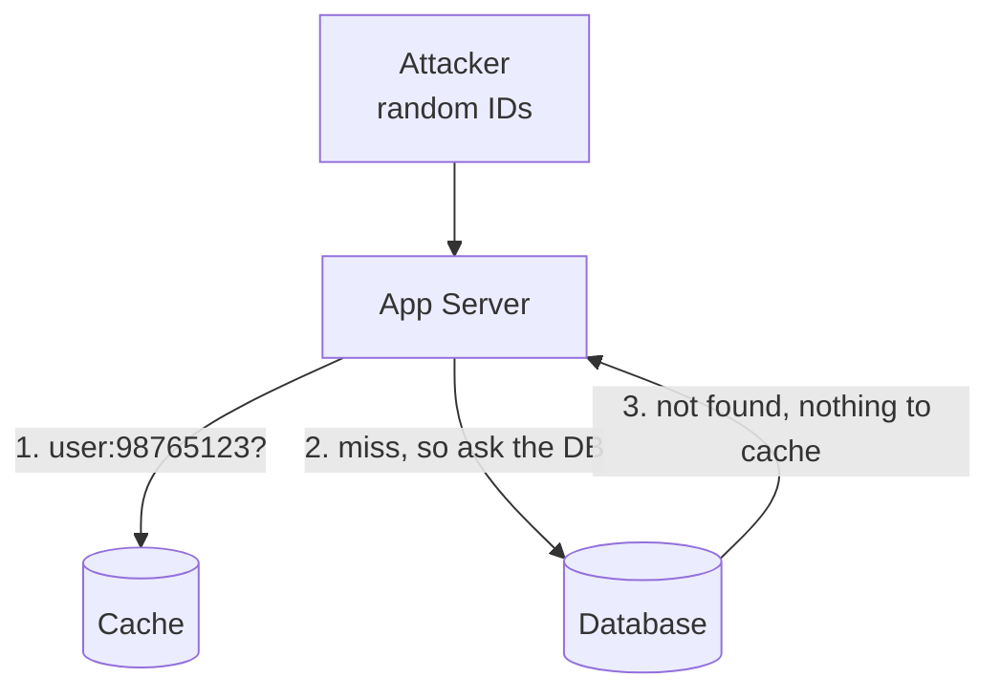

## What is it?

A cache protects the database by answering most reads. The problems on this page all have the same shape: **for some reason, the cache stops absorbing the reads, and a flood of requests hits the database at once.**

Think of a busy **bakery** with a display case (the cache) and a baker in the back (the database):

- **Stampede:** the tray of the bestselling bread runs out, and 50 customers all shout at the baker at the same moment.
- **Penetration:** people keep asking for a cake the bakery doesn't make. Each time, the clerk walks to the back to check, and comes back empty-handed.
- **Hot key:** everyone wants the same croissant, and only one clerk is allowed to sell it.
- **Cold start:** opening morning. The display case is empty, so every order goes to the baker.

## Why do we need it?

Once a cache works, the database is sized for the **misses**, not for all the reads. With a 95% hit ratio, it may only ever see about 5% of them.

So when the cache stops helping, even for a moment, the database suddenly gets up to **20 times** its normal load. It slows down, requests time out, clients retry, and the load grows even more. A small cache problem becomes a **full outage**. That is why you plan for these four cases before they happen.

## How it works inside

### Cache stampede

A **very popular key expires** (or gets deleted). In the next moment, hundreds of requests miss the cache **at the same time**, and all of them go to the database to load the same data. This is also called a **thundering herd**.



The database was fine with zero queries for that key. Now it gets 1,000 at once, slows down, and other requests start timing out too.

**Fixes:**

1. **Lock, so only one request reloads.** The first request that misses takes a lock and loads the data. The others wait a few milliseconds and read the cache again. (Some libraries call this **single flight** or **request coalescing**.)
2. **Refresh early.** For the hottest keys, a background job reloads the value **before** it expires, so it never actually expires.
3. **Serve the old value while refreshing.** Keep the stale value a little longer, return it, and refresh it in the background. A few seconds of old data is better than a database outage.
4. **Add jitter to TTLs.** When many keys are loaded at once with the same TTL, they also expire at once. A few random seconds per key spreads the misses out. (When a huge number of keys expire together, or a whole cache server dies, some people call it a **cache avalanche**.)

Fix 1 in code, using a Redis lock. It comes in three small pieces.

**Step 1: Small helpers.** A pause, a database read, and a script that releases the lock.

```js
import { randomUUID } from "node:crypto";

// Wait for some milliseconds
function sleep(milliseconds) {
    return new Promise((resolve) => {
        setTimeout(resolve, milliseconds);
    });
}

// Read from the database. "Nothing" (undefined) becomes null, so it can be cached.
async function loadValue(loadFromDb) {
    const value = await loadFromDb();

    if (value === undefined) {
        return null;
    }

    return value;
}

// A small Lua script. Redis runs it as one step:
// delete the lock only if it still holds our token.
const RELEASE = `
    if redis.call("GET", KEYS[1]) == ARGV[1] then
        return redis.call("DEL", KEYS[1])
    end
    return 0
`;
```

**Step 2: The main function.** Check the cache. On a miss, try to take the lock. If someone else has it, wait and try again.

```js
async function getWithLock(key, loadFromDb, triesLeft = 20) {
    // 1. Look in the cache
    const cached = await redis.get(key);

    if (cached !== null) {
        return JSON.parse(cached);
    }

    // 2. Try to take the lock. NX = set only if the key does not exist,
    // so only one request wins. EX 10 = the lock expires after 10 seconds.
    const lockKey = `lock:${key}`;
    const token = randomUUID();
    const gotLock = await redis.set(lockKey, token, "NX", "EX", 10);

    if (gotLock) {
        return loadAndSave(key, loadFromDb, lockKey, token);
    }

    // 3. Someone else is loading it. After 20 tries (about 1 second),
    // stop waiting and read the database directly.
    if (triesLeft === 0) {
        return loadValue(loadFromDb);
    }

    // Wait a moment, then check the cache again
    await sleep(50);
    return getWithLock(key, loadFromDb, triesLeft - 1);
}
```

**Step 3: The winner loads the data.** It reads the database, saves a copy in the cache, and releases the lock.

```js
async function loadAndSave(key, loadFromDb, lockKey, token) {
    try {
        const value = await loadValue(loadFromDb);

        // Found: keep it 10 minutes. Not found (null): only 1 minute.
        let seconds = 60;
        if (value) {
            seconds = 600;
        }

        await redis.set(key, JSON.stringify(value), "EX", seconds);
        return value;
    } finally {
        // This runs even if the database call failed
        await redis.eval(RELEASE, 1, lockKey, token);
    }
}
```

Three details make it safe:

- The lock's value is a **random token**. On release, we delete the lock only if it still holds our token. If our lock expired and another request took it, we don't delete theirs.
- `finally` releases the lock even if the database call fails. Otherwise everyone would wait 10 seconds for it to expire.
- The waiters retry only 20 times (about 1 second). If the reload is still not done (likely when the database is overloaded), each waiter reads the database itself, so users get an answer, not an error. They never wait forever. For the hottest keys, serving the old value (fix 3) is gentler on the database.

Now 1,000 misses turn into **1 database query** and 999 short waits. (Locks are covered in depth in [Distributed Locking](../distributed-systems/distributed-locking.mdx).)

### Cache penetration

Requests ask for data that **does not exist**, like `user:-1` or random product IDs. The cache never has it (there is nothing to cache), so **every request goes to the database**, finds nothing, and returns nothing. The cache does not help at all.

It can happen through a bug, or on purpose: an attacker sends millions of requests with made-up IDs to get past your cache.



**Fixes:**

1. **Cache the "not found" answer.** Save `null` as the value, with a **short TTL**, so repeat requests stop at the cache. `null` is valid JSON, so the normal read code (`JSON.parse`) still works:

   ```js
   async function getUser(id) {
     const cached = await redis.get(`user:${id}`);
     if (cached !== null) return JSON.parse(cached); // a user, or null = "not found"

     const user = (await db.findUser(id)) ?? null;
     // Found: keep it 10 minutes. Not found: remember that for only 1 minute.
     await redis.set(`user:${id}`, JSON.stringify(user), 'EX', user ? 600 : 60);
     return user;
   }
   ```

2. **Use a Bloom filter.** A **Bloom filter** is a tiny data structure that answers "is this ID **maybe** in the database, or **definitely not**?" using very little memory. Check it first, and drop requests for IDs that definitely don't exist. See [Bloom Filter, HyperLogLog, Count-Min Sketch](../advanced-components/probabilistic-data-structures.mdx).
3. **Check the input.** Reject IDs that can't be real (negative, wrong format) before touching the cache or database.
4. **Rate limit** clients that cause many misses. See [Rate Limiting](../reliability-security/rate-limiting.mdx).

### Hot keys

One key gets **far more traffic than all others**. A celebrity's profile, a viral post, the product on a flash sale. In a [distributed cache](./distributed-caching.mdx), each key lives on **one shard**. So one cache server gets most of the traffic while the others sit idle, and that one server runs out of CPU or network.

**Fixes:**

1. **Local cache for the hottest keys.** Each app server keeps the hot key in its own memory for a few seconds. Most reads never leave the app server.
2. **Several copies of the key.** Save the value under several keys, like `product:42#1` to `product:42#5`. Different names usually hash to different shards, but that is not guaranteed, so check where they land. On each read, pick one copy at random:

   ```js
   const n = 1 + Math.floor(Math.random() * 5);
   const data = await redis.get(`product:42#${n}`);
   ```

   The cost is on writes: when the value changes, you must update or delete **all 5 copies**.

3. **Read replicas** of the hot shard, so several machines share the reads.

More on hot keys, and the related "celebrity problem" for feeds and databases, is in [Hot Keys, Hot Partitions and Fan-out](../advanced-components/hot-keys-fan-out.mdx).

### Cold start

The cache is **empty**: after a restart, after adding a new cache cluster, or after someone flushed it. The hit ratio drops to zero, so all traffic goes to the database, which was never sized for that.

**Fixes:**

1. **Warm the cache first.** Before sending traffic, load the most popular keys (for example, the top items from yesterday's logs).
2. **Send traffic slowly.** Move 5% of users to the new cache, then 20%, then all, so it fills up gradually.
3. **Don't lose the cache in the first place.** Use replicas, restart cache nodes one at a time, and don't flush the whole cache during a deploy.

### All four side by side

| Problem | What happens | Main fixes |
| --- | --- | --- |
| **Stampede** | A hot key expires. Many misses at once | Lock so one request reloads, refresh early, TTL jitter |
| **Penetration** | Requests for data that doesn't exist. Always a miss | Cache "not found", Bloom filter, check input |
| **Hot key** | One key overloads one cache server | Local cache, copies of the key, replicas |
| **Cold start** | Empty cache. Everything goes to the database | Warm up first, shift traffic slowly |

## When to use which

- **Lock (one reloader):** hot keys that are slow to rebuild.
- **Refresh early, or serve the old value:** the very hottest keys, where even a short wait hurts.
- **TTL jitter:** always, when many keys are loaded at once. It costs nothing.
- **Cache "not found":** whenever IDs come from users or the outside world.
- **Bloom filter:** a huge set of valid IDs, and lots of requests for made-up ones.
- **Local copy or several copies:** only for keys you know get hot.
- **Warm-up:** before you switch traffic to a new or empty cache.

**Don't use them when:**

- **The key is not hot.** A lock on every key adds a round trip and more code for nothing.
- **"Not found" would be cached for long.** A new user or product stays invisible until that TTL ends.
- **The value changes often.** Several copies mean every write must update all of them.

## Alternatives

| Option | What it is | Pick it when |
| --- | --- | --- |
| **A database big enough for all reads** | Size the database so it survives with no cache at all | Small systems, or when the cache is only for speed |
| **Merge requests at the proxy or CDN** | Only one request for the same missing item goes to the server. The others wait for its answer (Nginx `proxy_cache_lock`, CDN request collapsing) | You cache whole HTTP responses |
| **Never expire, update by events** | Hot keys get no TTL. A worker updates them from the database's change log | The hot keys are few and known. See [Cache Invalidation and TTL](./cache-invalidation-ttl.mdx) |
| **Protect the database** | Timeouts, a circuit breaker, and dropping extra load. See [Circuit Breaker](../reliability-security/circuit-breaker.mdx) | Always, as the last line of defence when the cache fails anyway |

## In the real world

**Facebook's 2010 outage was a herd of requests.** On September 23, 2010, Facebook was down for about two and a half hours. Facebook explained that a system meant to fix bad configuration values in its cache saw a value it thought was invalid. **Every** client then tried to "fix" it by querying the same database cluster, which got hundreds of thousands of queries per second and fell over. Each failure made clients see more errors, which caused more queries. Facebook had to turn the site off to stop the loop.

**Facebook uses "leases" against stampedes.** The "Scaling Memcache at Facebook" paper (2013) describes it: when many clients miss on the same key, Memcached gives only one of them a lease (permission to reload it). The others wait briefly and retry, and by then the value is usually back in the cache.

**Facebook warms cold clusters from warm ones.** The same paper describes how a new cache cluster with an empty cache reads misses from an **already-warm cache cluster** instead of from the databases, until its own hit ratio is high.

## In the interview

After you add a cache, the interviewer may push: "What if that key expires?" or "What if one item goes viral?" Name the problem and the fix:

> "The home feed key is read by everyone, so when it expires we could get a stampede. I'll let only one request reload it, using a short Redis lock, and the rest wait a few milliseconds. For the celebrity profile, which is a hot key, I'll also keep a copy in each app server's memory for 5 seconds."

<Callout title="Remember this" type="success">
  - All four problems = the cache stops helping, and the **database gets flooded**.
  - **Stampede:** a hot key expires. Fix with a **lock** (one reloader), **early refresh**, **TTL jitter**.
  - **Penetration:** requests for data that doesn't exist. **Cache "not found"**, use a **Bloom filter**.
  - **Hot key:** one key overloads one shard. **Local cache** or **several copies** of the key.
  - **Cold start:** empty cache. **Warm it up** and **shift traffic slowly**.
  - **Why:** the database is sized for the misses. When the cache stops helping, it gets up to **20x** the load and falls over.
  - **Alternatives:** a bigger database, merging requests at the proxy or CDN, update-by-events, and a circuit breaker.
</Callout>
