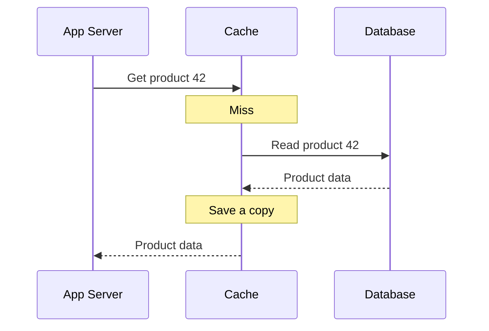
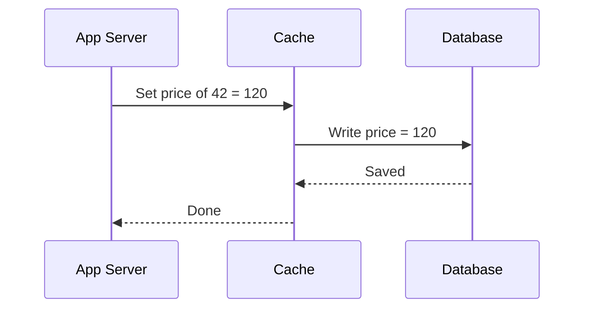
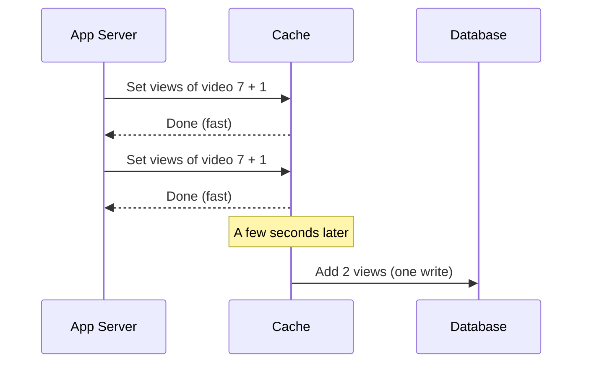
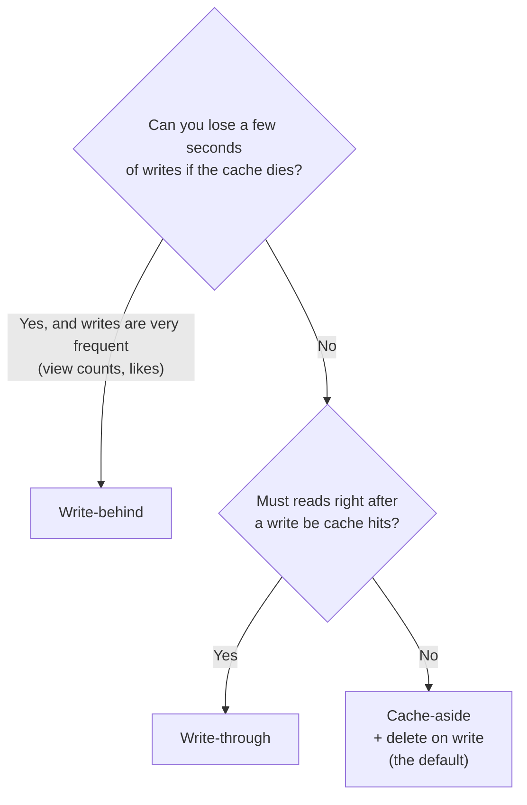

## The idea

Once you have a cache, you must decide two things:

1. **On a read:** who fills the cache on a miss, the app or the cache itself?
2. **On a write:** do you write to the cache, the database, or both? And in what order?

Think of a **restaurant waiter** and the **kitchen**. Some waiters keep a few popular desserts at their station and go to the kitchen only when they run out (the waiter fills the station). In other restaurants, the waiter only ever talks to a counter, and the counter staff deal with the kitchen (the counter fills itself). The four strategies below are just these choices, made clear.

All examples use an **online shop** with a `products` table and a Redis cache.

## Cache-aside (lazy loading)

The **app** talks to both the cache and the database. The cache is "on the side" and knows nothing about the database.

- **Read:** check the cache. On a miss, read the database, then save a copy in the cache.
- **Write:** update the database, then **delete** the key from the cache. The next read loads the fresh copy.

The read flow is drawn in [What is Caching](./what-is-caching.mdx). In code:

**Read:** check the cache first. On a miss, read the database and keep a copy.

```js
async function getProduct(id) {
    const key = `product:${id}`;

    // 1. Look in the cache
    const cached = await redis.get(key);

    if (cached) {
        // Cache hit
        return JSON.parse(cached);
    }

    // 2. Cache miss: read the database. No row means null.
    const result = await db.query("SELECT * FROM products WHERE id = $1", [id]);
    let product = null;
    if (result.rows.length > 0) {
        product = result.rows[0];
    }

    // 3. Keep a copy. Found: keep it 10 minutes. Not found (null): only 1 minute,
    // so a product created soon after still shows up quickly.
    let seconds = 60;
    if (product) {
        seconds = 600;
    }

    await redis.set(key, JSON.stringify(product), "EX", seconds);
    return product;
}
```

**Write:** update the database, then delete the cached copy.

```js
async function updatePrice(id, price) {
    await db.query("UPDATE products SET price = $1 WHERE id = $2", [price, id]);

    // The next read misses, and loads the new price
    await redis.del(`product:${id}`);
}
```

**Good:** simple. Only data that someone actually asked for goes into the cache. If the cache dies, the app still works (slower), because it can read the database directly.

**Bad:** the first read of every key is a miss. And the app code must handle the cache itself.

**This is the default choice in interviews.**

## Read-through

The app talks **only to the cache**. On a miss, **the cache itself** loads the data from the database.



It works like cache-aside, but the "check, then load" logic lives in the cache (or a library) instead of your app code.

**Good:** app code is simpler. **Bad:** you need a cache that knows how to talk to your database. Plain Redis does not do this by itself, so you usually get it from a library or a managed product.

## Write-through

On every write, the data goes to the **cache and the database together**, before the app says "done".



**Good:** the cache always has fresh data. Reads right after a write are hits.

**Bad:** every write is slower, because it waits for two writes. And the cache fills with data that may never be read. Write-through is often paired with read-through.

## Write-behind (write-back)

The app writes **only to the cache** and gets "done" right away. The cache saves the changes to the database **later**, often in batches.



**Good:** writes are very fast, and many small writes become one database write.

**Bad:** if the cache crashes before it saves, **those writes are lost**. It is also more complex to build. Use it only for data where losing a few seconds of changes is okay, like view counts or likes, and never for payments or orders.

## Side by side

| Strategy | Who fills the cache | Write path | Fresh data? | Main risk |
| --- | --- | --- | --- | --- |
| **Cache-aside** | The app, on a miss | Database, then delete the key | Fresh after the next miss | Small windows of stale data |
| **Read-through** | The cache, on a miss | (Combine with one of the write strategies) | Same as cache-aside | Needs a cache that can load data |
| **Write-through** | Every write | Cache and database together | Always fresh | Slower writes, cache full of unread data |
| **Write-behind** | Every write | Cache now, database later | Cache is fresh, database is behind | **Data loss** if the cache dies |

There is also **write-around**: writes go only to the database and skip the cache. The cache gets the data later, on a read miss. Cache-aside with "update the database, delete the key" is a kind of write-around.

## Which one to pick



Most real systems use **cache-aside + delete on write + a TTL**. How to keep that data fresh is in [Cache Invalidation and TTL](./cache-invalidation-ttl.mdx).

## In the real world

**Facebook uses cache-aside.** In the paper "Scaling Memcache at Facebook" (2013), Facebook calls Memcached a "demand-filled look-aside cache". A web server reads from Memcached and, on a miss, reads the database and fills the cache. On a write, it updates the database and then sends a **delete** to Memcached, instead of updating the cached value.

**Amazon DAX is read-through and write-through.** DynamoDB Accelerator (DAX) is an in-memory cache that sits in front of Amazon's DynamoDB database. The app sends its reads and writes to DAX. DAX loads missing items from DynamoDB itself, and writes go through DAX to DynamoDB.

**Your operating system uses write-behind.** When a program saves a file, the operating system usually puts the change in memory first and writes it to the disk a little later. That is why pulling the power at the wrong moment can lose recent changes.

## In the interview

Name the strategy and say what happens on a write:

> "I'll use cache-aside. On a read, I check Redis first and fill it on a miss. On a write, I update the database and then delete the cache key, so the next read gets fresh data. A TTL of 10 minutes is the safety net."

If writes are huge and losing a few is fine, mention write-behind for counters.

<Callout title="Remember this" type="success">
  - **Cache-aside:** the app checks the cache, loads from the database on a miss. **The default.**
  - **Read-through:** the cache loads from the database itself.
  - **Write-through:** write to the cache and the database together. Always fresh, slower writes.
  - **Write-behind:** write to the cache now, the database later. Fast, but **can lose data**.
  - On a write, **update the database, then delete the key**. Don't update the cached value.
</Callout>
