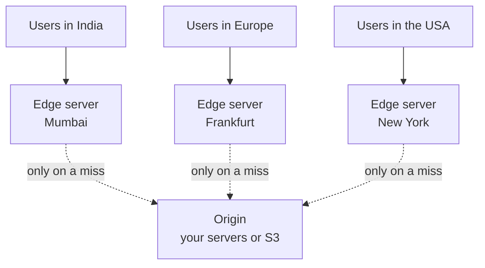
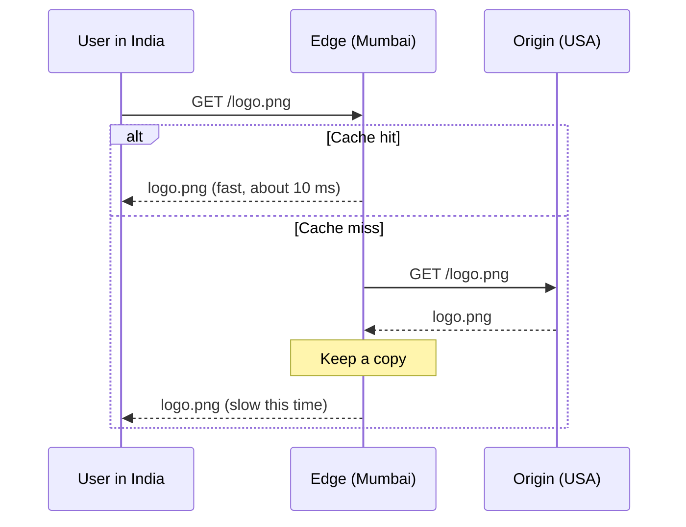

## What is it?

A **CDN** (content delivery network) is a large group of servers spread across many cities around the world. Each one keeps copies of your files, so users download them from a server **near them** instead of from your server far away.

Think of a big **online shop with one warehouse** in the USA. A customer in India waits two weeks for every order. So the shop opens **small local warehouses** in many countries and stocks them with the most popular items. Now most orders arrive in a day. Only rare items still come from the main warehouse.

- The **main warehouse** is your **origin**: your own servers or storage (like S3), where the real files live.
- The **local warehouses** are **edge servers**. A CDN location with edge servers is called a **PoP** (point of presence).

## Why do we need it?

Distance matters because data can't travel faster than light. A round trip from India to the USA takes around 200 ms. A round trip to a server in the same city takes a few ms. See [What is Caching](./what-is-caching.mdx) for the numbers.

Loading one page takes **several round trips**: setting up the connection, then the HTML, then its images and scripts. A far-away user pays those 200 ms again and again, and the page feels slow.

The origin suffers too. Every image is downloaded millions of times **from your servers**, so you pay for all that bandwidth, and a traffic spike or an attack hits you directly. A CDN answers most requests near the user, and the origin sees only the misses.

## How it works inside

### From the user to the edge



1. Your site points its files at the CDN, for example `cdn.myshop.com/logo.png`.
2. The CDN sends the user to a **nearby edge server**. It does this with DNS (the CDN's DNS answers with the address of a close edge server), or with **Anycast** (many edge servers share one IP address, and the internet's routing sends you to the closest one).
3. The edge server checks its own cache:



The first user in Mumbai pays for the slow trip. Everyone after them gets the fast copy. Your origin sees **one request** instead of millions.

### Pull vs push

- **Pull CDN:** the edge fetches a file from the origin on the **first miss**, like above. Simple, and the most common.
- **Push CDN:** you **upload** files to the CDN ahead of time. Useful for very large files, or a big launch where you don't want the first users to hit the origin.

### A shield in the middle

A CDN has hundreds of edge locations. If each one missed on its own, a new file would hit the origin hundreds of times. So many CDNs add a middle layer, often called an **origin shield** or **tiered cache**: edges ask the shield on a miss, and only the shield asks the origin. The origin sees about **one** request per file.

## Cache rules and expiry

The origin tells the CDN and the browser **how long** to keep each file, using the `Cache-Control` response header:

| `Cache-Control` value | Meaning |
| --- | --- |
| `public, max-age=3600` | Anyone (browser and CDN) may keep it for 3,600 seconds (1 hour) |
| `public, max-age=60, s-maxage=600` | The browser keeps it 1 minute. The CDN (a "shared" cache) keeps it 10 minutes |
| `private, max-age=60` | Only the user's own browser may keep it. **The CDN must not** |
| `no-cache` | You may keep it, but must **ask the origin first** whether it changed (the `304 Not Modified` check) |
| `no-store` | Never keep it anywhere. For sensitive data |
| `max-age=60, stale-while-revalidate=30` | After 60 seconds, still serve the old copy for up to 30 more seconds while fetching a fresh one in the background |

### Versioned file names: cache forever, change instantly

How do you cache a file for a year, but still ship a new version today? **Put a version in the file name.** Build tools add a short hash of the file's content:

```http
GET /assets/app.3f9a1c.js

HTTP/1.1 200 OK
Cache-Control: public, max-age=31536000, immutable
```

The file `app.3f9a1c.js` never changes, so it can be cached for a year (31,536,000 seconds). When you change the code, the build makes `app.8b21d7.js`, a **new name**. Your HTML (cached only briefly) points to the new name, and everyone gets the new file at once.

### Purging

If you must remove a file before it expires (a mistake, a legal request), CDNs let you **purge** (invalidate) it by URL. The next request is a miss and fetches the new copy. Purging is a fix for emergencies; versioned names are the everyday way.

## Edge caching for API responses

CDNs can cache **API responses** too, not just files. This works when many users get the **same answer**:

- The product list for "lamps"
- The live score of a cricket match
- Today's top news stories

Even a **very short TTL** helps a lot. If 10,000 users per second ask for the live score, and the edge keeps it for **2 seconds**, your origin gets about 1 request every 2 seconds from each edge, instead of 10,000 per second.

```http
HTTP/1.1 200 OK
Content-Type: application/json
Cache-Control: public, max-age=0, s-maxage=2
```

Here the browser does not keep it (`max-age=0`), but the CDN keeps it for 2 seconds (`s-maxage=2`).

**The big danger: personal data.** The CDN stores responses by URL. If `/api/me` is cached at the edge, the next user who asks for `/api/me` gets the **first user's** data. Personal responses must use `private` or `no-store`.

**Private files are different.** A user's photo or a paid video is one file with its own URL, not a shared URL like `/api/me`. These can still go through a CDN, using **signed URLs**: the app gives the user a link with a signature that only works for a short time, and the CDN checks the signature before serving the file.

## When to use it

| Put on a CDN | Don't put on a CDN |
| --- | --- |
| Images, videos, audio | Pages with **personal data** (your cart, your account) |
| JavaScript, CSS, fonts | Data that must be exact right now (stock left, bank balance) |
| Downloads: apps, PDFs, game updates | Requests that change data (`POST`, `PUT`, `DELETE`) |
| Video streams. A video is split into small chunks of a few seconds each, and each chunk is a cacheable file | |
| Public API responses that are the same for everyone (see above) | |

A CDN also helps in other ways: it absorbs huge traffic spikes and **DDoS attacks** (floods of fake traffic) before they reach you, and it handles HTTPS close to the user.

**Don't use it when:**

- **Your users are all near your servers,** and traffic is small. A CDN adds cost, and one more place where an old copy can hide.
- **Files change often and can't get versioned names.** Each change needs a purge, and some users see the old copy until it is gone.

## Alternatives

| Option | What it is | Pick it when |
| --- | --- | --- |
| **Serve from the origin** | Your own servers, or S3, answer every request | Users are close to your servers, and traffic is small |
| **Browser cache only** | The browser keeps files, told by `Cache-Control` | Users come back often on the same device. It doesn't help a first visit |
| **More regions** | Run your app and its data in several cloud regions, near users | Responses are personal or change all the time, so the edge can't cache them |
| **Edge functions** | Run small pieces of code on the CDN's own servers (Cloudflare Workers, Lambda@Edge) | You need logic near users: redirects, A/B tests, checking a login token |
| **Your own CDN** | Your own cache servers, placed inside internet providers' networks | Huge, steady video traffic, like Netflix (see below) |

## In the real world

**Netflix built its own CDN.** Netflix's **Open Connect** places Netflix's own cache servers inside internet providers' networks, close to viewers. Netflix fills them with the shows people are likely to watch during quiet, off-peak hours (a push approach), so when you press play, the video usually comes from a server inside your own internet provider.

**One CDN bug took down big websites.** On June 8, 2021, the CDN company **Fastly** had a major outage. A customer made a normal settings change that triggered a hidden bug, and most of Fastly's network started returning errors. Sites like Reddit, the New York Times and gov.uk were unreachable for close to an hour. It showed how much of the web sits behind a few CDNs.

**Steam showed users other people's pages.** On Christmas Day 2015, while under a traffic attack, Valve changed the caching setup of the Steam store. The new setup wrongly cached pages for logged-in users, so some users saw store pages generated for **other users**, including their account details. This is the "personal data at the edge" danger in real life.

## In the interview

Bring up a CDN whenever there are **images, videos or static files**, or users **all over the world**:

> "Images and videos go in S3, served through a CDN. Files get versioned names and a one-year cache time, so almost every request is answered at the edge. For the public trending list, I'll also cache the API response at the edge for 30 seconds. Personal API responses are marked `private`, so the CDN never stores them."

<Callout title="Remember this" type="success">
  - A **CDN** keeps copies of files on **edge servers** near users. The real files live on the **origin**.
  - Edge **hit** = fast, near the user. **Miss** = fetch once from the origin, then keep a copy.
  - Put **static files, images, video chunks** and **public** API responses on a CDN. Personal responses (like `/api/me`) are `private`. Private files use **signed URLs**.
  - `Cache-Control` decides how long: `max-age` (everyone), `s-maxage` (CDN only), `private`, `no-store`.
  - **Versioned file names** (`app.3f9a1c.js`): cache for a year, and change instantly with a new name.
  - Even **1-2 seconds** of edge caching can remove most of the load from the origin.
  - **Why:** distance costs about 200 ms per round trip across the world, and one origin can't serve every download.
  - **Inside:** DNS or **Anycast** sends users to a near edge. On a miss, the edge (or a **shield**) fetches once from the origin.
  - **Alternatives:** serve from the origin, browser cache only, more regions, edge functions, your own CDN.
</Callout>
