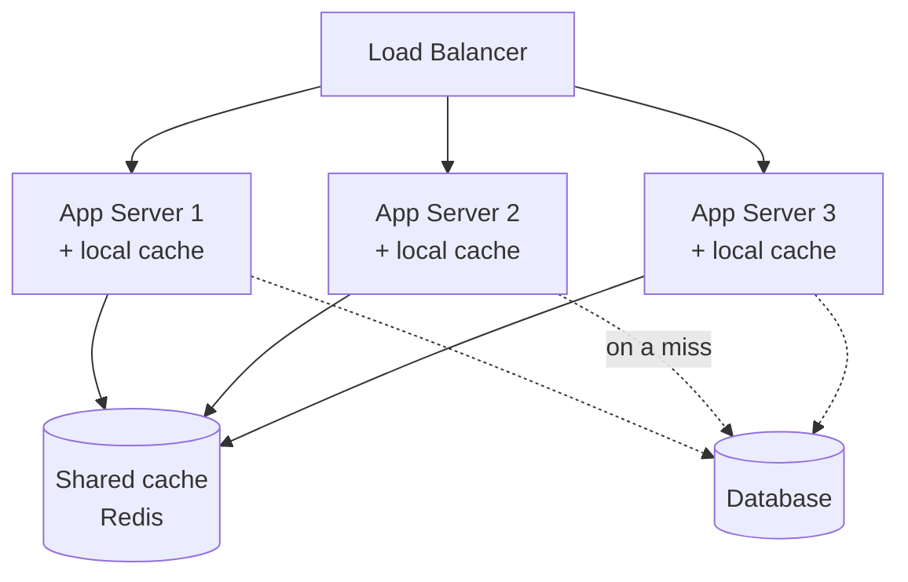
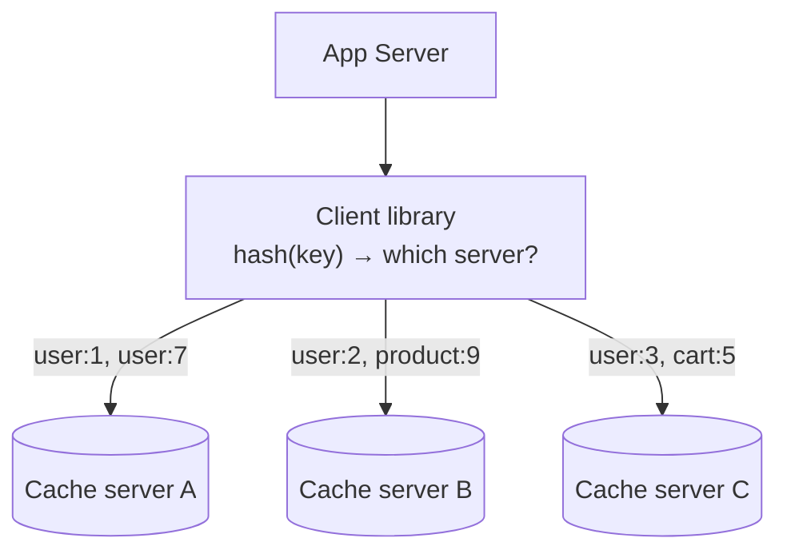
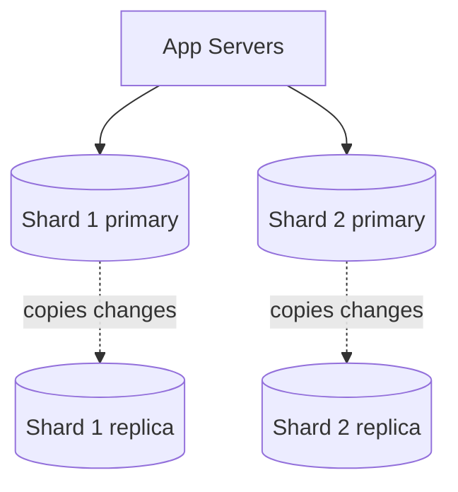

## What is it?

When you have many app servers, where should the cache live? And what if one cache machine is not big enough?

Think of a **restaurant kitchen with many cooks**:

- Each cook has a **small spice rack at their own station**. Very fast to reach, but every cook has their own, and one rack can run out of salt while another is full. This is a **local cache**.
- The kitchen also has **one big shared pantry**. A few steps away, but everyone sees the same shelves. This is a **shared cache**.
- When the pantry gets too small, you split it into **several rooms**: A to H in room 1, I to P in room 2, and so on. This is a **distributed cache**: one shared cache, spread over many machines.

## Why do we need it?

A cache inside one app server only helps that server. With 20 app servers, the same item is loaded from the database 20 times, the copies can disagree, and every deploy empties them. So most systems use a **shared** cache.

But one cache machine has limits too:

- **Memory:** it holds what fits in its RAM, maybe tens of gigabytes.
- **Traffic:** its CPU and network can serve only so many requests per second.
- **Failure:** if it dies, every key becomes a miss at once, and the database is flooded (see [Cache Problems](./cache-problems.mdx)).

A distributed cache fixes both problems: **one shared cache**, split across **many machines**, with **copies** of each part.

## How it works inside

### Local cache vs shared cache

A **local cache** lives inside each app server's memory (like a `Map` in Node.js). A **shared cache** is a separate server, like Redis, that all app servers talk to over the network.

| | Local (in-app) cache | Shared cache (Redis, Memcached) |
| --- | --- | --- |
| **Speed** | Fastest. No network, under a microsecond | Very fast. One network hop, under 1 ms |
| **Copies** | Each server has its own copy | One copy for everyone |
| **Same answer on every server?** | No. Server 1 may have old data, server 2 new data | Yes |
| **Size** | Small. Limited by each server's memory | Large. Add more cache machines |
| **After a deploy or restart** | Empty | Still full |
| **Good for** | Tiny, very hot data: config, feature flags | Almost everything else |

Many big systems use **both**, as two levels. The app checks its local cache first (level 1), then Redis (level 2), then the database:

On a miss in both levels, the **app** reads the database and saves a copy in Redis. Redis itself never talks to the database. This is cache-aside (see [Caching Strategies](./caching-strategies.mdx)).

Keep the local level's TTL **short** (seconds), because the local copies can't all be deleted at once when data changes.

### Spreading keys across cache servers

One Redis machine holds what fits in its memory, maybe tens of gigabytes. When you need more, you split the keys across several machines. Each machine holds **one part** of the keys. This is called **sharding**, and each part is a **shard**.

The app needs a rule to find which machine holds a key. It **hashes** the key: it turns the key into a number with a hash function. The number decides the machine.

#### The simple rule, and its problem

The simplest rule is `server = hash(key) mod N`, where `N` is the number of servers. ("mod" is the remainder after dividing.)

It works until `N` changes. Say you have 3 servers and add a 4th:

| Key's hash | With 3 servers (mod 3) | With 4 servers (mod 4) | Moved? |
| --- | --- | --- | --- |
| 20 | Server 2 | Server 0 | Yes |
| 21 | Server 0 | Server 1 | Yes |
| 22 | Server 1 | Server 2 | Yes |
| 23 | Server 2 | Server 3 | Yes |
| 24 | Server 0 | Server 0 | No |
| 25 | Server 1 | Server 1 | No |

**Most keys move** to a different server. On average, going from 3 to 4 servers moves about 3 out of 4 keys. Every moved key is now a **miss**, so the database suddenly gets most of the traffic the cache used to absorb. It can fall over.

There are two common fixes:

- **Consistent hashing.** It places servers and keys on a ring, so adding a 4th server moves only the keys that the new server takes over: about 1 in 4. Memcached client libraries often use it. See [Consistent Hashing](../databases/consistent-hashing.mdx).
- **Hash slots.** Redis Cluster does not use a ring. It splits keys into a fixed number of **slots** (16,384), and each server owns some slots. Adding a server moves only some slots to it, with their keys. The rest stay where they are.

### Replicas and failover

If a cache server dies, all its keys are gone at once, and they all become misses. To avoid that, each shard has a **replica**: a copy that receives every change from the **primary**.

**Failover** is what happens when a primary dies:

1. The other nodes notice the primary stopped answering.
2. They **promote** its replica to be the new primary.
3. Clients are told the new address and send requests there.

Copying to the replica usually happens **a moment after** the write (asynchronously), so a few of the newest writes can be lost in a failover. For a cache this is fine: a lost key just becomes a miss. More on this in [Redundancy and Failover](../reliability-security/redundancy-failover.mdx).

## Redis Cluster vs Memcached

The two classic choices for a distributed cache:

| | Redis Cluster | Memcached |
| --- | --- | --- |
| **Values** | Strings, lists, sets, sorted sets, hashes, and more | Plain strings (bytes) only |
| **Sharding** | Built in. Keys are split into **16,384 hash slots**, and each primary owns some slots | Done by the **client**: the client library picks the server |
| **Replicas and failover** | Built in. A replica is promoted automatically | None built in. A dead server's keys are just lost |
| **Saving to disk** | Optional | Never. Memory only |
| **Threads** | Runs commands one at a time on one main thread | Many threads. Uses all CPU cores of one machine |
| **Pick it when** | You need data types, replicas, or more than a cache. **The usual answer** | You need a very simple, very fast key-value cache |

**One Redis Cluster rule to know:** a command that touches several keys only works if those keys are in the **same slot**. You force keys into the same slot with a **hash tag**: only the part inside curly braces is hashed, so `{user:42}:cart` and `{user:42}:profile` land on the same shard.

## When to use it

- **Many app servers** read the same data.
- The hot data is **bigger than one machine's memory**, or there are more requests than one machine can serve.
- The database **can't survive** losing the cache, so each part needs a replica.

**Don't use it when:**

- **One node is enough.** A single Redis primary with a replica is simpler. Sharding adds machines, and limits commands that touch several keys.
- **There is one app server, or the data is tiny.** A local cache is enough.
- **Every read must be exact.** A cache is a copy, and async replicas can lose the newest writes.

## Alternatives

| Option | What it is | Pick it when |
| --- | --- | --- |
| **One node plus a replica** | A single cache primary, with a replica ready to take over | The hot data fits in one machine's memory. The simplest setup |
| **In-memory data grid** (Hazelcast, Apache Ignite) | The cache runs inside the app servers, and they share the data among themselves | Java apps that want a shared cache without separate cache servers |
| **Database read replicas** | Copies of the database that serve reads. See [Replication](../databases/replication.mdx) | The data is too varied to cache well |

For other cache servers (Memcached, Valkey, Dragonfly) and a CDN, see the alternatives on the [Redis](./redis.mdx) page.

## In the real world

**Facebook routes Memcached traffic through a proxy.** Facebook built **mcrouter**, a proxy that sits between its web servers and thousands of Memcached servers. It decides which server holds each key, and handles failover. Facebook open-sourced it in 2014.

**Twitter built twemproxy.** Twitter's open-source proxy (also called "nutcracker") does the same job for both Memcached and Redis: apps talk to the proxy, and the proxy spreads keys across many cache servers.

**Cloud providers run it for you.** Amazon ElastiCache and Google Cloud Memorystore are managed services: you choose how many shards and replicas you want, and they handle failover and upgrades.

## In the interview

When the data is too big for one cache machine, or you need it to survive a machine dying, say:

> "One Redis node isn't enough for this much data, so I'll use Redis Cluster with 6 shards. Keys are spread over 16,384 hash slots, so adding a shard moves only the slots it takes over, a small part of the keys. Each shard has a replica, so if a node dies, its replica takes over and we don't lose the whole shard."

If the interviewer asks "what happens when a cache node dies?", talk about replicas, and about the burst of misses hitting the database (see [Cache Problems](./cache-problems.mdx)).

<Callout title="Remember this" type="success">
  - **Local cache:** fastest, but every server has its own copy. Use for tiny, hot data with a short TTL.
  - **Shared cache** (Redis): one copy for all servers. The usual choice.
  - **Sharding** spreads keys over many cache servers by hashing the key.
  - `hash mod N` moves **most keys** when N changes. Use **consistent hashing** (a ring) or **hash slots** (Redis Cluster).
  - **Replicas** keep a copy of each shard. **Failover** promotes the replica when the primary dies.
  - **Redis Cluster:** data types, built-in sharding (16,384 slots) and failover. **Memcached:** simple and multi-threaded, no replicas.
  - **Why:** a local cache helps only one server, and one cache machine runs out of memory, traffic, or dies.
  - **Alternatives:** one node plus a replica, an in-memory data grid (Hazelcast), database read replicas.
</Callout>
