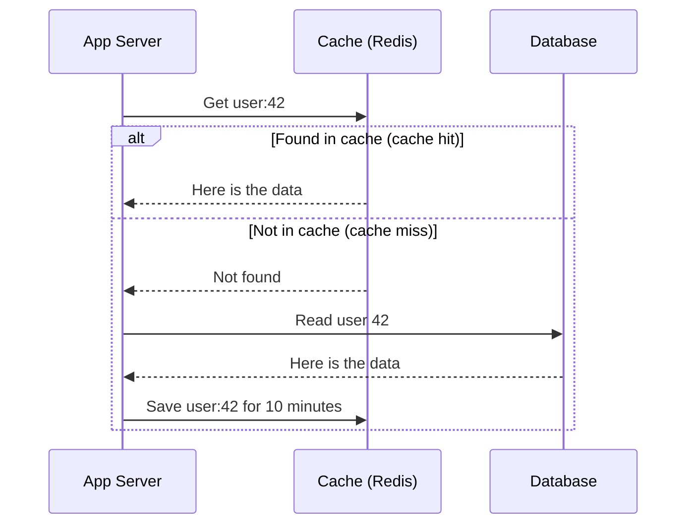
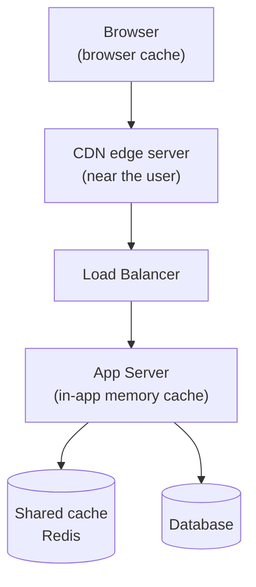

## What is it?

A **cache** is a small, fast storage that keeps a **copy** of data you use often. The next time you need that data, you read the copy instead of going back to the slow place where the real data lives.

Think of the **water bottle on your desk**. You don't walk to the kitchen every time you are thirsty. You fill the bottle once and drink from it many times. The bottle is the **cache**. The kitchen is the **database**. The bottle is small, so it only holds what you need right now.

In software, the "kitchen" is usually a **database** on disk, another service, or a server far away. The "bottle" is usually **memory (RAM)**, which is much faster to read.

## Why do we need it?

Without a cache, every request goes all the way to the place where the real data lives. Three things hurt:

- **The same work, again and again.** Most apps are **read-heavy**, and a few popular items (the home page, a famous profile, today's top products) get most of the reads. Each read repeats the same query.
- **The slow place is slow.** A database reads from disk and does real work. Another company's API, or a server far away, adds network trips. The numbers are below.
- **The slow place has a limit.** A database can answer only so many queries per second. Repeated reads use up that limit, and more database machines cost a lot.

A cache answers the repeated reads from a fast copy. Users get faster answers, and the database only sees the **misses**.

## How it works inside

### A key-value lookup in memory

Most caches are a big **hash table** in memory. You give a key, like `user:42`, and get the value back in one step, no matter how many entries there are. Two extra rules make it a cache: each entry can have a **time to live (TTL)**, after which it is gone, and when memory is full the cache **throws entries away** (eviction).

### Hit and miss

Every time you look in the cache, one of two things happens:

- **Cache hit:** the data is in the cache. You get it fast.
- **Cache miss:** the data is not there. You read it from the slow place, then save a copy in the cache for next time.

This is the most common way an app uses a cache. The app checks the cache first, and only goes to the database on a miss:

This pattern is called **cache-aside**. It and the other ways to read and write through a cache are in [Caching Strategies](./caching-strategies.mdx).

### The hit ratio

The **hit ratio** is the share of lookups that are hits:

`hit ratio = hits / (hits + misses)`

A small example. 100 requests come in. The cache answers in **1 ms**. The database answers in **20 ms**.

| | Without a cache | With a cache, 95% hit ratio |
| --- | --- | --- |
| Requests that reach the database | 100 | **5** |
| Total time | 100 × 20 ms = 2,000 ms | 95 × 1 ms + 5 × 21 ms = 200 ms |
| Average time per request | 20 ms | **about 2 ms** |

(A miss costs 21 ms: 1 ms to check the cache, plus 20 ms for the database.)

Two wins at once: requests are **10 times faster**, and the database does **20 times less work**. A good cache for popular data often has a hit ratio of 90% or more.

### Why a cache is fast

The answer is simple: **memory is much faster than disk, and a nearby machine is much faster than a far one.**

These are rough numbers from the well-known list "Latency numbers every programmer should know". To make them easy to feel, the last column pretends that one memory read takes **1 second**:

| Reading from | Rough time | If a memory read took 1 second |
| --- | --- | --- |
| Memory (RAM) | 100 ns | 1 second |
| SSD (fast disk) | 100 µs | about 17 minutes |
| Another server in the same data center (round trip) | 500 µs | about 1.4 hours |
| Spinning hard disk (HDD) seek | 10 ms | about 1 day |
| A server on another continent (round trip) | 150 ms | about 17 days |

Units: **ns** = nanosecond, a billionth of a second. **µs** = microsecond, a millionth of a second. **ms** = millisecond, a thousandth of a second.

So a Redis read is about **one memory read plus one short network trip** inside the data center: well under 1 ms. A database query often needs disk reads and real work (search, join, sort). A simple query using an index takes about **1 to 10 ms**. Joins and sorts take tens of ms or more. And a server on another continent is slow no matter how fast it is, because of distance. That is why we also cache **close to the user**.

## Where caches live

A cache can sit at every step between the user and the database:

The closer to the user a cache is, the faster it is, and the less work every layer behind it does.

| Where | Example | Good for | Watch out |
| --- | --- | --- | --- |
| **Browser** | Images, CSS and JS saved by the browser | Files that rarely change | You can't clear it from the server. The `Cache-Control` header decides how long it is kept |
| **CDN** | Cloudflare, Amazon CloudFront | Images, videos and files for users all over the world | Only for data that is the same for many users. See [CDN](./cdn.mdx) |
| **In-app memory** | A `Map` inside each Node.js server | Tiny, very hot data, like config or feature flags | Each server has its **own copy**, so copies can differ |
| **Shared cache** | Redis, Memcached | Data used by all servers. **The usual answer in interviews** | One more network hop. Needs its own servers. See [Distributed Caching](./distributed-caching.mdx) |

There are even caches you don't see: the CPU has its own tiny caches, the operating system caches disk files in memory, and DNS answers are cached too (see [DNS](../foundations/dns.mdx)).

## When to use it

Cache data that is:

- **Read often.** A product page viewed a million times a day.
- **Changed rarely.** A user's profile changes maybe once a month.
- **Slow or costly to get.** A big query, or a call to another company's API.
- **Okay to be a little old.** A like count that is a few seconds behind is fine.

**Don't use it when:**

- **A decision must always be exact.** Don't trust a cache for decisions like a bank balance at the moment of payment, or booking the last seat on a flight. Those always check the database. A cache can still help **show** such data, with a very short TTL.
- **Each item is read only once or twice,** or changes on almost every read. The hit ratio stays low, and the cache only adds a network hop.
- **The database is already fast enough.** A cache adds old data, more servers and more code that can break.

## Alternatives

| Option | What it is | Pick it when |
| --- | --- | --- |
| **Fix the query** | Add the right index, or rewrite the query. See [Indexes](../databases/indexes.mdx) | Reads are slow because of a missing index, not because they repeat |
| **Read replicas** | Copies of the database that serve reads. See [Replication](../databases/replication.mdx) | Too many reads, but the data is too big or too varied to cache |
| **Precompute the answer** | Build the result ahead of time: a summary table, or a feed built when a post is written | The same costly answer is needed often, and can be built in the background |
| **Bigger database machine** | More CPU and RAM. The database then keeps more data in its own memory | Traffic is still small. The simplest fix |

## The hard parts

A cache is a copy, and copies cause problems. Each has its own page:

- **The copy gets old** when the real data changes → [Cache Invalidation and TTL](./cache-invalidation-ttl.mdx)
- **The cache gets full** and must throw things away → [Cache Eviction](./cache-eviction.mdx)
- **One cache server is not enough** → [Distributed Caching](./distributed-caching.mdx)
- **Stampedes, hot keys and empty caches** → [Cache Problems](./cache-problems.mdx)

## In the real world

**Facebook runs one of the biggest caches in the world.** Facebook described its setup in the paper "Scaling Memcache at Facebook" (2013). Thousands of **Memcached** servers sit in front of its MySQL databases. The paper says the system handles **over a billion requests per second**. Most reads never reach a database.

**Your computer caches everywhere.** The CPU keeps recent memory in small caches called L1, L2 and L3. The operating system keeps recently read files in memory, which is why opening a file the second time is faster.

## In the interview

Add a cache when the system is **read-heavy** (many more reads than writes), when the **same data is read many times**, or when a **query is slow**.

Don't just say "add a cache". Say **what** you cache, the **key**, and **how long** you keep it:

> "Reads are about 100 times more than writes, so I'll put Redis in front of the database. The key is the short code, the value is the long URL, and I keep it for 24 hours. Most reads will be cache hits and never touch the database."

<Callout title="Remember this" type="success">
  - A cache keeps a **copy** of popular data in a **fast place**, usually memory.
  - **Hit** = found in the cache, fast. **Miss** = go to the database, then save a copy.
  - **Hit ratio** = hits / all lookups. 90%+ is common for popular data.
  - Memory is about **1,000 times faster** than an SSD. Redis reads take **under 1 ms**.
  - Caches live in the **browser, CDN, app server and a shared cache** like Redis.
  - Cache data that is **read often, changed rarely, and slow to get**.
  - **Why:** apps read the same data again and again, the database is slow, and it can only answer so many queries.
  - **Inside:** a **hash table** in memory, with a **TTL** per entry and **eviction** when full.
  - **Alternatives:** fix the query, read replicas, precompute the answer, a bigger database.
</Callout>
