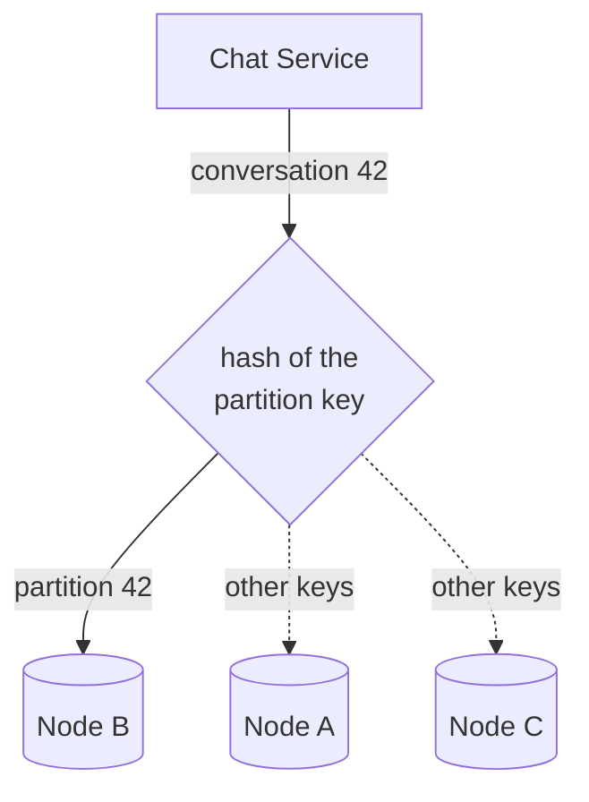
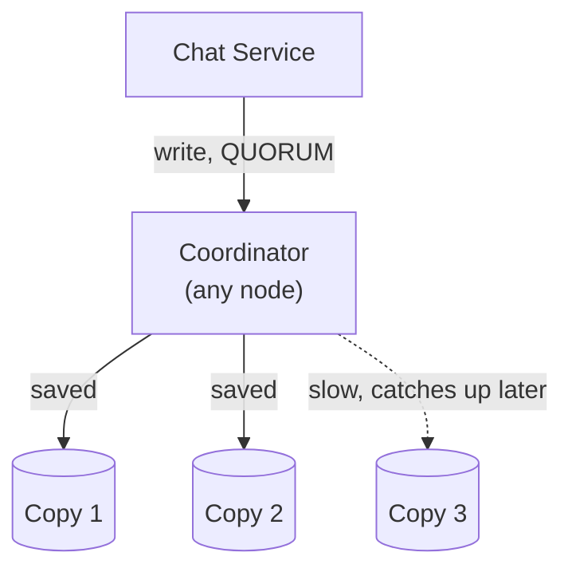
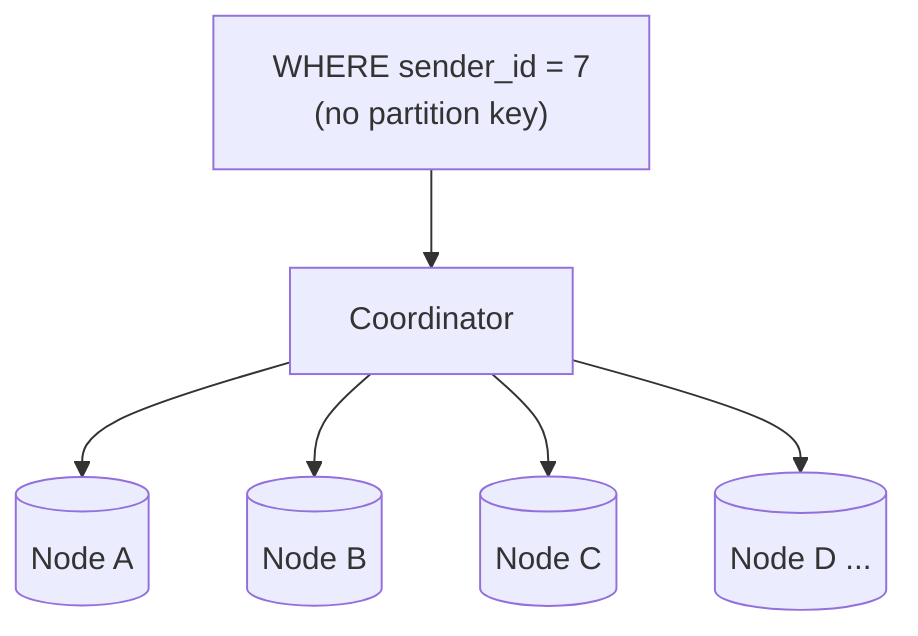

## The idea

Think of a big **filing cabinet** in a post office. Each drawer has a label, like a street name. Inside a drawer, the letters are kept **in order by date**.

- To find a letter, you must know the **drawer** first. Then you can grab "the newest 50 letters" from the front of the drawer, fast.
- You can't ask "show me every letter written by Asha" without opening **every drawer**.

**Cassandra** and **DynamoDB** work the same way. The drawer label is the **partition key**. The order inside the drawer is the **sort key**. Reads by these two keys are very fast at any size. Anything else is slow or not allowed.

They are cousins. Both grew out of ideas in Amazon's **Dynamo** paper (2007): spread data over many machines by hashing a key, and keep several copies. Cassandra is a **wide-column** store. DynamoDB is usually called a **key-value** store, but it reads data the same way: by partition key, then a range of sort keys. See [SQL vs NoSQL](./sql-vs-nosql.mdx) for the families.

## Side by side

| | Cassandra | DynamoDB |
| --- | --- | --- |
| **Who runs it** | You. It is open source (Apache). Cloud versions exist, like Amazon Keyspaces | AWS runs it for you. Nothing to install or patch |
| **How you talk to it** | **CQL**, which looks like SQL | API calls with JSON, like `PutItem` and `Query` |
| **Key names** | Partition key + **clustering key** | Partition key + **sort key** |
| **Copies** | You choose, usually 3 | 3 copies in 3 data centers of one region, done for you |
| **Consistency** | You choose per request: `ONE`, `QUORUM`, `ALL` | Eventually consistent reads by default. Strong reads if you ask |
| **Extra indexes** | Weak. Best avoided | Global and local secondary indexes |
| **You pay for** | Your servers | Each read and write, or capacity you reserve |

"Clustering key" and "sort key" mean the same thing. This page says **sort key** for both.

## The primary key: partition key + sort key

Every table has a primary key with two parts:

1. **Partition key.** The database hashes it to pick **which machines** store the row. All rows with the same partition key live together, in one **partition**.
2. **Sort key.** Inside a partition, rows are kept **sorted** by this key. So you can read a range: "the newest 50", "everything between Monday and Friday".



The machines form a ring, and each one owns a slice of the hash values. That is [consistent hashing](./consistent-hashing.mdx), so adding a machine moves only a small part of the data.

The rules that follow from this:

- **Every query must give the full partition key**, as an exact value. That is how the database knows where to look.
- The sort key can be a **range**: `<`, `>`, between, or "starts with" (DynamoDB).
- Reading one partition is fast because it sits on **one set of machines**, already sorted on disk.

## Query-first data modeling

In PostgreSQL you model the **data** first: clean tables with no copies (see [Normalization](./normalization.mdx)). Later you can write any query and add an index.

Here it is the other way round. You **list the queries first**, then build **one table for each query**. There are no joins, so you copy data into every table that needs it.

For a chat app, the main queries are:

| Query | Table | Partition key | Sort key |
| --- | --- | --- | --- |
| Open a chat: newest messages first | `messages_by_conversation` | `conversation_id` | `message_id`, newest first |
| Show my list of chats | `conversations_by_user` | `user_id` | `conversation_id` |

When a user starts a new chat, the app writes to **both** tables. Cassandra has a **logged batch** that makes sure both writes happen in the end. DynamoDB has **transactions** of up to 100 items.

## Example: chat messages by conversation

This is the table in CQL, Cassandra's language:

```sql
CREATE TABLE messages_by_conversation (
    conversation_id  bigint,
    message_id       bigint,
    sender_id        bigint,
    body             text,
    PRIMARY KEY ((conversation_id), message_id)
) WITH CLUSTERING ORDER BY (message_id DESC);
```

- The part in the **inner brackets**, `(conversation_id)`, is the partition key. What comes after it, `message_id`, is the sort key.
- `message_id` is a **Snowflake-style ID**: a number that grows with time (see [Distributed ID Generation](../distributed-systems/distributed-id-generation.mdx)). So sorting by ID is sorting by time, and two messages sent in the same millisecond still get different IDs.
- `DESC` stores the newest message first, because that is what the app reads most.

Inside partition `conversation_id = 42`, the rows look like this:

| message_id (sort key) | sender_id | body |
| --- | --- | --- |
| 1007 | 7 | "See you at 6" |
| 1004 | 9 | "Dinner tonight?" |
| 1001 | 7 | "Hi!" |

The two reads the app needs:

```sql
-- Open the chat: the newest 50 messages
SELECT message_id, sender_id, body
FROM messages_by_conversation
WHERE conversation_id = 42
LIMIT 50;

-- Scroll up: 50 messages older than the oldest one on screen
SELECT message_id, sender_id, body
FROM messages_by_conversation
WHERE conversation_id = 42
  AND message_id < 1001
LIMIT 50;
```

Both read **one partition**, from the front, in order. That stays fast with billions of messages.

This one does **not** work:

```sql
-- No partition key, so Cassandra would have to read every machine
SELECT * FROM messages_by_conversation WHERE sender_id = 7;
```

Cassandra refuses it with an error, unless you add `ALLOW FILTERING`. That makes it read everything, so don't use it in a real request path.

**The same model in DynamoDB.** The table has partition key `conversation_id` and sort key `message_id`. Each message is one **item** (a JSON object, up to 400 KB). "Newest 50" is a `Query` call:

```json
{
  "TableName": "Messages",
  "KeyConditionExpression": "conversation_id = :conversation",
  "ExpressionAttributeValues": {
    ":conversation": { "N": "42" }
  },
  "ScanIndexForward": false,
  "Limit": 50
}
```

`"ScanIndexForward": false` means "newest first". The answer includes a `LastEvaluatedKey`. Send it back as `ExclusiveStartKey` to get the next, older page.

## Why writes are so fast

This part is about Cassandra (and ScyllaDB). AWS does not let you see how DynamoDB stores data. You just get fast writes at any size.

Cassandra stores data in an **LSM tree** (explained in [Indexes: B-Trees and LSM Trees](./indexes.mdx)). A write is two cheap steps: **append** to a log on disk, and add to a sorted list **in memory**. Later, the list is written to disk as a sorted file in one go.

What this means in practice:

- **No reading before writing.** Cassandra doesn't look up the old row first. `INSERT` and `UPDATE` both just write the new value. Writing the same key twice **overwrites** it, so a retry never makes a duplicate. See [Idempotency](../messaging/idempotency.mdx).
- **Newest timestamp wins.** If two writes hit the same row, the one with the later timestamp is kept. So server clocks matter (see [Clocks](../distributed-systems/clocks.mdx)).
- **A delete is a write too.** It writes a marker called a **tombstone**. The data really goes away later, during **compaction** (by default, after 10 days). Many deletes leave many tombstones, and reads slow down as they step over them. This is why Cassandra makes a **bad queue**: a queue deletes every item it handles.
- **Data can expire by itself.** `INSERT ... USING TTL 2592000` deletes the row after 30 days. DynamoDB has TTL too, but it removes expired items some time later, not at the exact second.

## Copies and tunable consistency

Cassandra keeps each partition on several machines, usually **3**. This number is the **replication factor**.

There is **no leader**. Any machine can take a request. That machine is called the **coordinator** for that request. It sends the write to all 3 copies, and waits for as many answers as you asked for:



With `QUORUM`, the coordinator answers "OK" after **2 of 3** copies have saved the write. The third copy gets it a moment later.

You pick the **consistency level** on each read and write. With 3 copies:

| Level | Waits for | Good for |
| --- | --- | --- |
| `ONE` | 1 copy | Fastest. A read may be old. Likes, views, logs |
| `QUORUM` | 2 of 3 copies | **The usual choice.** One copy can be down |
| `LOCAL_QUORUM` | A majority in **this** data center | Apps in several regions: no waiting on far-away copies |
| `ALL` | All 3 copies | Rare. Fails if any copy is down |

**`QUORUM` writes + `QUORUM` reads:** 2 + 2 is more than 3, so the copies you read and the copies you wrote always overlap. A read sees the latest finished write. This is the **R + W > N** rule. It is close to strong consistency, but not fully. The edge cases are in [Consistency Models](../distributed-systems/consistency-models.mdx).

Things to know:

- **Missed writes catch up.** If a copy was down, the coordinator keeps a note and replays it when the copy is back (**hinted handoff**). Reads that spot an old copy fix it (**read repair**). A regular **repair** job compares all copies.
- **"Only if it does not exist" is slow.** `INSERT ... IF NOT EXISTS` is a **lightweight transaction**. It needs several round trips between the copies (it uses Paxos, see [Leader Election and Consensus](../distributed-systems/leader-election-consensus.mdx)). Use it for rare things, like claiming a username, not for every message.

**DynamoDB** does the copying for you: 3 copies in 3 data centers of one AWS region. Reads are **eventually consistent** by default, at half the price. Add `"ConsistentRead": true` to get the latest value. **Global tables** copy a table to other AWS regions.

## Hot partitions

All traffic for one partition key goes to the **same few machines**. If one key gets far more traffic than others, or grows far bigger, those machines struggle while the rest sit idle. This is a **hot partition**.

- **DynamoDB** allows each partition about **3,000 reads and 1,000 writes per second** (for small items). Past that, requests are **throttled**: refused with an error, and retried. DynamoDB moves spare capacity to busy partitions and can split them, but **one single key** still has that limit.
- **Cassandra** puts every partition on just 3 machines (with 3 copies). A huge partition also makes reads, repairs and compaction slow. A common rule: keep each partition **under about 100 MB**, and never let it grow without end.

| Bad partition key | Why it hurts | Better |
| --- | --- | --- |
| Today's date | Every write today hits one partition | `user_id`, or `(sensor_id, day)` |
| `status` (like "active") | Few values, so a few giant partitions | The item's own ID |
| `conversation_id` for a busy chat, forever | The partition grows for years | `(conversation_id, month)` |
| A celebrity's `post_id` for likes | One key gets most of the traffic | Add a number 0 to 9 to the key, spread over 10 partitions, add them up on read |

For the chat table, the fix for a busy group chat is a **time bucket** in the partition key:

```sql
PRIMARY KEY ((conversation_id, month), message_id)
```

Now one partition holds one month of one chat. To scroll back, the app reads this month first, then last month, until it has 50 messages. More fixes are in [Hot Keys and Fan-out](../advanced-components/hot-keys-fan-out.mdx).

## Secondary indexes: why they are limited

A **secondary index** lets you query by a column that is not the primary key. In PostgreSQL you add one and move on. Here it is harder.

**Cassandra.** Each machine indexes **only its own data**. So a query by `sender_id`, without a partition key, must ask **every machine**:



With 100 machines, that is 100 requests for one query. A secondary index is fine **inside one partition** (partition key + indexed column). Cassandra 5.0 (2024) added a better index type, **SAI** (Storage-Attached Index), but each machine still indexes only its own data.

**DynamoDB** has two kinds:

| | Global secondary index (GSI) | Local secondary index (LSI) |
| --- | --- | --- |
| **What it is** | A second copy of the items, with a **different partition key** | Same partition key, a **different sort key** |
| **When you add it** | Any time | Only when you create the table |
| **Reads** | Always eventually consistent (it is updated in the background) | Can be strongly consistent |
| **Limits** | Up to 20 per table, by default. Each one costs extra writes | Up to 5 per table. 10 GB per partition key |

**The usual answer in both:** make another table for the new query. In Cassandra, your app writes to both tables. In DynamoDB, a GSI does that copying for you. And never use a **scan** (read the whole table) to answer a user's request.

## Cassandra or DynamoDB, or PostgreSQL?

**Start with PostgreSQL** (see [SQL vs NoSQL](./sql-vs-nosql.mdx)). Switch only when you can name the reason.

| Pick Cassandra or DynamoDB when... | Stay with PostgreSQL when... |
| --- | --- |
| Writes are huge: more than one machine can take | You need **joins** or new kinds of questions later |
| Data grows **without end**: messages, events, sensor readings, activity | You need **transactions** across many rows: money, stock, bookings |
| Every read is by a **known key**, plus maybe a range | You need **unique rules** checked by the database, like a unique email |
| It must keep taking writes when a machine or a data center is down | The data fits on one machine plus [replicas](./replication.mdx) |

**Cassandra or DynamoDB?**

- **On AWS and want no servers to run:** DynamoDB.
- **Not on AWS, or in several clouds:** Cassandra (or ScyllaDB, which speaks the same language).
- **Very large, steady traffic:** running Cassandra yourself can cost less than paying DynamoDB per request. But you pay for it in engineers' time.

## In the real world

**Cassandra was built at Facebook.** It was made to power Facebook's inbox search, and made open source in 2008. One of its creators had co-written Amazon's Dynamo paper. Cassandra takes the spreading and copying of data from Dynamo, and the data model and LSM storage from Google's Bigtable.

**Discord stores messages the way this page does.** Discord's engineering blog described its Cassandra table for messages: partition key `(channel_id, bucket)`, where the bucket is a fixed time window, and sort key `message_id`. In 2023 they wrote about moving to ScyllaDB, after trouble with **hot partitions** and Java garbage-collection pauses. They also added a small Rust service in front of the database that merges identical requests for the same channel, to protect busy partitions.

**Netflix showed Cassandra scaling.** In 2011, Netflix's tech blog showed a Cassandra cluster on AWS handling **over a million writes per second**, and that adding machines raised the speed in a straight line.

**DynamoDB on Prime Day.** AWS wrote that during Prime Day 2022, DynamoDB served Amazon's sites with a peak of **105.2 million requests per second**.

## In the interview

Name the keys, and tie them to the query:

> "Messages go in Cassandra. The partition key is conversation ID plus a month bucket, and the sort key is message ID, newest first. So 'open a chat' reads one partition, in order, from one place on disk. It's very write-heavy, and LSM writes are cheap. I'll keep 3 copies and use QUORUM reads and writes, so one machine can be down. User accounts and payments stay in PostgreSQL, because they need transactions."

If the interviewer pushes:

- **"How do you search messages by word?"** Not in Cassandra. Stream messages to a search engine like [Elasticsearch](../advanced-components/elasticsearch.mdx).
- **"What about one huge group chat?"** That is a hot partition. The month bucket caps its size, and a cache in front takes the read load.

Avoid "NoSQL, because it scales" on its own. Say **which query** it serves, and **what you give up**: joins, new queries and transactions across many rows.

<Callout title="Remember this" type="success">
  - Primary key = **partition key** (which machines) + **sort key** (order inside the partition).
  - Every query needs the **partition key**. Design **one table per query**, and copy data. No joins.
  - Cassandra writes are fast: **LSM tree**, no read before write. Deletes leave **tombstones**.
  - **Tunable consistency:** 3 copies, `QUORUM` reads and writes (2 + 2 > 3). DynamoDB: eventual reads by default, strong if you ask.
  - Watch for **hot partitions**: pick a key that spreads traffic, add a **time bucket** to stop endless growth.
  - Secondary indexes are weak in Cassandra. DynamoDB has **GSIs**, which are eventually consistent.
  - **Default to PostgreSQL.** Pick these for huge writes, endless data and reads by a known key.
</Callout>
