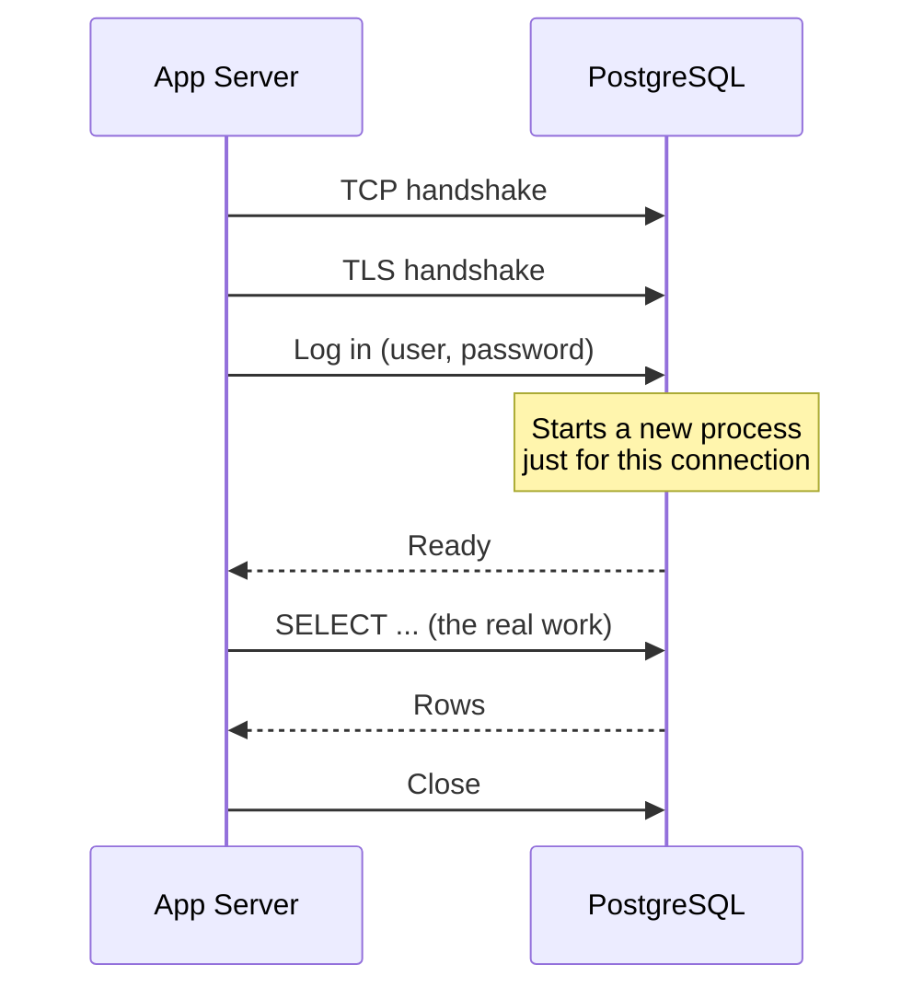
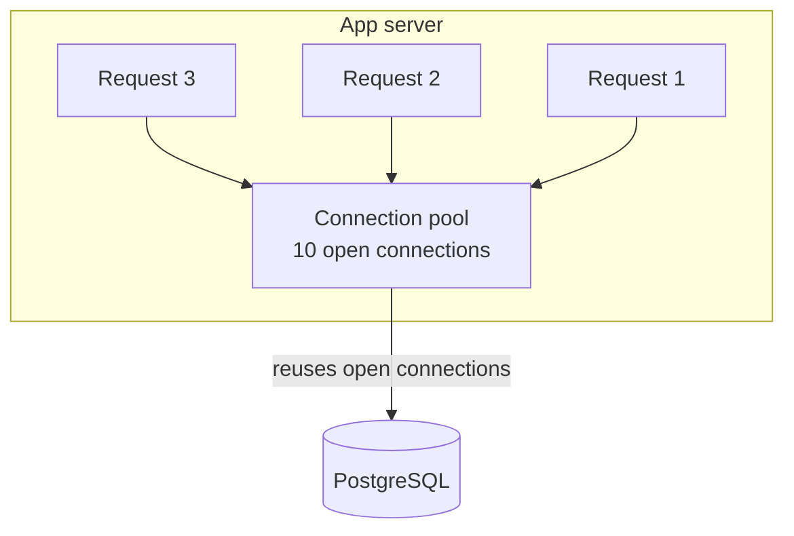
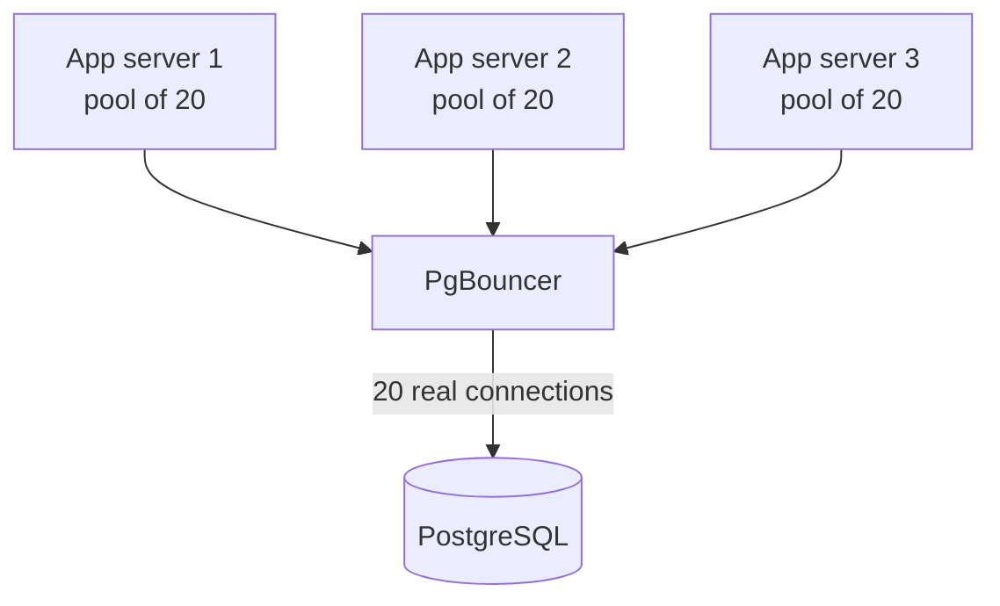

## What is it?

Imagine a restaurant that **hires a new waiter** for every customer, trains them, and fires them when the customer leaves. Most of the time would go into hiring, not serving.

A real restaurant keeps a **team of ten waiters**. Each one serves whoever is next, then comes back for the next table. If all ten are busy, a new customer waits a moment at the door.

A **connection pool** is that team of waiters. It keeps a few database connections **open all the time**. Each request **borrows** one, runs its queries, and **gives it back**. Nobody pays to open a new connection for every request.

## Why do we need it?

A **connection** is an open line between your app and the database. Opening a new one takes several steps before your query even starts:



- The **TCP** and **TLS** handshakes each cost network round trips. See [TCP vs UDP](../foundations/tcp-vs-udp.mdx) and [HTTP and HTTPS](../foundations/http-and-https.mdx).
- **Logging in** means checking the password.
- **PostgreSQL starts a whole new process** for every connection. MySQL uses a thread per connection, which is lighter, but still costs memory.

Often the setup takes **longer than the query itself**. And each open connection uses memory on the database server, even when idle. That is why databases limit them: PostgreSQL allows **100 connections by default** (`max_connections`).

So without a pool, a busy app has two bad choices: pay this setup cost on **every request**, or keep so many connections open that the database **runs out**.

## How it works inside

### Borrow, use, give back



1. When the app starts, the pool opens a few connections and keeps them open.
2. A request **borrows** a free connection, runs its queries, and **returns** it.
3. If all connections are busy, the request **waits in line** for one, up to a time limit.
4. The pool closes connections that sit idle too long, and replaces broken ones.

Inside, the pool is two lists: the **idle connections** that are free right now, and a **queue of waiting requests**. When a connection comes back, it goes straight to the first request in the queue. If nobody is waiting, it joins the idle list. Many pools also check that a connection still works before handing it out, because the database or the network may have closed it.

### In code

Most database libraries have a pool built in. In Node.js, with the `pg` library:

```js
import { Pool } from "pg";

const pool = new Pool({
    host: "db.internal",

    // At most 10 open connections
    max: 10,

    // Close a connection that sits unused for 30 seconds
    idleTimeoutMillis: 30000,

    // Wait at most 2 seconds for a free connection
    connectionTimeoutMillis: 2000,
});

// pool.query borrows a connection, runs the query, and gives the connection back
const result = await pool.query("SELECT * FROM orders WHERE user_id = $1", [7]);
const orders = result.rows;
```

**Always give connections back.** If code borrows a connection and forgets to return it (for example, on an error path), the pool slowly runs dry. This is called a **connection leak**. Soon every request is waiting, and the app looks frozen even though the database is idle.

## Pool size: not too big, not too small

- **Too small:** requests wait in line for a connection, even though the database has spare power.
- **Too big:** the database has only a few CPU cores. Hundreds of queries running at once fight over those cores, memory and locks. Each query gets **slower**, and total work done can go **down**.

**Watch the multiplication.** Every app server has its own pool:

| App servers | Pool size each | Connections to the database |
| --- | --- | --- |
| 5 | 10 | 50 |
| 20 | 10 | 200 |
| 50 | 20 | 1,000 |

PostgreSQL's default limit is 100. Past the limit, new connections fail with the error "sorry, too many clients already". Autoscaling makes this worse: a traffic spike adds app servers, and every new server opens its own pool.

**A starting point:** the guide for HikariCP, a popular Java pool, suggests a pool size of about **(CPU cores × 2) + number of disks** on the database server. The main lesson: **small pools usually beat big ones.** Then measure: if requests often wait for a connection while the database CPU is low, the pool is too small.

## Tools: PgBouncer

Pools inside each app server are not enough when you have **many** app servers. The fix is a pooler that sits **in front of** the database and is shared by everyone. For PostgreSQL, the most common one is **PgBouncer**.

PgBouncer is a small, light **proxy** (a program that sits between the app and the database and passes messages along). Apps open **many cheap connections** to PgBouncer. PgBouncer shares a **few real connections** to PostgreSQL among them.



PgBouncer has three modes. They differ in **when** a real connection goes back to the shared pool:

| Mode | Real connection is returned... | Notes |
| --- | --- | --- |
| **Session** | When the app disconnects | Safest, but saves the least |
| **Transaction** | After each transaction | The most popular. Big savings. Features tied to one session, like `SET` or `LISTEN`, don't work as expected |
| **Statement** | After each single statement | Transactions with several statements are not allowed |

Other tools: **Amazon RDS Proxy** (managed, for AWS databases), **Pgpool-II** for PostgreSQL, and **ProxySQL** for MySQL.

## When to use it

- **Any app server that talks to a SQL database.** Most libraries pool by default. Keep it on.
- **Many app servers, or autoscaling.** Add a shared pooler like PgBouncer, so the total stays small.
- **Serverless functions.** Put a managed proxy like RDS Proxy in front, because every copy of the function opens its own connections.

**Don't use it when:**

- **The app needs session features** (`SET`, `LISTEN`) and the shared pooler runs in transaction mode. Use session mode, or a direct connection, for that part.
- **A job holds a connection for minutes,** like a big report or a migration. Give it its own connection outside the main pool, so it doesn't starve normal requests.
- **You count on a pool inside each serverless function.** Each copy has its own small pool, so the total still explodes. Pool outside the functions.

## Alternatives

| Option | What it is | Pick it when |
| --- | --- | --- |
| **Open and close per request** | A new connection for every request | Rare scripts or cron jobs, where the setup time does not matter |
| **Raise `max_connections`** | Let the database accept more connections | A small bump. Each connection still costs memory, so it doesn't go far |
| **HTTP data API** | Send queries over HTTP, with no long-lived connection (for example, the Amazon Aurora Data API) | Short-lived serverless functions |
| **Queue the writes** | Put the work on a queue. A few workers, with a few connections, write it to the database | Spiky writes that don't need an instant answer. See [Message Queues](../messaging/message-queues-pub-sub.mdx) |
| **A database you call over HTTP** | DynamoDB: each call is an HTTP request, so there is no database session to keep | Key-based access from serverless functions. See [Cassandra and DynamoDB](./cassandra-dynamodb.mdx) |

## In the real world

**GitLab** runs PgBouncer in front of its PostgreSQL databases, and its documentation explains how to set it up for large self-hosted installs.

**AWS built RDS Proxy for serverless apps.** Serverless functions like AWS Lambda can start thousands of copies during a spike, and each copy may open its own database connections. AWS offers RDS Proxy to pool and share those connections, so a spike doesn't exhaust the database.

## In the interview

Mention it when you have many app servers talking to one SQL database, or when you use serverless functions:

> "Each app server keeps a small connection pool, and PgBouncer in transaction mode sits in front of Postgres. That way 50 app servers share a small, fixed number of real connections, and a traffic spike can't drown the database in new connections."

<Callout title="Remember this" type="success">
  - **Why:** opening a connection is **slow**: TCP, TLS, login, and a new process in PostgreSQL. And each open one costs database memory.
  - A **pool** keeps connections open. Requests **borrow and return** them.
  - **Always return** connections, or the pool leaks and the app freezes.
  - **Small pools** usually beat big ones. Remember: servers × pool size = total connections.
  - **PgBouncer** in **transaction mode** lets many app servers share a few real connections.
  - **Inside:** a list of **idle connections** and a **queue** of waiting requests.
  - **Alternatives:** a new connection per request, an HTTP data API, a queue in front, or a database you call over HTTP.
</Callout>
