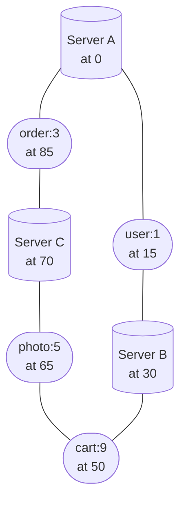
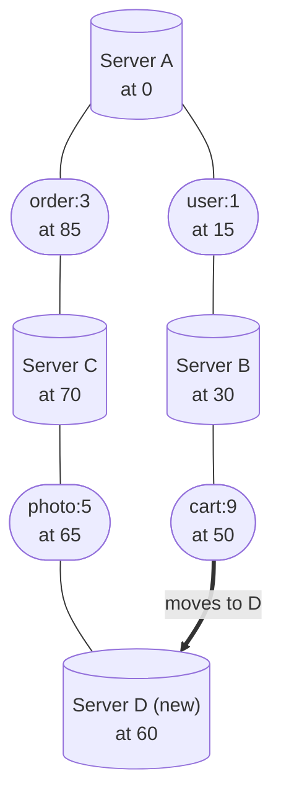
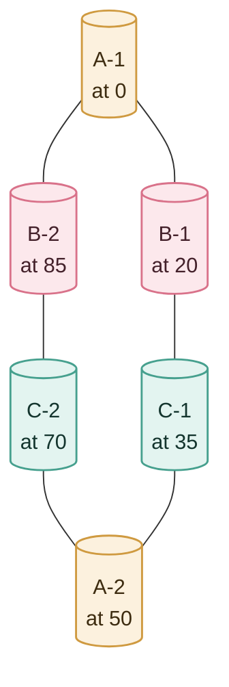

## What is it?

You have millions of keys (user IDs, cache keys) and a few servers. Each key must live on exactly one server. Every app server must be able to work out which one, on its own, without asking anyone.

Think of a **circular bus route**. The bus stops are the servers. Each passenger is a key. A passenger gets on somewhere on the loop and rides **clockwise to the next stop**. If the city adds a new stop, only the passengers who got on just before it change where they get off. Everyone else gets off at the same stop as before.

That is consistent hashing. When you add or remove a server, **only a small share of the keys move**. The simple way, "hash mod N", moves almost all of them.

## Why do we need it?

When data is spread over many servers (a [sharded](./partitioning-sharding.mdx) database, or a cache on many nodes), every app server needs a rule to find a key's server. Servers are added when traffic grows, and they die without warning. So the rule must keep working when the **number of servers changes**. The simple rule, hash mod N, breaks badly when it does.

A **hash function** turns any text into a number. The same text always gives the same number. Different texts give numbers that look random. MD5 and MurmurHash are examples.

The simple way to pick a server:

```js
// N = the number of servers
const server = hash(key) % N;
```

`%` means "the remainder after dividing". It always gives a number from 0 to N - 1, so every key gets a server.

Here is an example with small, made-up hash values. We start with 3 servers, then add a 4th:

| Key | hash(key) | `% 3` (3 servers) | `% 4` (4 servers) | Moved? |
| --- | --- | --- | --- | --- |
| `user:1` | 10 | 1 | 2 | Yes |
| `user:2` | 11 | 2 | 3 | Yes |
| `user:3` | 12 | 0 | 0 | No |
| `user:4` | 13 | 1 | 1 | No |
| `user:5` | 14 | 2 | 2 | No |
| `user:6` | 15 | 0 | 3 | Yes |
| `user:7` | 16 | 1 | 0 | Yes |
| `user:8` | 17 | 2 | 1 | Yes |

**5 of 8 keys moved.** With many keys, going from 3 to 4 servers moves about **3 out of every 4** keys. Why that hurts:

- **For a cache:** a moved key is a **cache miss**, because the new server does not have it. Most keys miss at the same moment, and all those requests fall through to the database. The database can fall over. See [Cache Problems](../caching/cache-problems.mdx).
- **For a database:** most of the data must be copied between machines, just to add one server.

What we want: when we go from 3 to 4 servers, only about **1/4** of the keys should move. That is the fair share of the new server.

## How it works inside

### The hash ring, step by step

<Steps>
<Step>

**Make a ring.** Take all possible hash values and bend the line into a circle. Real systems use a huge range, like 0 to about 4.3 billion (all 32-bit numbers). Here we use 0 to 99. After 99 comes 0 again.

</Step>
<Step>

**Put the servers on the ring.** Hash each server's name to get its spot. Server A lands at 0, Server B at 30, Server C at 70.

</Step>
<Step>

**Put the keys on the ring.** Hash each key with the same function. `user:1` lands at 15, `cart:9` at 50, `photo:5` at 65, `order:3` at 85.

</Step>
<Step>

**Walk clockwise.** From the key's spot, walk clockwise until you meet a server. That server owns the key. If you pass 99, wrap around to 0.

</Step>
</Steps>

On these drawings, clockwise means: start at the top, go **down the right side**, then **up the left side**.



| Key | Spot | Walking clockwise, the first server is | Owner |
| --- | --- | --- | --- |
| `user:1` | 15 | Server B at 30 | **B** |
| `cart:9` | 50 | Server C at 70 | **C** |
| `photo:5` | 65 | Server C at 70 | **C** |
| `order:3` | 85 | Past 99, wrap to Server A at 0 | **A** |

So each server owns the **arc** (the piece of the ring) that ends at its spot. B owns 1 to 30. C owns 31 to 70. A owns 71 to 99, and 0.

### Adding a server

We add **Server D**. Its name hashes to spot **60**.



Walk clockwise again:

- `cart:9` at 50: the first server is now **D at 60**. It **moves from C to D**.
- `photo:5` at 65: it still meets C at 70 first. **Stays on C.**
- `user:1` and `order:3`: nothing changed on their path. **They stay.**

Only the keys between B (30) and D (60) move, and they all come from **one** server, C. With N servers, a new server takes about **1/N** of the keys. Everything else stays put.

### Removing a server

Now Server B (at 30) dies. Each of its keys walks clockwise to the next server:

- `user:1` at 15: B is gone, so it walks on to **D at 60**. It moves from B to D.
- Every other key: no change.

Only the dead server's keys move, and they go to its clockwise neighbor.

### Virtual nodes for an even spread

One spot per server has two problems:

1. **Uneven arcs.** The spots are random, so one server can get a big arc, and much more data than the others. With few servers, this happens a lot.
2. **One neighbor takes it all.** When B died, all its keys went to D. If D was already busy, it can be overloaded and fail too.

The fix is **virtual nodes**, often called **vnodes**. Each real server gets **many spots** on the ring, by hashing names like `A-1`, `A-2`, `A-3`. Real systems use tens or hundreds of spots per server. Here each server has two:



- **Even spread.** Each server owns many small arcs, so in total each one gets close to an equal share.
- **Failure load is shared.** If Server A dies, the keys of A-1 walk on to B-1, and the keys of A-2 walk on to C-2. The load **splits between B and C**, instead of landing on one server.
- **Bigger machines can do more.** Give a server with twice the memory twice as many vnodes.

### Finding the owner fast

The code does not really walk around a circle. It keeps every spot (every vnode) in a **sorted list**, together with the server it belongs to. To find a key's owner:

1. Hash the key.
2. **Binary search** the list for the first spot that is equal to or bigger than the hash.
3. If there is none, wrap around and take the **first** spot in the list.

Binary search is fast even with thousands of vnodes. Every app server builds the same list from the same server names, so they all agree on the owner without asking anyone.

## When to use it

- **A distributed cache,** where nodes are added and lost. Only about 1/N of the keys miss after a change.
- **A sharded key-value store,** like Cassandra or Dynamo, that grows by adding nodes.
- **Sticky routing:** send the same user, chat room or session to the same server every time.

**Don't use it when:**

- **The number of servers never changes.** Plain hash mod N is simpler.
- **You need range queries,** like "all orders from last week". Hashing scatters neighbors across every node. Use range sharding.
- **You must move single keys by hand,** like giving one huge customer its own machine. Use a lookup table (a directory).

## Alternatives

| Option | What it is | Pick it when |
| --- | --- | --- |
| **Hash mod N** | `hash(key) % N` | The number of servers is fixed, or moving almost every key is OK |
| **Hash slots** | Keys map to a fixed number of slots, and a small table maps slots to nodes (Redis Cluster uses 16,384) | You want to move data in clear chunks, and see exactly who owns what |
| **Rendezvous hashing** | For each key, score every server with `hash(key + server)` and pick the highest | Few servers. Even spread with no ring and no vnodes, but each lookup checks every server |
| **Jump consistent hash** | A tiny function from Google (2014) that maps a key to a bucket number, moving as few keys as possible | Shards are numbered and only grow. You can't remove a server in the middle |
| **Directory** | A lookup table that says which server owns each key | You need full control over where each key lives. See [Partitioning and Sharding](./partitioning-sharding.mdx) |

## In the real world

**Cassandra** places its nodes on a token ring. Each node owns ranges of the ring and has several vnodes. Extra copies of a row go to the next nodes around the ring.

**Amazon's Dynamo paper (2007)** described a key-value store built on a hash ring with virtual nodes. Cassandra and Riak took this design. **DynamoDB** grew out of the same work: it hashes each item's partition key to pick a partition, and AWS splits and moves partitions as a table grows.

**Cache clients** use it to spread keys over Memcached servers. A well-known method called **ketama** puts each cache server on a ring many times, so adding a cache server does not wipe out the whole cache.

**Load balancers** use it to send the same user to the same server. Nginx has a `hash ... consistent` option, and Envoy has a "ring hash" load balancing policy.

**Where it started:** consistent hashing was described in 1997 by researchers at MIT, including David Karger, to spread load across web caches. Some of the same group went on to found Akamai, one of the first big CDNs.

**Not everyone uses a ring.** Redis Cluster splits keys into **16,384 hash slots** and gives each node a set of slots. Moving a slot moves only its keys. It is a different method with the same goal. See [Distributed Caching](../caching/distributed-caching.mdx).

## In the interview

Bring it up whenever data is spread over many cache or database nodes and nodes can come and go: a distributed cache, a sharded key-value store, routing chat users to servers. Name it and say why in one line. Explain the ring only if asked.

> "I'll put the cache nodes on a consistent hash ring with virtual nodes. When we add or lose a node, only about 1/N of the keys move, so we don't get a wave of cache misses hitting the database."

<Callout title="Remember this" type="success">
  - **Hash mod N** moves almost every key when N changes. Bad for caches and databases.
  - **The ring:** hash servers and keys onto a circle. A key belongs to the **next server clockwise**.
  - **Add a server:** it takes keys from one neighbor only. **Remove one:** its keys go to the next server.
  - Only about **1/N** of the keys move.
  - **Virtual nodes:** many spots per server give an even spread and share the load when a server dies.
  - Used by **Cassandra**, **Dynamo**, and cache clients. **Redis Cluster** uses 16,384 slots instead.
  - **Why:** servers come and go. With mod N, every change moves most keys, so caches miss and data is copied.
  - **Inside:** a **sorted list** of spots and a **binary search** for the first spot at or after the key's hash.
  - **Alternatives:** hash mod N, hash slots, rendezvous hashing, jump hash, a directory.
</Callout>
