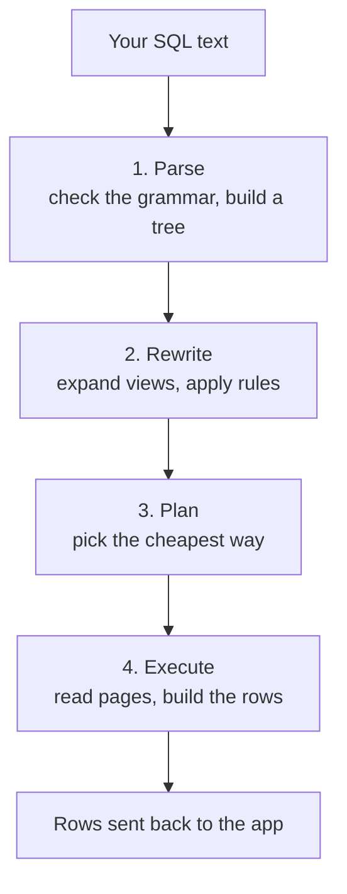

## The idea

When you use a **map app**, you only say **where** you want to go. The app picks the **route**: the highway or the side streets, based on what it knows about traffic.

SQL works the same way. You say **what** data you want, not **how** to get it. The database has a part called the **query planner** that picks the route: which index to use, which table to read first, how to combine them.

## The steps



1. **Parse.** Check the SQL is written correctly, and turn it into a tree the database understands. Typos fail here.
2. **Rewrite.** Replace views with the queries behind them, and apply other rules.
3. **Plan.** Think of the possible ways to run the query, guess the cost of each, and pick the cheapest.
4. **Execute.** Run the chosen plan: read pages from memory or disk, filter, join, sort, and send the rows back.

## The query planner and EXPLAIN

The planner guesses costs using **statistics**: how many rows each table has, and how values are spread in each column. PostgreSQL updates these statistics in the background. You can also refresh them yourself with `ANALYZE`.

To see the plan the database picked, put `EXPLAIN` in front of a query. `EXPLAIN ANALYZE` also **runs** it and shows real times:

```sql
EXPLAIN ANALYZE
SELECT * FROM orders WHERE user_id = 7;
```

Without an index on `user_id`, the output looks like this:

```text
Seq Scan on orders  (cost=0.00..20834.00 rows=98 width=40) (actual time=0.015..112.512 rows=97 loops=1)
  Filter: (user_id = 7)
  Rows Removed by Filter: 999903
Planning Time: 0.080 ms
Execution Time: 112.540 ms
```

How to read the first line:

- The **first brackets** are the planner's **guesses**: the `cost` (in its own units, not milliseconds) and the `rows` it expects to find (98).
- The **second brackets** are what **really** happened: the time in milliseconds and the actual `rows` (97).

It read a million rows to find 97. After `CREATE INDEX ON orders (user_id)`:

```text
Index Scan using orders_user_id_idx on orders  (cost=0.42..392.17 rows=98 width=40) (actual time=0.021..0.108 rows=97 loops=1)
  Index Cond: (user_id = 7)
Planning Time: 0.095 ms
Execution Time: 0.131 ms
```

On a big table, PostgreSQL may also split a full scan across several workers. Then the plan shows `Gather` with a `Parallel Seq Scan` under it. The idea is the same.

These plans are in the PostgreSQL 17 format. Since PostgreSQL 18 (2025), `EXPLAIN ANALYZE` also prints `Buffers` lines (how many pages came from memory or disk), shows actual rows with decimals (`rows=97.00`), and adds `Index Searches` to index scans.

What to look for: the **type of scan**, the **time**, and whether the **guessed rows** (98) are close to the **actual rows** (97). A big gap, like a guess of 98 but 50,000 actual, often means the statistics are out of date. It can also happen when you filter on two columns that depend on each other, like city and postal code: the planner treats them as unrelated and guesses too few rows. Either way, the planner may pick a bad route.

## Full scan vs index scan

| Scan | What it does | Good when |
| --- | --- | --- |
| **Seq Scan** (full scan) | Reads every page of the table, in order | The table is small, or the query needs a big part of it |
| **Index Scan** | Walks the index, then fetches each matching row | Few rows match |
| **Index Only Scan** | Answers from the index alone, without touching the table | The index holds every column the query needs |
| **Bitmap Heap Scan** | Collects the matching row spots from the index, then reads those pages in order | A medium number of rows match |

A full scan is **not always bad**. If a query needs 40% of the table, reading it straight through is faster than jumping back and forth through an index. The planner knows this. See [Indexes](./indexes.mdx).

## Why a query is slow

- **No index** on the column you filter, join or sort by.
- **The index can't be used:** a function on the column (`WHERE lower(email) = ...`), a search that starts with a wildcard (`LIKE '%shoes'`), or a multi-column index without its first column.
- **Old statistics,** so the planner picks a bad plan. Run `ANALYZE`.
- **Too much data returned:** `SELECT *` on wide rows, or no `LIMIT`.
- **Deep pages with `OFFSET`:** `OFFSET 100000` still reads and throws away 100,000 rows. See [API Pagination](../advanced-components/api-pagination-versioning.mdx).
- **Waiting on locks,** not doing work. See [Locks and Deadlocks](./locking.mdx).
- **The N+1 problem:** the app runs 1 query to get 50 orders, then 1 more query **per order** to get its items. That is 51 trips to the database instead of 1 or 2. Fix it with a join, or one query on `order_items` using `WHERE order_id IN (...)`.

## In the real world

PostgreSQL teams usually find slow queries with two built-in tools. The `pg_stat_statements` extension records how often each query runs and how much total time it takes, so you can fix the most costly ones first. The `log_min_duration_statement` setting writes every query slower than a set time to the log.

## In the interview

You rarely go this deep. It helps when the interviewer asks "this query is slow, what do you do?":

> "I'd run `EXPLAIN ANALYZE` on it. If it shows a sequential scan on orders, I'd add an index on `user_id`, check the plan switches to an index scan, and make sure statistics are fresh."

<Callout title="Remember this" type="success">
  - SQL says **what**. The **planner** decides **how**.
  - Steps: **parse, rewrite, plan, execute**.
  - `EXPLAIN ANALYZE` shows the plan and the real time.
  - **Seq Scan** reads everything. **Index Scan** jumps to matches. A full scan is fine for big result sets.
  - Common causes of slowness: missing index, unusable index, old statistics, N+1 queries.
</Callout>
