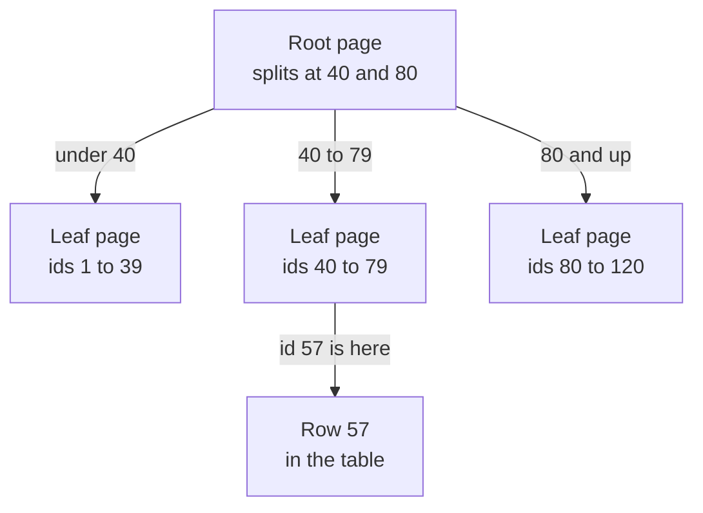
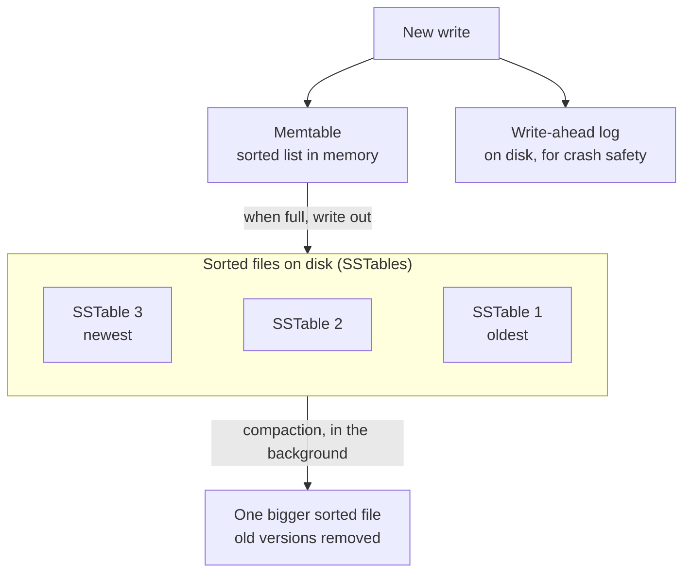

## The idea

A big textbook has an **index at the back**: "Replication ... page 214". Without it, you would read the whole book to find one topic. With it, you look up the word, jump to the page, and you are done.

A database **index** is the same idea. It is a separate, **sorted** list of values from one column, and each value says where its row is stored.

Without an index, this query must read **every row** in the table. That is called a **full table scan**:

```sql
SELECT * FROM users WHERE email = 'asha@example.com';
```

With 10 million users, that is 10 million rows checked to find one. With an index on `email`, the database finds it in a few small steps.

## What an index is

You create one with a single line:

```sql
CREATE INDEX idx_users_email ON users (email);
```

The database keeps the index up to date for you on every insert, update and delete. Primary keys and `UNIQUE` columns get an index automatically.

An index helps only with the column it is sorted by. Your phone contacts are sorted by name, so finding "Ravi" is instant. But "who has a number ending in 4321?" means scrolling through every contact.

## B-trees: great for reads

Almost every SQL database uses a **B-tree** as its normal index. A B-tree is a short, wide tree of **pages**. A page is a small block of disk, 8 KB in PostgreSQL, that holds many sorted keys.

- The **root page** at the top says which page to go to next for each range of values.
- The **leaf pages** at the bottom hold the actual keys, each with the location of its row.
- The leaves are linked in order, so you can walk along them for a range.



To find `id = 57`: the root says "40 to 79", so go to that leaf, find 57, and follow it to the row. **Each level is one page read.** A page holds hundreds of keys, so a tree only 3 or 4 levels deep can cover many millions of rows.

Because the keys are sorted, a B-tree helps with:

- Exact matches: `WHERE email = '...'`
- Ranges: `WHERE created_at > '2026-01-01'`, `BETWEEN`
- Sorting: `ORDER BY created_at` (the index is already in order)
- Starts-with text: `LIKE 'run%'` (but not `LIKE '%shoes'`)

The weak side: every write must find the right page and change it **in place**, at a random spot on disk. When a page is full, it **splits** in two. Heavy write loads mean lots of small random disk writes.

## LSM trees: great for writes

An **LSM tree** (Log-Structured Merge tree) is built for heavy writes. Think of a **busy restaurant**. The waiter doesn't walk to the kitchen's order book after every table. He jots orders on a notepad, fast. When the page is full, he hands over the whole page at once. Later, someone neatly merges all the pages into one tidy book.



Step by step:

1. **Write:** the change is appended to a log on disk (so a crash loses nothing) and added to a sorted list **in memory**, called the **memtable**. Both are very fast.
2. **Flush:** when the memtable is full, it is written to disk in one go as a sorted file, called an **SSTable** (Sorted String Table). These files are never changed after being written.
3. **Compaction:** in the background, small files are merged into bigger ones. Old versions and deleted items are thrown away.
4. **Read:** check the memtable, then the newest file, then older ones. To skip files quickly, each file has a **Bloom filter**, a tiny summary that can say "this key is definitely not in this file". See [Probabilistic Data Structures](../advanced-components/probabilistic-data-structures.mdx).

## B-tree vs LSM tree

| | B-tree | LSM tree |
| --- | --- | --- |
| **Writes** | Change pages in place. Random disk writes | Append and sort in memory. Very fast |
| **Reads** | Fast and steady: one path down the tree | May check several files. Bloom filters help |
| **Background work** | Little | Compaction uses disk and CPU |
| **Best for** | Read-heavy apps, most SQL workloads | Write-heavy apps: chat, events, logs, sensors |
| **Used by** | PostgreSQL, MySQL (InnoDB), SQL Server, Oracle | Cassandra, ScyllaDB, HBase, RocksDB, LevelDB |

## Indexes on many columns, and why the order matters

An index can cover several columns. This one helps the "my orders, newest first" page:

```sql
CREATE INDEX idx_orders_user_created ON orders (user_id, created_at);
```

It is sorted **by `user_id` first**, then by `created_at` inside each user. Like a phone book sorted by last name, then first name: finding all the "Sharmas" is easy, and so is "Sharma, Ravi". Finding everyone named "Ravi" is not.

| Query | Uses this index well? |
| --- | --- |
| `WHERE user_id = 7` | Yes |
| `WHERE user_id = 7 AND created_at > '2026-01-01'` | Yes |
| `WHERE user_id = 7 ORDER BY created_at DESC LIMIT 20` | Yes, and no sorting needed |
| `WHERE created_at > '2026-01-01'` | No. The first column is missing |

The rule: the index works from the **leftmost column**. Put columns you match **exactly** (`=`) first, and the column you use for a **range or sort** last.

**Covering index:** if the index also holds every column the query needs, the database can answer from the index alone, without visiting the table. PostgreSQL lets you add extra columns with `INCLUDE`.

## The cost of indexes

Indexes are not free:

- **Slower writes.** Every insert, update and delete must also update **every index** on the table. Five indexes means six places to write.
- **More space,** on disk and in memory.
- **Useless on columns with few values.** An index on `status` (3 possible values) rarely helps. A **partial index** can: `CREATE INDEX ... ON orders (created_at) WHERE status = 'pending'`.
- **Easy to break by accident.** `WHERE lower(email) = '...'` can't use a plain index on `email`. You need an index on `lower(email)`.
- **Building one can block writes.** On a big live table, use `CREATE INDEX CONCURRENTLY` in PostgreSQL.

Index the columns your **main queries** filter, join and sort by. Drop indexes nobody uses. To check whether a query uses an index, see [How a Query Runs](./how-a-query-runs.mdx).

## In the real world

**SQL databases use B-trees by default.** PostgreSQL and MySQL both create B-tree indexes unless you ask for another type. MySQL's InnoDB engine goes further: the table rows themselves live inside the primary key's B-tree.

**Google's Bigtable made LSM trees famous.** The LSM tree itself comes from a 1996 research paper by Patrick O'Neil and others. Google's Bigtable paper (2006) used the idea with memtables and SSTables, and made it popular. Cassandra, HBase and Google's LevelDB grew out of these ideas.

**Facebook moved a huge database to an LSM tree.** Facebook built **RocksDB** (based on LevelDB), and then **MyRocks**, which is MySQL running on RocksDB. Facebook has written about moving its main user database from InnoDB to MyRocks, to use much less disk space.

## In the interview

When you write your schema, name the index for each main query:

> "Users open their order history a lot, so I'll index `orders (user_id, created_at)`. Then 'latest 20 orders for this user' is a quick index lookup, not a full scan."

For a write-heavy store, mention the structure underneath:

> "For the event log I'd pick Cassandra. It uses an LSM tree, so writes are cheap appends."

<Callout title="Remember this" type="success">
  - An **index** is a sorted copy of a column with pointers to rows. No index means a **full scan**.
  - **B-tree:** short, wide, sorted tree. Fast reads and ranges. The default in SQL databases.
  - **LSM tree:** memtable, then sorted files, then compaction. Very fast writes.
  - **Multi-column index:** works from the leftmost column. Exact matches first, range or sort last.
  - Every index **slows writes** and uses space. Index your main queries only.
</Callout>
