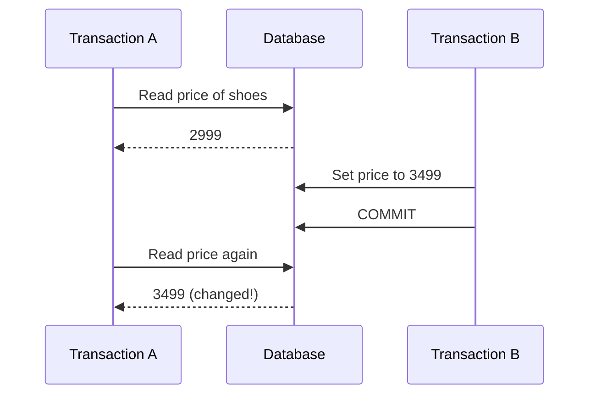
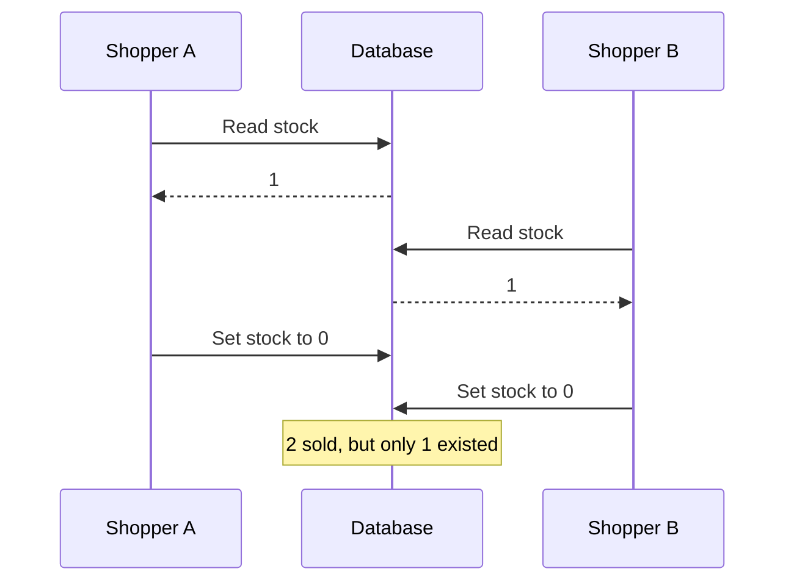

## The idea

Picture two bank clerks working on the **same account book** at the same time. Can one clerk see the other's half-finished pencil notes? Can the numbers change under one clerk while she is still adding them up?

That is **isolation**: how much transactions that run at the same time can see of each other. (A **transaction** is a group of steps that succeed or fail together. See [Transactions and ACID](./transactions-acid.mdx).)

Full isolation is like making the clerks **take turns**: perfectly safe, but slow. Real databases let you choose a level. Each level stops some problems and allows others, in exchange for speed.

## The problems

| Problem | What happens | Shop example |
| --- | --- | --- |
| **Dirty read** | You read a change that another transaction has **not committed yet**. It may still be undone | You see stock = 0 from an order that then fails |
| **Non-repeatable read** | You read the **same row twice** and get different values, because someone committed a change in between | Checkout reads the price as 2999, then as 3499 |
| **Phantom read** | You run the **same search twice** and new rows appear | "Orders today" counts 10, then 11 |
| **Lost update** | Two transactions read a value, both change it, and the second write **wipes out** the first | Two shoppers buy the last item. Stock goes 1 → 0 twice |
| **Write skew** | Two transactions read the same data, each makes a decision, and each writes a **different** row. Together they break a rule | Two doctors both see "2 on call" and both go off call. Now nobody is on call |

A **non-repeatable read**, step by step:



A **lost update**, step by step:



## Read committed, repeatable read, serializable

The SQL standard defines four levels. Each one stops more problems:

| Level | Dirty read | Non-repeatable read | Phantom read | Lost update | Write skew |
| --- | --- | --- | --- | --- | --- |
| **Read uncommitted** | Possible | Possible | Possible | Possible | Possible |
| **Read committed** | Stopped | Possible | Possible | Possible | Possible |
| **Repeatable read** | Stopped | Stopped | Allowed by the standard, but stopped in PostgreSQL and MySQL | Stopped in PostgreSQL, possible in MySQL (see below) | Possible |
| **Serializable** | Stopped | Stopped | Stopped | Stopped | Stopped |

The SQL standard only names the first three problems. The lost update and write skew columns show what PostgreSQL and MySQL really do.

- **Read uncommitted:** you can see other people's unfinished work. Almost nobody uses it. PostgreSQL quietly treats it as read committed.
- **Read committed:** each **statement** sees only data that was committed before it started. No dirty reads. But two statements in the same transaction can see different data.
- **Repeatable read:** the whole **transaction** sees one **snapshot**, a photo of the data taken when it started. Re-reading a row always gives the same answer.
- **Serializable:** the strongest. The result is the same as if the transactions had run **one at a time**. This stops lost updates and write skew too.

**How snapshots work:** databases like PostgreSQL and MySQL keep **old versions** of a row for a while when it changes. A reader simply reads the version that matches its snapshot. This is called **MVCC** (Multi-Version Concurrency Control). Its big win: **readers don't block writers, and writers don't block readers**.

**How serializable works in PostgreSQL:** it lets transactions run side by side, but watches for patterns that could give a wrong result. If it finds one, it stops one of the transactions with a "could not serialize access" error. Your app must then **retry the whole transaction**.

## Speed vs safety

| | Weaker levels | Stronger levels |
| --- | --- | --- |
| **Speed** | Faster. Many transactions run side by side | Slower. More waiting, or more failed transactions |
| **Bugs** | More chances for lost updates and write skew | Fewer surprises |
| **App work** | You must protect the risky spots yourself | You must retry failed transactions |

A common, practical approach: **keep the default level**, and protect only the few risky spots:

- Do the math **inside the database**: `UPDATE products SET stock = stock - 1 WHERE id = 42 AND stock >= 1`. This one statement can't lose an update.
- **Lock the row** you are about to change with `SELECT ... FOR UPDATE`. See [Locks and Deadlocks](./locking.mdx).
- Let the database enforce rules with `UNIQUE` and `CHECK` constraints.
- Run the few critical transactions at a stronger level:

```sql
BEGIN ISOLATION LEVEL SERIALIZABLE;
-- check that the seat is free, then book it
COMMIT;
-- if this fails with a serialization error, run the whole thing again
```

## Default levels in PostgreSQL and MySQL

| Database | Default level |
| --- | --- |
| PostgreSQL | Read committed |
| MySQL (InnoDB) | Repeatable read |
| Oracle | Read committed |
| SQL Server | Read committed |

So the same code can behave differently on PostgreSQL and MySQL. Know your database's default.

Even the **same level name** works differently. Here is repeatable read in each:

| At repeatable read | PostgreSQL | MySQL (InnoDB) |
| --- | --- | --- |
| **Phantom read** | Stopped. The snapshot hides new rows | Stopped in practice. Plain reads use the snapshot, and locking reads (`FOR UPDATE`) also lock the gaps between rows, so no new rows can be added there |
| **Lost update** | Stopped. The second writer gets a "could not serialize access" error and must retry | Possible. The second `UPDATE` quietly writes over the first |
| **Write skew** | Possible | Possible |

Take the lost update diagram above. On PostgreSQL at repeatable read, Shopper B's write fails, and the app retries with fresh data. On MySQL, B's write goes through, and the shop sells an item it doesn't have. So on MySQL, repeatable read alone doesn't protect a "read, then write" step. Use an atomic update or `SELECT ... FOR UPDATE`.

## In the real world

**Shop apps had real bugs from weak isolation.** In 2017, researchers at Stanford published a paper called "ACIDRain". They tested popular open-source online shop apps and found many bugs caused by requests running at the same time. For example, by sending many requests at once, a shopper could spend the same gift card balance more than once.

**Databases don't always do what they promise.** Jepsen, a project by Kyle Kingsbury, tests databases under stress and network failures. Its reports have found isolation bugs in many well-known databases, where real behavior was weaker than the documentation said.

## In the interview

Bring it up when two users can change the **same thing at the same time**: the last seat, the last item in stock, a shared balance.

> "For booking the last seat, read committed alone isn't enough, because two users could both see the seat as free. I'll lock the seat row with `SELECT ... FOR UPDATE`, or run that one transaction as serializable and retry on conflict."

<Callout title="Remember this" type="success">
  - **Isolation** = how much transactions running at the same time see of each other.
  - Problems: **dirty read**, **non-repeatable read**, **phantom read**, **lost update**, **write skew**.
  - Levels: read uncommitted, **read committed**, **repeatable read**, **serializable**. Stronger is safer but slower.
  - **Defaults:** PostgreSQL = read committed. MySQL = repeatable read.
  - **Same name, different rules:** at repeatable read, PostgreSQL stops lost updates (with an error to retry). MySQL doesn't.
  - **MVCC** keeps old row versions, so readers and writers don't block each other.
  - Keep the default, and protect hot spots with **atomic updates, row locks or serializable** plus retries.
</Callout>
