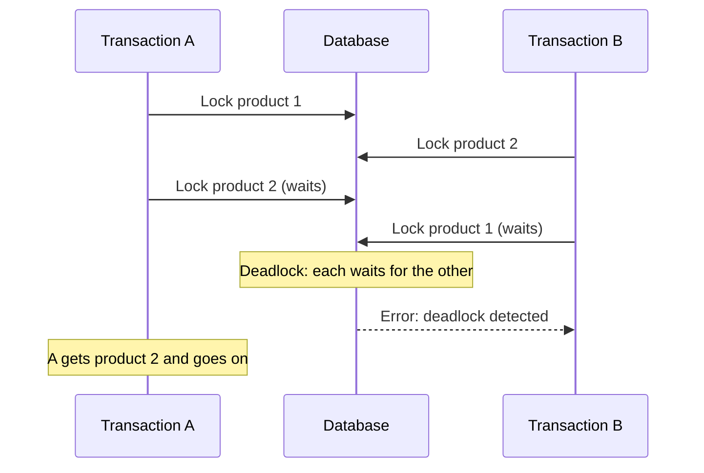
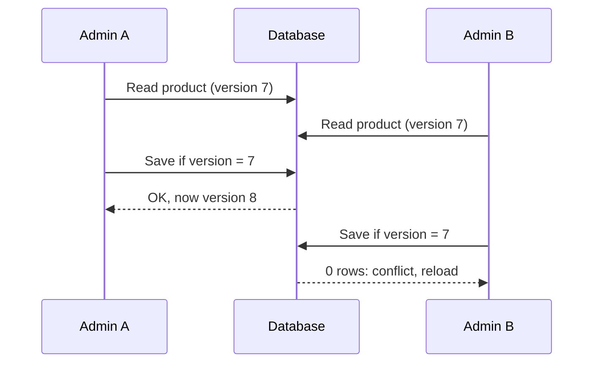

## The idea

A **lock** stops two people from changing the same data at the same time. There are two ways to think about it.

- **Pessimistic locking** is like a **library with one copy of a book**. While you have it, nobody else can borrow it. They wait until you bring it back. You expect trouble, so you lock first.
- **Optimistic locking** is like **editing a Wikipedia page**. Anyone can start editing. When you press save, the site checks whether someone else saved first. If they did, you get an "edit conflict" and must redo your change. You expect no trouble, and only check at the end.

Both are ways to stop a **lost update**: two people change the same thing, and the second one silently wipes out the first. See [Isolation Levels](./isolation-levels.mdx).

## Row locks and table locks

| Lock | What it covers | When it happens |
| --- | --- | --- |
| **Row lock** | One row | `UPDATE`, `DELETE`, and `SELECT ... FOR UPDATE` |
| **Table lock** | The whole table | Many kinds of `ALTER TABLE`, and `LOCK TABLE` |

Locks also come in two strengths:

- A **shared lock** (read lock): many transactions can hold it at once. "We are all reading this. Nobody change it."
- An **exclusive lock** (write lock): only one transaction can hold it. "I am changing this. Everybody wait."

Row locks are normal and cheap. If two transactions update the **same row**, the second one **waits** until the first commits or rolls back. Transactions that touch **other rows** don't wait at all.

Table locks are the dangerous ones. Some `ALTER TABLE` commands in PostgreSQL block **all reads and writes** on the table until they finish. On a big, busy table, that can look like an outage.

In PostgreSQL and MySQL, a plain `SELECT` takes **no row lock**, and is not blocked by writers. It reads an older version of the row instead, thanks to MVCC (see [Isolation Levels](./isolation-levels.mdx)).

## Deadlocks, and how databases handle them

A **deadlock** happens when two transactions each wait for a lock the other one holds. Neither can move. It is like two cars meeting on a narrow bridge, each waiting for the other to back up.



**How databases handle it:** they watch who is waiting for whom. When they find a circle of waiting, they pick one transaction as the **victim**, roll it back, and return an error. The other one continues.

- **PostgreSQL** checks for deadlocks after a lock has waited for a short time (1 second by default).
- **MySQL (InnoDB)** spots them right away, and usually rolls back the smaller transaction.

**How to avoid them:**

1. **Always lock in the same order.** If every transaction locks products in order of ID, the circle above can't happen.
2. **Keep transactions short,** so locks are held for less time.
3. **Retry** the victim transaction. A deadlock error is normal and safe to retry.
4. Set a **lock timeout** (`lock_timeout` in PostgreSQL), so nothing waits forever.

## Pessimistic locking: lock first

Lock the row **before** you read and change it. Others who want the same row wait.

```sql
BEGIN;
SELECT stock FROM products WHERE id = 42 FOR UPDATE;
-- Row 42 is now locked. Anyone else asking for it waits here.
-- The app checks: is stock at least 1?
UPDATE products SET stock = stock - 1 WHERE id = 42;
COMMIT;  -- the lock is released
```

Two useful options:

- `FOR UPDATE NOWAIT`: don't wait. Fail right away if the row is locked.
- `FOR UPDATE SKIP LOCKED`: skip rows that are locked, and take the next free one. This is how **job queues** built on PostgreSQL let many workers each grab a **different** job.

Often you don't need an explicit lock at all. A **single conditional update** does the check and the change in one step, and the database locks the row only for that moment:

```sql
UPDATE products SET stock = stock - 1
WHERE id = 42 AND stock >= 1;
-- 1 row changed: success. 0 rows changed: sold out.
```

## Optimistic locking: check the version when you save

Don't lock anything. Add a `version` number to the row. When you save, only save if the version is **still the one you read**.

1. **Read:** `SELECT name, price_cents, version FROM products WHERE id = 42;` returns version 7.
2. The admin edits the product for two minutes. **No lock is held.**
3. **Save, but only if nobody else did:**

```sql
UPDATE products
SET price_cents = 3499, version = version + 1
WHERE id = 42 AND version = 7;
```

4. If **0 rows** changed, someone else saved first. Reload the product and try again, or show the user a conflict.



The same idea works over HTTP: the server sends an `ETag` (a version tag), and the client sends it back in an `If-Match` header when saving. If the data changed, the server answers `412 Precondition Failed`. See [HTTP Methods, Status Codes and Headers](../foundations/http-methods-status-codes-headers.mdx).

## Which one to use

| | Pessimistic | Optimistic |
| --- | --- | --- |
| **How** | Lock before changing | Check the version when saving |
| **On a clash** | The second one waits | The second one fails and retries |
| **Best when** | Clashes are **common**, like the last seats of a hot concert | Clashes are **rare**, like editing a profile or a product page |
| **Risks** | Waiting, deadlocks, locks held too long | Lots of retries if clashes become common |
| **Can span** | One short database transaction | A long time, even across separate HTTP requests while a user thinks |

**Rule of thumb:** use **optimistic** by default, and especially when a person is editing something. Use **pessimistic** for short, hot spots where many users fight over the same row.

When the thing to protect is **not a database row**, like "only one server should run this job", see [Distributed Locking](../distributed-systems/distributed-locking.mdx).

## In the real world

**Wikipedia uses optimistic locking.** If someone saved a page while you were editing it, MediaWiki (the software behind Wikipedia) shows you an "edit conflict" page instead of silently overwriting their work.

**Kubernetes does it for every object.** Each object has a `resourceVersion`. An update that carries an old version is rejected with a conflict, and the client must re-read and try again.

**Job queues on PostgreSQL use SKIP LOCKED.** Libraries like pg-boss (Node.js) and Solid Queue (Ruby on Rails) store jobs in a PostgreSQL table, and use `FOR UPDATE SKIP LOCKED` so that each worker picks a different job.

**A missing lock emptied a Bitcoin bank.** In 2014, Flexcoin, a small Bitcoin bank, shut down after an attacker sent thousands of transfer requests between accounts at the same moment. The balance checks ran before the balances were updated, so the same coins were moved many times. A row lock or an atomic update would have stopped it.

## In the interview

Bring it up whenever two users can change the same record:

> "For seat booking, I'll use a conditional update, `UPDATE seats SET user_id = ? WHERE id = ? AND user_id IS NULL`, so only one user can win the seat. For editing event details, which rarely clashes, I'll use optimistic locking with a version column."

<Callout title="Remember this" type="success">
  - **Row locks** are normal. **Table locks** (some `ALTER TABLE`) can block a whole table.
  - **Deadlock:** two transactions wait for each other. The database kills one. **Lock in the same order** and retry.
  - **Pessimistic:** `SELECT ... FOR UPDATE`, lock first. For hot, short, high-clash spots.
  - **Optimistic:** a `version` column, check on save. For rare clashes and long user edits.
  - A **conditional update** (`... WHERE stock >= 1`) often replaces a lock.
  - `SKIP LOCKED` lets many workers take different jobs from one table.
</Callout>
