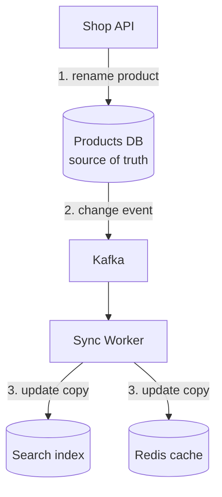

## The idea

Think of your **address book**. You write a friend's address in it **once**. On your list of people to send birthday cards to, you only write their name. When the friend moves, you fix **one** place. This is **normalization**: each fact is stored once, and everything else points to it.

Now imagine you write the full address on every list: the birthday list, the wedding list, the holiday list. Reading a list is faster, because you don't have to look anything up. But when your friend moves, you must fix every list. Miss one, and a card goes to the old house. This is **denormalization**: you copy data to make reads faster, and you pay for it when the data changes.

## Normalization: no repeated data

Here is an orders table where everything is stored in one place:

| order_id | user_email | user_name | product | product_price |
| --- | --- | --- | --- | --- |
| 1 | asha@example.com | Asha | Shoes | 2999 |
| 2 | asha@example.com | Asha | Socks | 199 |
| 3 | ravi@example.com | Ravi | Shoes | 2999 |

Asha's email and the shoe price are stored again and again. That causes three kinds of bugs, called **anomalies**:

- **Update problem:** Asha changes her email. You must change it in every row. Miss one, and she has two emails.
- **Insert problem:** You can't add a new product until someone orders it, because there is no row to put it in.
- **Delete problem:** Delete order 2, and you lose the only record that socks cost 199.

The fix is to **split the data into tables**, one per kind of thing, linked by IDs: `users`, `products`, `orders` and `order_items`. Each fact now lives in one place. (See [Schemas and Keys](./schemas-and-keys.mdx) for the tables.)

### Normal forms, in short

The rules for this have names. You rarely need more than the first three:

| Rule | In simple words | Breaks the rule |
| --- | --- | --- |
| **1st normal form** | One value per cell. No lists inside a cell | A `phones` column holding "98..., 99..." |
| **2nd normal form** | Every column depends on the **whole** key | In `order_items` (key: order + product), a `product_name` column depends on the product only |
| **3rd normal form** | Columns depend on the key, not on other columns | `orders` has `user_id` **and** `user_email`. The email depends on the user, not the order |

The classic one-liner: every column must depend on **the key, the whole key, and nothing but the key**.

## Denormalization: copy data for faster reads

Normalized data needs **joins** to read. Joins are fine most of the time. But on a very hot page, or with huge tables, or when the data lives on different [shards](./partitioning-sharding.mdx) where you can't join at all, they can be too slow.

So you **copy data to where it is read**:

| Copy | Instead of |
| --- | --- |
| `posts.like_count` column | `COUNT(*)` over millions of rows in `likes`, on every page view |
| `comments.author_name` column | Joining `users` for every comment on the page |
| A ready-made feed list per user | Collecting posts from everyone they follow, on every visit |

A stored counter is the most common case. When someone likes a post, you insert the like **and** add one to the counter:

```sql
BEGIN;
INSERT INTO likes (post_id, user_id) VALUES (42, 7);
UPDATE posts SET like_count = like_count + 1 WHERE id = 42;
COMMIT;
```

Reading the count is now one tiny lookup.

PostgreSQL also offers a middle path: a **materialized view**. It saves the result of a query as a table. You refresh it when you choose, with `REFRESH MATERIALIZED VIEW`. Good for dashboards that can be a few minutes old.

## The cost: keeping copies in sync

Every copy is a promise to update it. There are three common ways:

1. **Same transaction.** Change the original and the copy together, like the like counter above. Always correct, but only works inside one database.
2. **Events.** Change the original. A change event goes through a queue, and a worker updates the copies a moment later. The copies are briefly out of date. This is called **eventual consistency**.
3. **Batch jobs.** Rebuild the copies every hour or every night. Simple, but often out of date.

The original data is called the **source of truth**. If a copy and the original disagree, the original wins, and you can always rebuild the copy from it.



To get change events out of the database safely, see [Change Data Capture](../distributed-systems/change-data-capture.mdx) and the [Outbox Pattern](../distributed-systems/outbox-pattern.mdx).

**Not every copy needs syncing.** `order_items.price_cents` copies the product price on purpose. It is a **snapshot** of the price on the day of the order. It must **never** change when the product price changes later.

## When to use each

| Normalize when... | Denormalize when... |
| --- | --- |
| Data changes often | Data is read far more than it is written |
| Correctness matters most: money, stock, bookings | One slow join sits on a very hot page |
| You don't know all your future queries yet | The database has no joins (Cassandra, DynamoDB) |
| You have one database | Data is split across shards or services |

**Start normalized. Denormalize one specific read** when you know it is too slow, and decide how you will keep the copy in sync.

## In the real world

**NoSQL databases expect you to denormalize.** Cassandra and DynamoDB have no joins. Their data modeling guides tell you to design one table per query, and to copy data into every table that needs it.

**Twitter's home timeline is a precomputed copy.** Twitter engineers have described how, when someone tweets, the tweet's ID is pushed into a cached timeline list for each follower. Reading your home timeline is then one fast lookup. Accounts with millions of followers are handled differently, because one tweet would mean millions of copies. See [Hot Keys and Fan-out](../advanced-components/hot-keys-fan-out.mdx).

## In the interview

Mention it when a read is hot and needs data from several places:

> "The product page shows the average rating. Instead of averaging all reviews on every view, I'll store `avg_rating` and `review_count` on the product, and update them when a review is added. It's denormalized, so that update runs in the same transaction as the review insert."

<Callout title="Remember this" type="success">
  - **Normalization:** each fact stored once. No update, insert or delete bugs.
  - **Denormalization:** copy data where it is read, for faster reads.
  - Every copy must be **kept in sync**: same transaction, events, or batch jobs.
  - The original is the **source of truth**. Copies can always be rebuilt.
  - **Start normalized**, then denormalize the specific reads that are too slow.
  - A price saved on an order is a **snapshot**, not a copy to sync.
</Callout>
