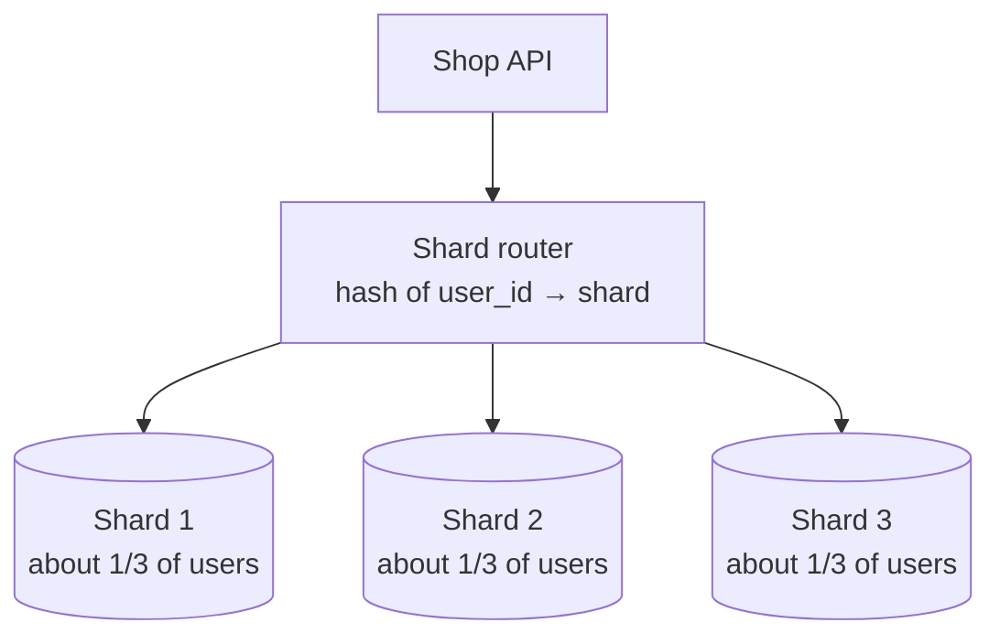

## The idea

Think of a big **exam**. One hall can't hold 3,000 students, so the school splits them by roll number: 1 to 1,000 in Hall A, 1,001 to 2,000 in Hall B, the rest in Hall C. Every student knows their hall from their roll number. Each hall has its own invigilator, so no single person is overloaded.

Databases do the same with data that is too big or too busy for one table or one machine.

- **Partitioning** splits a big table into smaller pieces, **inside one database server**. Like splitting one huge filing drawer into twelve smaller drawers in the same cabinet.
- **Sharding** splits the data across **many database servers**. Each server, called a **shard**, holds some of the rows and has its own CPU, memory and disk. Like the exam halls, each with its own invigilator.

## Partitioning vs sharding

**Partitioning** in PostgreSQL. One `orders` table, split into one piece per month:

```sql
CREATE TABLE orders (
  id          BIGINT NOT NULL,
  user_id     BIGINT NOT NULL,
  total_cents INTEGER NOT NULL,
  created_at  TIMESTAMPTZ NOT NULL
) PARTITION BY RANGE (created_at);

CREATE TABLE orders_2026_01 PARTITION OF orders
  FOR VALUES FROM ('2026-01-01') TO ('2026-02-01');
CREATE TABLE orders_2026_02 PARTITION OF orders
  FOR VALUES FROM ('2026-02-01') TO ('2026-03-01');
```

The app still uses one table called `orders`. But:

- A query for last week only reads **one** small partition. This is called **partition pruning**.
- Deleting a month of old data is a quick `DROP TABLE orders_2025_01`, not a slow `DELETE` of millions of rows.

It still runs on **one machine**, so it does not give you more CPU or disk.

**Sharding** gives you more machines. Every shard has the **same tables**, but **different rows**:



The **router** decides which shard holds a row. It can be a library inside the app, or a proxy in front of the databases.

The words get mixed up in practice. Cassandra and DynamoDB call their pieces "partitions", even though they live on many machines.

## When you really need sharding

Sharding is **hard work**. Joins across shards, transactions across shards, moving data between shards, backups of many databases: all of it gets harder. Try these first:

1. **Indexes** and better queries. See [Indexes](./indexes.mdx).
2. A **cache** for hot reads. See [Caching](../caching/what-is-caching.mdx).
3. **Read replicas** for more reads. See [Replication](./replication.mdx).
4. A **bigger machine**. Today's servers have a lot of memory and fast disks.
5. **Partitioning** and archiving old data.

Shard when one machine truly can't keep up:

- **Too many writes** for one primary. Replicas don't help here, because every write still goes to the primary. See [Scaling Writes](../hld-basics/scaling-writes.mdx).
- **Too much data** for one machine's disk.
- The data that is used often **no longer fits in memory**, so everything gets slow.

## Picking a good shard key

The **shard key** is the column used to decide which shard a row goes to. It is the most important choice, and the hardest to change later. A good shard key:

1. **Spreads data and traffic evenly.** It has many different values. This is called high **cardinality**.
2. **Matches your main queries,** so most queries need only **one** shard.
3. **Keeps related data together:** a user and all their orders on the same shard.
4. **Never changes** for a row.

For our shop's `orders` table:

| Shard key | Even spread? | "My orders" on one shard? | Verdict |
| --- | --- | --- | --- |
| `user_id` | Yes | Yes | **Good** |
| `created_at` | No. All new orders hit the newest shard | No | **Bad**: one hot shard |
| `country` | No. Few values, and one country can be huge | No | **Bad** |
| `order_id` | Yes | No. A user's orders are on every shard | **OK** only if you mostly look up single orders |

## Range vs hash sharding

| | Range sharding | Hash sharding |
| --- | --- | --- |
| **How** | Each shard owns a range of keys: users 1 to 1M, then 1M + 1 to 2M ... | Run the key through a hash function, and use the number to pick a shard |
| **Range queries** | Easy: "users 500 to 600" is on one shard | Hard: neighbors are scattered on every shard |
| **Even spread** | Often not. New IDs and new dates all land on the last shard | Yes. Keys spread out evenly |
| **Adding shards** | Split a range in two | Simple "hash mod N" moves almost every key |

To add shards without moving almost everything, hash sharding uses [Consistent Hashing](./consistent-hashing.mdx) or a fixed set of slots.

A third option is a **directory**: a lookup table that says which shard each key lives on. It is the most flexible, because you can move any key, but the directory must be fast and never go down.

## Hot shards and queries across shards

**Hot shard.** One shard gets much more traffic than the others. Causes: a bad key (like time), or one huge customer or celebrity. Fixes:

- Pick a better key, or a combination of keys.
- Split one hot key into several by adding a small number to it, like `celebrity_42#1` to `celebrity_42#8`. Reads then gather from all of them.
- Give the busy customer their own shard.
- Put a cache in front of the hot data.

See [Hot Keys and Fan-out](../advanced-components/hot-keys-fan-out.mdx).

**Queries across shards.** "Top 10 products sold today" needs data from **every** shard. The router sends the query to all shards and merges the answers. This is called **scatter-gather**, and it is only as fast as the **slowest** shard. If you need such queries often, keep a separate copy of the data built for them, like an analytics database. See [CQRS](../distributed-systems/cqrs.mdx).

**Other headaches:**

- **Transactions across shards** need [Two-Phase Commit](../distributed-systems/distributed-transactions-2pc.mdx) or a [Saga](../distributed-systems/saga-pattern.mdx). Choose a shard key that avoids them.
- **Unique IDs** can't come from one auto-increment counter anymore. See [Distributed ID Generation](../distributed-systems/distributed-id-generation.mdx).
- **Adding shards** means moving data while the app is live. A common trick: create **many small logical shards** up front (say, 1,000), and place several on each machine. To grow, move whole logical shards to new machines. No key ever changes shard.

## In the real world

**Instagram** sharded PostgreSQL early on. In 2012 they wrote that they split data into several thousand **logical shards**, mapped to far fewer physical database servers. As the servers filled up, they moved logical shards to new machines. Each Instagram ID even contains the number of its shard.

**Notion** sharded its PostgreSQL database in 2021. They split data by **workspace ID** into 480 logical shards, spread over 32 physical databases. All the pages of one workspace live on the same shard.

**YouTube** built **Vitess**, a system that shards MySQL, to keep up with its growth. Vitess is now open source, and Slack has written about moving its databases onto it.

**Discord** stores messages in a wide-column database, with a partition key of **channel ID plus a time bucket**. The time bucket stops one very busy channel from growing into one giant, hot partition.

## In the interview

Bring it up when the numbers show that one machine can't take the **writes** or the **data size**. Name the shard key and why:

> "We'll shard orders by `user_id`, using hashing. 'Show my orders' hits a single shard, and load spreads evenly. The rare 'all orders today' report runs on a separate analytics copy, not on the shards."

<Callout title="Remember this" type="success">
  - **Partitioning:** split a table on **one** machine. **Sharding:** split data across **many** machines.
  - Shard only when **writes or data size** outgrow one machine. Try indexes, caching, replicas first.
  - A good **shard key**: even spread, matches the main query, keeps related data together.
  - **Range** sharding is good for ranges but makes hot spots. **Hash** sharding spreads evenly.
  - Watch for **hot shards** and slow **scatter-gather** queries across all shards.
  - Start with **many logical shards** so you can move them later.
</Callout>
