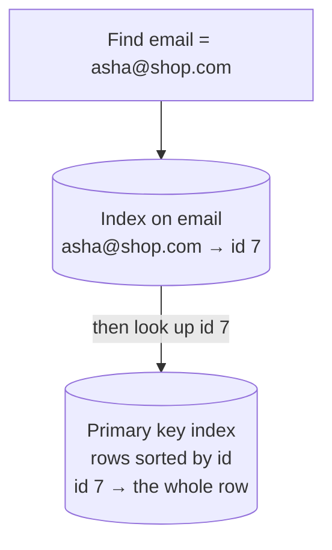
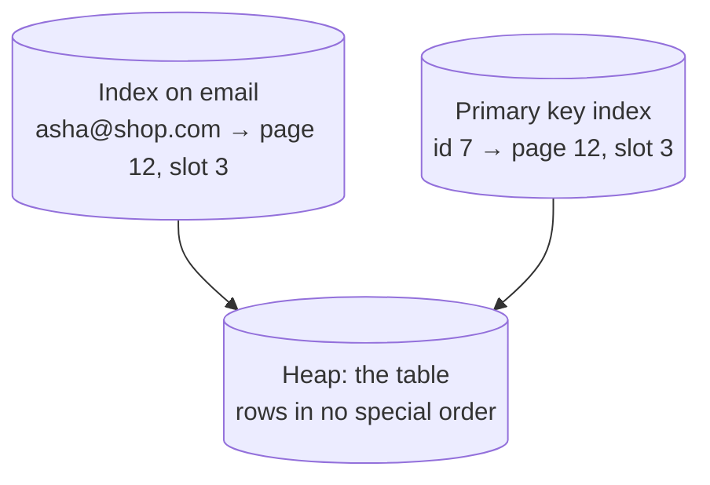
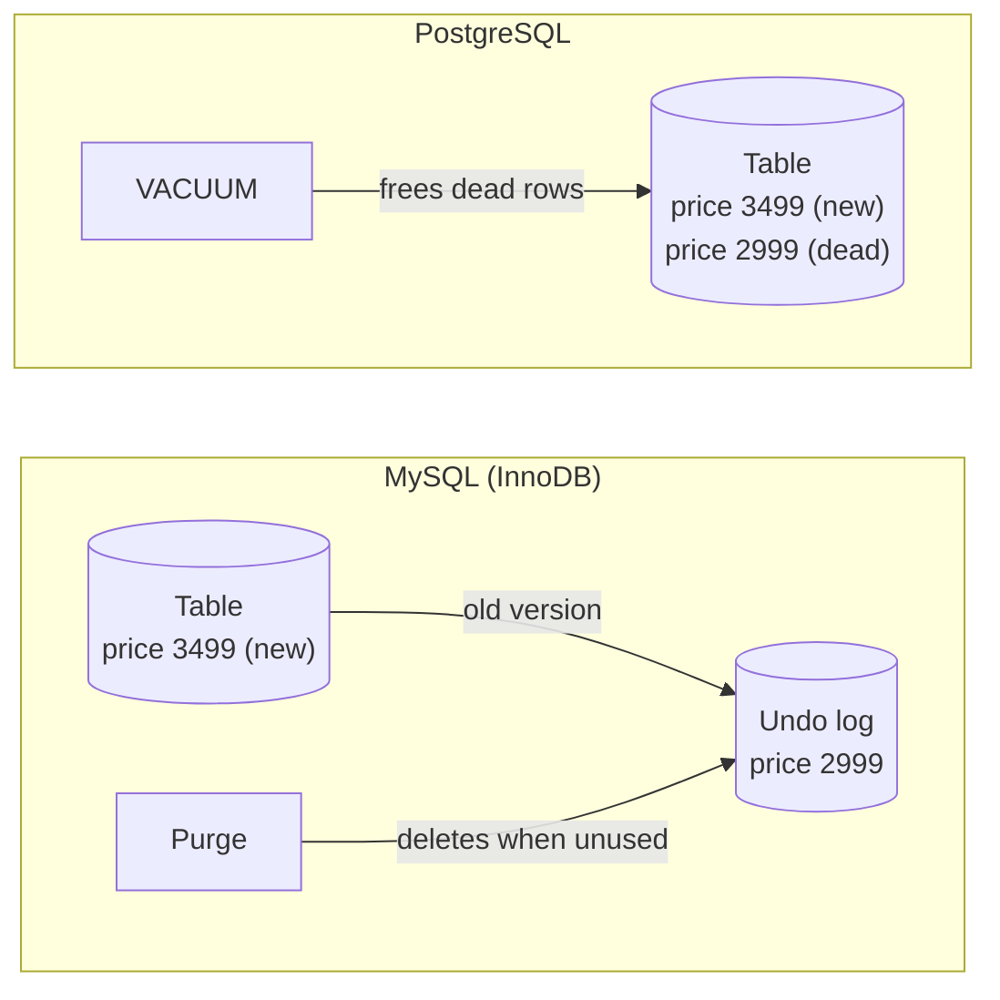

## The idea

PostgreSQL and MySQL are like two good car brands. Both get you to work safely, and most drivers would be happy with either. The differences show up when you open the hood: how the engine is built, what happens when something goes wrong, and which extras come with it.

Both are free, open-source **SQL databases** (see [SQL vs NoSQL](./sql-vs-nosql.mdx)). Both have transactions, indexes and replication, and both run at huge companies. For most apps, **either is a fine choice**. Interviewers ask about the differences to see whether you understand what happens inside a database.

Here, "MySQL" means recent MySQL (8.0 and later) with its default **storage engine**, **InnoDB**. The storage engine is the part that actually stores and reads the data.

## Side by side

A quick overview first. Don't worry about the new words in it (heap, VACUUM, undo log and so on): each row is explained further down.

| | PostgreSQL | MySQL (InnoDB) |
| --- | --- | --- |
| **Default isolation level** | Read committed | Repeatable read |
| **Lost update at repeatable read** | The second writer gets an error and retries | The second write quietly wins |
| **A failed statement in a transaction** | The whole transaction is aborted until `ROLLBACK` | Usually only that statement is undone |
| **Where rows live** | In a **heap**. Every index points to the row's location | Inside the **primary key index** (clustered) |
| **Old row versions** | Kept in the table. **VACUUM** cleans them up | Kept in the **undo log**. **Purge** cleans them up |
| **Schema changes** | Can run inside a transaction and be rolled back | Committed at once (implicit commit) |
| **JSON** | `JSONB`, indexed with **GIN** | `JSON`, indexed through generated columns |
| **Upsert** | `ON CONFLICT ... DO UPDATE` | `ON DUPLICATE KEY UPDATE` |
| **`RETURNING`** | Yes | No |
| **Each connection is** | A separate process | A thread |
| **Replication** | Streaming (WAL) and logical | Binlog |

## Transactions behave differently

**Default isolation level.** PostgreSQL uses **read committed**. MySQL uses **repeatable read**. Even at the same level, they act differently. At repeatable read, if two transactions update the same row, PostgreSQL stops the second one with the error "could not serialize access due to concurrent update", and your app retries. MySQL lets the second write go through and overwrite the first: a **lost update**. The full story is in [Isolation Levels](./isolation-levels.mdx).

**A failed statement.** Say one statement in a transaction breaks a rule, like inserting an email that already exists:

```sql
BEGIN;
INSERT INTO users (email, name) VALUES ('asha@shop.com', 'Asha');  -- fails: email taken
UPDATE products SET stock = stock - 1 WHERE id = 42;
COMMIT;
```

- **PostgreSQL** marks the whole transaction as failed. The `UPDATE` is refused with "current transaction is aborted, commands ignored until end of transaction block". Nothing from this transaction can be saved: even `COMMIT` acts as a `ROLLBACK`.
- **MySQL** undoes only the failed `INSERT`. The `UPDATE` runs, and `COMMIT` saves it. If your app ignores the error, half the work is saved. (A deadlock is different: InnoDB then rolls back the whole transaction.)

The safe habit is the same in both: on any error, roll back the whole transaction. See [Transactions and ACID](./transactions-acid.mdx).

## How rows and indexes are stored

This is the biggest difference on the inside, and it explains several others.

- **MySQL is like a phone book.** Entries are sorted by name, and each entry holds everything. To find someone by phone number, a separate list gives you their name, and then you look up the name.
- **PostgreSQL is like a warehouse.** Boxes go wherever there is space. Every catalog says where a box is: "aisle 12, shelf 3".

### MySQL (InnoDB): rows inside the primary key

InnoDB stores the table **as** the primary key's B-tree (see [Indexes](./indexes.mdx)). The leaves of that tree hold the **whole rows**, sorted by primary key. This is called a **clustered index**.

Every other index, called a **secondary index**, stores the indexed value plus the row's **primary key**. So a search by email walks two trees:



If a table has no primary key, InnoDB uses the first `UNIQUE` index whose columns are all `NOT NULL`, or adds a hidden row ID.

### PostgreSQL: rows in a heap

PostgreSQL stores rows in a **heap**: pages of rows in no special order. A new row goes wherever there is free space. Every index, including the primary key, is a separate tree that points to the row's **location** (page number and slot). The primary key index is not special. It is just one more index:



### What this changes

- **Primary key choice matters more in MySQL.** The rows are stored in primary key order, and every secondary index keeps a copy of the key. A long primary key makes every index bigger. A short, growing number like `BIGINT AUTO_INCREMENT` is ideal.
- **Random UUID primary keys hurt InnoDB inserts.** With a growing number, each new row goes at the **end** of the tree. With a random UUID, each new row lands at a **random spot** in the middle of the table. Full pages split in two and are left half empty, and new rows can land on any page, so once the table is bigger than memory, inserts start waiting on the disk. If you need UUIDs, use time-ordered ones like **UUIDv7**. PostgreSQL 18 (2025) makes them with a built-in `uuidv7()` function. MySQL has no UUID type, so store them as `BINARY(16)`, not as 36-character text. In PostgreSQL, random UUIDs scatter inserts only in the primary key index, not in the table itself, so they hurt less. See [Schemas and Keys](./schemas-and-keys.mdx).
- **Lookups by primary key are very fast in MySQL**, and rows with nearby keys sit together on disk. A search through a secondary index costs two tree walks, though.
- **Updates can touch more indexes in PostgreSQL.** An `UPDATE` writes a **new version** of the row at a new location (see the next section), so every index needs a new entry pointing to it. This is called **write amplification**: one small change causes many writes. PostgreSQL avoids it in a common case, a **HOT update** (heap-only tuple): if no indexed column changed and the new version fits on the same page, the indexes are left alone. In InnoDB, secondary indexes point to the primary key, which doesn't change, so they are only updated when their own column changes.

## Old row versions: VACUUM vs the undo log

Both databases keep **old versions** of changed rows for a while, so a reader can see the data as it was when its snapshot was taken. This is **MVCC** (see [Isolation Levels](./isolation-levels.mdx)). They keep the old versions in different places.

PostgreSQL is like writing the new price on a fresh line and crossing out the old one. Later, a cleaner erases the crossed-out lines. MySQL rubs out the old price and writes the new one in the same spot, but first copies the old price into a side notebook.



- **PostgreSQL:** an `UPDATE` writes a new row version into the table. The old version stays there as a **dead row** until **VACUUM** removes it and frees its space for new rows. A background job, **autovacuum**, runs VACUUM for you. If it falls behind, dead rows pile up: tables and indexes grow much bigger than the real data, and queries slow down. This is called **bloat**. A normal VACUUM makes the space reusable, but usually doesn't shrink the file.
- **MySQL (InnoDB):** an `UPDATE` changes the row in place, after copying the old version into the **undo log**. A reader with an older snapshot follows the undo log back to the version it needs. A background **purge** job deletes undo records once no transaction needs them.

**In both, long-running transactions cause trouble.** An open transaction may still need old versions, so neither VACUUM nor purge can remove them. A transaction left open for hours makes PostgreSQL tables bloat and MySQL's undo log grow.

## Schema changes

A **schema change** is a command that changes the shape of the data, like `CREATE TABLE`, `ALTER TABLE` or `CREATE INDEX`. These commands are called **DDL** (data definition language).

**PostgreSQL** can run most of them inside a transaction (a few can't, like `CREATE INDEX CONCURRENTLY`). If a step fails, or you change your mind, everything is undone:

```sql
BEGIN;
ALTER TABLE orders ADD COLUMN coupon_code TEXT;
CREATE INDEX orders_coupon_code_idx ON orders (coupon_code);
-- something went wrong? Undo both:
ROLLBACK;
```

**MySQL** commits each schema change **at once**. It also quietly commits any transaction that was open before it. This is called an **implicit commit**, and `ROLLBACK` can't undo it. If a migration with five steps fails at step three, steps one and two stay done, and you clean up by hand. Since MySQL 8.0, a single schema change is **atomic**: it fully happens or not at all, even after a crash. But you still can't group several of them into one transaction.

## Features

| Feature | PostgreSQL | MySQL |
| --- | --- | --- |
| **JSON** | `JSONB`: JSON stored in a parsed, binary form. A **GIN** index makes searches inside it fast | `JSON` type. The usual way to index a value inside it: copy it into a **generated column** and index that |
| **Arrays** | Columns like `TEXT[]` | No array type. Use JSON or a separate table |
| **Extensions** | Add-ons like **PostGIS** (maps and locations) and **pgvector** (similarity search on AI embeddings) | No add-on system as rich as PostgreSQL's |
| **Get changed rows back** | `RETURNING` on `INSERT`, `UPDATE` and `DELETE` | No `RETURNING`. Read a new ID with `LAST_INSERT_ID()` |
| **Upsert** | `INSERT ... ON CONFLICT ... DO UPDATE` | `INSERT ... ON DUPLICATE KEY UPDATE` |

A **GIN index** (generalized inverted index) is like the index at the back of a book: for each key and value inside the JSON, it lists the rows that contain it. A **generated column** is a column the database computes from other columns.

```sql
-- PostgreSQL: index the whole JSON, then search inside it
ALTER TABLE products ADD COLUMN attributes JSONB;
CREATE INDEX products_attributes_idx ON products USING GIN (attributes);
SELECT id, name FROM products WHERE attributes @> '{"color": "red"}';

-- MySQL: copy one value into a generated column, and index that
ALTER TABLE products ADD COLUMN attributes JSON;
ALTER TABLE products ADD COLUMN color VARCHAR(50) AS (attributes->>'$.color');
CREATE INDEX products_color_idx ON products (color);
SELECT id, name FROM products WHERE color = 'red';
```

An **upsert** means "insert, or update if it already exists":

```sql
-- PostgreSQL: insert or update, and get the id back
INSERT INTO users (email, name) VALUES ('asha@shop.com', 'Asha')
ON CONFLICT (email) DO UPDATE SET name = EXCLUDED.name
RETURNING id;

-- MySQL: the same idea, but no RETURNING
INSERT INTO users (email, name) VALUES ('asha@shop.com', 'Asha') AS new
ON DUPLICATE KEY UPDATE name = new.name;
```

One more difference: PostgreSQL's `ON CONFLICT` names the column it watches. MySQL's version fires on a clash with **any** unique key, including the primary key.

## Connections

- **PostgreSQL** starts a separate **process** (a running program with its own memory) for every connection. Each one costs memory, so thousands of open connections hurt. That is why a pooler like **PgBouncer** in front of PostgreSQL is so common. See [Connection Pooling](./connection-pooling.mdx). The default limit is 100 connections.
- **MySQL** runs one server process and gives each connection a **thread**, a lighter worker inside that process. Connections are cheaper, so MySQL copes with more of them. The default limit is 151. Big setups still use connection pools, and proxies like ProxySQL.

## Replication

Both copy changes from a primary to its replicas by sending a log (see [Replication](./replication.mdx)). The logs are different:

- **PostgreSQL streaming replication** sends the **WAL** (write-ahead log). The WAL records low-level changes, like "these bytes changed on page 12". The replica becomes an exact copy of the whole server. It is read-only, and must run the same major version.
- **PostgreSQL logical replication** sends **row changes** instead, like "insert this row into `orders`". You choose which tables to copy, and the other side can run a newer version. Teams use it to upgrade with little downtime, or to copy some tables into another system.
- **MySQL binlog replication.** MySQL writes every change to a separate **binary log (binlog)**, by default as row changes. Replicas read it and replay it. Because it describes rows, not disk pages, a replica can usually run a newer version, which helps with upgrades.

## How to choose

For most apps, **both are fine**. Your schema, your indexes and how you scale matter much more than the name on the box.

**Lean toward PostgreSQL when you want:**

- Rich data types: `JSONB`, arrays, PostGIS for maps, pgvector for AI search.
- More kinds of indexes, like GIN and partial indexes (an index on only some rows), which MySQL doesn't have.
- Schema changes inside transactions, so a failed migration rolls back cleanly.

**Lean toward MySQL when:**

- Your team already knows it well, or your company already runs it.
- Most queries read and write single rows by primary key, where the clustered index shines.
- You expect huge, sharded setups and want well-proven tools, like **Vitess** (built at YouTube to scale MySQL).

Either way, choose what your team can run well at 3 a.m. Every big cloud offers both as managed services, like Amazon RDS and Google Cloud SQL.

## In the real world

**Uber moved from PostgreSQL to MySQL (2016).** Uber's engineering blog post "Why Uber Engineering Switched from Postgres to MySQL" explained the move. Two of its main reasons are covered above: **write amplification** (an update that changed one column could mean new entries in every index on the table), and **replication** (the low-level WAL sent a lot of data between data centers, and made upgrades hard). The post was widely debated. It describes Uber's workload, not a rule for everyone.

**Instagram runs on PostgreSQL.** Instagram's 2012 engineering post "Sharding & IDs at Instagram" describes splitting its data into many logical shards on PostgreSQL, and making unique IDs inside PostgreSQL itself.

**Shopify and GitHub run on MySQL.** Both run their main Ruby on Rails apps on MySQL. GitHub also built **gh-ost**, an open-source tool for changing the schema of big MySQL tables while they stay online.

## In the interview

Don't spend long on it. Pick one, and give a reason:

> "I'll use PostgreSQL, because orders need transactions and I want `JSONB` for product attributes. MySQL would work just as well here. What matters more is the schema, the indexes and how we scale reads."

If the interviewer asks for differences, give one or two deep ones: MySQL stores rows inside the primary key index, so keep keys short and growing. PostgreSQL keeps old row versions in the table, so VACUUM must keep up.

<Callout title="Remember this" type="success">
  - **Both are good.** Pick one, give a reason, and move on.
  - **Defaults differ:** PostgreSQL = read committed, MySQL = repeatable read. A failed statement aborts the whole transaction in PostgreSQL, but only that statement in MySQL.
  - **MySQL (InnoDB)** stores rows **inside the primary key index**. Keep primary keys short and growing. Random UUIDs hurt inserts.
  - **PostgreSQL** stores rows in a **heap**. Old versions stay in the table until **VACUUM**. MySQL keeps them in the **undo log**.
  - PostgreSQL can **roll back schema changes**. MySQL commits them at once.
  - PostgreSQL extras: `JSONB` with GIN, arrays, extensions, `RETURNING`. Its connections are processes, so use **PgBouncer**.
</Callout>
