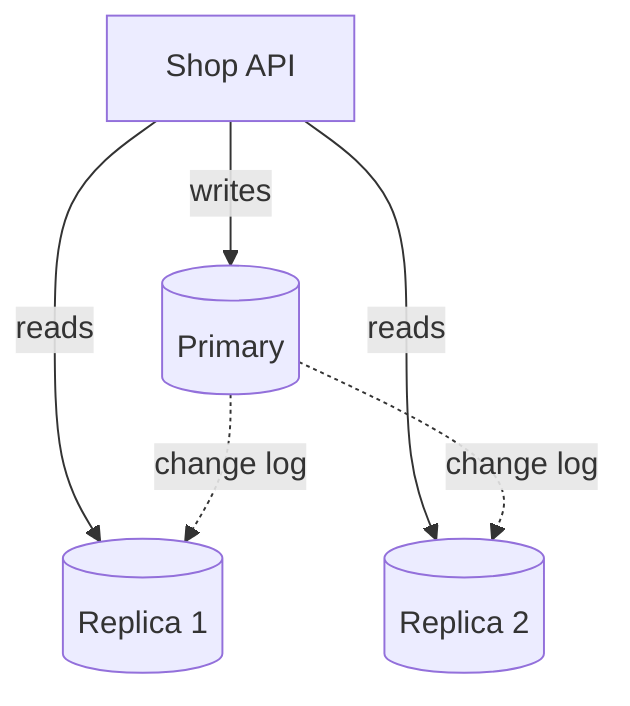
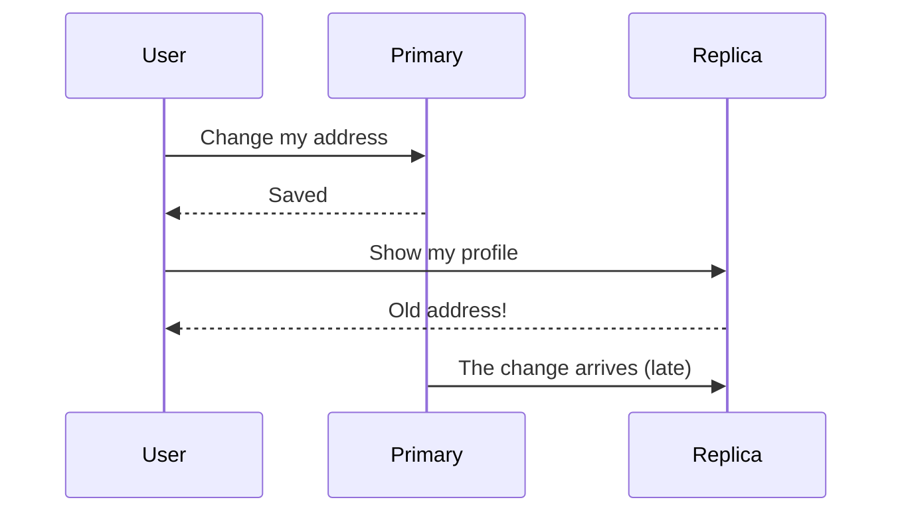

## The idea

A teacher writes on the **main board**. The students copy it into their **notebooks**. Anyone can answer a question by looking in their own notebook, so the teacher isn't asked everything. But only the teacher writes new things on the board. If a student copies slowly, their notebook is a little **behind** the board.

**Replication** works the same way. One database, the **primary**, takes all the writes. It sends every change to other databases, the **replicas**, which keep a copy of the same data. Replicas can answer reads, and one can take over if the primary dies.

Other names you will hear: primary and replica are also called **leader and follower**, or **master and slave** in older docs.

## Why copy data

1. **Survive failures.** If one machine dies, another already has all the data. This is called **high availability**.
2. **More reads.** Spread read traffic across many copies. See [Scaling Reads](../hld-basics/scaling-reads.mdx).
3. **Faster for far-away users.** Put a copy in another region, close to them.
4. **Heavy reports without hurting users.** Run big analytics queries on a replica, not on the primary.

**Replication is not a backup.** If someone runs a bad `DELETE`, the delete is copied to every replica within seconds. You still need backups. See [Disaster Recovery](../reliability-security/disaster-recovery.mdx).

## The primary and read replicas

Every change on the primary is written to its **change log**. In PostgreSQL this is the write-ahead log (WAL). In MySQL it is the binary log (binlog). The primary **streams** this log to each replica, and each replica replays it to make the same changes.

- **Writes** always go to the primary.
- **Reads** can go to any replica.
- Replicas are **read-only**. They refuse writes.

## Sync vs async copying, and replica lag

The big question: when the app writes, does the primary **wait** for the replicas before saying "done"?

| | Synchronous | Asynchronous |
| --- | --- | --- |
| **Primary waits for replicas?** | Yes, before saying "done" | No. It says "done" right away |
| **Write speed** | Slower: every write waits for the network | Fast |
| **If the primary dies** | No committed data is lost | The last few writes may be lost |
| **If a replica is slow or down** | Writes slow down or stop | No effect on writes |

Most setups use **async**, or a mix called **semi-sync**: the primary waits for **one** replica, and the rest copy in the background. That way at least two machines have every committed write, and one slow replica can't stall everything.

### Replica lag

With async copying, a replica is always a little **behind** the primary. Usually by milliseconds, sometimes by seconds or more when it is busy. This delay is called **replica lag**, and it causes a classic bug:

The user thinks their change was lost. Ways to fix it:

- **Read your own writes from the primary.** For a few seconds after a user changes something, read **their** data from the primary.
- **Read important things from the primary** always, like a balance just before a payment.
- **Watch the lag,** and stop sending reads to a replica that falls too far behind.

For the different promises a system can make about this, see [Consistency Models](../distributed-systems/consistency-models.mdx).

## Multi-leader and leaderless, in short

Everything above is **single-leader** replication. It is the simplest and the most common. There are two other styles:

| Style | How it works | Good | Bad |
| --- | --- | --- | --- |
| **Single-leader** | One primary takes all writes | Simple. No write conflicts | All writes go to one machine |
| **Multi-leader** | Several primaries take writes, often one per region | Fast local writes in every region | Two leaders can change the same row at once, so you need rules to settle **conflicts** |
| **Leaderless** | Any node can take a write. That node (the **coordinator**), or a smart client library, sends it to several copies at once, and reads from several | No single point of failure | Must compare copies and fix old ones |

A common conflict rule is **last write wins**: keep the change with the newest timestamp. It is simple, but the other change is silently lost.

Leaderless systems use **quorums**. With N copies, a write must reach W of them and a read asks R of them. If **W + R is greater than N**, at least one copy in every read has the newest write. For example, N = 3, W = 2, R = 2. Cassandra, ScyllaDB and Riak work this way.

## Failover when the primary dies

<Steps>
<Step>

**Notice.** The primary stops answering health checks for a few seconds.

</Step>
<Step>

**Choose.** Pick the replica that is the most up to date.

</Step>
<Step>

**Promote.** That replica becomes the new primary and starts taking writes.

</Step>
<Step>

**Redirect.** Point the app, or the proxy in front of the database, to the new primary. The other replicas now copy from it. If the old primary comes back, it must join as a replica.

</Step>
</Steps>

Things that can go wrong:

- **Lost writes.** With async copying, writes the old primary had not yet sent are lost.
- **Split brain.** The old primary was only cut off, not dead. Now **two** machines think they are the primary and both take writes. Systems use majority votes to avoid this. See [Leader Election and Consensus](../distributed-systems/leader-election-consensus.mdx).
- **False alarms.** A slow network looks like a dead primary, and causes a failover nobody needed.

Common tools: **Patroni** for PostgreSQL and **Orchestrator** for MySQL. Managed databases like **Amazon RDS Multi-AZ** keep a standby copy in another availability zone (a separate data center) and fail over automatically. See also [Redundancy and Failover](../reliability-security/redundancy-failover.mdx).

## In the real world

**GitHub, October 2018.** A network problem cut GitHub's main East Coast data center off for 43 seconds. Their failover tool, Orchestrator, promoted database primaries in a West Coast data center. Some writes on the East Coast had not been copied there yet. Now the two sides each had writes the other did not have. GitHub spent about a day in a degraded state, restoring data and making the copies match again.

**GitLab, January 2017.** While fighting a replication problem, an engineer accidentally deleted the data directory on the **primary** database instead of the broken replica. Several backup methods turned out not to be working. GitLab restored from a copy about six hours old, and lost the changes made in those hours. The replica did not help either: it had already been wiped to rebuild replication, so no good copy was left.

## In the interview

Bring it up as soon as you draw the database, especially for read-heavy systems:

> "The database has one primary and two read replicas, with async replication. Reads go to the replicas. Right after a user changes something, we read their data from the primary for a few seconds, so they always see their own change. If the primary dies, a replica is promoted automatically."

<Callout title="Remember this" type="success">
  - **Primary** takes writes, **replicas** copy its change log and serve reads.
  - **Sync:** no data loss, slower writes. **Async:** fast, but replicas lag and the last writes can be lost.
  - **Replica lag** breaks "I just saved it, where is it?" Read your own writes from the primary.
  - **Multi-leader** gives write conflicts. **Leaderless** uses quorums: W + R greater than N.
  - **Failover:** notice, choose, promote, redirect. Watch out for **split brain**.
  - **Replication is not a backup.** Deletes are copied too.
</Callout>
