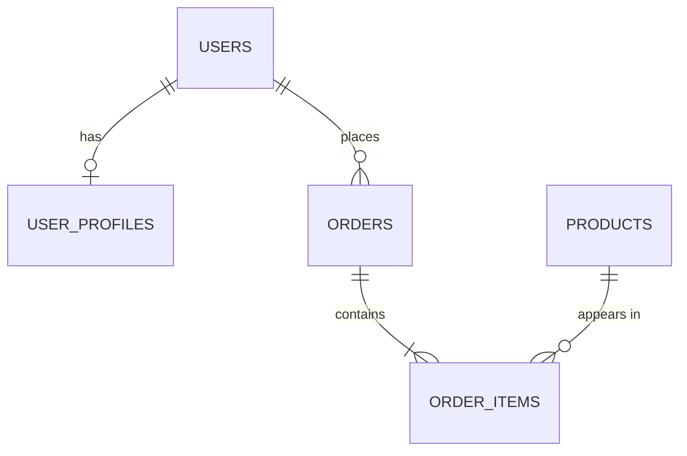

## The idea

Think of the **contacts app** on your phone. Each contact is a **row**. Name, phone and email are the **columns**. The whole list is a **table**. The form you fill in for a new contact, with its fixed fields, is the **schema**: the shape every row must follow.

Now think of a **library**. Every book has a unique number on its spine. Every member has a unique card number. A loan slip just writes down two numbers: the book's number and the member's card number. It doesn't copy the whole book or the member's address.

That is how a database links data. Each row gets a unique ID (a **primary key**). Other rows point to it by storing that ID (a **foreign key**).

## Tables, rows and columns

Each column has a **type**, and can have **rules** (called **constraints**). The database refuses data that breaks the rules.

| Column | Type | Rule | Meaning |
| --- | --- | --- | --- |
| `id` | `BIGINT` | `PRIMARY KEY` | A unique number for each user |
| `email` | `TEXT` | `NOT NULL UNIQUE` | Must be filled in, and no two users can share it |
| `name` | `TEXT` | `NOT NULL` | Must be filled in |
| `created_at` | `TIMESTAMPTZ` | `DEFAULT now()` | Date and time, filled in for you |

Common PostgreSQL types: `BIGINT` (whole numbers), `TEXT`, `BOOLEAN`, `NUMERIC` (exact decimals), `TIMESTAMPTZ` (date and time with time zone), `JSONB` (JSON data), `UUID`.

**Store money as whole cents** (`INTEGER` or `BIGINT`), or as `NUMERIC`. Never as a floating-point number, because those can't store values like 0.10 exactly.

## Primary keys

A **primary key** is the column (or columns) that identifies one row. It must be:

- **Unique:** no two rows share it.
- **Never empty.**
- **Never changing.** Other tables point to it.

So **don't use an email as the primary key**. People change their email.

Most tables use a made-up ID that has no meaning, called a **surrogate key**. Two common choices:

| | Auto-increment number | UUID |
| --- | --- | --- |
| **Looks like** | `1`, `2`, `3`, ... | `3f2b8c1e-6d4a-4b7e-9c0f-1a2b3c4d5e6f` |
| **Size** | 8 bytes (`BIGINT`) | 16 bytes |
| **Made by** | The database, one at a time | Anyone, anywhere, with no coordination |
| **Good** | Small, fast, sorted by creation time | Works across many servers. Can't be guessed |
| **Bad** | Needs one central counter. Easy to guess (`/orders/1002`) | Bigger. Random ones scatter inserts across the index |

When many servers must create IDs without a central counter, see [Distributed ID Generation](../distributed-systems/distributed-id-generation.mdx).

## Foreign keys

A **foreign key** is a column that points to the primary key of another table. `orders.user_id` points to `users.id`.

The database then protects the link:

- You **can't create** an order for user 99 if user 99 doesn't exist.
- You **can't delete** a user who still has orders, unless you say what should happen:

| Option | What happens to the user's orders |
| --- | --- |
| Nothing written (the default, `NO ACTION`), or `ON DELETE RESTRICT` | The delete is refused |
| `ON DELETE CASCADE` | The orders are deleted too |
| `ON DELETE SET NULL` | The orders stay, with `user_id` set to empty. Only works if `user_id` allows `NULL` (not with `NOT NULL`) |

Foreign keys only work **inside one database**. Once data is split across [shards](./partitioning-sharding.mdx) or across microservices, the app must check the links itself.

## One-to-one, one-to-many, many-to-many

| Relationship | Shop example | How to store it |
| --- | --- | --- |
| **One-to-one** | A user has one profile | Foreign key with `UNIQUE` on the profile table |
| **One-to-many** | A user places many orders | Foreign key on the "many" side: `orders.user_id` |
| **Many-to-many** | An order has many products, and a product is in many orders | A third table in the middle: `order_items` |

The table in the middle of a many-to-many relationship is called a **join table**. It holds one row per link: "order 1001 contains product 42, quantity 2".



How to read the line ends: `||` means "exactly one", `o|` means "zero or one", `o{` means "zero or more", and `|{` means "one or more". So: a user places zero or more orders, and each order has one or more items.

## Writing a simple schema for a design

<Steps>
<Step>

**List the nouns.** For a shop: users, products, orders, order items.

</Step>
<Step>

**List the fields** each one needs to support your features.

</Step>
<Step>

**Find the relationships.** One-to-many gets a foreign key. Many-to-many gets a join table.

</Step>
<Step>

**Pick the keys,** and add indexes for the queries you will run most. See [Indexes](./indexes.mdx).

</Step>
</Steps>

```sql
CREATE TABLE users (
  id          BIGINT GENERATED ALWAYS AS IDENTITY PRIMARY KEY,
  email       TEXT NOT NULL UNIQUE,
  name        TEXT NOT NULL,
  created_at  TIMESTAMPTZ NOT NULL DEFAULT now()
);

CREATE TABLE products (
  id           BIGINT GENERATED ALWAYS AS IDENTITY PRIMARY KEY,
  name         TEXT NOT NULL,
  price_cents  INTEGER NOT NULL CHECK (price_cents >= 0),
  stock        INTEGER NOT NULL CHECK (stock >= 0)
);

CREATE TABLE orders (
  id          BIGINT GENERATED ALWAYS AS IDENTITY PRIMARY KEY,
  user_id     BIGINT NOT NULL REFERENCES users(id),
  total_cents INTEGER NOT NULL CHECK (total_cents >= 0),
  status      TEXT NOT NULL DEFAULT 'pending',
  created_at  TIMESTAMPTZ NOT NULL DEFAULT now()
);

CREATE TABLE order_items (
  order_id     BIGINT NOT NULL REFERENCES orders(id),
  product_id   BIGINT NOT NULL REFERENCES products(id),
  quantity     INTEGER NOT NULL CHECK (quantity > 0),
  price_cents  INTEGER NOT NULL,  -- the price when the order was placed
  PRIMARY KEY (order_id, product_id)
);
```

Two things to notice:

- `order_items` uses **two columns together** as its primary key. This is called a **composite key**. The same product can't appear twice in one order.
- `order_items.price_cents` copies the price **at the moment of purchase**. If the product's price changes tomorrow, old orders must not change. See [Normalization](./normalization.mdx).

## In the real world

**Basecamp ran out of numbers.** In November 2018, Basecamp 3 went read-only for several hours. An ID column in one big table used a 32-bit integer, and it reached the largest value that type can hold: 2,147,483,647. New rows could not get an ID. This is why `BIGINT` is the safe default for IDs: it is 64-bit, with a largest value of about 9.2 billion billion (9.2 × 10¹⁸), so it never runs out in practice.

**Stripe puts the type in the ID.** Stripe's API IDs start with a short prefix, like `cus_` for a customer and `pi_` for a payment intent. When an ID shows up in a log or a support ticket, you can tell at once what kind of object it is.

## In the interview

You don't need full SQL. After the API, write the main tables with their keys, and point out the relationships:

> "Users have many orders, so `orders` gets a `user_id` foreign key. Orders and products are many-to-many, so I'll add an `order_items` table, which also stores the price at the time of purchase."

<Callout title="Remember this" type="success">
  - A **schema** is the fixed shape of your tables: columns, types and rules.
  - **Primary key:** unique, never empty, never changes. Use `BIGINT` or a UUID, not an email.
  - **Foreign key:** points to another table's primary key. The database protects the link.
  - **One-to-many:** foreign key on the "many" side. **Many-to-many:** a join table.
  - Store **money as whole cents**, never as a float.
  - Foreign keys don't work **across shards or services**. The app must check there.
</Callout>
