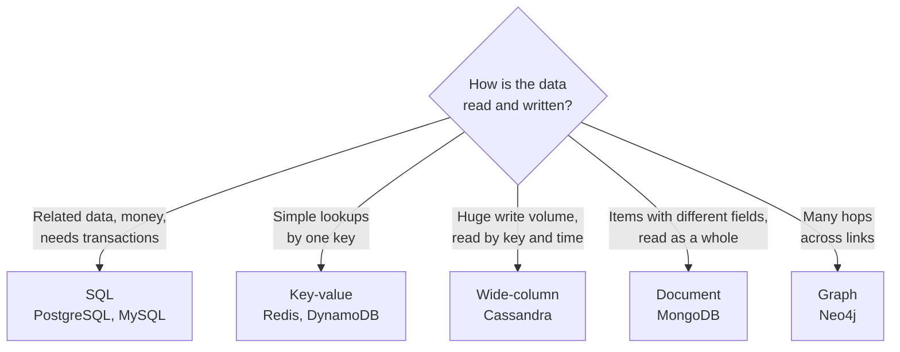
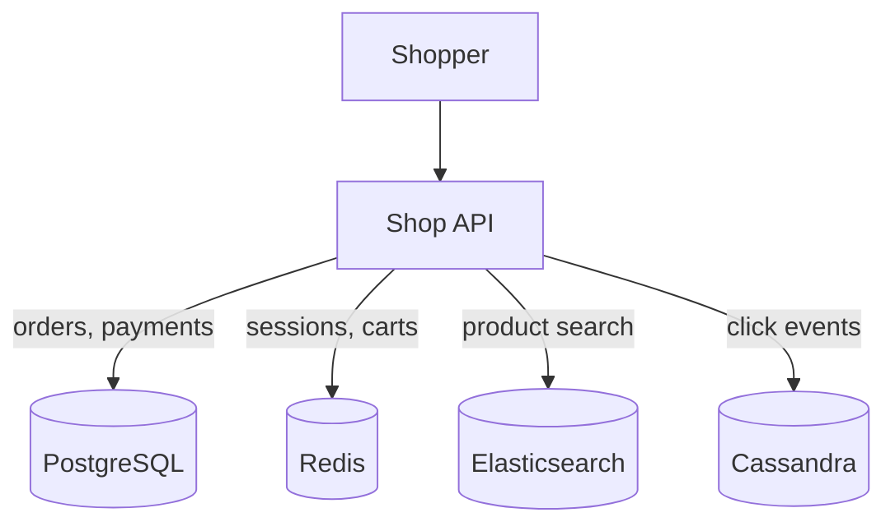

## The idea

A **database** is a program that stores your data safely and helps you find it again fast. There are two big families.

- **SQL databases**, also called **relational databases**, are like a **library with a strict catalog**. Every book has a card with the same fields. You can search the catalog in any way you like: by author, by year, by topic.
- **NoSQL databases** ("not only SQL") are a group of different designs. The simplest kind, a **key-value store**, is like a **coat check**. You hand over your coat and get ticket 42. Later, "ticket 42" gets your coat back in a second. Very fast, but you can't ask "show me all the red coats". Other NoSQL types can answer more kinds of questions, but each is built for a few planned ones.

SQL databases are great at **asking any question** and keeping related data correct. Each NoSQL database gives up some of that to be faster, or easier to spread across many machines, **for one kind of job**.

All examples on this page use an **online shop** with users, products and orders.

## SQL databases: tables and relations

Data lives in **tables**. A table has **columns** (fixed fields, each with a type, like number or text) and **rows** (one per item). The fixed shape of all the tables is called the **schema**.

Tables point to each other with IDs. An order row stores the ID of the user who placed it:

| id | user_id | total_cents | status |
| --- | --- | --- | --- |
| 1001 | 7 | 4999 | paid |
| 1002 | 7 | 1299 | shipped |
| 1003 | 12 | 899 | paid |

You talk to these databases with **SQL** (Structured Query Language). One query can combine tables. This is called a **join**:

```sql
SELECT o.id, o.total_cents, u.email
FROM orders o
JOIN users u ON u.id = o.user_id
WHERE o.status = 'paid';
```

What you get:

- **Joins:** combine tables in one query.
- **Transactions:** many changes succeed or fail together. See [Transactions and ACID](./transactions-acid.mdx).
- **Rules the database checks for you:** a price can't be empty, an order can't point to a user who doesn't exist. See [Schemas and Keys](./schemas-and-keys.mdx).
- **Any question, any time:** you can ask new questions later, and add an [index](./indexes.mdx) to make them fast.

**Examples:** PostgreSQL, MySQL, SQL Server, Oracle, SQLite.

## NoSQL: four main types

| Type | Picture it as | You read data by... | Examples | Good for |
| --- | --- | --- | --- | --- |
| **Key-value** | A coat check: ticket → coat | The key | Redis, DynamoDB | Sessions, shopping carts, caches |
| **Document** | A folder of JSON files | ID, or fields inside the document | MongoDB, Firestore | Product catalogs, user profiles |
| **Wide-column** | A huge table split into groups by a key, sorted inside each group | Group key, then a range | Cassandra, ScyllaDB, HBase | Chat messages, events, sensor data |
| **Graph** | Dots joined by lines | Following the lines | Neo4j, Amazon Neptune | Friends of friends, fraud rings |

### Key-value

The simplest kind. You store a value under a key, and get it back by that key.

- Key: `cart:user:7` → Value: the items in user 7's cart.

Lookups by key are extremely fast. But you can't ask "which carts contain product 42?" without reading everything.

Some key-value stores do a little more. DynamoDB can also read a range of items that share one key, sorted by a second key, and lets you add extra indexes.

### Document

Each item is a **document**, usually JSON. Documents in the same collection can have different fields. That fits a product catalog, where shoes have sizes and a TV has a screen size:

```json
{
  "_id": "p_1001",
  "name": "Running shoes",
  "price_cents": 2999,
  "sizes": [7, 8, 9, 10],
  "specs": { "color": "blue", "weight_grams": 250 }
}
```

You usually read the **whole document** at once, so data that is used together is stored together.

### Wide-column

Rows are grouped by a **partition key**, and sorted inside the group by a **clustering key**. For chat messages, the partition key is the chat ID and the messages are sorted by time. "Give me the last 50 messages in chat 9" then reads one group, from one place on disk.

These databases are built for **huge numbers of writes**, spread over many machines. You must design tables around your queries up front.

### Graph

Data is **nodes** (people, products) and **edges** (follows, bought). Questions with many hops, like "friends of my friends who bought this product", are natural here. In SQL they need many joins.

## Good and bad sides

| | SQL | NoSQL |
| --- | --- | --- |
| **Shape of data** | Fixed schema, checked by the database | Flexible, often checked by the app |
| **Relations** | Joins built in | Few or no joins. You copy data instead |
| **Transactions** | Strong, across many tables | Often limited to one item or one partition, though many now offer more |
| **Scaling out** | One big machine first. Splitting across machines is extra work | Many are built to spread across machines from day one |
| **Queries** | Ask anything | Fast for the queries you planned. Hard for new ones |

The line is blurry today. PostgreSQL can store and search JSON with its `JSONB` type. MongoDB and DynamoDB support transactions across several items. So **pick by access pattern**, not by label. An **access pattern** is how the app reads and writes the data: by which key, how often, and how much at once.

## How to pick a database in an interview



**Start with PostgreSQL by default.** It is safe, flexible, and scales further than most people expect with [replicas](./replication.mdx) and [sharding](./partitioning-sharding.mdx). Move to NoSQL when you can name the reason: write volume one machine can't take, simple key lookups at huge scale, or very flexible data.

Big systems often use **several databases**, each for the job it does best. This is called **polyglot persistence**:



For search, see [Search](../advanced-components/search.mdx). For Redis, see [Redis](../caching/redis.mdx).

## In the real world

**Discord moved its messages twice.** Discord first stored chat messages in MongoDB. As the data grew, they moved messages to Cassandra around the start of 2016 (and wrote about it in 2017), because it handles huge write volumes and reads "latest messages in this channel" well. In 2023 they wrote about moving again, to ScyllaDB, a Cassandra-compatible database.

**Amazon built Dynamo for the shopping cart.** Amazon's Dynamo paper (2007) describes a key-value store built so that services like the shopping cart can always accept writes. The paper notes that many Amazon services only need to look up data by its key. DynamoDB, the AWS service, grew out of these ideas.

**Instagram runs on PostgreSQL.** Instagram has written about storing its main data in PostgreSQL, split across many servers by sharding. A SQL database can go very far.

## In the interview

Name the database in your high-level design, and give **one reason tied to the access pattern**:

> "Orders and payments go in PostgreSQL, because I need transactions and the data is relational. Chat messages go in Cassandra, partitioned by chat ID and sorted by time, because it's write-heavy and we always read the latest messages of one chat."

Avoid "NoSQL, because it scales" on its own. Interviewers will push back, because SQL databases scale too.

<Callout title="Remember this" type="success">
  - **SQL:** tables, fixed schema, joins, strong transactions. Ask any question.
  - **NoSQL types:** key-value, document, wide-column, graph. Each is great at one kind of access.
  - NoSQL usually means **no joins**, so you design around your queries and copy data.
  - **Default to PostgreSQL.** Switch only with a clear reason.
  - Pick by **access pattern**, and say the reason out loud.
  - Big systems often use **several databases** for different jobs.
</Callout>
