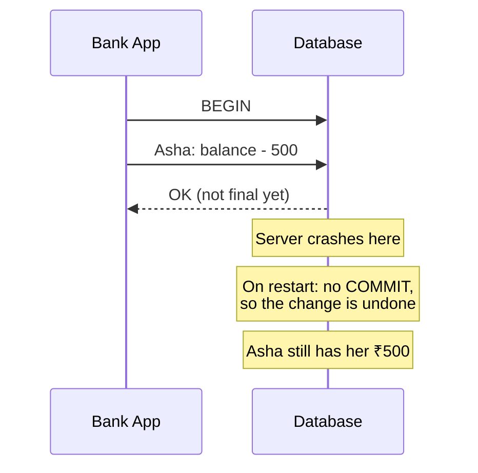

## What is it?

A **transaction** groups steps into **one unit**: either all of them happen, or none of them do. It is like a deal at a shop counter. You hand over the money, and they hand over the item. If either side backs out, everyone gets their own thing back. Nobody walks away with both.

In SQL, you wrap the steps in `BEGIN` and `COMMIT`:

```sql
BEGIN;
UPDATE accounts SET balance = balance - 500 WHERE id = 1;  -- Asha
UPDATE accounts SET balance = balance + 500 WHERE id = 2;  -- Ravi
COMMIT;
```

Until `COMMIT`, the changes are not final, and other users don't see them. If anything goes wrong before `COMMIT`, every step is undone: by the database itself after a crash, or by your app calling `ROLLBACK` after an error.

## Why do we need it?

Asha sends ₹500 to Ravi. For the bank, that is **two steps**:

1. Take ₹500 from Asha's account.
2. Add ₹500 to Ravi's account.

What if the server crashes after step 1, but before step 2? Asha has lost ₹500, and Ravi never got it. The money has vanished.

A crash halfway is not the only danger. Without transactions:

- **Other users see half-done work.** A report that runs between step 1 and step 2 shows ₹500 missing from the bank.
- **Two users overwrite each other.** Two withdrawals both read a balance of ₹500, and both take ₹500 out. See [Isolation Levels](./isolation-levels.mdx).
- **"Saved" is not really saved.** The app shows "Transfer done", then a power cut loses the change.
- **Rules break.** A half-done change leaves a balance below zero, or an order with no items.

Each letter of **ACID** below fixes one of these.

## How it works inside

### ACID, in simple words

A database that supports proper transactions promises four things, known as **ACID**:

| Letter | Name | Simple meaning | In the bank example |
| --- | --- | --- | --- |
| **A** | Atomicity | All or nothing | Either both accounts change, or neither does |
| **C** | Consistency | The data always follows your rules | A balance can never go below zero, if you made that a rule |
| **I** | Isolation | Transactions running at the same time act as if they ran **one at a time**. They don't see or trip over each other's half-done work | Nobody sees the moment when the money has left Asha but not reached Ravi |
| **D** | Durability | Once it says "committed", it stays saved, even after a crash or power cut | After the app shows "Transfer done", the money can't un-move |

A few notes:

- **Consistency** here means your **rules** hold: `CHECK (balance >= 0)`, foreign keys, unique emails. It is **not** the same "C" as in the [CAP Theorem](../distributed-systems/cap-theorem.mdx), which is about every copy showing the newest data.
- **Isolation** comes in levels: stronger is safer, weaker is faster. Only the strongest level fully gives "one at a time". See [Isolation Levels](./isolation-levels.mdx).
- **Durability** works through a **write-ahead log (WAL)**. Before the database says "committed", it writes the change to a log file on disk. It is like a diary: write down what you are about to do, then do it. After a crash, the database reads the diary and finishes or undoes the work.

### Atomicity and durability: the write-ahead log

Here is what happens to a commit, step by step:

1. Each change is made to the data pages **in memory**, and also written as a small **log record** (what changed, and in which transaction).
2. On `COMMIT`, the database forces the log records to **disk** (an `fsync`). This is one fast write to the end of one file.
3. Only then does it answer "committed".
4. The changed data pages are written to their real places on disk **later**, in the background (at a **checkpoint**).

After a crash, the database replays the log from the last checkpoint. Changes from committed transactions are put back. Changes from transactions with no `COMMIT` in the log never count:

- **PostgreSQL** keeps those row versions but marks the transaction as aborted, so nobody ever sees them. They are cleaned up later.
- **MySQL (InnoDB)** uses an **undo log** to roll them back.



### Isolation: locks and snapshots

Two tools keep transactions apart:

- **Row locks** for writes. If two transactions change the **same row**, the second one waits until the first commits or rolls back. See [Locks and Deadlocks](./locking.mdx).
- **Snapshots** for reads. The database keeps old versions of changed rows, so a reader sees the data as it was, and never sees half-done work. This is called **MVCC**. See [Isolation Levels](./isolation-levels.mdx).

### Commit and rollback

- `COMMIT` makes all the changes final.
- `ROLLBACK` throws all of them away. Your app calls it when something goes wrong.
- The database also rolls back **by itself** if the server crashes or the app's connection drops.
- A **failed statement** is different. The whole transaction is not undone for you:
  - **PostgreSQL** marks the transaction as failed and refuses every later statement. Your app must send `ROLLBACK`.
  - **MySQL** usually undoes only the failed statement. The rest of the transaction stays open, so your app must decide to roll back.

Here is placing an order in our shop. Taking stock and creating the order must happen together:

```sql
BEGIN;

-- Take one item from stock, only if there is one left
UPDATE products SET stock = stock - 1
WHERE id = 42 AND stock >= 1;
-- If this changed 0 rows, the item is sold out: ROLLBACK

INSERT INTO orders (user_id, total_cents, status) VALUES (7, 2999, 'pending')
RETURNING id;  -- say it returns 1001

INSERT INTO order_items (order_id, product_id, quantity, price_cents)
VALUES (1001, 42, 1, 2999);

COMMIT;
```

In app code, the pattern is always the same: begin, do the work, commit, and roll back on any error.

```js
const client = await pool.connect();

try {
    await client.query("BEGIN");

    // Take 1 from stock, but only if there is at least 1 left
    const result = await client.query(
        "UPDATE products SET stock = stock - 1 WHERE id = $1 AND stock >= 1",
        [productId],
    );

    // No row changed means the stock was 0
    if (result.rowCount === 0) {
        throw new Error("Sold out");
    }

    await client.query(
        "INSERT INTO orders (user_id, total_cents, status) VALUES ($1, $2, $3)",
        [userId, priceCents, "pending"],
    );

    // Both writes worked: save them together
    await client.query("COMMIT");
} catch (error) {
    // Something failed: undo every write since BEGIN
    await client.query("ROLLBACK");
    throw error;
} finally {
    // Give the connection back to the pool, whatever happened
    client.release();
}
```

## When to use it

**Use one when several writes must stay together:**

- Moving money between accounts.
- Taking stock and creating an order.
- Booking a seat and recording the payment.
- Reading a value and then writing based on it, like "check the balance, then withdraw". This also needs the right [isolation level or a lock](./locking.mdx).

**Don't use it when:**

- It is a single insert or update. Each statement already runs as its own small transaction (this is called **autocommit**).
- The data is logs, analytics or view counters, where losing or repeating one event doesn't matter much.

**Keep transactions short.** While a transaction is open, it can hold locks that make other users wait. Never call a slow outside service, like a payment provider, in the middle of one.

**One database only.** A transaction covers one database. When a flow touches several services, each with its own database, you need other tools: [Two-Phase Commit](../distributed-systems/distributed-transactions-2pc.mdx) or the [Saga Pattern](../distributed-systems/saga-pattern.mdx).

## Alternatives

| Option | What it is | Pick it when |
| --- | --- | --- |
| **One atomic statement** | A single `UPDATE ... WHERE stock >= 1` that checks and changes in one step | Only one row changes. It is already its own transaction |
| **Saga** | A chain of small local transactions, each with an undo step | The flow spans several services. See [Saga Pattern](../distributed-systems/saga-pattern.mdx) |
| **Two-phase commit (2PC)** | A coordinator asks every database to get ready, then tells all of them to commit | You need all-or-nothing across a few databases, and can accept the slowness. See [Two-Phase Commit](../distributed-systems/distributed-transactions-2pc.mdx) |
| **Idempotent steps with retries** | Each step is safe to run twice, so after a crash you just run it again | No transaction is available, like calls to outside APIs. See [Idempotency](../messaging/idempotency.mdx) |
| **BASE (eventual consistency)** | Accept that data is briefly out of sync, and let it catch up | Speed and availability matter more than instant correctness. See [ACID vs BASE](../distributed-systems/acid-vs-base.mdx) |

## In the real world

**NoSQL databases added transactions too.** MongoDB added multi-document ACID transactions in version 4.0 (2018). The same year, DynamoDB added transactions across several items. Apps kept needing "all or nothing", even in databases that started without it.

**PostgreSQL waits for the disk by default.** With its default settings, PostgreSQL does not report a `COMMIT` as done until the change is safely written to its write-ahead log on disk. That is the "D" in ACID in practice.

## In the interview

Say what goes in one transaction, and what does not:

> "Placing an order takes stock and creates the order in one database transaction, so we never sell an item we don't have. The call to the payment provider happens outside the transaction. If payment fails, a saga cancels the order and puts the stock back."

<Callout title="Remember this" type="success">
  - A **transaction** makes several steps **all or nothing**.
  - **Why:** without it, a crash halfway loses money, others see **half-done work**, and "saved" may not be saved.
  - **ACID:** Atomicity (all or nothing), Consistency (rules hold), Isolation (as if run one at a time), Durability (committed means saved).
  - `COMMIT` makes it final. `ROLLBACK` undoes it. Crashes roll back on their own. After a failed statement, **your app** sends `ROLLBACK`.
  - Durability comes from the **write-ahead log** on disk.
  - **Inside:** on `COMMIT`, the log is forced to disk **before** the answer. Data pages are written later. Isolation uses **row locks** and **snapshots**.
  - Keep transactions **short**. No slow outside calls inside them.
  - Across services, use a **saga** or **2PC**, not a database transaction.
  - **Alternatives:** one atomic statement, a saga, 2PC, idempotent steps with retries, BASE.
</Callout>
