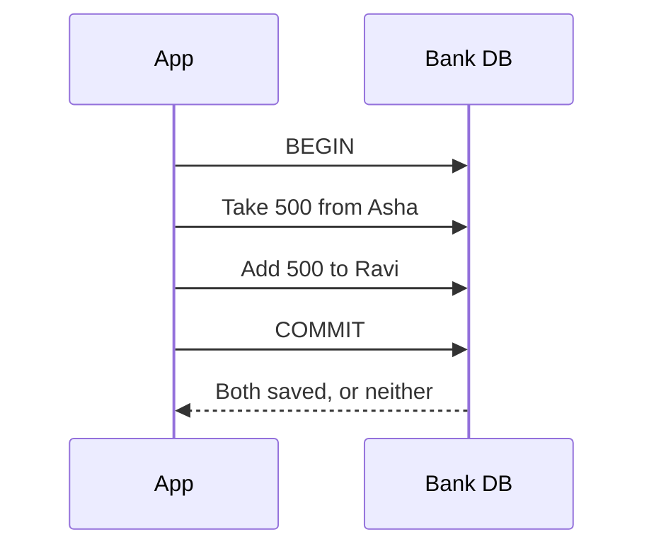
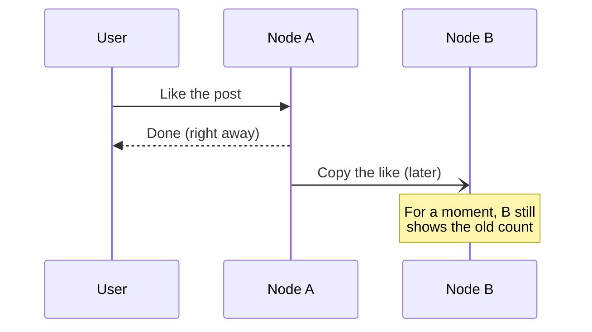
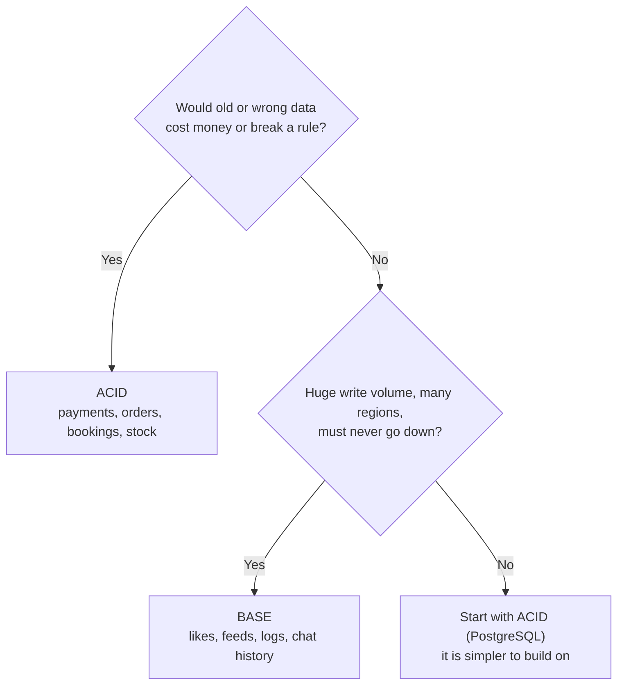

## The idea

There are two big ways of thinking about how a database should behave.

Think of a shop with many branches:

- **ACID** is like one **central bank counter**. Every payment is written in the main book right away. It is either fully done or not done at all. If the book is busy, you wait in line.
- **BASE** is like **branch shops with their own notebooks**. Each branch keeps selling, even when the phone line to head office is down. Every evening, the notebooks are matched up. For a few hours, the branches may disagree about the stock.

ACID puts **correct data** first. BASE puts **always answering** first. (The names are a little chemistry joke: acids and bases are opposites.)

## ACID, a quick recap

ACID is the set of promises a **transaction** gives. A transaction is a group of steps that are treated as one. The full lesson is [Transactions and ACID](../databases/transactions-acid.mdx).

| Letter | Name | In simple words |
| --- | --- | --- |
| **A** | Atomicity | All steps happen, or none do |
| **C** | Consistency | Data always follows the rules, like "a balance is never negative" |
| **I** | Isolation | Transactions running at the same time don't mess each other up |
| **D** | Durability | Once saved, it stays saved, even after a crash |

**Don't mix up the two C's.** The C in ACID means the data follows **your rules**. The C in [CAP](./cap-theorem.mdx) means every reader sees the **newest write**. Same letter, different ideas.

## BASE

| Letter | Name | In simple words |
| --- | --- | --- |
| **BA** | Basically Available | The system always answers, even if some machines are down or the data is a little old |
| **S** | Soft state | The data may still be changing in the background, while copies catch up |
| **E** | Eventually consistent | Given a little time with no new writes, all copies become the same |

The user gets a fast answer. Node B shows the old count for a moment. Nobody is harmed, because it's a like count. See [Consistency Models](./consistency-models.mdx) for the levels between these two.

## Side by side

| | ACID | BASE |
| --- | --- | --- |
| **Main goal** | Correct data, always | Always available and fast |
| **Right after a write** | Everyone sees the new value | Some readers see the old value for a while |
| **When the network breaks** | Usually refuses requests rather than give old data (CAP's **C**, not ACID's C) | Keeps answering (CAP's **A**) |
| **Growing bigger** | Harder to spread across many machines | Built to spread across many machines |
| **Typical use** | Payments, orders, bookings, stock | Likes, feeds, logs, sessions, metrics |

## Which databases follow which

| Database | Leans to | Notes |
| --- | --- | --- |
| PostgreSQL, MySQL, Oracle, SQL Server | ACID | Classic relational (SQL) databases |
| Google Spanner, CockroachDB | ACID, across many machines | Often called **NewSQL**: SQL and ACID, spread over many machines |
| Cassandra | BASE | You can ask for stronger reads per query, like `QUORUM` |
| DynamoDB | BASE by default | Strong reads and ACID transactions are available as options |
| MongoDB | In between | Writes to one document are atomic. Multi-document transactions are available |
| Redis (with replicas) | BASE | Copies are made in the background, so a failover can lose the latest writes |

Today the line is blurry. Many databases let you choose **per operation**. In an interview, what matters is that you choose on purpose.

## When to use each

**Mixing is normal.** One app often uses both: orders and payments in PostgreSQL, likes and activity feeds in Cassandra. See [SQL vs NoSQL](../databases/sql-vs-nosql.mdx) for picking a database.

## In the real world

**MongoDB added ACID transactions.** MongoDB started out with atomic writes only inside one document. Version 4.0 (2018) added transactions across many documents, because so many apps needed all-or-nothing changes for things like orders.

**DynamoDB did the same.** DynamoDB launched as a BASE-style key-value store. In 2018, AWS added ACID transactions across many items and tables.

**Discord stored chat messages in Cassandra.** Discord wrote in 2017 about storing billions of messages in Cassandra, a BASE-style database built for huge write volumes. It later moved them to ScyllaDB, a database that works like Cassandra.

The pattern: BASE databases add ACID options, and ACID databases learn to spread across machines. Both sides move toward the middle.

## In the interview

When you pick a database, say which data needs ACID and which can be BASE:

> "Orders and payments go in PostgreSQL, because they need ACID: we never want half an order. Likes and the activity feed go in Cassandra. They need huge write throughput, and a few seconds of delay is fine."

<Callout title="Remember this" type="success">
  - **ACID** = correct first: all-or-nothing, rules kept, saved for good.
  - **BASE** = available first: always answers, copies agree **eventually**.
  - When the network breaks, ACID systems usually pick CAP's **C**. BASE picks **A**.
  - ACID's C (rules kept) is **not** CAP's C (newest data for every reader).
  - **Money, orders, bookings, stock → ACID.** Likes, feeds, logs → BASE.
  - Most databases now offer **both**, per operation. Choose on purpose.
  - Start with ACID unless scale forces you away from it.
</Callout>
