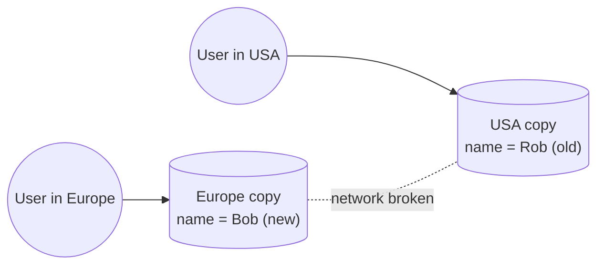

## The idea

Think of a bank with **two branches**. They keep the same account records, and they phone each other about every withdrawal. One day the **phone line between them goes dead**. A customer walks into one branch and asks for cash. The branch has two choices:

- **Say "sorry, come back later"** until the line works again. The balance can never be wrong, but the customer leaves with nothing.
- **Pay out anyway**, using the last balance it heard. The customer is served, but the balance may be out of date: maybe they just took money out at the other branch.

It can't do both until the line is fixed.

Big systems are the same. They store data on **many machines**. Sometimes the network between these machines breaks.

When that happens, you must choose one:

- **Always give the latest, correct data**, even if that means returning an error. (Consistency)
- **Always give an answer**, even if the data may be a little old. (Availability)

You cannot have both at that moment. That is the CAP theorem.

## What the three letters mean

| Letter | Name | Meaning |
| --- | --- | --- |
| **C** | Consistency | Every read gets the newest data. All users see the same thing. |
| **A** | Availability | Every request gets an answer, not an error. |
| **P** | Partition tolerance | The system keeps working when the network between machines breaks. A break like this is called a **partition**. |

## Why the real choice is C or A

Network problems **will** happen in real life. So you must always handle them. P is not optional.

That means the real question is: **when the network breaks, do you pick C or A?**

## An example

You have two copies of your database. One is in Europe and one is in the USA. The network between them breaks.

A user in Europe changes their name from **Rob** to **Bob**. Then a user in the USA opens the profile. What should the USA copy do?

- **Pick consistency:** the USA copy returns an error, or waits, until it can be sure it has the newest data. The data is correct, but the user gets no answer.
- **Pick availability:** the USA copy answers right away with **Rob**. The user gets an answer, but it is old for a short time.

## How to choose

Ask yourself: **"What is worse for the user: old data for a few seconds, or an error?"**

| Pick consistency when... | Pick availability when... |
| --- | --- |
| Money and bank balances | Likes and view counts |
| Booking the last seat or ticket (never sell it twice) | News feeds and comments |
| Stock count during checkout | Profile pictures and reviews |

## Eventual consistency

When you pick availability, the copies will become the same again soon after the network is fixed. This is called **eventual consistency**. Most big systems use it for most of their data.

## You can mix both

One system can choose differently for each feature. For a ticket site like Ticketmaster:

- **Viewing an event page:** pick availability. Old data for a few seconds is fine.
- **Booking a seat:** pick consistency. Two people must never get the same seat.

## In the real world

**Where the name comes from.** Eric Brewer presented CAP as an idea in 2000. Two years later, Seth Gilbert and Nancy Lynch of MIT proved it mathematically.

**Amazon's shopping cart picked availability.** Amazon's 2007 Dynamo paper explains that "add to cart" must always work, even when servers or networks fail. If two copies of a cart were changed separately during a failure, both versions were kept and merged later. The paper admits a side effect: an item you deleted could sometimes come back. Amazon accepted that, because a cart that refuses to add an item loses a sale.

**ATMs pick availability, with a limit.** In a 2012 article, Brewer used the ATM as an example. If an ATM loses its connection to the bank, it can still let you take out cash, but only up to a small limit. The bank fixes any problem later, for example with an overdraft fee. The risk is allowed, but kept small.

**Coordination services pick consistency.** etcd and ZooKeeper need a majority of their servers to agree. A server cut off from the majority refuses writes, instead of risking two different answers. See [Leader Election and Consensus](./leader-election-consensus.mdx).

**Google Spanner picks consistency, and makes breaks rare.** In 2017, Brewer (by then at Google) wrote that Spanner is technically a "pick C" system. But Google's private network makes partitions so rare that, for users, Spanner behaves almost as if it were always available too.

## In the interview

Say your choice in the **non-functional requirements**, and say why:

> "The system should be highly available for viewing events, and strongly consistent for booking, so a seat is never sold twice."

<Callout title="Remember this" type="success">
  - **C** = newest data, **A** = always an answer, **P** = survives network breaks.
  - Network breaks always happen, so the real choice is **C or A**.
  - Ask: "Is old data worse, or is an error worse?"
  - **Money and bookings → consistency.** Likes, feeds, profiles → availability.
  - Availability usually comes with **eventual consistency**.
  - You can choose **per feature**.
</Callout>
