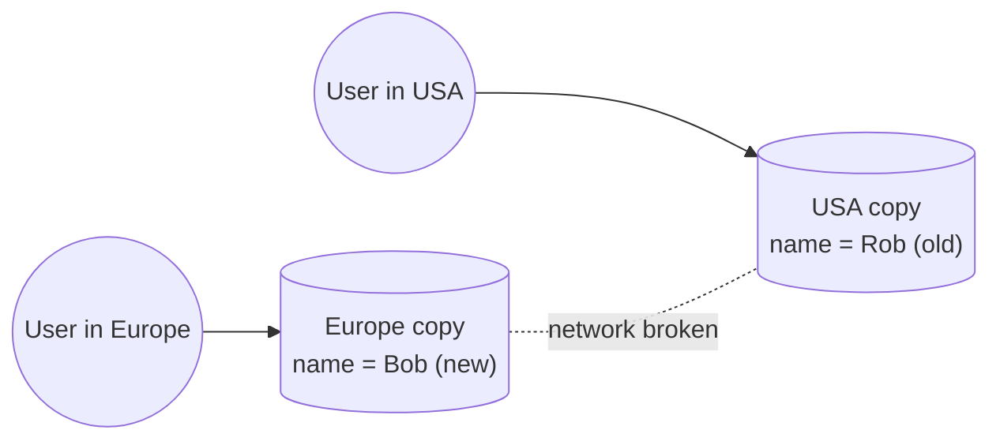
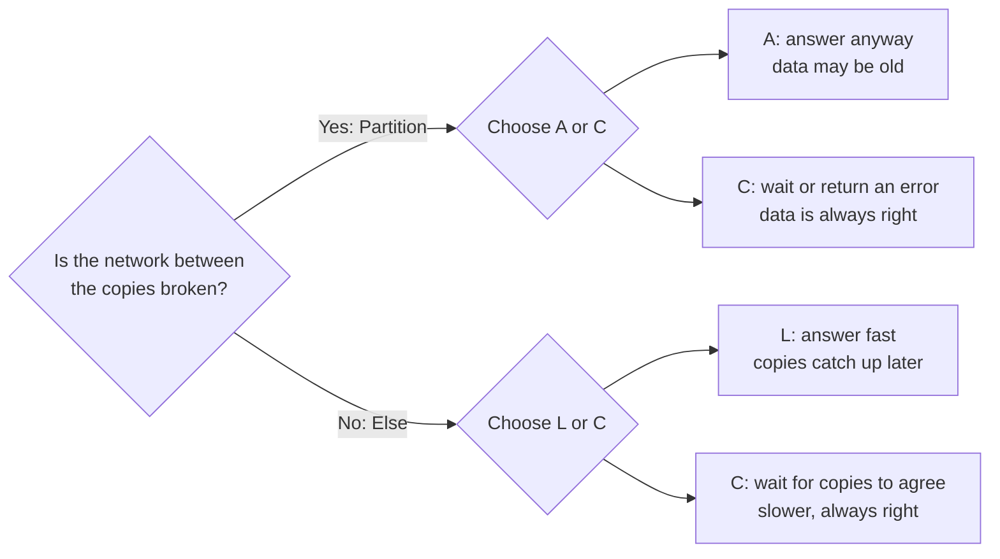

## What is it?

Think of a bank with **two branches**. They keep the same account records, and they phone each other about every withdrawal. One day the **phone line between them goes dead**. A customer walks into one branch and asks for cash. The branch has two choices:

- **Say "sorry, come back later"** until the line works again. The balance can never be wrong, but the customer leaves with nothing.
- **Pay out anyway**, using the last balance it heard. The customer is served, but the balance may be out of date: maybe they just took money out at the other branch.

It can't do both until the line is fixed.

Big systems are the same. They store data on **many machines**. Sometimes the network between these machines breaks.

When that happens, you must choose one:

- **Always give the latest, correct data**, even if that means returning an error. (Consistency)
- **Always give an answer**, even if the data may be a little old. (Availability)

You cannot have both at that moment. That is the CAP theorem.

## Why do we need it?

- **Big systems keep copies of the data on many machines.** One machine can die, and users far away want a copy close to them. See [Replication](../databases/replication.mdx).
- **The copies stay the same by talking over the network.** And networks break: a cable is cut, a switch fails, a server freezes for a few seconds. See [Why Distributed Systems Are Hard](./why-distributed-is-hard.mdx).
- **Without a plan, the system decides for you during the outage.** It either serves wrong data (a seat sold twice) or stops answering, and nobody chose which.

CAP tells you this choice **cannot be avoided**. So you make it on purpose, ahead of time, for each feature.

## How it works inside

### What the three letters mean

| Letter | Name | Meaning |
| --- | --- | --- |
| **C** | Consistency | Every read gets the newest data. All users see the same thing. |
| **A** | Availability | Every request gets an answer, not an error. |
| **P** | Partition tolerance | The system keeps working when the network between machines breaks. A break like this is called a **partition**. |

### Why the real choice is C or A

Network problems **will** happen in real life. So you must always handle them. P is not optional.

That means the real question is: **when the network breaks, do you pick C or A?**

### An example

You have two copies of your database. One is in Europe and one is in the USA. The network between them breaks.

A user in Europe changes their name from **Rob** to **Bob**. Then a user in the USA opens the profile. What should the USA copy do?

- **Pick consistency:** the USA copy returns an error, or waits, until it can be sure it has the newest data. The data is correct, but the user gets no answer.
- **Pick availability:** the USA copy answers right away with **Rob**. The user gets an answer, but it is old for a short time.

### What each choice looks like in a real system

- **Pick C:** a write must be confirmed by a **majority** of the copies (a **quorum**) before it counts. A copy cut off from the majority **refuses** reads or writes it can't be sure of. This is how etcd, ZooKeeper and Spanner work. See [Leader Election and Consensus](./leader-election-consensus.mdx).
- **Pick A:** every copy accepts reads and writes **on its own**, and sends the changes to the others later. When the network comes back, the copies may hold two different values for the same key. They must settle it, for example **last write wins** (keep the newest timestamp) or by **keeping both versions** and merging them, like Amazon's cart below.

### Eventual consistency

When you pick availability, the copies will become the same again soon after the network is fixed. This is called **eventual consistency**. Most big systems use it for most of their data.

## Beyond CAP: PACELC

CAP only talks about the time **when the network is broken**. That is rare. But there is a second choice that you make **all the time**, even when nothing is broken.

Go back to the two bank branches. Today the phone line works fine. Before paying out cash, a branch can:

- **Phone the other branch first, and wait for "OK".** Both branches always agree on the balance. But every customer waits an extra minute, every single time.
- **Pay out right away, and phone afterwards.** The customer is served fast. But for a short moment, the other branch has an old balance.

Nothing is broken, and there is still a trade-off. Keeping copies in sync means **waiting for the other copies to confirm**, and that wait is added to **every write**, not only during failures.

The database researcher **Daniel Abadi** gave this a name: **PACELC**. He first wrote about it in 2010, and explained it fully in a 2012 article. Read it as a sentence:

- **If** there is a **P**artition: choose **A**vailability or **C**onsistency. (This part is CAP.)
- **E**lse, in normal times: choose **L**atency or **C**onsistency. **Latency** is how long one request takes (see [Latency, Throughput and QPS](../hld-basics/latency-throughput-qps.mdx)).

A system gets a short name from its two choices:

| System | During a partition | In normal times | Short name |
| --- | --- | --- | --- |
| **Cassandra** (default settings) | Keeps answering (A) | Doesn't wait for every copy. Copies catch up later (L) | **PA/EL** |
| **Google Spanner** | Picks consistency (C) | Every write waits until a majority of copies agree (C) | **PC/EC** |

Abadi's 2012 article puts Amazon's original Dynamo and Riak in the same PA/EL group as Cassandra, with their default settings.

Many databases let you turn the dial **per request**, just like you can mix C and A per feature:

- **Cassandra:** ask for `QUORUM` (a majority of copies must answer) instead of `ONE`. The data is more up to date, but each request waits longer.
- **DynamoDB:** reads are eventually consistent by default. You can ask for a **strongly consistent read** instead. AWS says it can be slower, and it uses twice as much read capacity.

### Why "CA" is not a real choice

Some charts show three kinds of systems: CP, AP and **CA** (consistent and available, but not partition tolerant). For a distributed system, CA is not a real option:

- **Partitions happen whether you like it or not.** A cable gets cut, a switch fails, a server freezes for a few seconds and looks dead to the others. You can't opt out of P. A system that "ignores" partitions still loses C or A when one comes. It just never decided which.
- **A single-node database is not distributed.** One database server on one machine has no network between copies to break, so it can be consistent and answer every request. But if that one machine goes down, nothing answers at all.

So for a distributed system, the real labels are **CP or AP**, or, with PACELC, **PC or PA** plus **EC or EL**.

## When to use which

Ask yourself: **"What is worse for the user: old data for a few seconds, or an error?"**

| Pick consistency when... | Pick availability when... |
| --- | --- |
| Money and bank balances | Likes and view counts |
| Booking the last seat or ticket (never sell it twice) | News feeds and comments |
| Stock count during checkout | Profile pictures and reviews |

### You can mix both

One system can choose differently for each feature. For a ticket site like Ticketmaster:

- **Viewing an event page:** pick availability. Old data for a few seconds is fine.
- **Booking a seat:** pick consistency. Two people must never get the same seat.

**CAP doesn't help when:**

- **The data lives on one machine.** There is no network between copies to break. Think about failover instead.
- **The question is speed on a normal day.** CAP is only about partitions. Use PACELC (above).

## Alternatives

CAP is a rule about what is possible, so there is no "other CAP". But there are other ways to think about the same trade-off:

| Option | What it is | Pick it when |
| --- | --- | --- |
| **PACELC** | CAP plus the latency-or-consistency choice on normal days (above) | You also want to talk about speed, not only failures |
| **Consistency models** | A finer scale than "C or not C": strong, read-your-writes, causal, eventual. See [Consistency Models](./consistency-models.mdx) | You need to say exactly how stale a read may be |
| **Harvest and yield** | Fox and Brewer (1999): answer every request, but with **part** of the data, instead of all or nothing | Partial answers are fine, like search results from the shards that are up |

## In the real world

**Where the name comes from.** Eric Brewer presented CAP as an idea in 2000. Two years later, Seth Gilbert and Nancy Lynch of MIT proved it mathematically.

**Amazon's shopping cart picked availability.** Amazon's 2007 Dynamo paper explains that "add to cart" must always work, even when servers or networks fail. If two copies of a cart were changed separately during a failure, both versions were kept and merged later. The paper admits a side effect: an item you deleted could sometimes come back. Amazon accepted that, because a cart that refuses to add an item loses a sale.

**ATMs pick availability, with a limit.** In a 2012 article, Brewer used the ATM as an example. If an ATM loses its connection to the bank, it can still let you take out cash, but only up to a small limit. The bank fixes any problem later, for example with an overdraft fee. The risk is allowed, but kept small.

**Coordination services pick consistency.** etcd and ZooKeeper need a majority of their servers to agree. A server cut off from the majority refuses writes, instead of risking two different answers. See [Leader Election and Consensus](./leader-election-consensus.mdx).

**Google Spanner picks consistency, and makes breaks rare.** In 2017, Brewer (by then at Google) wrote that Spanner is technically a "pick C" system. But Google's private network makes partitions so rare that, for users, Spanner behaves almost as if it were always available too.

## In the interview

Say your choice in the **non-functional requirements**, and say why:

> "The system should be highly available for viewing events, and strongly consistent for booking, so a seat is never sold twice."

If you pick consistency, also say what it costs on a normal day (PACELC): every write waits for the copies to agree, so it is a little slower.

<Callout title="Remember this" type="success">
  - **C** = newest data, **A** = always an answer, **P** = survives network breaks.
  - **Why:** data is copied across machines, and the network between them **will** break. Decide C or A ahead of time, not during the outage.
  - Network breaks always happen, so the real choice is **C or A**.
  - **Inside:** pick C = a **majority** must agree, cut-off copies refuse. Pick A = each copy answers alone, conflicts are merged later.
  - Ask: "Is old data worse, or is an error worse?"
  - **Money and bookings → consistency.** Likes, feeds, profiles → availability.
  - Availability usually comes with **eventual consistency**.
  - You can choose **per feature**.
  - **PACELC:** if **P**artition, pick **A** or **C**. **E**lse, pick **L**atency or **C**onsistency, because syncing copies costs time on **every** write.
  - **Alternatives:** PACELC, consistency models, harvest and yield.
</Callout>
