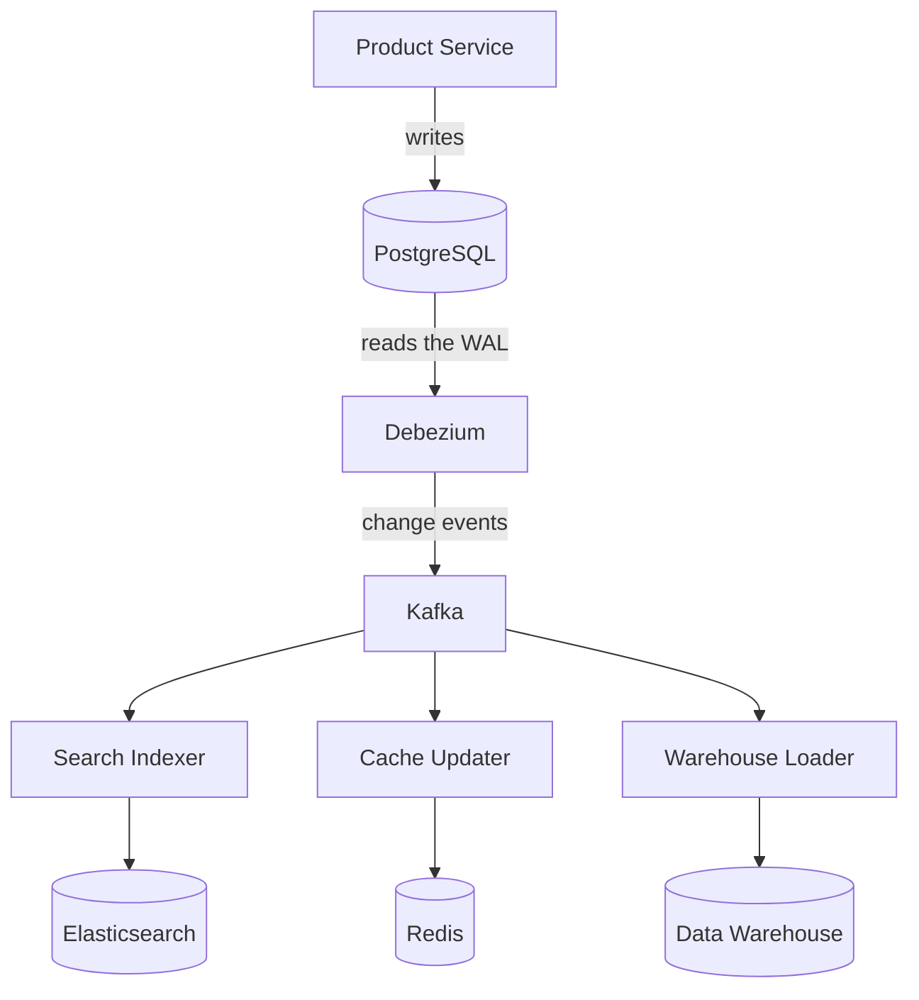

## The idea

Think about how you follow your bank account. You don't phone the bank every minute to ask "what is my balance now?" and compare. The bank sends you a **statement**: a list of every payment in and out, in order. From that list you can rebuild everything.

**Change Data Capture (CDC)** does the same for a database. It watches the database and turns **every insert, update and delete into an event**. Other systems follow that stream of events and stay in sync.

The app writes to **one place only**: its database. Search, caches and reports all follow the database's changes.

## What a change event looks like

When a product's price changes from 100 to 90, CDC produces an event like this (this is close to what Debezium sends):

```json
{
  "op": "u",
  "table": "products",
  "before": { "id": 7, "name": "Desk lamp", "price": 100 },
  "after": { "id": 7, "name": "Desk lamp", "price": 90 },
  "ts_ms": 1763539200000
}
```

`op` is the kind of change: `c` for create, `u` for update, `d` for delete. You get the row **before** and **after** the change.

## Why not just write to both places?

The simple idea: when the app saves a product, it also updates Elasticsearch and deletes the Redis key. That is the **dual write problem** again (see [Outbox Pattern](./outbox-pattern.mdx)):

- If the second write fails, the database and search **disagree forever**.
- If two updates race, search can get them **in the wrong order** and keep the older one.
- Every new system that needs the data means more code in the app.

With CDC, the database's own log decides the order, and nothing is skipped.

## Reading the database log

Every serious database keeps a **log** of its changes, for its own safety. Before it changes any data, it first writes what it is about to do into an append-only file (a file you only add to at the end). After a crash, it replays this log to recover. In PostgreSQL this is called the **write-ahead log (WAL)**.

[Replicas](../databases/replication.mdx) already stay in sync by reading this log. A CDC tool reads it the same way, like one more replica, and turns each entry into an event.

| Database | Its change log |
| --- | --- |
| PostgreSQL | WAL, read through **logical decoding** |
| MySQL | **binlog** (binary log) |
| MongoDB | **oplog**, read through change streams |
| DynamoDB | **DynamoDB Streams**, built in |

There are other ways to capture changes, but the log is usually best:

| Way | How it works | Problem |
| --- | --- | --- |
| **Polling** | Every minute, query rows where `updated_at` is newer than last time | Misses deletes. Misses quick changes in between. Extra load on the database |
| **Triggers** | A database trigger copies each change into a "changes" table | Slows down every write |
| **Log-based** | Read the database's own log | Catches everything, in order, with little extra load. **The usual choice** |

## Keeping search and caches in sync



What people use CDC for:

- **Search:** keep Elasticsearch in sync with the main database. See [Search](../advanced-components/search.mdx).
- **Caches:** delete or update a Redis key whenever its row changes. See [Cache Invalidation](../caching/cache-invalidation-ttl.mdx).
- **Analytics:** stream changes into a data warehouse, instead of copying the whole database every night.
- **Other services:** let them react to changes.
- **Moving to a new database:** copy the existing data once, then stream every change until you switch over.

Things to watch:

- **Lag.** Search is a little behind the database. That is [eventual consistency](./consistency-models.mdx), usually less than a second or two.
- **The first copy.** When CDC starts, it first reads all existing rows (a **snapshot**), then follows new changes.
- **Duplicates.** Events are delivered at least once. Consumers should write by ID (an "upsert": insert or update), so a repeat does no harm.
- **Your tables become an API.** Other teams now depend on your column names. Renaming a column can break them.

That last point is why many teams combine CDC with the outbox: CDC reads only the **outbox table**, so others see designed events like `OrderPlaced`, not raw table rows.

| | Raw CDC | Outbox read with CDC |
| --- | --- | --- |
| **What is sent** | Every row change, exactly as stored | Events you designed, like `OrderPlaced` |
| **Good for** | Search, caches, analytics copies | Telling other services about business events |
| **Coupling** | Consumers see your table layout | Consumers see a stable event format |

## Tools: Debezium

**Debezium** is the best-known open-source CDC tool. It was started at Red Hat and runs on **Kafka Connect** (Kafka's framework for moving data in and out of Kafka).

- It has connectors for PostgreSQL, MySQL, MongoDB, SQL Server, Oracle and more.
- It usually writes each table's changes to its own Kafka topic, like `shop.public.products`.
- It remembers how far it has read in the log, so after a restart it continues where it stopped.

Other options: **DynamoDB Streams** and **MongoDB change streams** are built into those databases. **AWS DMS** (Database Migration Service) can also stream changes.

## In the real world

**LinkedIn built Databus.** LinkedIn built its own CDC system, called Databus, to capture changes from its main databases and keep things like search indexes and caches in sync. It later open-sourced it.

**Netflix built DBLog.** Netflix wrote in 2019 about DBLog, its CDC framework. It reads changes from the database log and can also take a full copy of a table while changes keep flowing.

**DynamoDB Streams with Lambda.** On AWS, a common setup is to turn on DynamoDB Streams and attach a Lambda function. Each time an item changes, the function runs, for example to update a search index or send a notification.

## In the interview

Use CDC when you have a second copy of data that must follow the main database, like a search index:

> "The Product Service writes only to PostgreSQL. Debezium reads the write-ahead log and puts each change on Kafka, and an indexer updates Elasticsearch. Search may be a second behind, which is fine, and we avoid the dual-write problem."

<Callout title="Remember this" type="success">
  - **CDC** = turn every insert, update and delete into an event.
  - Best way: **read the database's log** (PostgreSQL WAL, MySQL binlog).
  - The app writes to **one place**. Search, caches and analytics **follow the log**.
  - Avoids the **dual write problem**. Copies lag a little: **eventual consistency**.
  - Events can repeat, so consumers **upsert by ID**.
  - Tool to name: **Debezium**, with Kafka.
</Callout>
