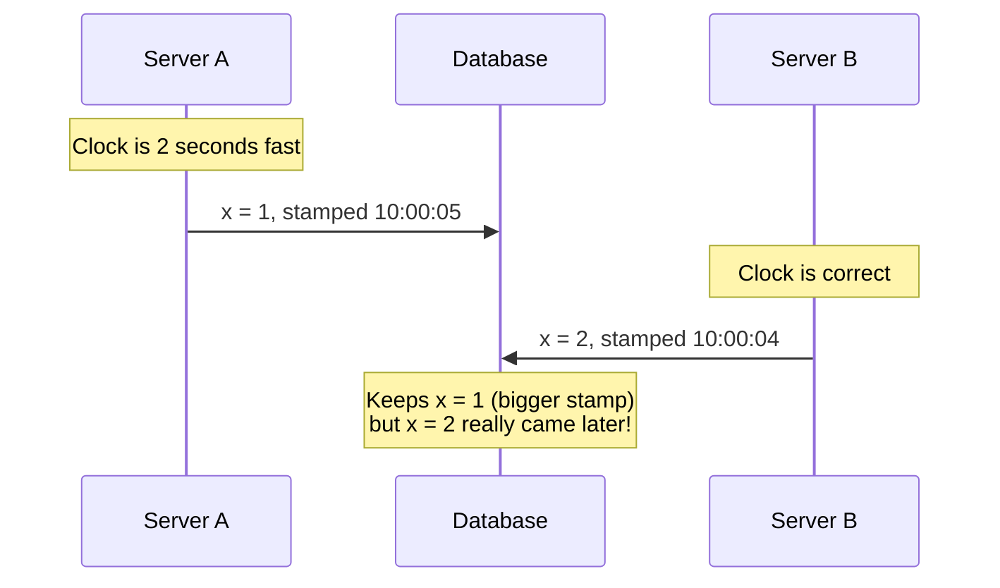
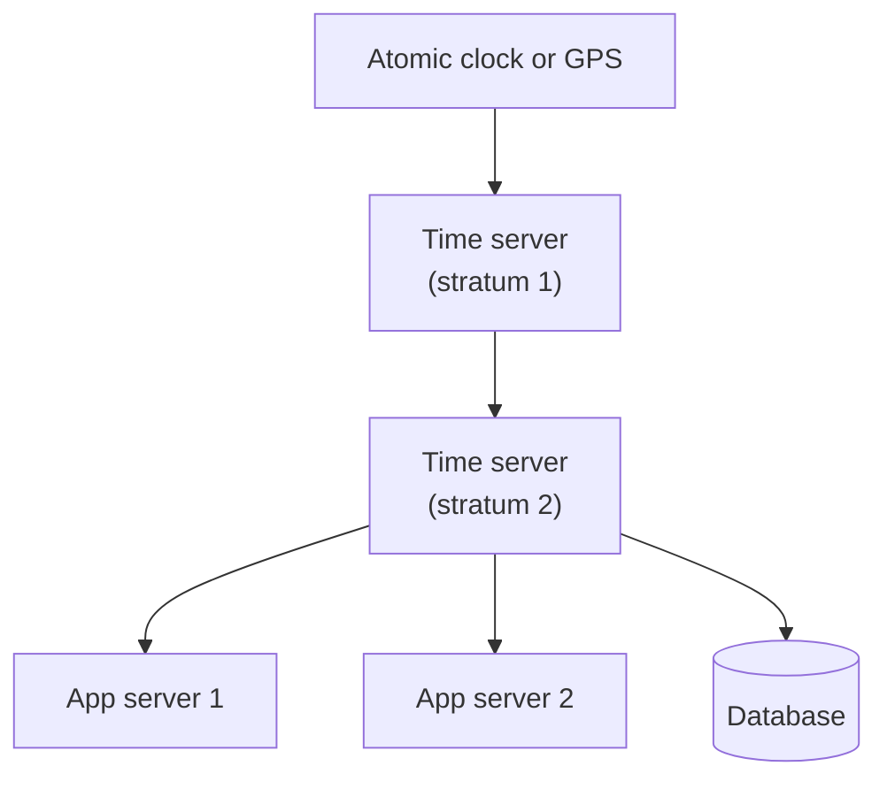
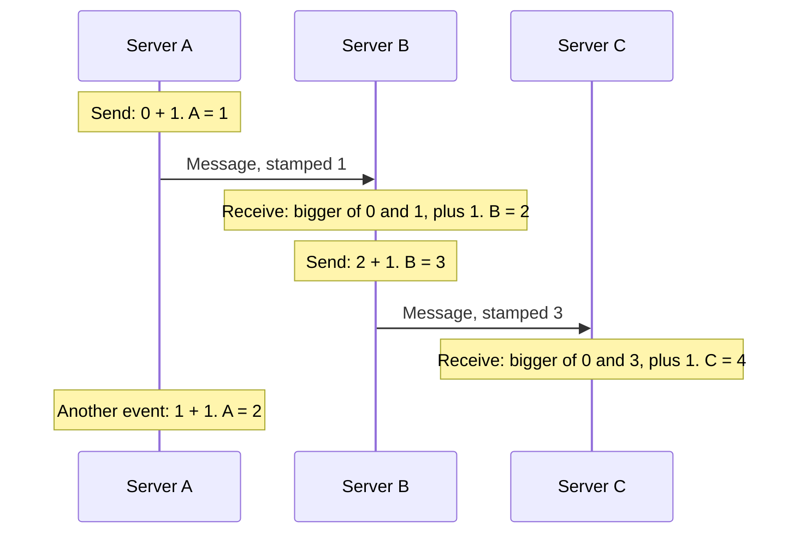

## The idea

Imagine a group of friends, each with their own wristwatch. No two watches show exactly the same time. One is two minutes fast, another is a little slow. If two friends write "sent at 3:00:01" and "sent at 3:00:02" on their notes, you still can't be sure which note really came first.

Servers are the same. **Every server has its own clock**, and no two clocks agree exactly. So "sort the events by timestamp" does not reliably tell you the real order of events on different machines.

There are two kinds of clocks to know:

- **Physical clocks** tell the time of day, like 10:00:05.
- **Logical clocks** don't care about the time at all. They only count events, to get the **order** right.

## Clock drift

A server's clock is driven by a tiny quartz crystal. Crystals tick at slightly different speeds, depending on their quality and temperature. Over time, clocks move apart. This is called **clock drift**. The difference between two clocks at one moment is called **clock skew**.

Here is why it matters. Many databases use **last write wins**: when two writes hit the same value, keep the one with the bigger timestamp.



Server B's write really happened **after** Server A's. But A's clock is fast, so A's write has the bigger timestamp. The newer value is **silently thrown away**.

Clocks can also **jump**. When a clock is corrected, it can suddenly move forward or even **backward**. So inside one machine, there are two kinds of clock:

| Clock | What it shows | Use it for |
| --- | --- | --- |
| **Wall clock** (time of day) | A date and time, like `2026-11-19 10:00:05` | Showing time to people, log lines. **It can jump** |
| **Monotonic clock** | A counter that only moves forward | Measuring how long something took, and timeouts |

```js
// Measuring how long a call took
const start = performance.now();   // monotonic: never goes backward
await callPaymentService();
const tookMs = performance.now() - start;

// Avoid Date.now() for this: it can jump when the clock is corrected
```

## NTP

**NTP (Network Time Protocol)** keeps clocks close to the correct time. Every server regularly asks a time server "what time is it?" and slowly adjusts its own clock. Time servers are arranged in layers called **strata**. The top layer is connected to very accurate sources like atomic clocks or GPS.



NTP helps a lot, but it is never perfect:

- Over the public internet, it usually keeps clocks within **tens of milliseconds**. On a good local network, it can do better than one millisecond.
- The network delay to the time server is only estimated, so some error always remains.
- If NTP breaks or is blocked, a clock can drift far without anyone noticing.

The rule: **use timestamps for showing time to people and for rough ordering, not for deciding which write wins.**

## Lamport clocks (logical clocks)

Often you don't need the real time. You only need to know **"did A happen before B?"** In 1978, Leslie Lamport showed a simple way: a **logical clock**, which is just a counter on each server.

Three rules:

1. Before each event, add 1 to your counter. **Sending a message counts as an event.**
2. When you send a message, attach your counter to it.
3. When you receive a message, set your counter to the **bigger** of your counter and the received one, plus 1.



```ts
class LamportClock {
  private time = 0;

  tick() {                       // a local event, or sending a message
    return ++this.time;
  }

  receive(remoteTime: number) {  // a message arrived
    this.time = Math.max(this.time, remoteTime) + 1;
    return this.time;
  }
}
```

**The promise:** if event X **caused** event Y (directly or through a chain of messages), X's number is smaller than Y's.

**The limit:** it doesn't work the other way. A smaller number does **not** prove that one event caused the other. In the example, A's second event has the number 2, smaller than C's 4, but it didn't cause C's event. They are unrelated. Two events that happen without knowing about each other are called **concurrent**.

To get one total order for all events, break ties with the server name: compare `(counter, serverId)`.

## Vector clocks, in short

Lamport clocks can't tell you that two events were **concurrent**. Vector clocks can.

Each server keeps **a list of counters, one per server**, like `[A:2, B:1, C:0]`. To compare two versions:

- If every counter in version X is **less than or equal to** the one in version Y, then X happened before Y. Y is newer, so keep Y.
- If X is bigger in one place and Y is bigger in another, they are **concurrent**: a real conflict. Keep both and let the app (or the user) merge them.

**Example:** a shopping cart. Your phone adds milk, giving `[phone:1, laptop:0]`. At the same time, your laptop adds bread, giving `[phone:0, laptop:1]`. Neither is newer, so it is a conflict. The app merges them: the cart has milk **and** bread.

The cost: the list grows with every server that writes, so vector clocks are used only where conflict detection really matters.

| | Physical clock | Lamport clock | Vector clock |
| --- | --- | --- | --- |
| **Gives you** | The time of day | An order that respects cause and effect | Order, and spots conflicts |
| **Detects concurrent writes** | No | No | Yes |
| **Size** | One number | One number | One number per server |
| **Used for** | Logs, expiry times, showing time | Ordering events and messages | Detecting conflicts in leaderless databases |

## In the real world

**Cloudflare and the 2017 leap second.** A **leap second** is an extra second sometimes added to official time. On January 1, 2017, one was added. Some of Cloudflare's DNS code assumed time never goes backward, got a negative duration, and crashed, so some DNS lookups failed. The fix was to measure durations with a monotonic clock. Later that year, the Go language started including a monotonic reading in its `time.Now()`.

**Google smears leap seconds.** Instead of adding a whole second at once, Google's time servers run the clock very slightly slower over many hours. No clock ever jumps.

**Google Spanner and TrueTime.** Google put GPS receivers and atomic clocks in its data centers. Its **TrueTime** service doesn't return a single time. It returns a small range: "it is now somewhere between these two times". Spanner waits until that range has passed before it confirms a write, so the timestamps of its transactions are always in the real order.

**Amazon's Dynamo used vector clocks.** Amazon's 2007 Dynamo paper describes using vector clocks to detect when two copies of a shopping cart were changed at the same time. Conflicting versions were kept and merged.

## In the interview

Bring it up when someone suggests ordering events across servers by timestamp, or "last write wins":

> "I won't use server timestamps to decide which write wins, because clocks drift. Each chat gets a sequence number from its partition, so the order is exact. Timestamps are only for showing the time to users."

<Callout title="Remember this" type="success">
  - Every server's clock **drifts**. Timestamps from different servers can be in the **wrong order**.
  - **Last write wins** with bad clocks can silently **lose** newer writes.
  - Use a **monotonic clock** to measure durations. The wall clock can jump back.
  - **NTP** keeps clocks close (milliseconds), never perfect.
  - **Lamport clock:** a counter. If X caused Y, X's number is smaller.
  - **Vector clock:** one counter per server. Can spot **concurrent** writes (conflicts).
</Callout>
